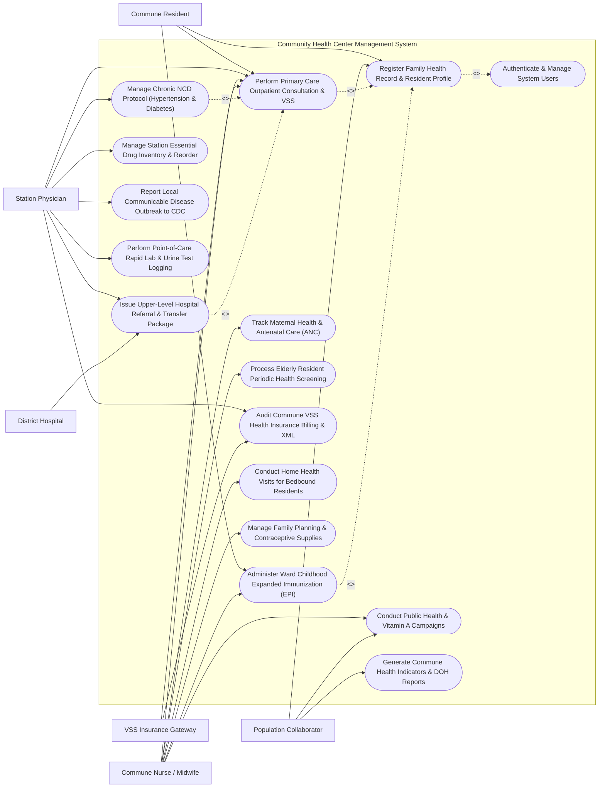

# Use Case Diagram — Community Health Center Management System

## Mermaid Code

## Actor Table | Bảng Actor

| # | Actor | Actor Type | Role Description | Related Use Cases |
|---|-------|------------|------------------|-------------------|
| 1 | Commune Resident | Primary | Local ward/commune resident receiving primary medical care, chronic disease monitoring, and vaccinations. | UC01, UC02, UC04 |
| 2 | Station Physician | Primary | Health station doctor examining patients, prescribing essential drugs, managing NCDs, and issuing hospital referrals. | UC02, UC03, UC05, UC06, UC10, UC11, UC12 |
| 3 | Commune Nurse / Midwife | Primary | Health station nurse/midwife administering EPI vaccines, ANC checks, public health campaigns, and home visits. | UC02, UC04, UC07, UC08, UC09, UC13, UC14 |
| 4 | Population Collaborator | Primary | Village health worker updating household population records, surveying elderly health, and assisting public health drives. | UC01, UC08, UC15 |
| 5 | VSS Insurance Gateway | Secondary / System | Vietnam Social Security insurance clearinghouse validating primary care BHYT cards and processing commune claims. | UC02, UC12 |
| 6 | District Hospital | Secondary / System | Upper-level district hospital receiving transferred patients under primary health insurance referral guidelines. | UC05 |

## Use Case Table | Bảng Use Case

| # | UC ID | Use Case Name | Primary Actor | Secondary Actor | Description | Priority |
|---|-------|---------------|---------------|-----------------|-------------|----------|
| 1 | UC01 | Register Family Health Record & Resident Profile | Population Collaborator | Commune Resident | Create electronic Family Health Record (Hồ sơ Sức khỏe Gia đình), link household members, and index Citizen ID. | High |
| 2 | UC02 | Perform Primary Care Outpatient Consultation & VSS | Station Physician | VSS Insurance Gateway | Conduct primary care consultation, code ICD-10, prescribe essential drugs from station inventory, and calculate BHYT copays. | High |
| 3 | UC03 | Manage Chronic NCD Protocol (Hypertension & Diabetes) | Station Physician | None | Track monthly NCD checkups for hypertension and diabetes patients, monitoring BP, blood glucose, and dispensing monthly drug packs. | High |
| 4 | UC04 | Administer Ward Childhood Expanded Immunization (EPI) | Commune Nurse / Midwife | None | Manage ward EPI vaccine sessions (BCG, HepB, DTP, Polio, Measles), log batch lot numbers, and sync national registry. | High |
| 5 | UC05 | Issue Upper-Level Hospital Referral & Transfer Package | Station Physician | District Hospital | Generate official BHYT Hospital Referral Form (Giấy chuyển tuyến BHYT) to district/provincial hospital with medical summary. | High |
| 6 | UC06 | Manage Station Essential Drug Inventory & Reorder | Station Physician | None | Track commune health station essential drug inventory (Danh mục Thuốc Thiết yếu Tuyến Xã), batch expiry dates, and reorder levels. | High |
| 7 | UC07 | Track Maternal Health & Antenatal Care (ANC) | Commune Nurse / Midwife | None | Manage ANC prenatal visits (ANC 1-4), administer Tetanus Toxoid (TT) shots, track high-risk pregnancies, and log delivery plans. | High |
| 8 | UC08 | Conduct Public Health & Vitamin A Campaigns | Commune Nurse / Midwife | Population Collaborator | Organize community public health drives: Vitamin A dosing for toddlers, bi-annual Deworming, and Dengue vector cleanups. | Medium |
| 9 | UC09 | Process Elderly Resident Periodic Health Screening | Commune Nurse / Midwife | None | Conduct annual health screening for residents aged >= 60 years, evaluating BP, blood sugar, BMI, and vision/hearing. | Medium |
| 10 | UC10 | Report Local Communicable Disease Outbreak to CDC | Station Physician | None | Report local ward outbreaks (Dengue, Hand-Foot-Mouth, Influenza) to District CDC within statutory reporting timelines. | High |
| 11 | UC11 | Perform Point-of-Care Rapid Lab & Urine Test Logging | Station Physician | None | Log rapid point-of-care test results: capillary blood glucose, dipstick urine analysis, Dengue NS1 rapid test, Malaria blood smear. | Medium |
| 12 | UC12 | Audit Commune VSS Health Insurance Billing & XML | Station Physician | VSS Insurance Gateway | Audit monthly commune primary care insurance claims, compile electronic XML file (File 1, 2, 3 per VSS rules), and export. | High |
| 13 | UC13 | Conduct Home Health Visits for Bedbound Residents | Commune Nurse / Midwife | None | Perform mobile home care visits for disabled or bedbound elderly residents, dressing wounds, and monitoring vital signs. | Medium |
| 14 | UC14 | Manage Family Planning & Contraceptive Supplies | Commune Nurse / Midwife | None | Dispense family planning supplies (oral contraceptives, condoms, IUD insertion tracking) and record reproductive health data. | Medium |
| 15 | UC15 | Generate Commune Health Indicators & DOH Reports | Population Collaborator | None | Render commune health statistics: NCD management coverage %, EPI vaccination rates, maternal mortality (0%), and DOH metrics. | Medium |
| 16 | UC16 | Authenticate & Manage System Users | All Users | None | Enforce secure role-based login, resident data privacy compliance, and audit trail logging per Ministry of Health rules. | High |

## Use Case Specification | Đặc tả Use Case

---

### UC01 — Register Family Health Record & Resident Profile

| Field | Detail |
|-------|--------|
| **UC ID** | UC01 |
| **Use Case Name** | Register Family Health Record & Resident Profile |
| **Actor(s)** | Primary: Population Collaborator   Secondary: Commune Resident |
| **Description** | Creates a comprehensive electronic Family Health Record (Hồ sơ Sức khỏe Gia đình / Cá nhân) for a commune resident, indexing their national Citizen ID (CCCD), linking household members, capturing baseline health history (blood type, allergies, chronic conditions), and assigning a Unique Resident Health Code. |
| **Precondition** | 1. The commune/ward population master registry is loaded.   2. The Population Collaborator or Nurse is authenticated in CHCMS. |
| **Main Flow** | 1. The Collaborator opens "New Resident Profile / Family Health Record" in CHCMS.   2. The Collaborator scans the resident's Citizen ID (CCCD) QR code.   3. The System populates verified personal details: Full Name (e.g., Tran Van B), Date of Birth (Jan 15, 1968), Gender (Male), Citizen ID Number (034068001234), and Permanent Residence Address (Hamlet 2, Commune Phuoc Ly).   4. The Collaborator links the resident to an existing **Household Folder** (e.g., Household #HH-2026-0812) or creates a new household folder, designating "Head of Household".   5. The Collaborator captures baseline clinical data:   &nbsp;&nbsp;&nbsp;&nbsp;- **VSS Health Insurance Card**: `DN4797918234567` (Primary Care Clinic: Commune Health Station Phuoc Ly)   &nbsp;&nbsp;&nbsp;&nbsp;- **Blood Type**: A Positive (Rh+)   &nbsp;&nbsp;&nbsp;&nbsp;- **Known Drug/Food Allergies**: Penicillin   &nbsp;&nbsp;&nbsp;&nbsp;- **Existing Chronic Conditions**: Hypertension (Diagnosed 2022).   6. The System generates a **Unique Personal Health Code** (e.g., PID-COMM-2026-9918) formatted per MOH electronic health record guidelines.   7. The System activates the Family Health Booklet view, displaying all 4 household members on a single dashboard. |
| **Alternative Flow** | **AF1** — Newborn Resident Profile Auto-Creation: When a child is born in the commune, the Midwife creates the newborn profile directly linked to the mother's Family Health Record, auto-queuing the EPI vaccination schedule (UC04).   **AF2** — Resident Migration / Address Transfer: A resident moves into the ward from another province; the System executes "Inter-Commune Profile Transfer", pulling prior health records using Citizen ID. |
| **Exception Flow** | **EX1** — Duplicate Citizen ID Alert: If the scanned Citizen ID is already registered under another health station, the System flags "Duplicate Profile Detected" and prompts profile merge/transfer.   **EX2** — Unverified VSS Insurance Card: If the VSS insurance card number fails gateway validation, the System sets insurance status to "Unverified / Fee-Paying" until corrected. |
| **Postcondition** | Family Health Record is created, unique personal health code is assigned, resident is linked to household folder, and profile is active for primary care consultations. |
| **Business Rule** | **BR1**: Every resident profile MUST be linked to a valid Citizen ID (CCCD) or Birth Certificate number to ensure 1-to-1 national health record integration.   **BR2**: Family Health Records must group all co-habitating family members under a single Household Folder for epidemiology and genetic risk tracking. |

---

### UC02 — Perform Primary Care Outpatient Consultation & VSS Billing

| Field | Detail |
|-------|--------|
| **UC ID** | UC02 |
| **Use Case Name** | Perform Primary Care Outpatient Consultation & VSS Billing |
| **Actor(s)** | Primary: Station Physician   Secondary: VSS Insurance Gateway |
| **Description** | Manages a primary care outpatient consultation at the commune health station under primary Social Health Insurance (BHYT Tuyến Xã), examining the patient, recording vitals, coding primary/secondary ICD-10 diagnoses, prescribing essential drugs from station inventory, calculating VSS copays, and issuing e-prescriptions. |
| **Precondition** | 1. The resident is checked in at the station desk with active Family Health Record (UC01).   2. Primary health insurance card (BHYT Tuyến Xã) is validated. |
| **Main Flow** | 1. The Station Physician calls the next resident into the consultation desk.   2. The System loads the resident's Family Health Record (PID-COMM-2026-9918), displaying baseline vitals logged by the nurse (BP 148/92 mmHg, HR 82 bpm, Temp 36.8°C, Blood Glucose 135 mg/dL).   3. The Physician examines the patient and documents Clinical SOAP Notes:   &nbsp;&nbsp;&nbsp;&nbsp;- **Subjective**: Patient reports mild headache and neck stiffness for 2 days.   &nbsp;&nbsp;&nbsp;&nbsp;- **Objective**: BP 148/92 mmHg. Heart regular, lungs clear.   &nbsp;&nbsp;&nbsp;&nbsp;- **Assessment**: Primary ICD-10 Code `I10 (Essential Primary Hypertension)`.   4. The Physician opens the **Commune Essential Drug Formulary** (UC06) and prescribes monthly medications:   &nbsp;&nbsp;&nbsp;&nbsp;- *Amlodipine 5mg Tablet* — 1 tab PO Daily in morning x 30 days (Qty: 30 tabs)   &nbsp;&nbsp;&nbsp;&nbsp;- *Paracetamol 500mg Tablet* — 1 tab PO PRN for headache x 10 tabs.   5. The System verifies VSS Commune Coverage (100% covered under primary BHYT Tuyến Xã list, $0 patient copay).   6. The Physician signs the consultation record.   7. The System decrements drug stock in the Station Pharmacy inventory (UC06), generates VSS Billing XML File 1 & 2 (UC12), and prints the prescription slip. |
| **Alternative Flow** | **AF1** — Fee-Paying Non-Insured Consultation: For a resident without VSS insurance, the System calculates out-of-pocket charges based on municipal health price frames, generating a cashier payment receipt.   **AF2** — Rapid Bedside Point-of-Care Testing: The Physician performs a rapid capillary blood glucose test (UC11) using a glucometer; the System logs glucose result (135 mg/dL) directly into the consultation record. |
| **Exception Flow** | **EX1** — Essential Drug Stockout Alert: If Amlodipine 5mg stock is zero in station inventory, the System alerts "Drug Out of Stock", suggesting alternative essential antihypertensive *Enalapril 5mg* or issuing a retail pharmacy slip.   **EX2** — Invalid Referral / Wrong-Line Insurance Clearance: If patient's BHYT card is registered at a different provincial hospital without referral, the System flags "Wrong-Line BHYT (Trái Tuyến)", reducing benefit coverage rate to statutory out-of-line percentage. |
| **Postcondition** | Consultation SOAP notes and ICD-10 diagnosis are logged in Family Health Record, essential drug stock is updated, VSS claim XML is queued, and prescription slip is printed. |
| **Business Rule** | **BR1**: Prescriptions at commune health stations MUST strictly select medications from the official Ministry of Health Commune Essential Drug List (Danh mục Thuốc Thiết yếu Tuyến Xã).   **BR2**: Primary care consultations covered by BHYT Tuyến Xã must generate VSS XML data files (File 1, File 2, File 3) for automated insurance reimbursement. |

---

### UC03 — Manage Chronic NCD Protocol (Hypertension & Diabetes)

| Field | Detail |
|-------|--------|
| **UC ID** | UC03 |
| **Use Case Name** | Manage Chronic NCD Protocol (Hypertension & Diabetes) |
| **Actor(s)** | Primary: Station Physician |
| **Description** | Manages long-term community-based Non-Communicable Disease (NCD) management protocols for hypertension and Type 2 diabetes patients, tracking monthly checkups, blood pressure/glucose control targets, medication adherence, and preventing chronic organ complications at the commune level. |
| **Precondition** | 1. The resident is enrolled in the Commune Chronic NCD Management Registry.   2. The resident presents at the health station for their monthly NCD checkup. |
| **Main Flow** | 1. The Physician opens the "Commune Chronic NCD Management Module" and calls the scheduled NCD patient.   2. The System displays the patient's **Longitudinal NCD Control Dashboard**:   &nbsp;&nbsp;&nbsp;&nbsp;- 12-Month Blood Pressure Curve (Target BP < 140/90 mmHg)   &nbsp;&nbsp;&nbsp;&nbsp;- 12-Month Fasting Blood Glucose Trend (Target < 130 mg/dL)   &nbsp;&nbsp;&nbsp;&nbsp;- Last Year's HbA1c & ECG Results   &nbsp;&nbsp;&nbsp;&nbsp;- Medication Adherence Score (100% compliance over past 3 months).   3. The Physician reviews today's checkup measurements: BP 132/84 mmHg (Controlled Target Met); Fasting Blood Glucose 118 mg/dL (Controlled Target Met).   4. The Physician performs Target Organ Screening: Checks for pedal edema, inspects diabetic feet, and screens for proteinuria using dipstick urine test (UC11).   5. The Physician re-prescribes the 30-day Chronic Medication Maintenance Pack: *Amlodipine 5mg + Metformin 500mg*.   6. The Physician logs NCD Management Status: **Well-Controlled Chronic NCD**.   7. The System schedules the next 30-Day Monthly NCD Checkup appointment date and sends an automated SMS reminder. |
| **Alternative Flow** | **AF1** — Uncontrolled NCD Treatment Escalation: If BP remains 165/102 mmHg despite 2 drugs, the Physician adds a second-line antihypertensive (*Losartan 50mg*) or orders a 14-day re-check.   **AF2** — NCD Complication Referral to District Hospital: Patient presents with diabetic nephropathy (Proteinuria 3+ and vision impairment); the Physician executes an Upper-Level Hospital Referral (UC05) to District Hospital Endocrinology. |
| **Exception Flow** | **EX1** — Missed Monthly NCD Checkup Alert (> 45 Days Overdue): If an enrolled NCD patient misses their monthly checkup by > 15 days, the System flags "NCD Defaulter Alert", prompting the Population Collaborator to conduct a home welfare check.   **EX2** — Severe Severe Hypoglycemia (< 50 mg/dL): If capillary glucose is 45 mg/dL, the Physician halts checkup and immediately administers 30% IV Glucose. |
| **Postcondition** | Monthly NCD checkup parameters are recorded, 30-day drug maintenance pack is dispensed, NCD control status is updated, and next monthly checkup is scheduled. |
| **Business Rule** | **BR1**: Enrolled chronic NCD patients MUST receive a monthly clinical checkup including blood pressure, fasting glucose, and medication compliance evaluation.   **BR2**: Uncontrolled NCD cases failing to meet target goals after 3 consecutive months MUST be flagged for specialist consultation or upper-level hospital referral. |

---

### UC04 — Administer Ward Childhood Expanded Immunization (EPI)

| Field | Detail |
|-------|--------|
| **UC ID** | UC04 |
| **Use Case Name** | Administer Ward Childhood Expanded Immunization (EPI) |
| **Actor(s)** | Primary: Commune Nurse / Midwife |
| **Description** | Manages monthly commune childhood Expanded Program on Immunization (EPI) sessions, verifying child age and vaccine eligibility (BCG, HepB, DTP-HepB-Hib, IPV Polio, Measles-Rubella), scanning vaccine vial batch lot barcodes, administering doses, logging adverse events, and syncing data with the National EPI Registry. |
| **Precondition** | 1. The child's profile is registered in CHCMS and linked to their mother's Family Health Record (UC01).   2. Vaccine cold-chain storage temperatures (2°C - 8°C) are verified. |
| **Main Flow** | 1. The Nurse opens the "Ward EPI Vaccination Module" during the monthly commune vaccination day.   2. The Nurse calls 2-month-old infant (Child ID: `CHILD-COMM-2026-0412`).   3. The System loads the child's **EPI Vaccination Passport**:   &nbsp;&nbsp;&nbsp;&nbsp;- [x] Birth: BCG & HepB-0 (Completed at hospital)   &nbsp;&nbsp;&nbsp;&nbsp;- [ ] 2 Months: **Pentavalent-1 (DTP-HepB-Hib)** + **OPV-1 (Oral Polio)** + **Rotavirus-1** (DUE TODAY).   4. The Nurse conducts Pre-Vaccination Screening: Temperature 36.7°C, No active fever, No history of severe allergy -> Cleared for Vaccination.   5. The Nurse scans the barcode on the Pentavalent vaccine vial:   &nbsp;&nbsp;&nbsp;&nbsp;- **Vaccine Name**: SII-PORT (DTP-HepB-Hib)   &nbsp;&nbsp;&nbsp;&nbsp;- **Batch Lot Number**: `LOT-EPI-2026-991`   &nbsp;&nbsp;&nbsp;&nbsp;- **Expiration Date**: Aug 2027 (Active)   &nbsp;&nbsp;&nbsp;&nbsp;- **Cold-Chain Status**: Verified 4°C.   6. The Nurse administers Pentavalent-1 (0.5 mL IM anterolateral thigh) and OPV-1 drops.   7. The Nurse logs Administration Timestamp, Injection Site, and Batch Lot Number in the record.   8. The System updates the digital EPI Vaccine Passport, dispatches the record to the National EPI Registry, and schedules the 3-Month EPI Vaccination Date.   9. The child is observed for 30 minutes post-vaccination in the waiting area (No immediate adverse events noted). |
| **Alternative Flow** | **AF1** — Catch-Up Vaccine Schedule Generation: For a 9-month-old child who missed their 2 and 4-month shots, the System auto-calculates an accelerated Catch-Up Vaccine Schedule complying with minimum interval rules.   **AF2** — Adverse Event Following Immunization (AEFI) Logging: If a child returns 6 hours later with high fever 39.2°C or swelling, the Nurse logs an AEFI Report (Minor / Severe), notifying District CDC. |
| **Exception Flow** | **EX1** — Quarantined / Recalled Vaccine Batch Warning: If the scanned vaccine lot barcode belongs to a lot flagged for recall by National EPI, the System blocks administration and flashes "VACCINE LOT RECALLED — DO NOT USE".   **EX2** — Acute Fever Pre-Vaccination Deferral (Temp >= 37.5°C): If the child's temp is 38.0°C, the Nurse defers vaccination for 7 days until fever resolves. |
| **Postcondition** | Vaccine dose, injection site, and batch lot number are recorded, digital EPI passport is updated, National EPI Registry is synced, and next dose date is scheduled. |
| **Business Rule** | **BR1**: All administered EPI vaccines MUST record verified vaccine batch lot number, expiration date, and cold-chain storage validation.   **BR2**: Every vaccinated child MUST undergo mandatory 30-minute post-vaccination observation at the health station to monitor for immediate anaphylactic reactions. |

---

### UC05 — Issue Upper-Level Hospital Referral & Transfer Package

| Field | Detail |
|-------|--------|
| **UC ID** | UC05 |
| **Use Case Name** | Issue Upper-Level Hospital Referral & Transfer Package |
| **Actor(s)** | Primary: Station Physician   Secondary: District Hospital |
| **Description** | Generates an official BHYT Hospital Referral Form (Giấy chuyển tuyến BHYT) to transfer a patient from the commune health station to an upper-level district or provincial hospital when medical conditions exceed commune capability, compiling clinical summaries, diagnostic test results, emergency transport notes, and securing 100% insurance transfer coverage. |
| **Precondition** | 1. A primary care consultation (UC02) or emergency evaluation indicates need for upper-level care.   2. The Station Physician is authorized to sign BHYT referral forms. |
| **Main Flow** | 1. The Station Physician selects "Issue Hospital Referral Order" from the patient's active consultation workspace.   2. The Physician selects Target Referral Hospital: **District 3 General Hospital (Trung tâm Y tế / Bệnh viện Huyện)** — Specialty: *General Surgery / Cardiology*.   3. The Physician inputs Referral Type & Urgency:   &nbsp;&nbsp;&nbsp;&nbsp;- **Referral Category**: Correct Line BHYT Referral (Chuyển tuyến Đúng tuyến BHYT)   &nbsp;&nbsp;&nbsp;&nbsp;- **Urgency**: Urgent / Emergency (or Routine Elective Referral).   4. The System compiles the **Official BHYT Referral Package**:   &nbsp;&nbsp;&nbsp;&nbsp;- Patient Demographics & Citizen ID / VSS Card Number   &nbsp;&nbsp;&nbsp;&nbsp;- Admitting & Primary Diagnosis: `ICD-10 K35.8 (Acute Appendicitis)`   &nbsp;&nbsp;&nbsp;&nbsp;- Clinical Summary: 12-hour right lower quadrant pain, rebound tenderness, fever 38.5°C   &nbsp;&nbsp;&nbsp;&nbsp;- Initial Treatment Given: Spasmolytic IM injection, 0.9% NaCl IV drip   &nbsp;&nbsp;&nbsp;&nbsp;- Reason for Transfer: Exceeds commune surgical capability; requires emergency appendectomy.   5. The Physician electronically signs the referral document using their digital certificate.   6. The System generates the official **BHYT Referral Form (Form 14/BHYT)** featuring an official verification QR Code.   7. The System dispatches an electronic transfer notification payload to the District Hospital's reception desk and prints 2 physical copies for the patient/ambulance team. |
| **Alternative Flow** | **AF1** — Emergency Ambulance Transport Handover: For a critical trauma case, the Physician calls 115 Ambulance, logs ambulance transport vehicle ID, and attaches an active IV drip monitoring sheet to the transfer package.   **AF2** — Chronic Special Disease Referral Renewal: For a cancer or hemodialysis patient needing annual BHYT referral renewal to a provincial hospital, the Physician issues a 1-Year Chronic Referral Letter (Giấy chuyển tuyến mãn tính 1 năm). |
| **Exception Flow** | **EX1** — Unjustified Out-of-Line Referral Block: If the Physician attempts to refer a simple uncomplicated cold to a Tertiary National Hospital without medical justification, the System alerts "Unjustified Referral Line Violation — Recommend District Hospital Placement".   **EX2** — Missing Primary ICD-10 Code on Referral: The System blocks referral printing if the primary diagnosis ICD-10 code is omitted. |
| **Postcondition** | Official BHYT Referral Form is generated with QR verification code, electronic transfer notification is sent to District Hospital, and insurance coverage continuity is secured. |
| **Business Rule** | **BR1**: BHYT Referral Forms issued by commune health stations MUST include primary ICD-10 diagnosis, clinical summary, treatment given, and explicit medical justification for transfer.   **BR2**: Emergency transfers exceeding commune capabilities MUST be processed immediately with 100% BHYT insurance continuity clearance. |
