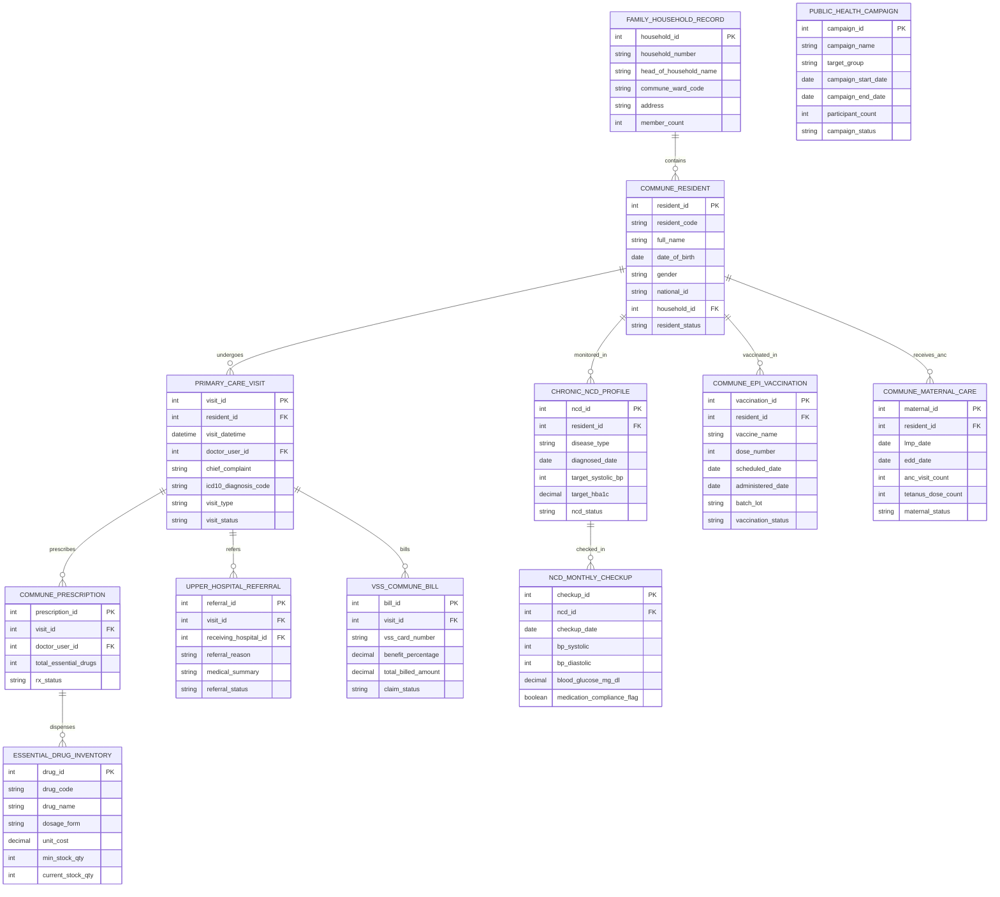

# Conceptual ERD — Community Health Center Management System

## Mermaid Code

## Entity Description Table | Bảng mô tả Entity

| # | Entity Name | Vietnamese Name | Description | Key Attributes | Main Relationships |
|---|-------------|-----------------|-------------|----------------|-------------------|
| 1 | COMMUNE_RESIDENT | Cư dân Xã/Phường Master | Master commune resident profile storing resident code, full name, DOB, gender, national Citizen ID, household ID, and status. | resident_id, resident_code, full_name, dob, gender, national_id, household_id, resident_status | Belongs to FAMILY_HOUSEHOLD_RECORD; Has VISIT, NCD_PROFILE, EPI_VACCINATION, MATERNAL_CARE. |
| 2 | FAMILY_HOUSEHOLD_RECORD | Sổ Hộ gia đình Xã/Phường | Family household folder record tracking household number, head of household name, commune/ward code, address, and member count. | household_id, household_number, head_of_household_name, commune_ward_code, address, member_count | Has many COMMUNE_RESIDENT entities. |
| 3 | PRIMARY_CARE_VISIT | Lượt Khám Trạm Y tế (Visit) | Primary care outpatient visit record logging visit datetime, doctor user ID, chief complaint, ICD-10 diagnosis, visit type, and status. | visit_id, resident_id, visit_datetime, doctor_user_id, chief_complaint, icd10_diagnosis_code, visit_status | Belongs to COMMUNE_RESIDENT; Has COMMUNE_PRESCRIPTION, UPPER_HOSPITAL_REFERRAL, VSS_COMMUNE_BILL. |
| 4 | COMMUNE_PRESCRIPTION | Đơn thuốc Thiết yếu Tuyến Xã | Essential drug prescription record storing visit ID, prescribing doctor ID, total essential drug items, and rx status. | prescription_id, visit_id, doctor_user_id, total_essential_drugs, rx_status | Belongs to PRIMARY_CARE_VISIT; Has ESSENTIAL_DRUG_INVENTORY. |
| 5 | ESSENTIAL_DRUG_INVENTORY | Kho Thuốc Thiết yếu Trạm Y tế | Commune health station essential drug inventory tracking drug code, drug name, dosage form, unit cost, min stock, and current stock quantity. | drug_id, drug_code, drug_name, dosage_form, unit_cost, min_stock_qty, current_stock_qty | Dispensed in COMMUNE_PRESCRIPTION. |
| 6 | CHRONIC_NCD_PROFILE | Hồ sơ Bệnh Mạn tính (NCD) | Chronic Non-Communicable Disease (NCD) management profile tracking disease type (Hypertension, Diabetes), diagnosed date, and targets. | ncd_id, resident_id, disease_type, diagnosed_date, target_systolic_bp, target_hba1c, ncd_status | Belongs to COMMUNE_RESIDENT; Has NCD_MONTHLY_CHECKUP. |
| 7 | NCD_MONTHLY_CHECKUP | Kiểm tra Mạn tính Hàng tháng | Monthly NCD checkup record tracking checkup date, BP systolic/diastolic, blood glucose mg/dL, and medication compliance flag. | checkup_id, ncd_id, checkup_date, bp_systolic, bp_diastolic, blood_glucose_mg_dl, medication_compliance_flag | Belongs to CHRONIC_NCD_PROFILE. |
| 8 | COMMUNE_EPI_VACCINATION | Tiêm chủng Mở rộng Xã (EPI) | Ward childhood Expanded Program on Immunization (EPI) record tracking vaccine name, dose number, scheduled date, administered date, and lot. | vaccination_id, resident_id, vaccine_name, dose_number, scheduled_date, administered_date, batch_lot | Belongs to COMMUNE_RESIDENT. |
| 9 | COMMUNE_MATERNAL_CARE | Chăm sóc Sức khỏe Sinh sản | Commune maternal care record tracking Last Menstrual Period (LMP), Estimated Due Date (EDD), ANC visit count, and Tetanus doses. | maternal_id, resident_id, lmp_date, edd_date, anc_visit_count, tetanus_dose_count, maternal_status | Belongs to COMMUNE_RESIDENT. |
| 10 | UPPER_HOSPITAL_REFERRAL | Giấy Chuyển tuyến BHYT | Upper-level hospital referral record tracking visit ID, receiving hospital ID, referral reason, medical summary, and referral status. | referral_id, visit_id, receiving_hospital_id, referral_reason, medical_summary, referral_status | Belongs to PRIMARY_CARE_VISIT. |
| 11 | VSS_COMMUNE_BILL | Hóa đơn BHYT Tuyến Xã | Commune health insurance (VSS) billing record tracking VSS card number, benefit percentage, total billed amount, and claim status. | bill_id, visit_id, vss_card_number, benefit_percentage, total_billed_amount, claim_status | Belongs to PRIMARY_CARE_VISIT. |
| 12 | PUBLIC_HEALTH_CAMPAIGN | Chiến dịch Y tế Cộng đồng | Community public health campaign record tracking campaign name (Vitamin A, Deworming), target group, dates, participant count, and status. | campaign_id, campaign_name, target_group, campaign_start_date, campaign_end_date, participant_count | Standalone community health campaign tracking entity. |

## Relationship Description | Mô tả Quan hệ

| # | From Entity | Cardinality | To Entity | Relationship Label | Business Explanation |
|---|-------------|-------------|-----------|-------------------|----------------------|
| 1 | FAMILY_HOUSEHOLD_RECORD | one-to-many | COMMUNE_RESIDENT | contains | One family household record contains multiple resident family members. |
| 2 | COMMUNE_RESIDENT | one-to-many | PRIMARY_CARE_VISIT | undergoes | One commune resident undergoes primary care outpatient visits at the station. |
| 3 | COMMUNE_RESIDENT | one-to-many | CHRONIC_NCD_PROFILE | monitored_in | One commune resident is monitored in chronic NCD management profiles (Hypertension/Diabetes). |
| 4 | COMMUNE_RESIDENT | one-to-many | COMMUNE_EPI_VACCINATION | vaccinated_in | One child resident is vaccinated in childhood expanded immunization (EPI) doses. |
| 5 | COMMUNE_RESIDENT | one-to-many | COMMUNE_MATERNAL_CARE | receives_anc | One female resident receives maternal care and antenatal care (ANC) visits. |
| 6 | PRIMARY_CARE_VISIT | one-to-many | COMMUNE_PRESCRIPTION | prescribes | One primary care visit prescribes essential drug formulations. |
| 7 | PRIMARY_CARE_VISIT | one-to-one | UPPER_HOSPITAL_REFERRAL | refers | One primary care visit refers patients to upper-level district/provincial hospitals. |
| 8 | PRIMARY_CARE_VISIT | one-to-one | VSS_COMMUNE_BILL | bills | One primary care visit bills primary health insurance (VSS Tuyến Xã) claims. |
| 9 | CHRONIC_NCD_PROFILE | one-to-many | NCD_MONTHLY_CHECKUP | checked_in | One chronic NCD profile undergoes monthly clinical checkup entries. |
| 10 | COMMUNE_PRESCRIPTION | many-to-many | ESSENTIAL_DRUG_INVENTORY | dispenses | Prescriptions dispense essential drugs from station inventory stock. |
