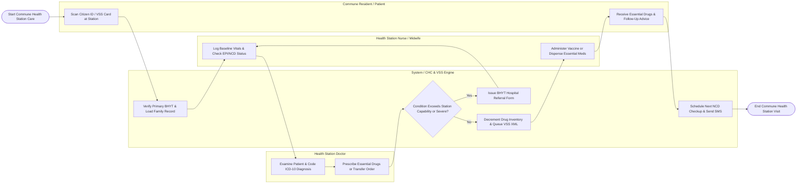

# Swimlane Diagram — Community Health Center Management System

## Mermaid Code

## Flow Description | Mô tả luồng

| Lane | Actor / Subsystem | Role in Flow |
|------|-------------------|--------------|
| 1 | Commune Resident / Patient | Scans Citizen ID or VSS insurance card at station desk, receives primary consultation and vaccinations, receives essential drug packs, and departs. |
| 2 | Health Station Nurse / Midwife | Records baseline vital signs (BP, HR, Temp, Glucose), verifies child EPI vaccine schedules, dispenses prescribed essential drugs, and logs vaccination/ANC details. |
| 3 | System / CHC & VSS Engine | Validates primary BHYT Tuyến Xã coverage, loads electronic Family Health Records, screens referral thresholds, decrements drug stock, queues VSS XML files, and sends SMS reminders. |
| 4 | Health Station Doctor | Examines primary care patients, codes ICD-10 diagnoses, manages chronic NCD control targets, prescribes essential drugs from station inventory, or issues upper-level hospital referrals. |
