# Action Tree — Community Health Center Management System

## Mermaid Code

```mermaid
graph TD
    Root["Community Health Center Management System"]

    Root --> M1["Family Health Record & Population"]
    Root --> M2["Primary Outpatient & Essential Drugs"]
    Root --> M3["Chronic NCD Management HTN Diabetes"]
    Root --> M4["Childhood Expanded Immunization EPI"]
    Root --> M5["Maternal & Reproductive Health"]
    Root --> M6["Public Health & Disease Outbreaks"]
    Root --> M7["Upper-Level Hospital Referrals"]
    Root --> M8["Commune VSS Billing & DOH Reports"]

    M1 --> A11["Create Electronic Family Health Record"]
    M1 --> A12["Index Citizen ID & Household Folder"]
    M1 --> A13["Log Household Demographic Changes"]
    M1 --> A14["Assign Personal Health Identification Code"]

    M2 --> A21["Examine Primary Outpatient & Vitals"]
    M2 --> A22["Code ICD-10 Primary Diagnoses"]
    M2 --> A23["Prescribe Essential Drug Formulary Items"]
    M2 --> A24["Perform Rapid Point-of-Care Blood Tests"]

    M3 --> A31["Enroll Hypertension & Diabetes Patients"]
    M3 --> A32["Track Monthly NCD Blood Pressure Curves"]
    M3 --> A33["Dispense 30-Day NCD Maintenance Packs"]
    M3 --> A34["Flag NCD Defaulters for Home Welfare Checks"]

    M4 --> A41["Schedule Monthly Ward EPI Vaccine Sessions"]
    M4 --> A42["Scan Vaccine Vial Batch Lot Barcodes"]
    M4 --> A43["Log Child Immunization Passport Doses"]
    M4 --> A44["Sync Records with National EPI Registry"]

    M5 --> A51["Conduct ANC Prenatal Checkup Visits"]
    M5 --> A52["Administer Maternal Tetanus Toxoid Shots"]
    M5 --> A53["Manage Family Planning & Contraceptives"]
    M5 --> A54["Screen High-Risk Obstetric Conditions"]

    M6 --> A61["Report Local Dengue & HFMD Outbreaks"]
    M6 --> A62["Log Mosquito Breteau Vector Density Index"]
    M6 --> A63["Execute Vitamin A Dosing & Deworming"]
    M6 --> A64["Conduct Elderly Resident Health Screenings"]

    M7 --> A71["Issue Official BHYT Hospital Referral Forms"]
    M7 --> A72["Compile Clinical Transfer Summary Packages"]
    M7 --> A73["Coordinate Emergency Ambulance Handover"]
    M7 --> A74["Track Hospital Discharge Feedback Notes"]

    M8 --> A81["Query Primary BHYT Tuyyen Xa Clearances"]
    M8 --> A82["Compile Commune VSS Billing XML Batches"]
    M8 --> A83["Track Essential Drug Stock Reorder Points"]
    M8 --> A84["Export DOH Primary Health Metric Bulletins"]
```

## Module Description | Mô tả Module

| # | Module | Description | Actions |
|---|--------|-------------|---------|
| 1 | Family Health Record & Population | Creates electronic Family Health Records (Hồ sơ Sức khỏe Gia đình), indexes Citizen IDs, links households, and assigns personal health codes. | Create Electronic Family Health Record, Index Citizen ID & Household Folder, Log Household Demographic Changes, Assign Personal Health Identification Code |
| 2 | Primary Outpatient & Essential Drugs | Examines primary care patients, codes ICD-10 diagnoses, prescribes essential drugs from station formulary, and performs rapid point-of-care lab tests. | Examine Primary Outpatient & Vitals, Code ICD-10 Primary Diagnoses, Prescribe Essential Drug Formulary Items, Perform Rapid Point-of-Care Blood Tests |
| 3 | Chronic NCD Management HTN Diabetes | Enrolls hypertension and diabetes patients, tracks monthly BP/glucose curves, dispenses 30-day maintenance packs, and flags defaulters. | Enroll Hypertension & Diabetes Patients, Track Monthly NCD Blood Pressure Curves, Dispense 30-Day NCD Maintenance Packs, Flag NCD Defaulters for Home Welfare Checks |
| 4 | Childhood Expanded Immunization EPI | Schedules monthly ward EPI sessions, scans vaccine vial batch lots, logs child vaccine passports, and syncs the National EPI Registry. | Schedule Monthly Ward EPI Vaccine Sessions, Scan Vaccine Vial Batch Lot Barcodes, Log Child Immunization Passport Doses, Sync Records with National EPI Registry |
| 5 | Maternal & Reproductive Health | Conducts ANC prenatal checkups, administers Tetanus Toxoid shots, dispenses contraceptives, and screens high-risk obstetric cases. | Conduct ANC Prenatal Checkup Visits, Administer Maternal Tetanus Toxoid Shots, Manage Family Planning & Contraceptives, Screen High-Risk Obstetric Conditions |
| 6 | Public Health & Disease Outbreaks | Reports local Dengue/HFMD outbreaks to CDC, monitors mosquito vector Breteau indices, organizes Vitamin A dosing, and screens elderly residents. | Report Local Dengue & HFMD Outbreaks, Log Mosquito Breteau Vector Density Index, Execute Vitamin A Dosing & Deworming, Conduct Elderly Resident Health Screenings |
| 7 | Upper-Level Hospital Referrals | Issues official BHYT Hospital Referral Forms (Form 14/BHYT), compiles transfer clinical summaries, coordinates ambulance handovers, and receives feedback. | Issue Official BHYT Hospital Referral Forms, Compile Clinical Transfer Summary Packages, Coordinate Emergency Ambulance Handover, Track Hospital Discharge Feedback Notes |
| 8 | Commune VSS Billing & DOH Reports | Queries primary BHYT Tuyến Xã insurance clearances, compiles VSS XML claim batches, tracks essential drug stock reorder levels, and exports DOH reports. | Query Primary BHYT Tuyyen Xa Clearances, Compile Commune VSS Billing XML Batches, Track Essential Drug Stock Reorder Points, Export DOH Primary Health Metric Bulletins |
