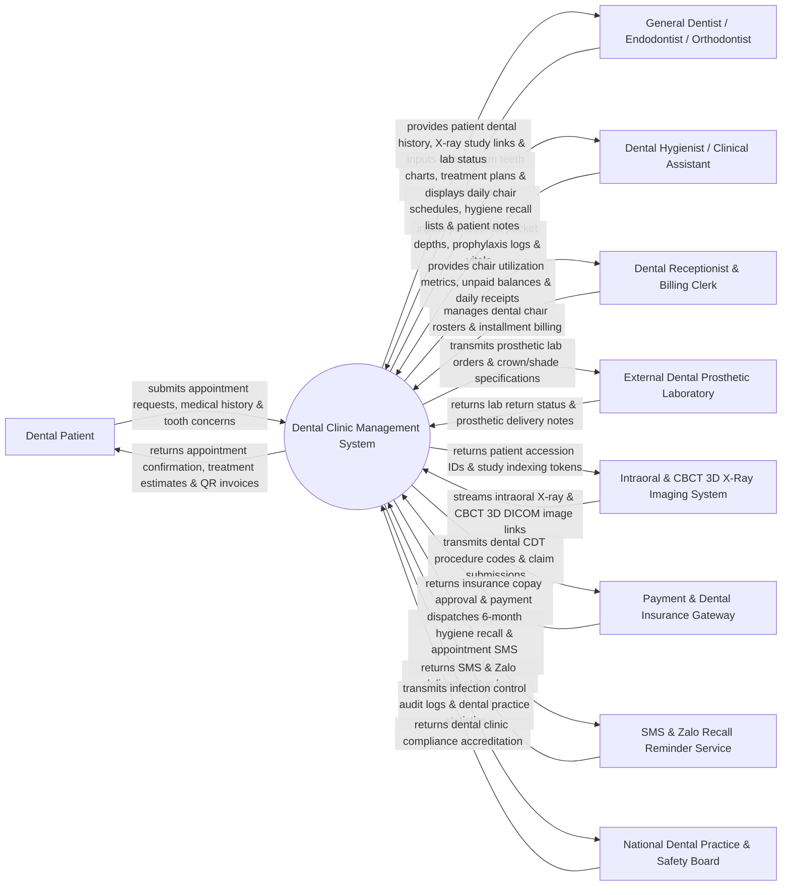

# Context Diagram — Dental Clinic Management System

## Mermaid Code

## Actor & Interaction Table | Bảng Actor & Tương tác

| # | Actor | Actor Type | Data Sent TO System | Data Received FROM System | Notes |
|---|-------|------------|---------------------|---------------------------|-------|
| 1 | Dental Patient | Primary | Appointment bookings, dental chief complaints, medical history (allergies, systemic diseases), payment transactions. | Appointment QR tokens, treatment cost estimates, dental hygiene reminders, digital invoices. | Individual receiving dental check-ups, cleanings, fillings, root canals, implants, or braces. |
| 2 | General Dentist / Endodontist / Orthodontist | Primary | Odontogram tooth charting, treatment plan proposals, clinical dental procedure logs, e-prescriptions. | Patient dental history, intraoral X-ray images, external lab order status, treatment progress. | Dental surgeon performing diagnosis, restorative dentistry, root canals, oral surgery, and orthodontics. |
| 3 | Dental Hygienist / Clinical Assistant | Primary | Periodontal probing depth measurements, teeth cleaning (prophylaxis) records, sterilization logs. | Daily dental chair rosters, patient hygiene recall schedules, tooth plaque indices. | Allied dental professional performing teeth cleaning, periodontal charting, and assisting dentists. |
| 4 | Dental Receptionist & Billing Clerk | Primary | Dental chair time slot allocations, patient check-in status, installment payment plans, co-pay receipts. | Real-time chair availability matrix, outstanding balance alerts, daily revenue summaries. | Front-desk staff managing clinic scheduling, cashiering, and dental insurance claims. |
| 5 | External Dental Prosthetic Laboratory | Supporting System | Crown/bridge/denture delivery status, lab remake notes, lab billing invoices. | Dental lab work orders, tooth shade specifications, CAD/CAM impression files, return due dates. | Commercial dental lab fabricating custom crowns, bridges, veneers, dentures, and clear aligners. |
| 6 | Intraoral & CBCT 3D X-Ray Imaging System | Supporting System | Intraoral sensor X-ray images, Panoramic Radiographs (OPG), CBCT 3D DICOM volumes. | Patient accession UIDs, DICOM modality worklist (MWL) queries. | Dental imaging hardware (e.g., Carestream, Planmeca, Vatech) capturing digital dental X-rays. |
| 7 | Payment & Dental Insurance Gateway | Supporting System | Credit card authorization codes, digital wallet payments, dental insurance claim approvals (CDT). | Dental procedure billing claims, patient co-pay calculations, clinic batch settlement files. | Financial payment processor and dental insurance payer clearing CDT procedure claims. |
| 8 | SMS & Zalo Recall Reminder Service | Supporting System | Message delivery status logs, Zalo message receipt confirmations, patient reply tokens. | Automated 6-month hygiene recall notices, appointment confirmation SMS, post-op care tips. | Multi-channel messaging service sending automated reminders for routine dental cleanings. |
| 9 | Dental Practice & Safety Board | Regulatory | National dental practice standards, sterilization audit rules, radiation safety guidelines. | Clinic infection control logs, radiation exposure safety compliance reports, licensing metrics. | Governmental health body enforcing dental clinic sanitation, radiation safety, and practice licenses. |

## System Boundary Description | Mô tả Phạm vi Hệ thống

The **Dental Clinic Management System (DCMS)** is a specialized ambulatory healthcare software platform engineered for dental clinics and multi-specialty dental centers. It digitizes the interactive Odontogram (visual 32-adult / 20-pediatric teeth charting across 5 surfaces), Periodontal Probing Depth charting, multi-phase Dental Treatment Planning with cost estimates, Dental Prosthetic Lab Order tracking, Intraoral & CBCT 3D X-Ray DICOM integration, hygiene recall automation, installment financing, and CDT dental procedure billing.

**Inside System Scope:**
- Interactive visual Odontogram charting (restorations, extractions, root canals, crowns, implants).
- Periodontal probing depth charting (1 to 6 mm bleeding on probing indices).
- Multi-phase dental treatment plan creation, phased cost estimates, and patient consent sign-off.
- Dental chair appointment scheduling, operatory room management, and hygiene recall tracking.
- External dental lab work order management (CAD/CAM impressions, crown shade matching, return tracking).
- Integration with intraoral X-ray sensors, Panoramic OPG, and 3D CBCT DICOM viewers.
- Dental billing, CDT code insurance claims, and multi-installment patient payment plans.

**Outside System Scope:**
- Physical CAD/CAM milling of ceramic crowns inside the lab (handled by dental lab equipment).
- Physical sterilization of dental instruments in autoclaves (handled by clinic sterilization hardware).
- General non-dental hospital inpatient surgical operations (handled by HIS / Hospital systems).
- Commercial financial banking ledger accounting (handled by general accounting software).
