# Use Case Diagram — Dental Clinic Management System

## Mermaid Code

```mermaid
flowchart LR
    actor_Patient["Dental Patient"]
    actor_Dentist["Dentist / Dental Specialist"]
    actor_Hygienist["Dental Hygienist / Assistant"]
    actor_Receptionist["Dental Receptionist & Billing Clerk"]
    actor_ProstheticLab["Dental Prosthetic Lab"]
    actor_ImagingSystem["X-Ray & CBCT System"]

    subgraph SystemBoundary["Dental Clinic Management System"]
        UC01(["Schedule Dental Appointment & Chair Reservation"])
        UC02(["Record Odontogram & Periodontal Charting"])
        UC03(["Formulate Dental Treatment Plan & Cost Estimate"])
        UC04(["Dispatch Dental Lab Work Order & Track Prosthetics"])
        UC05(["Capture Intraoral X-Ray & Attach CBCT DICOM Study"])
        UC06(["Execute Dental Procedure & Log CDT Codes"])
        UC07(["Manage Dental Hygiene & 6-Month Recall Schedule"])
        UC08(["Process Dental Invoice & Installment Payment Plan"])
        UC09(["Submit Dental Insurance Claim (CDT Code)"])
        UC10(["Track Dental Instrument Sterilization Audit"])
        UC11(["Manage Dental Consumables & Material Inventory"])
        UC12(["Prescribe Dental Medications & Antibiotic Cover"])
        UC13(["Record Pediatric Dental Charting (Primary Teeth)"])
        UC14(["Manage Orthodontic Treatment Progress"])
        UC15(["Generate Dental Clinic Revenue & Analytics Reports"])
        UC16(["Authenticate & Manage System Users"])
    end

    actor_Patient --> UC01
    actor_Patient --> UC08

    actor_Dentist --> UC02
    actor_Dentist --> UC03
    actor_Dentist --> UC04
    actor_Dentist --> UC05
    actor_Dentist --> UC06
    actor_Dentist --> UC12
    actor_Dentist --> UC13
    actor_Dentist --> UC14

    actor_Hygienist --> UC02
    actor_Hygienist --> UC07
    actor_Hygienist --> UC10
    actor_Hygienist --> UC11

    actor_Receptionist --> UC01
    actor_Receptionist --> UC07
    actor_Receptionist --> UC08
    actor_Receptionist --> UC09
    actor_Receptionist --> UC15

    actor_ProstheticLab --> UC04

    actor_ImagingSystem --> UC05

    UC01 -.->|"<<include>>"| UC16
    UC03 -.->|"<<include>>"| UC02
    UC06 -.->|"<<include>>"| UC03
    UC04 -.->|"<<extend>>"| UC03
    UC08 -.->|"<<include>>"| UC06
    UC09 -.->|"<<include>>"| UC08
```

## Actor Table | Bảng Actor

| # | Actor | Actor Type | Role Description | Related Use Cases |
|---|-------|------------|------------------|-------------------|
| 1 | Dental Patient | Primary | Patient booking dental appointments, reviewing treatment plan estimates, and paying bills via installments. | UC01, UC08 |
| 2 | Dentist / Dental Specialist | Primary | General dentist, endodontist, or orthodontist charting odontograms, creating treatment plans, performing procedures, and ordering lab work. | UC02, UC03, UC04, UC05, UC06, UC12, UC13, UC14 |
| 3 | Dental Hygienist / Assistant | Primary | Clinical staff member recording periodontal pocket depths, performing teeth cleanings, sterilizing instruments, and tracking materials. | UC02, UC07, UC10, UC11 |
| 4 | Dental Receptionist & Billing Clerk | Primary | Front-desk staff managing dental chair schedules, patient check-ins, installment payment plans, insurance claims, and revenue reports. | UC01, UC07, UC08, UC09, UC15 |
| 5 | Dental Prosthetic Lab | Secondary / System | External laboratory receiving CAD/CAM impression files and fabricating crowns, bridges, veneers, and dentures. | UC04 |
| 6 | X-Ray & CBCT System | Secondary / System | Dental imaging hardware streaming intraoral sensor X-rays and 3D CBCT DICOM studies into patient charts. | UC05 |

## Use Case Table | Bảng Use Case

| # | UC ID | Use Case Name | Primary Actor | Secondary Actor | Description | Priority |
|---|-------|---------------|---------------|-----------------|-------------|----------|
| 1 | UC01 | Schedule Dental Appointment & Chair Reservation | Dental Receptionist & Billing Clerk | Dental Patient | Book dental visits, assign operatory dental chairs (Chair 1-5), and select provider dentists. | High |
| 2 | UC02 | Record Odontogram & Periodontal Charting | Dentist / Dental Specialist | Dental Hygienist / Assistant | Interactively chart 32 adult / 20 primary teeth (conditions, existing restorations) and record 1-6mm probing depths. | High |
| 3 | UC03 | Formulate Dental Treatment Plan & Cost Estimate | Dentist / Dental Specialist | None | Group required dental procedures into phased treatment plans (e.g., Phase 1: Hygiene, Phase 2: Root Canal, Phase 3: Crown) with fee estimates. | High |
| 4 | UC04 | Dispatch Dental Lab Work Order & Track Prosthetics | Dentist / Dental Specialist | Dental Prosthetic Lab | Create lab orders for crowns/bridges/aligners, specify tooth shade/materials, attach 3D impression files, and track return due dates. | High |
| 5 | UC05 | Capture Intraoral X-Ray & Attach CBCT DICOM Study | Dentist / Dental Specialist | X-Ray & CBCT System | Ingest intraoral bitewing/periapical sensor X-rays and 3D CBCT DICOM volumes directly into patient dental charts. | High |
| 6 | UC06 | Execute Dental Procedure & Log CDT Codes | Dentist / Dental Specialist | None | Record completed clinical dental procedures, select CDT insurance codes (e.g., D2140 Amalgam, D3330 Root Canal), and decrement materials. | High |
| 7 | UC07 | Manage Dental Hygiene & 6-Month Recall Schedule | Dental Hygienist / Assistant | Dental Receptionist & Billing Clerk | Auto-generate 6-month routine dental cleaning recall lists and dispatch automated SMS/Zalo reminders to patients. | Medium |
| 8 | UC08 | Process Dental Invoice & Installment Payment Plan | Dental Receptionist & Billing Clerk | Dental Patient | Calculate co-pays, process single or multi-installment payment agreements for high-value treatments (Implants/Braces). | High |
| 9 | UC09 | Submit Dental Insurance Claim (CDT Code) | Dental Receptionist & Billing Clerk | None | Format and transmit electronic dental insurance claims using CDT procedure codes and attached X-ray proof. | High |
| 10 | UC10 | Track Dental Instrument Sterilization Audit | Dental Hygienist / Assistant | None | Log autoclave sterilization cycle numbers, chemical indicator tape checks, and biological spore test results for compliance. | High |
| 11 | UC11 | Manage Dental Consumables & Material Inventory | Dental Hygienist / Assistant | None | Track composite resins, anesthetic carpules, burs, impression materials, and enforce minimum stock reorder levels. | Medium |
| 12 | UC12 | Prescribe Dental Medications & Antibiotic Cover | Dentist / Dental Specialist | None | Issue prescriptions for post-op analgesics, prophylactic antibiotics (for endocarditis prevention), and antiseptic rinses. | High |
| 13 | UC13 | Record Pediatric Dental Charting (Primary Teeth) | Dentist / Dental Specialist | None | Chart primary deciduous teeth (Teeth A-T), track eruption milestones, and log fluoride varnish applications. | Medium |
| 14 | UC14 | Manage Orthodontic Treatment Progress | Dentist / Dental Specialist | None | Track cephalometric analysis, archwire changes, bracket placements, and clear aligner tray progression schedules. | Medium |
| 15 | UC15 | Generate Dental Clinic Revenue & Analytics Reports | Dental Receptionist & Billing Clerk | None | Produce daily chair utilization rates, provider productivity, treatment plan acceptance rates, and outstanding balances. | Medium |
| 16 | UC16 | Authenticate & Manage System Users | All Users | None | Enforce secure user login, role-based access control, and electronic charting signature audit logs. | High |

## Use Case Specification | Đặc tả Use Case

---

### UC01 — Schedule Dental Appointment & Chair Reservation

| Field | Detail |
|-------|--------|
| **UC ID** | UC01 |
| **Use Case Name** | Schedule Dental Appointment & Chair Reservation |
| **Actor(s)** | Primary: Dental Receptionist & Billing Clerk   Secondary: Dental Patient |
| **Description** | Reserves a specific dental operatory chair (e.g., Chair 01 - Surgical, Chair 02 - Hygiene) and provider dentist for a patient, checking chair operating hours, procedure duration requirements, and patient preferences. |
| **Precondition** | 1. Dental chairs and dentist working schedules are configured in DCMS.   2. The patient profile is registered or created during intake. |
| **Main Flow** | 1. The Receptionist opens the "Dental Chair Appointment Calendar" and selects the target date.   2. The System displays the multi-chair grid (Chairs 1 to 5) with color-coded appointment blocks and open time slots.   3. The Receptionist searches for the patient by name, phone, or code and selects the requested CDT procedure (e.g., CDT D0120 Periodic Exam + CDT D1110 Adult Cleaning).   4. The System calculates required slot duration (e.g., 45 minutes) based on procedure master data.   5. The Receptionist selects an available dentist (e.g., Dr. Smith) and drops the reservation into an open chair column (e.g., Chair 02 at 10:00 AM).   6. The System checks for dentist double-booking or chair maintenance conflicts.   7. The Receptionist confirms the booking, and the System generates an Appointment QR Token and sends automated SMS/Zalo confirmation to the patient. |
| **Alternative Flow** | **AF1** — Online Patient Self-Booking: The Patient logs into the clinic mobile app, picks an open chair slot, selects the reason for visit, and receives instant QR booking confirmation.   **AF2** — Emergency Dental Pain Walk-In: For acute toothache walk-ins, the Receptionist selects "Emergency Slot", placing the patient into the emergency buffer chair for immediate triage. |
| **Exception Flow** | **EX1** — Dentist Schedule Double-Booking Warning: If the selected dentist is already assigned to Chair 01 during the same 10:00 AM slot, the System blocks double-booking and prompts for an alternate dentist or time.   **EX2** — Special Equipment Unavailability: If a procedure requires the 3D CBCT chair but Chair 03 (CBCT room) is out of service, the System flags an equipment conflict banner. |
| **Postcondition** | Dental appointment is saved, specific operatory chair and dentist are reserved, duration block is locked, and SMS confirmation is dispatched. |
| **Business Rule** | **BR1**: Specialized surgical procedures (Implants, Wisdom Tooth Extractions) must only be booked in designated Surgical Operatory Chairs equipped with sterile field setup.   **BR2**: Routine hygiene cleanings must be booked with at least 15 minutes buffer time between appointments for chair surface disinfection. |

---

### UC02 — Record Odontogram & Periodontal Charting

| Field | Detail |
|-------|--------|
| **UC ID** | UC02 |
| **Use Case Name** | Record Odontogram & Periodontal Charting |
| **Actor(s)** | Primary: Dentist / Dental Specialist   Secondary: Dental Hygienist / Assistant |
| **Description** | Digitally charts the patient's dental anatomy using an interactive graphical Odontogram (FDI 2-digit or Universal 1-32 numbering system), recording tooth status across 5 surfaces (Mesial, Distal, Occlusal, Facial, Lingual) and measuring 1-6mm periodontal probing depths with bleeding indices. |
| **Precondition** | 1. The patient is checked into a dental chair with an active clinical visit.   2. The Dentist/Hygienist is authenticated in DCMS with charting privileges. |
| **Main Flow** | 1. The Dentist opens the "Interactive Odontogram Chart" for the active patient.   2. The System renders a 3D/2D graphical layout of 32 permanent teeth (Teeth 11-48 FDI) or 20 primary teeth (Teeth 51-85 FDI).   3. The Dentist clicks on a specific tooth (e.g., Tooth 46 - Lower Right First Molar) and selects tooth surface(s): Mesial (M), Distal (D), Occlusal (O), Facial (F), Lingual (L).   4. The Dentist assigns conditions using standardized graphical symbols: Present, Missing, Caries (Decay), Amalgam/Composite Filling, Crown, Root Canal (Endodontics), Bridge Abutment, Implant, Impacted, or Fractured.   5. The Hygienist switches to the "Periodontal Flowsheet" view and inputs 6-point probing depth measurements (1 to 12 mm) per tooth (Distofacial, Facial, Mesiofacial, Distolingual, Lingual, Mesiolingual).   6. The System automatically highlights probing depths >= 4mm in red (indicating periodontal pockets) and calculates Bleeding on Probing (BOP %) and Plaque Index (%).   7. The Dentist reviews and clicks "Save Odontogram", locking the baseline entry with a timestamp and digital signature. |
| **Alternative Flow** | **AF1** — Voice-Assisted Hands-Free Charting: The Hygienist uses voice commands (e.g., "Tooth 16, Mesial 3, Facial 4, Bleeding") to enter probing depths hands-free while maintaining a sterile field.   **AF2** — Historical Odontogram Comparison: The Dentist toggles "Compare Chart History" to view side-by-side progression of tooth decay or bone loss over the past 3 years. |
| **Exception Flow** | **EX1** — Tooth Number Conflict: If the Dentist attempts to chart a root canal on a tooth previously marked as "Extracted/Missing", the System alerts "Tooth Marked Extracted - Confirm Status".   **EX2** — Severe Periodontal Loss Alert: If multiple probing depths exceed 7mm with mobility Grade III, the System flags a red "Advanced Periodontitis Alert" and prompts for specialist referral. |
| **Postcondition** | Graphical Odontogram baseline and 6-point periodontal probing depths are saved, color-coded pocket depths are highlighted, and chart history is locked for audit. |
| **Business Rule** | **BR1**: Periodontal probing depths >= 4mm must be highlighted in red visual indicators and included in periodontal disease diagnosis coding.   **BR2**: Baseline Odontogram charts cannot be overwritten; new clinical entries must be saved as new timestamped chart revisions. |

---

### UC03 — Formulate Dental Treatment Plan & Cost Estimate

| Field | Detail |
|-------|--------|
| **UC ID** | UC03 |
| **Use Case Name** | Formulate Dental Treatment Plan & Cost Estimate |
| **Actor(s)** | Primary: Dentist / Dental Specialist |
| **Description** | Creates a comprehensive, multi-phase dental treatment plan based on Odontogram diagnostic findings, grouping recommended CDT procedures into prioritized phases (e.g., Phase 1: Pain Relief/Hygiene, Phase 2: Restorative/Endo, Phase 3: Prosthetics/Implants), calculating fee estimates, and capturing patient consent. |
| **Precondition** | 1. The patient has a completed Odontogram and diagnostic examination in DCMS.   2. Procedure CDT master fees are active in the clinic fee schedule. |
| **Main Flow** | 1. The Dentist opens the "Treatment Plan Builder" for the target patient.   2. The System displays Odontogram findings with flagged conditions (e.g., Tooth 16 Deep Caries, Tooth 36 Missing, Tooth 21 Fractured).   3. The Dentist selects diagnoses and adds corresponding CDT procedures: e.g., Tooth 16 -> CDT D3330 (Root Canal) + CDT D2750 (Porcelain/Metal Crown); Tooth 36 -> CDT D6010 (Surgical Implant Placement).   4. The Dentist organizes selected procedures into prioritized treatment phases: **Phase 1 (Urgent/Symptomatic)**: Scaling + Root Canal; **Phase 2 (Restorative)**: Fillings + Crowns; **Phase 3 (Reconstructive/Cosmetic)**: Implant + Abutment.   5. The System calculates standard fees for each item, applies active clinic discount packages, estimates insurance coverage amounts, and calculates the Net Patient Out-of-Pocket Cost Estimate.   6. The Dentist reviews the treatment plan with the patient on screen, explains alternative options (e.g., Bridge vs Implant), and prints or emails the "Treatment Plan Proposal".   7. The Patient approves the proposal, and the System captures the patient's electronic signature, locking the agreed treatment plan status as "Approved - Ready for Scheduling". |
| **Alternative Flow** | **AF1** — Multi-Option Treatment Plan Comparison: The Dentist creates Option A (Ideal - Implants) and Option B (Alternative - Removable Partial Denture), displaying side-by-side cost and longevity comparisons for the patient.   **AF2** — Installment Financing Integration: The Patient selects a 12-month zero-interest payment plan for an implant, and the System routes to the Installment Plan Module (UC08) to set up monthly payment terms. |
| **Exception Flow** | **EX1** — Unapproved High-Cost Plan Warning: If a treatment plan exceeds $2,000 without a signed patient consent form, the System blocks procedure execution in the chair.   **EX2** — Insurance Pre-Authorization Requirement: If a procedure (e.g., Orthodontic Braces) requires mandatory insurance pre-authorization, the System flags the item as "Pending Insurance Pre-Auth". |
| **Postcondition** | Phased dental treatment plan is created, total and out-of-pocket costs are estimated, patient electronic consent is captured, and procedures are queued for execution. |
| **Business Rule** | **BR1**: All invasive dental procedures (Root Canals, Extractions, Implants, Surgeries) require a signed patient informed consent form prior to clinical execution.   **BR2**: Treatment plan cost estimates are valid for 60 calendar days from creation date. |

---

### UC04 — Dispatch Dental Lab Work Order & Track Prosthetics

| Field | Detail |
|-------|--------|
| **UC ID** | UC04 |
| **Use Case Name** | Dispatch Dental Lab Work Order & Track Prosthetics |
| **Actor(s)** | Primary: Dentist / Dental Specialist   Secondary: Dental Prosthetic Lab |
| **Description** | Generates digital work orders for external dental prosthetic laboratories to fabricate custom crowns, bridges, veneers, dentures, or clear aligners, specifying VITA tooth shade, margin design, CAD/CAM 3D impression files, and tracking return due dates. |
| **Precondition** | 1. The patient has an approved treatment plan requiring a prosthetic device.   2. Digital 3D intraoral impressions or physical silicone impressions are captured. |
| **Main Flow** | 1. The Dentist opens "New Dental Lab Order" from the patient's active treatment plan.   2. The Dentist selects the Target Tooth/Arch (e.g., Tooth 21) and Prosthetic Type (e.g., Zirconia All-Ceramic Crown, E-Max Veneer, Cobalt-Chrome Partial Denture).   3. The Dentist selects VITA Tooth Shade (e.g., A2, A3, Bleach 1), translucency parameters, and occlusal clearance requirements.   4. The System attaches digital 3D STL intraoral scan files or notes physical silicone impression pickup details.   5. The Dentist selects the preferred partner Dental Lab (e.g., Elite Dental Lab) and sets the Expected Return Date (e.g., 7 business days out).   6. The Dentist signs the digital work order ticket.   7. The System dispatches an electronic lab order notification to the lab portal and places the patient's delivery appointment in "Pending Lab Work" status.   8. When the lab completes fabrication, the lab technician updates status to "Shipped - In Transit". Upon physical arrival at the clinic, the receptionist scans the lab package, verifying shade and quality before updating status to "Received - Ready for Fitting". |
| **Alternative Flow** | **AF1** — In-House Chairside CAD/CAM Milling: If the clinic possesses an in-house milling unit (e.g., CEREC), the System routes the STL file directly to the clinic's local milling machine queue for same-day single-visit crown delivery.   **AF2** — Lab Remake Request: If the crown fitting fails during trial-in due to tight contact or shade mismatch, the Dentist selects "Lab Remake Request", attaches photos/new impressions, and re-dispatches the work order. |
| **Exception Flow** | **EX1** — Overdue Lab Return Alert: If the lab order has not arrived 24 hours prior to the patient's scheduled fitting appointment, the System alerts the receptionist to call the lab and reschedule the patient if necessary.   **EX2** — Corrupted 3D STL Scan File: If the lab portal detects a gap or distortion in the 3D STL digital scan file, the System alerts the Dentist to recall the patient for a quick re-scan. |
| **Postcondition** | Dental lab work order is created with detailed shade/material specs, 3D STL files are attached, return due date is tracked, and prosthetic arrival status is monitored. |
| **Business Rule** | **BR1**: All custom dental prosthetic lab orders must specify VITA shade code, material composition, and dentist license number.   **BR2**: Fitting appointments cannot be confirmed as "Ready" until physical receiving inspection of the prosthetic is logged by clinic staff. |

---

### UC05 — Capture Intraoral X-Ray & Attach CBCT DICOM Study

| Field | Detail |
|-------|--------|
| **UC ID** | UC05 |
| **Use Case Name** | Capture Intraoral X-Ray & Attach CBCT DICOM Study |
| **Actor(s)** | Primary: Dentist / Dental Specialist   Secondary: X-Ray & CBCT System |
| **Description** | Ingests digital intraoral bitewing/periapical sensor X-rays, Panoramic OPG radiographs, and 3D Cone Beam Computed Tomography (CBCT) DICOM imaging volumes directly into the patient's dental chart for diagnostic evaluation and implant planning. |
| **Precondition** | 1. The patient is checked into the dental chair or X-ray room.   2. Digital intraoral X-ray sensors or CBCT scanner hardware is connected to the network. |
| **Main Flow** | 1. The Dentist or Assistant selects "Take X-Ray / Import Image" from the patient's chart.   2. The System queries the digital X-ray acquisition gateway via DICOM Modality Worklist (MWL) or TWAIN sensor interface.   3. The Assistant positions the digital intraoral sensor (Size 1 or Size 2) in the patient's mouth for target tooth region (e.g., Upper Right Premolars Bitewing) and triggers the X-ray tube.   4. The digital image is captured instantly and transmitted to DCMS.   5. The System attaches the high-resolution radiograph to the specific tooth number on the graphical Odontogram chart.   6. The Dentist applies image enhancement filters: Contrast adjustment, Invert scale, Zoom, Sharpening, and Measurement tools (calibrating root canal length in mm or bone height for implant placement).   7. The Dentist saves the diagnostic interpretation notes (e.g., "Periapical radiolucency on Tooth 36 disto-buccal root indicating apical periodontitis"). |
| **Alternative Flow** | **AF1** — 3D CBCT DICOM Volume Import: The Dentist imports a 3D CBCT volume for implant planning; the System launches an integrated 3D DICOM MPR viewer displaying Axial, Sagittal, Coronal cross-sections, and inferior alveolar nerve tracing.   **AF2** — Historical X-Ray Comparison: The Dentist selects two radiographs of the same tooth taken 2 years apart and displays a side-by-side split screen to evaluate bone loss progression. |
| **Exception Flow** | **EX1** — Overexposed / Blurry Image Re-Take: If the captured intraoral image is blurred due to patient movement, the Dentist marks "Retake Required", logging the retake reason to monitor patient radiation exposure.   **EX2** — DICOM Link Disconnection: If the network link to the central PACS/CBCT storage server drops, the System saves the image in local encrypted cache and queues background sync upon reconnection. |
| **Postcondition** | Digital intraoral X-rays or 3D CBCT DICOM volumes are attached to specific tooth numbers, radiograph measurements are logged, and diagnostic notes are recorded. |
| **Business Rule** | **BR1**: Every diagnostic X-ray image entry must be linked to a specific tooth number or anatomical jaw quadrant and accompanied by a documented dentist interpretation note.   **BR2**: X-ray retakes must be audited to ensure compliance with ALARA (As Low As Reasonably Achievable) radiation safety guidelines. |
