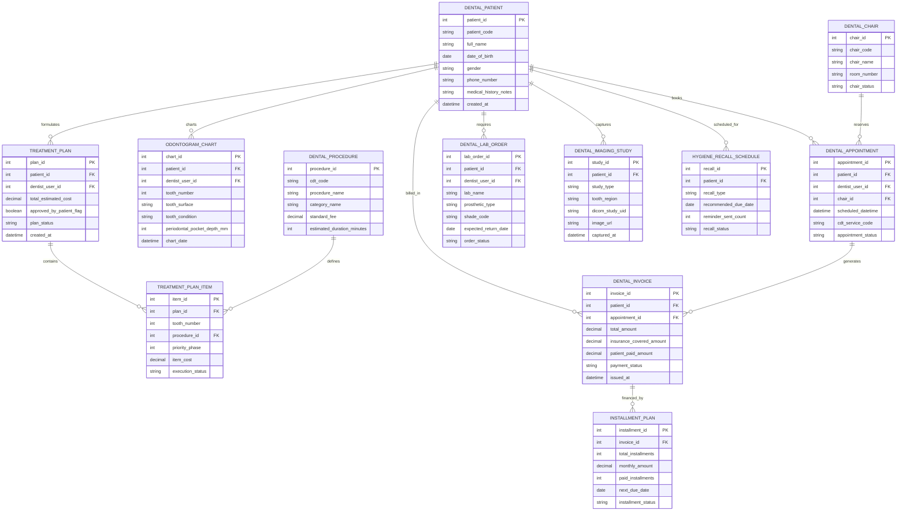

# Conceptual ERD — Dental Clinic Management System

## Mermaid Code

## Entity Description Table | Bảng mô tả Entity

| # | Entity Name | Vietnamese Name | Description | Key Attributes | Main Relationships |
|---|-------------|-----------------|-------------|----------------|-------------------|
| 1 | DENTAL_PATIENT | Bệnh nhân Nha khoa | Master dental patient profile storing patient code, demographics, medical/allergy history, and creation timestamp. | patient_id, patient_code, full_name, dob, gender, phone_number, medical_history_notes | Has many DENTAL_APPOINTMENT, ODONTOGRAM_CHART, TREATMENT_PLAN, DENTAL_LAB_ORDER, DENTAL_INVOICE, etc. |
| 2 | DENTAL_CHAIR | Ghế Nha khoa | Operatory dental chair definition holding chair code, name, operatory room number, and availability status. | chair_id, chair_code, chair_name, room_number, chair_status | Has many DENTAL_APPOINTMENT entities. |
| 3 | DENTAL_APPOINTMENT | Lịch hẹn Nha khoa | Booking appointment record tying patient, dentist, operatory chair, scheduled datetime, and CDT service codes. | appointment_id, patient_id, dentist_user_id, chair_id, scheduled_datetime, cdt_service_code | Belongs to DENTAL_PATIENT and DENTAL_CHAIR; Has many DENTAL_INVOICE entities. |
| 4 | ODONTOGRAM_CHART | Sơ đồ Răng (Odontogram) | Interactive digital tooth chart recording tooth numbers (11-48 FDI), 5 surfaces (M, D, O, F, L), tooth condition, and probing depth. | chart_id, patient_id, dentist_user_id, tooth_number, tooth_surface, tooth_condition, periodontal_pocket_depth_mm | Belongs to DENTAL_PATIENT. |
| 5 | DENTAL_PROCEDURE | Quy trình Nha khoa (CDT) | Master catalog of dental procedures defining CDT codes, procedure names, categories (Endo, Ortho, Restorative), and standard fees. | procedure_id, cdt_code, procedure_name, category_name, standard_fee, estimated_duration_minutes | Has many TREATMENT_PLAN_ITEM entities. |
| 6 | TREATMENT_PLAN | Kế hoạch Điều trị | Comprehensive dental treatment plan aggregating phased procedure items, total estimated costs, and patient approval status. | plan_id, patient_id, dentist_user_id, total_estimated_cost, approved_by_patient_flag, plan_status | Belongs to DENTAL_PATIENT; Has many TREATMENT_PLAN_ITEM entities. |
| 7 | TREATMENT_PLAN_ITEM | Chi tiết Kế hoạch | Phased procedure line item detailing target tooth number, CDT procedure ID, priority phase, cost, and execution status. | item_id, plan_id, tooth_number, procedure_id, priority_phase, item_cost, execution_status | Belongs to TREATMENT_PLAN and DENTAL_PROCEDURE. |
| 8 | DENTAL_LAB_ORDER | Đơn Xưởng Giả lập (Lab) | Digital work order sent to external dental prosthetic labs specifying crown/bridge type, VITA shade code, and return due date. | lab_order_id, patient_id, dentist_user_id, lab_name, prosthetic_type, shade_code, expected_return_date | Belongs to DENTAL_PATIENT. |
| 9 | DENTAL_IMAGING_STUDY | Phim X-Quang / CBCT 3D | Dental imaging record holding intraoral sensor X-rays, OPG panoramas, 3D CBCT DICOM study UIDs, and image URLs. | study_id, patient_id, study_type, tooth_region, dicom_study_uid, image_url, captured_at | Belongs to DENTAL_PATIENT. |
| 10 | DENTAL_INVOICE | Hóa đơn Nha khoa | Clinical invoice itemizing procedure fees, insurance covered amounts, patient co-pays, and payment status. | invoice_id, patient_id, appointment_id, total_amount, insurance_covered_amount, patient_paid_amount | Belongs to DENTAL_PATIENT and DENTAL_APPOINTMENT; Has many INSTALLMENT_PLAN entities. |
| 11 | INSTALLMENT_PLAN | Kế hoạch Trả góp | Payment installment agreement structuring high-cost treatments (Implants, Braces) into monthly payment terms. | installment_id, invoice_id, total_installments, monthly_amount, paid_installments, next_due_date | Belongs to DENTAL_INVOICE. |
| 12 | HYGIENE_RECALL_SCHEDULE | Lịch Nhắc Tái khám Vệ sinh | Automated 6-month hygiene recall schedule tracking recommended cleaning due dates, reminder counts, and statuses. | recall_id, patient_id, recall_type, recommended_due_date, reminder_sent_count, recall_status | Belongs to DENTAL_PATIENT. |

## Relationship Description | Mô tả Quan hệ

| # | From Entity | Cardinality | To Entity | Relationship Label | Business Explanation |
|---|-------------|-------------|-----------|-------------------|----------------------|
| 1 | DENTAL_PATIENT | one-to-many | DENTAL_APPOINTMENT | books | One dental patient books multiple appointments over time. |
| 2 | DENTAL_PATIENT | one-to-many | ODONTOGRAM_CHART | charts | One dental patient has multiple Odontogram tooth charting entries across visits. |
| 3 | DENTAL_PATIENT | one-to-many | TREATMENT_PLAN | formulates | One dental patient can have multiple phased treatment plans created. |
| 4 | DENTAL_PATIENT | one-to-many | DENTAL_LAB_ORDER | requires | One dental patient requires custom dental lab work orders for crowns, veneers, or dentures. |
| 5 | DENTAL_PATIENT | one-to-many | DENTAL_IMAGING_STUDY | captures | One dental patient has multiple intraoral X-rays or 3D CBCT imaging studies captured. |
| 6 | DENTAL_PATIENT | one-to-many | DENTAL_INVOICE | billed_in | One dental patient is billed in multiple clinical invoices. |
| 7 | DENTAL_PATIENT | one-to-many | HYGIENE_RECALL_SCHEDULE | scheduled_for | One dental patient is scheduled for recurring 6-month hygiene recall cleanings. |
| 8 | DENTAL_CHAIR | one-to-many | DENTAL_APPOINTMENT | reserves | One operatory dental chair reserves multiple patient appointments daily. |
| 9 | TREATMENT_PLAN | one-to-many | TREATMENT_PLAN_ITEM | contains | One treatment plan contains multiple individual tooth procedure line items. |
| 10 | DENTAL_PROCEDURE | one-to-many | TREATMENT_PLAN_ITEM | defines | One CDT master procedure defines multiple treatment plan line items. |
| 11 | DENTAL_APPOINTMENT | one-to-many | DENTAL_INVOICE | generates | One completed dental appointment generates clinical invoices. |
| 12 | DENTAL_INVOICE | one-to-many | INSTALLMENT_PLAN | financed_by | One high-cost dental invoice can be financed by a monthly installment payment plan. |
