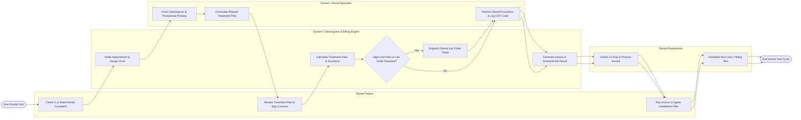

# Swimlane Diagram — Dental Clinic Management System

## Mermaid Code

## Flow Description | Mô tả luồng

| Lane | Actor / Subsystem | Role in Flow |
|------|-------------------|--------------|
| 1 | Dental Patient | Checks in at front desk, states tooth symptoms/concerns, reviews proposed treatment plan estimates, signs informed consent, and settles invoices via cash, card, or installment plans. |
| 2 | System / Odontogram & Billing Engine | Verifies appointments, assigns operatory chairs, renders digital Odontogram charts, calculates procedure fees and insurance copays, dispatches dental lab work orders, and generates 6-month hygiene recall schedules. |
| 3 | Dentist / Dental Specialist | Conducts clinical exam, charts tooth conditions on interactive Odontogram, measures 1-6mm periodontal pocket depths, formulates phased treatment plans, and executes dental procedures with CDT codes. |
| 4 | Dental Receptionist | Manages front-desk check-in, collects co-pays, issues final invoices, sets up monthly installment payment agreements, and schedules follow-up fitting visits or hygiene recalls. |
