# Action Tree — Dental Clinic Management System

## Mermaid Code

```mermaid
graph TD
    Root["Dental Clinic Management System"]

    Root --> M1["Chair Scheduling & Check-In"]
    Root --> M2["Odontogram & Periodontal Charting"]
    Root --> M3["Treatment Planning & Cost Estimates"]
    Root --> M4["Dental Lab Order Tracking"]
    Root --> M5["X-Ray & CBCT 3D DICOM Integration"]
    Root --> M6["Hygiene Recall Management"]
    Root --> M7["Billing & Installment Plans"]
    Root --> M8["Infection Control & Analytics"]

    M1 --> A11["Reserve Operatory Chair Slot"]
    M1 --> A12["Process Patient Kiosk Check-In"]
    M1 --> A13["Manage Emergency Pain Slots"]
    M1 --> A14["Track Operatory Room Status"]

    M2 --> A21["Chart 32 Adult FDI Teeth Status"]
    M2 --> A22["Record 5 Tooth Surface Restorations"]
    M2 --> A23["Measure 6-Point Periodontal Pockets"]
    M2 --> A24["Calculate Bleeding on Probing BOP"]

    M3 --> A31["Group Procedures into Phased Plans"]
    M3 --> A32["Calculate Out-of-Pocket Fee Estimate"]
    M3 --> A33["Capture Patient Consent Digital Signature"]
    M3 --> A34["Compare Ideal vs Alternative Options"]

    M4 --> A41["Specify VITA Tooth Shade & Material"]
    M4 --> A42["Attach 3D STL Intraoral Scan File"]
    M4 --> A43["Track External Lab Return Status"]
    M4 --> A44["Process Lab Remake Request Ticket"]

    M5 --> A51["Capture Digital Intraoral Sensor X-Ray"]
    M5 --> A52["Launch 3D CBCT DICOM Viewer"]
    M5 --> A53["Calibrate Root & Bone mm Measures"]
    M5 --> A54["Compare Historical X-Ray Images"]

    M6 --> A61["Auto-Generate 6-Month Recall List"]
    M6 --> A62["Dispatch SMS & Zalo Cleaning Reminders"]
    M6 --> A63["Track Prophylaxis Cleaning Frequency"]
    M6 --> A64["Monitor Hygiene Dropout Rates"]

    M7 --> A71["Itemize Procedure CDT Billing Codes"]
    M7 --> A72["Submit Electronic Insurance Claims"]
    M7 --> A73["Setup Zero-Interest Installment Terms"]
    M7 --> A74["Process Card & Digital Wallet Payments"]

    M8 --> A81["Log Autoclave Sterilization Cycles"]
    M8 --> A82["Audit Biological Spore Test Logs"]
    M8 --> A83["Calculate Chair Utilization Rates"]
    M8 --> A84["Export Dentist Revenue Productivity"]
```

## Module Description | Mô tả Module

| # | Module | Description | Actions |
|---|--------|-------------|---------|
| 1 | Chair Scheduling & Check-In | Manages operatory dental chair reservations, patient kiosk check-ins, emergency pain slot triaging, and chair room statuses. | Reserve Operatory Chair Slot, Process Patient Kiosk Check-In, Manage Emergency Pain Slots, Track Operatory Room Status |
| 2 | Odontogram & Periodontal Charting | Provides interactive 32 adult / 20 primary teeth Odontogram charting across 5 surfaces and 6-point periodontal probing depth flowsheets. | Chart 32 Adult FDI Teeth Status, Record 5 Tooth Surface Restorations, Measure 6-Point Periodontal Pockets, Calculate Bleeding on Probing BOP |
| 3 | Treatment Planning & Cost Estimates | Formulates phased treatment plans, calculates out-of-pocket fee estimates, captures patient digital consent signatures, and compares options. | Group Procedures into Phased Plans, Calculate Out-of-Pocket Fee Estimate, Capture Patient Consent Digital Signature, Compare Ideal vs Alternative Options |
| 4 | Dental Lab Order Tracking | Generates digital lab work orders with VITA shade specs, attaches 3D STL intraoral impression files, and monitors prosthetic return due dates. | Specify VITA Tooth Shade & Material, Attach 3D STL Intraoral Scan File, Track External Lab Return Status, Process Lab Remake Request Ticket |
| 5 | X-Ray & CBCT 3D DICOM Integration | Ingests intraoral sensor X-rays, launches 3D CBCT DICOM viewers, calibrates millimeter measurements, and compares historical radiographs. | Capture Digital Intraoral Sensor X-Ray, Launch 3D CBCT DICOM Viewer, Calibrate Root & Bone mm Measures, Compare Historical X-Ray Images |
| 6 | Hygiene Recall Management | Auto-generates 6-month routine dental cleaning lists, dispatches automated SMS/Zalo reminders, and monitors hygiene dropout rates. | Auto-Generate 6-Month Recall List, Dispatch SMS & Zalo Cleaning Reminders, Track Prophylaxis Cleaning Frequency, Monitor Hygiene Dropout Rates |
| 7 | Billing & Installment Plans | Itemizes CDT procedure billing codes, submits dental insurance claims, sets up monthly installment payment terms, and processes payments. | Itemize Procedure CDT Billing Codes, Submit Electronic Insurance Claims, Setup Zero-Interest Installment Terms, Process Card & Digital Wallet Payments |
| 8 | Infection Control & Analytics | Logs autoclave instrument sterilization cycles, audits biological spore tests, calculates chair utilization rates, and exports revenue productivity. | Log Autoclave Sterilization Cycles, Audit Biological Spore Test Logs, Calculate Chair Utilization Rates, Export Dentist Revenue Productivity |
