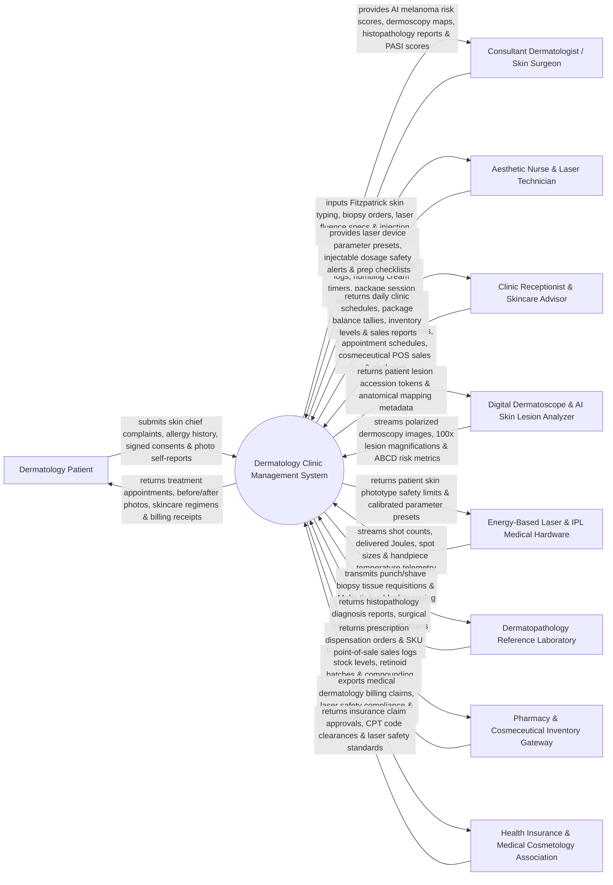

# Context Diagram — Dermatology Clinic Management System

## Mermaid Code

## Actor & Interaction Table | Bảng Actor & Tương tác

| # | Actor | Actor Type | Data Sent TO System | Data Received FROM System | Notes |
|---|-------|------------|---------------------|---------------------------|-------|
| 1 | Dermatology Patient | Primary | Skin chief complaints, medical allergy history, signed procedural consent forms, self-reported skin photos. | Treatment appointment schedules, before/after photo comparisons, cosmeceutical skincare regimens, billing invoices. | Patient receiving clinical medical dermatology (acne, psoriasis, eczema) or aesthetic laser/injectable treatments. |
| 2 | Consultant Dermatologist / Skin Surgeon | Primary | Fitzpatrick skin type classification, biopsy requests, laser fluence settings (J/cm²), facial injection vector grids. | AI melanoma risk scores, dermoscopy mole maps, histopathology biopsy reports, PASI/GAGS severity scores. | Specialist dermatologist or skin surgeon performing skin cancer screening, laser surgery, and injectables. |
| 3 | Aesthetic Nurse & Laser Technician | Primary | Topical numbing cream timers, post-laser cooling logs, treatment session redemptions, post-procedure checks. | Laser parameter presets, injectable unit dosage safety alerts, procedure prep checklists. | Nurse or trained technician operating laser/IPL devices, applying topical anesthesia, and assisting surgeries. |
| 4 | Clinic Receptionist & Skincare Advisor | Primary | Patient check-ins, appointment scheduling, treatment package sales, cosmeceutical POS sales transactions. | Daily appointment rosters, patient package balance tallies, cosmeceutical inventory stock, sales revenue. | Front desk staff managing appointments, package subscriptions, and retail cosmeceutical sales. |
| 5 | Digital Dermatoscope & AI Analyzer | Supporting System | Polarized dermoscopy image captures, 100x magnification images, ABCD asymmetry scores, AI risk metrics. | Patient lesion accession tokens, anatomical body map coordinates, imaging calibration parameters. | High-resolution dermatoscope camera (e.g., FotoFinder, DermLite) capturing pigmented lesion images. |
| 6 | Energy-Based Laser & IPL Hardware | Supporting System | Laser shot counts, total delivered Energy (Joules), spot sizes, pulse durations (ms), cooling temperature. | Patient skin phototype safety limits, calibrated laser parameter presets, handpiece unlock tokens. | Medical laser hardware (CO2 Fractional, Nd:YAG 1064nm, Alexandrite, IPL, Pico Laser, HIFU). |
| 7 | Dermatopathology Laboratory | Supporting System | Histopathology diagnosis reports, surgical margin clearance status, immunohistochemistry (IHC) staining. | Punch/shave biopsy tissue requisitions, Mohs micrographic tissue mapping specimens, patient EHR IDs. | Pathology reference laboratory evaluating skin biopsy specimens and Mohs frozen sections. |
| 8 | Pharmacy & Cosmeceutical Gateway | Supporting System | Retinoid stock levels, Hydroquinone batches, chemical peel concentrations, compounding ingredients. | Prescription dispensation orders, cosmeceutical SKU point-of-sale sales logs, reorder alerts. | In-house pharmacy or skincare retail inventory system dispensing dermatological therapeutics. |
| 9 | Health Insurance & Cosmetology Assn | Regulatory | Health insurance coverage rules for medical dermatology (excision of dysplastic nevi), CPT codes. | Medical dermatology insurance claim submissions, laser safety compliance logs, accreditation audits. | Insurance clearinghouses and medical boards governing medical vs aesthetic dermatology coverage. |

## System Boundary Description | Mô tả Phạm vi Hệ thống

The **Dermatology Clinic Management System (DCMS)** is an enterprise clinical, surgical, and aesthetic dermatology software platform. It operates across dermatology clinics, skin health centers, cosmetic institutes, and dermatopathology units. It manages patient Fitzpatrick skin typing, digital dermoscopy mole mapping, AI melanoma screening, energy-based laser procedure logging (CO2, Nd:YAG, Pico, IPL), facial injectable vector mapping (Botox units, Hyaluronic Acid dermal fillers), Mohs micrographic surgery mapping, dermatopathology biopsy tracking, before/after photo comparison, cosmeceutical retail POS, and teledermatology photo consultations.

**Inside System Scope:**
- Patient intake, Fitzpatrick Skin Type (Type I-VI) assessment, Glogau photo-aging scale, and GAGS acne grading.
- High-resolution digital dermoscopy imaging, anatomical mole body mapping, and AI melanoma screening (ABCD rule).
- Energy-Based Device (EBD) laser parameter logging: wavelength (nm), fluence (J/cm²), pulse width (ms), spot size (mm), passes, and shot counter.
- Aesthetic injectables facial grid mapping: Botulinum Toxin (Botox) unit distribution and Dermal Filler (HA) volume (mL) per anatomical vector.
- Dermatopathology biopsy workflow (punch, shave, excision) and Mohs micrographic surgical stage/margin mapping.
- Cosmeceutical prescription management (Retinoids, Tretinoin, Hydroquinone, Azelaic acid, Barrier repair creams).
- Interactive Before-and-After Photo Comparison Studio (standardized lighting and alignment overlay).
- Multi-session treatment package management, topical anesthesia timer tracking, and retail cosmeceutical POS.

**Outside System Scope:**
- Physical manufacturing of laser hardware or IPL flashlamps (handled by Alma, Candela, Lumenis, etc.).
- Physical compounding of chemical peel solutions or pharmaceutical creams in labs (handled by Pharmacy).
- General hospital inpatient intensive care bed management (handled by HIS / Inpatient).
- Commercial corporate financial general ledger accounting (handled by enterprise ERP).
