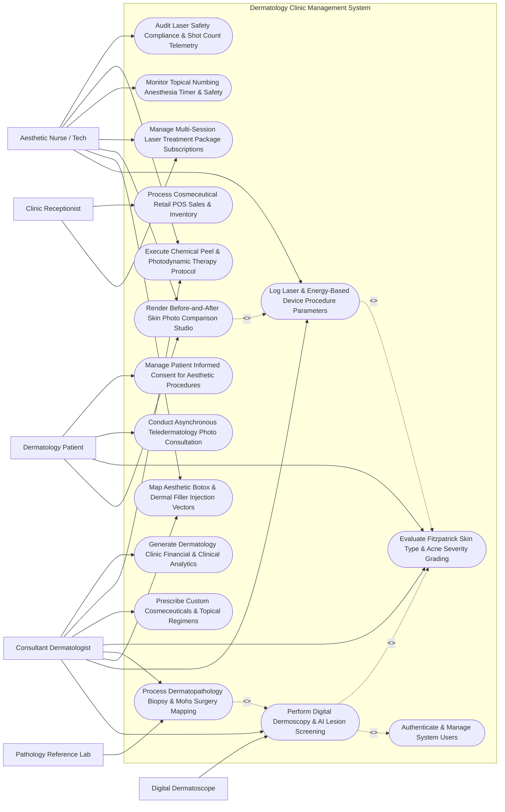

# Use Case Diagram — Dermatology Clinic Management System

## Mermaid Code

## Actor Table | Bảng Actor

| # | Actor | Actor Type | Role Description | Related Use Cases |
|---|-------|------------|------------------|-------------------|
| 1 | Dermatology Patient | Primary | Patient receiving medical skin evaluations, signing procedural consents, viewing before/after photos, and submitting teledermatology photos. | UC05, UC06, UC10, UC14 |
| 2 | Consultant Dermatologist | Primary | Specialist physician diagnosing skin conditions, evaluating dermoscopy, prescribing lasers/injectables, performing biopsies and Mohs surgery. | UC01, UC02, UC03, UC04, UC06, UC08, UC11, UC15 |
| 3 | Aesthetic Nurse / Tech | Primary | Trained clinical assistant administering laser treatments, mapping injection units, applying topical numbing, and capturing standardized photos. | UC02, UC03, UC05, UC07, UC09, UC11, UC13 |
| 4 | Clinic Receptionist | Primary | Front desk staff managing patient appointments, multi-session package redemptions, and cosmeceutical retail POS sales. | UC07, UC12 |
| 5 | Digital Dermatoscope | Secondary / System | High-magnification polarized dermatoscope camera capturing mole images and streaming ABCD asymmetry metrics. | UC01 |
| 6 | Pathology Reference Lab | Secondary / System | External reference lab evaluating punch/shave biopsies and frozen Mohs section slides, returning histopathology diagnoses. | UC04 |

## Use Case Table | Bảng Use Case

| # | UC ID | Use Case Name | Primary Actor | Secondary Actor | Description | Priority |
|---|-------|---------------|---------------|-----------------|-------------|----------|
| 1 | UC01 | Perform Digital Dermoscopy & AI Lesion Screening | Consultant Dermatologist | Digital Dermatoscope | Capture polarized 100x dermoscopy images, map skin lesions on 3D body maps, analyze ABCD criteria, and score AI melanoma risk. | High |
| 2 | UC02 | Log Laser & Energy-Based Device Procedure Parameters | Consultant Dermatologist | Aesthetic Nurse / Tech | Record medical laser parameters: wavelength (nm), fluence (J/cm²), pulse width (ms), spot size (mm), passes, and total shot counts. | High |
| 3 | UC03 | Map Aesthetic Botox & Dermal Filler Injection Vectors | Consultant Dermatologist | Aesthetic Nurse / Tech | Map facial injection vector grids, logging Botulinum Toxin units (Botox/Dysport) and Hyaluronic Acid dermal filler volume (mL) per point. | High |
| 4 | UC04 | Process Dermatopathology Biopsy & Mohs Surgery Mapping | Consultant Dermatologist | Pathology Reference Lab | Request punch/shave/excision biopsies, track tissue specimens, log Mohs micrographic surgical stage mapping, and record margin status. | High |
| 5 | UC05 | Render Before-and-After Skin Photo Comparison Studio | Aesthetic Nurse / Tech | Dermatology Patient | Capture standardized clinical skin photos (fixed lighting and posture), aligning baseline and post-treatment photos in a split-screen studio. | High |
| 6 | UC06 | Evaluate Fitzpatrick Skin Type & Acne Severity Grading | Consultant Dermatologist | Dermatology Patient | Assess Fitzpatrick Skin Phototype (Type I-VI), Glogau photo-aging scale, and score Global Acne Grading System (GAGS) / PASI scores. | High |
| 7 | UC07 | Manage Multi-Session Laser Treatment Package Subscriptions | Clinic Receptionist | Aesthetic Nurse / Tech | Sell and track multi-session treatment packages (e.g., 6-Session CO2 Fractional Laser), auto-deducting sessions upon completion. | Medium |
| 8 | UC08 | Prescribe Custom Cosmeceuticals & Topical Regimens | Consultant Dermatologist | None | Prescribe medical-grade skincare regimens (Tretinoin, Hydroquinone 4%, Vitamin C, Sunscreen), generating morning/evening patient schedules. | High |
| 9 | UC09 | Monitor Topical Numbing Anesthesia Timer & Safety | Aesthetic Nurse / Tech | None | Track topical lidocaine/tetracaine numbing cream application timestamps, enforcing a 30-45 minute safety timer to prevent lidocaine toxicity. | Medium |
| 10 | UC10 | Conduct Asynchronous Teledermatology Photo Consultation | Dermatology Patient | Consultant Dermatologist | Submit asynchronous high-res skin lesion photos and symptom questionnaires, receiving remote dermatologist diagnosis and prescriptions. | Medium |
| 11 | UC11 | Execute Chemical Peel & Photodynamic Therapy Protocol | Consultant Dermatologist | Aesthetic Nurse / Tech | Log chemical peel protocols (TCA 20%, Glycolic 70%, Salicylic), tracking neutralization timers and Photodynamic Therapy (PDT) ALA light exposure. | Medium |
| 12 | UC12 | Process Cosmeceutical Retail POS Sales & Inventory | Clinic Receptionist | None | Execute point-of-sale sales of cosmeceutical products, updating stock levels, batch numbers, and reorder alerts. | Medium |
| 13 | UC13 | Audit Laser Safety Compliance & Shot Count Telemetry | Aesthetic Nurse / Tech | None | Track medical laser handpiece shot counts, IPL lamp lifespan, protective eyewear verification, and laser safety compliance logs. | High |
| 14 | UC14 | Manage Patient Informed Consent for Aesthetic Procedures | Dermatology Patient | None | Execute procedure-specific digital informed consent forms (Laser Resurfacing, Botox, Chemical Peels), capturing patient e-signatures. | High |
| 15 | UC15 | Generate Dermatology Clinic Financial & Clinical Analytics | Consultant Dermatologist | None | Render clinic analytics dashboards: revenue by procedure category (Cosmetic vs Medical), laser utilization %, and patient retention. | Medium |
| 16 | UC16 | Authenticate & Manage System Users | All Users | None | Enforce secure multi-factor authentication, role-based access control (Dermatologist, Nurse, Receptionist), and HIPAA medical record security. | High |

## Use Case Specification | Đặc tả Use Case

---

### UC01 — Perform Digital Dermoscopy & AI Lesion Screening

| Field | Detail |
|-------|--------|
| **UC ID** | UC01 |
| **Use Case Name** | Perform Digital Dermoscopy & AI Lesion Screening |
| **Actor(s)** | Primary: Consultant Dermatologist   Secondary: Digital Dermatoscope |
| **Description** | Captures high-resolution polarized dermoscopy images (100x magnification), maps pigmented skin lesions onto a 3D anatomical body map, evaluates ABCD dermoscopy criteria (Asymmetry, Border, Color, Differential structures), and runs AI deep-learning algorithms to calculate a Melanoma Risk Score. |
| **Precondition** | 1. Digital Dermatoscope camera is connected and calibrated in DCMS.   2. Patient's Fitzpatrick Skin Type (UC06) is recorded. |
| **Main Flow** | 1. The Dermatologist opens "Digital Dermoscopy & Lesion Mapping" for Patient `PAT-2026-08192`.   2. The Dermatologist selects anatomical location on the 3D Body Map: *Upper Back (Interscapular Region, Grid B4)*.   3. The Dermatologist captures a 100x polarized dermoscopy image of a suspicious pigmented nevus using the connected Dermatoscope.   4. The System receives Image `IMG-DERM-9918` and measures **Lesion Physical Dimensions**: `Diameter = 7.4 mm` (> 6.0mm Threshold).   5. The System calculates **ABCD Dermoscopy Criteria**:   &nbsp;&nbsp;&nbsp;&nbsp;- **A (Asymmetry)**: Two-axis asymmetry detected -> Score 1.8   &nbsp;&nbsp;&nbsp;&nbsp;- **B (Border)**: Irregular pigment network cutoff -> Score 1.2   &nbsp;&nbsp;&nbsp;&nbsp;- **C (Color Variegation)**: 3 Colors present (Dark Brown, Black, Erythema) -> Score 1.5   &nbsp;&nbsp;&nbsp;&nbsp;- **D (Dermoscopic Structures)**: Atypical pigment network & regression structures -> Score 1.6   &nbsp;&nbsp;&nbsp;&nbsp;- Total Dermatoscopy Score (TDS): `6.1` (TDS > 5.4 indicates Malignancy Suspicion).   6. The **AI Melanoma Screening Algorithm** analyzes lesion texture: **Melanoma Risk Score = 84.2% (HIGH RISK)**.   7. The Dermatologist flags the lesion as "SUSPICIOUS FOR MELANOMA IN SITU" and orders an Excisional Biopsy (UC04). |
| **Alternative Flow** | **AF1** — Sequential Digital Dermoscopy Imaging (SDDI Mole Monitoring): For a low-risk dysplastic nevus (TDS 4.2), the System saves baseline image and sets a 6-month automated recall reminder for comparative dermoscopy analysis.   **AF2** — Benign Seborrheic Keratosis Screening: AI Algorithm identifies classic "comedo-like openings and brain-like gyri", classifying lesion as Benign (Risk Score 2.1%), reassuring patient. |
| **Exception Flow** | **EX1** — Out-of-Focus / Hairy Dermoscopy Image Warning: Hair fibers obstruct 50% of the pigment network; System flags "Image Quality Low — Shave Area & Recapture Dermoscopy".   **EX2** — Dermatoscope Hardware Disconnect: USB/Wireless link drops; System prompts "Dermatoscope Disconnected — Check Cable Connection". |
| **Postcondition** | Dermoscopy image IMG-DERM-9918 is mapped to 3D body grid B4, ABCD score (TDS 6.1) and AI Melanoma Risk (84.2%) are recorded, and biopsy order is generated. |
| **Business Rule** | **BR1**: Lesions with a Total Dermatoscopy Score (TDS) > 5.45 or AI Melanoma Risk > 75% MUST trigger an automated recommendation for histopathological biopsy.   **BR2**: Dermoscopy images MUST be tagged with exact 3D anatomical body map coordinates to ensure 100% accurate lesion tracking over time. |

---

### UC02 — Log Laser & Energy-Based Device Procedure Parameters

| Field | Detail |
|-------|--------|
| **UC ID** | UC02 |
| **Use Case Name** | Log Laser & Energy-Based Device Procedure Parameters |
| **Actor(s)** | Primary: Consultant Dermatologist   Secondary: Aesthetic Nurse / Tech |
| **Description** | Logs clinical and aesthetic laser procedure parameters for Energy-Based Devices (EBD) including CO2 Fractional, Nd:YAG 1064nm, Pico Laser, Alexandrite, IPL, and HIFU, validating patient Fitzpatrick skin phototype safety limits to prevent laser burns or post-inflammatory hyperpigmentation (PIH). |
| **Precondition** | 1. Patient Fitzpatrick Skin Type (UC06) and signed laser consent (UC14) are verified.   2. Topical numbing cream timer (UC09) is completed. |
| **Main Flow** | 1. The Dermatologist selects "New Laser & EBD Procedure Log" for Patient `PAT-2026-0412` (Fitzpatrick Skin Type III - Acne Scarring).   2. The Dermatologist selects Device: **CO2 Fractional Laser (Ablative)**.   3. The Dermatologist inputs **Calibrated Treatment Parameters**:   &nbsp;&nbsp;&nbsp;&nbsp;- Wavelength: `10,600 nm`   &nbsp;&nbsp;&nbsp;&nbsp;- **Fluence (Energy)**: `25.0 J/cm²`   &nbsp;&nbsp;&nbsp;&nbsp;- **Pulse Duration**: `1.2 ms`   &nbsp;&nbsp;&nbsp;&nbsp;- **Spot Size / Scan Area**: `15mm x 15mm Square`   &nbsp;&nbsp;&nbsp;&nbsp;- **Density / Overlap**: 15% Coverage (Deep Micro-Thermal Zones)   &nbsp;&nbsp;&nbsp;&nbsp;- **Passes Count**: 2 Full Passes over Cheeks & Forehead   &nbsp;&nbsp;&nbsp;&nbsp;- **Total Shot Count**: `1,420 Shots`.   4. The System verifies **Fitzpatrick Safety Rules**:   &nbsp;&nbsp;&nbsp;&nbsp;- Checks Fluence 25 J/cm² against Fitzpatrick Type III Max Safety Limit (30 J/cm²) -> **Safety Verification PASSED**.   5. The Nurse logs **Post-Laser Cooling Protocol**: 20 minutes Zimmer Chiller Cold Air Cooling + Hydrogel Sheet Mask applied.   6. The System decrements 1 session from Patient's CO2 Package (UC07) and logs total shots to handpiece telemetry (UC13). |
| **Alternative Flow** | **AF1** — Q-Switched Nd:YAG Tattoo Removal Logging: For tattoo removal, Dermatologist logs 1064nm wavelength for black ink (Fluence 5.5 J/cm², 4mm spot, 10Hz frequency, 2,800 shots).   **AF2** — IPL Vascular Rosacea Treatment: For facial erythema, Nurse logs Intense Pulsed Light (IPL 560nm filter, 18 J/cm², double pulse 3.0ms, cooling crystal set to 4°C). |
| **Exception Flow** | **EX1** — Fitzpatrick Skin Type Safety Exceeded (PIH Burn Risk): Dermatologist attempts to set CO2 fluence to 45 J/cm² for a Fitzpatrick Type V patient; System blocks operation with error "CRITICAL LASER SAFETY ERROR — High Risk of Severe Burn & PIH for Skin Type V".   **EX2** — Handpiece Shot Count Expiry Alert: IPL flashlamp reaches 100,000 maximum shot capacity; System flags "Lamp Expired — Replace Cartridge". |
| **Postcondition** | Laser parameters (CO2 10600nm, 25 J/cm², 1420 shots) are logged, Fitzpatrick safety rules pass, package balance is updated, and post-laser cooling is logged. |
| **Business Rule** | **BR1**: Energy-Based Device (EBD) laser parameter entries MUST be validated against the patient's recorded Fitzpatrick Skin Phototype to prevent iatrogenic laser burns.   **BR2**: All laser treatment logs MUST record exact wavelength (nm), energy fluence (J/cm²), pulse width (ms), spot size (mm), total passes, and shot count. |

---

### UC03 — Map Aesthetic Botox & Dermal Filler Injection Vectors

| Field | Detail |
|-------|--------|
| **UC ID** | UC03 |
| **Use Case Name** | Map Aesthetic Botox & Dermal Filler Injection Vectors |
| **Actor(s)** | Primary: Consultant Dermatologist   Secondary: Aesthetic Nurse / Tech |
| **Description** | Maps precise facial injection vector coordinates on a digital facial anatomical grid, logging exact unit dosages of Botulinum Toxin (Botox/Dysport) per muscle group (Glabella, Frontalis, Crow's Feet) and volume (mL) of Hyaluronic Acid (HA) dermal fillers per anatomical plane (Nasolabial folds, Cheeks, Lips), recording product lot/expiry numbers. |
| **Precondition** | 1. Facial aesthetic consultation and signed injectable consent (UC14) are verified.   2. Baseline facial expression photos (UC05) are captured. |
| **Main Flow** | 1. The Dermatologist opens "Facial Aesthetic Injectable Grid Mapper" for Patient `PAT-2026-0918`.   2. The Dermatologist selects Injectable Product 1: **Botulinum Toxin Type A (Botox 100U Vial)**.   3. The Dermatologist inputs Product Traceability Data: `Brand: Allergan Botox, Lot #BTX-2026-041, Expiration: Dec 2027`.   4. The Dermatologist taps anatomical facial injection points on the 2D/3D Facial Grid:   &nbsp;&nbsp;&nbsp;&nbsp;- **Glabellar Complex (Corrugator/Procerus)**: 5 Points -> Total `20 Units`   &nbsp;&nbsp;&nbsp;&nbsp;- **Frontalis (Forehead Lines)**: 4 Points -> Total `10 Units`   &nbsp;&nbsp;&nbsp;&nbsp;- **Orbicularis Oculi (Crow's Feet)**: 6 Points (3 per side) -> Total `12 Units`.   5. The Dermatologist selects Injectable Product 2: **Hyaluronic Acid Dermal Filler (Juvederm Voluma XC)**.   6. The Dermatologist maps filler volumes:   &nbsp;&nbsp;&nbsp;&nbsp;- **Zygomatic Arch / Cheeks (Periosteal Bolus)**: Right 0.5 mL + Left 0.5 mL = `1.0 mL Total`   &nbsp;&nbsp;&nbsp;&nbsp;- **Nasolabial Folds (Linear Threading)**: Right 0.5 mL + Left 0.5 mL = `1.0 mL Total`.   7. The System logs total usage: **42 Units Botox + 2.0 mL HA Filler**, saves the vector grid JSON map, updates product inventory (UC12), and schedules a 14-day touch-up review appointment. |
| **Alternative Flow** | **AF1** — Lip Augmentation Mapping: Dermatologist maps 0.8 mL HA Filler (Restylane Kysse) across vermilion border, Cupid's bow, and oral commissures using a 27G cannula.   **AF2** — Masseter Hypertrophy / Jawline Slimming: Dermatologist maps 25 Units Botox into each Masseter muscle (50 Units Total) for bruxism and jawline contouring. |
| **Exception Flow** | **EX1** — Maximum Dosage Safety Limit Warning: Attempting to map > 100 Units Botox in a single facial session triggers a warning "High Unit Count Warning — Verify Total Dosage".   **EX2** — Expired Product Lot Alert: Selected Hyaluronic Acid filler lot expired 5 days ago; System blocks saving with error "Expired Injectable Product — Cannot Dispense". |
| **Postcondition** | Facial injection vector grid map is saved, product lot numbers (BTX-2026-041) and exact units (42U Botox, 2.0mL HA) are recorded, and 14-day review is scheduled. |
| **Business Rule** | **BR1**: Every facial injectable procedure MUST record manufacturer product lot numbers, expiration dates, and exact unit/mL volumes mapped to specific anatomical facial coordinates.   **BR2**: Dermal filler injection logs MUST document the specific injection depth/plane (Supra-periosteal, Deep Subcutaneous, Submucosal) and administration technique (Bolus, Cannula, Threading). |

---

### UC04 — Process Dermatopathology Biopsy & Mohs Surgery Mapping

| Field | Detail |
|-------|--------|
| **UC ID** | UC04 |
| **Use Case Name** | Process Dermatopathology Biopsy & Mohs Surgery Mapping |
| **Actor(s)** | Primary: Consultant Dermatologist   Secondary: Pathology Reference Lab |
| **Description** | Manages skin biopsy requests (Punch, Shave, Excision), labels tissue specimen containers with barcodes, tracks pathology lab status, maps Mohs Micrographic Surgery stages and frozen section tissue grid margins, and ingests final histopathology diagnostic reports (e.g., Basal Cell Carcinoma). |
| **Precondition** | 1. Suspicious skin lesion is identified during consultation (UC01).   2. Tissue specimen containers and barcode printer are ready. |
| **Main Flow** | 1. The Dermatologist selects "New Dermatopathology Biopsy Order" for Patient `PAT-2026-08192` (Lesion on Upper Back, Grid B4).   2. The Dermatologist performs a **3mm Punch Biopsy**, places tissue in 10% Neutral Buffered Formalin, and prints Specimen Barcode `SPEC-PATH-2026-9918`.   3. The Dermatologist inputs Clinical Differential Diagnosis: *Rule Out Dysplastic Nevus vs Melanoma In Situ*.   4. The System dispatches specimen order to the **Dermatopathology Reference Lab**.   5. Upon tissue processing, the Pathology Lab ingests the **Histopathology Diagnostic Report**:   &nbsp;&nbsp;&nbsp;&nbsp;- Histological Diagnosis: **MODERATELY DYSPLASTIC JUNCTIONAL NEVUS**   &nbsp;&nbsp;&nbsp;&nbsp;- Surgical Margins: Clear (Distance to Margin = 1.2 mm)   &nbsp;&nbsp;&nbsp;&nbsp;- Clark Level / Breslow Depth: N/A (Non-Invasive)   &nbsp;&nbsp;&nbsp;&nbsp;- Pathologist Signature: Dr. Tran Van P, MD (Dermatopathologist).   6. The System links the pathology PDF report to Lesion `IMG-DERM-9918`, updates status to "Biopsy Completed - Benign Dysplastic", and sends an automated notification to the Dermatologist. |
| **Alternative Flow** | **AF1** — Mohs Micrographic Surgery Grid Mapping: For a facial Basal Cell Carcinoma (BCC) on the nose, Skin Surgeon performs Mohs Stage 1 excision, maps 4 tissue quadrants (12, 3, 6, 9 o'clock) on the Mohs Grid, evaluates frozen sections, finds residual BCC at Quadrant 3, and performs Stage 2 targeted re-excision until 100% margins are clear.   **AF2** — Malignant Melanoma Wide Local Excision: Pathology returns "Invasive Nodular Melanoma (Breslow Depth 1.4mm, Clark Level IV)"; System flags "CRITICAL CANCER DIAGNOSIS", triggering urgent appointment for 1cm Wide Local Excision and Sentinel Lymph Node Referral. |
| **Exception Flow** | **EX1** — Unlabeled Specimen Barcode Error: Lab receives a specimen jar without a barcode; System flags "Unidentified Specimen Alert — Hold Processing Pending Verification".   **EX2** — Inconclusive Biopsy Result / Re-Biopsy Required: Pathologist reports "Inconclusive Specimen — Tissue Artifact; Re-Biopsy Recommended"; System alerts Dermatologist. |
| **Postcondition** | Punch biopsy specimen SPEC-PATH-2026-9918 is processed, histopathology report (Moderately Dysplastic Nevus, Clear Margins) is ingested and linked to lesion profile. |
| **Business Rule** | **BR1**: Skin biopsy tissue containers MUST be labeled with automated 2D barcodes containing patient ID, anatomical site, and collection timestamp before leaving the procedure room.   **BR2**: Mohs micrographic surgery mapping MUST document exact tissue orientation (12, 3, 6, 9 o'clock), stage numbers, and frozen section margin clearance before defect closure. |

---

### UC05 — Render Before-and-After Skin Photo Comparison Studio

| Field | Detail |
|-------|--------|
| **UC ID** | UC05 |
| **Use Case Name** | Render Before-and-After Skin Photo Comparison Studio |
| **Actor(s)** | Primary: Aesthetic Nurse / Tech   Secondary: Dermatology Patient, Consultant Dermatologist |
| **Description** | Captures standardized clinical photography (using fixed camera distance, polarized lighting, and head positioning grids), aligns baseline and post-treatment photos in an interactive split-screen Comparison Studio, calculates objective skin improvements (pigment reduction %, scar depth reduction), and renders patient photo portals. |
| **Precondition** | 1. Baseline pre-treatment clinical photos are captured prior to starting a procedure series (e.g., CO2 laser or Melasma treatment).   2. The Patient attends a post-treatment follow-up visit. |
| **Main Flow** | 1. The Aesthetic Nurse opens "Before-and-After Photo Studio" for Patient `PAT-2026-0412` (Follow-up: 3 Sessions CO2 Fractional Laser for Acne Scars).   2. The Nurse places the patient in the standardized clinical photography station.   3. The System displays the **Baseline Photo Alignment Overlay**:   &nbsp;&nbsp;&nbsp;&nbsp;- Displays translucent ghosting of Baseline Photo `IMG-BASE-2026-0105` (Jan 5, 2026)   &nbsp;&nbsp;&nbsp;&nbsp;- Aligns patient's eyes, nose tip, and chin against the baseline grid guide.   4. The Nurse captures **Post-Treatment Follow-up Photo**: `IMG-POST-2026-0412` (April 12, 2026).   5. The System loads both images into the **Interactive Split-Screen Comparison Studio**:   &nbsp;&nbsp;&nbsp;&nbsp;- Left View: Baseline (Jan 5) vs Right View: 3-Month Post-CO2 (April 12)   &nbsp;&nbsp;&nbsp;&nbsp;- Features: Interactive Slider Bar, Polarized vs Cross-Polarized Filters, 3D Surface Texture Map.   6. The System calculates **Quantitative Image Analytics**:   &nbsp;&nbsp;&nbsp;&nbsp;- Acne Scar Depth Volume Reduction: `38.4% Improvement`   &nbsp;&nbsp;&nbsp;&nbsp;- Erythema / Redness Score: `42.1% Reduction`.   7. The Dermatologist and Patient review the visual results.   8. The Patient signs a Photo Release Consent (UC14), and the System exports a branded Before/After Comparison PDF to the Patient's Mobile Portal. |
| **Alternative Flow** | **AF1** — Melasma Pigmentation Cross-Polarized Comparison: Nurse captures cross-polarized UV photos for a Melasma patient; System calculates epidermal vs dermal pigment density reduction (54.2% Melanin Index Reduction).   **AF2** — Botox 14-Day Dynamic Expression Comparison: Captures full-smile and forehead-frown photos 14 days post-Botox, demonstrating complete wrinkle smoothing during animation. |
| **Exception Flow** | **EX1** — Misaligned Head Angle Warning: Patient turns head 15° to the right compared to baseline; System flags "Angle Mismatch — Adjust Head Position 15° Left to Match Baseline Grid".   **EX2** — Ambient Lighting Variation Alert: Room lighting is brighter than baseline studio preset; System prompts "Lighting Mismatch — Turn On Polarized Ring Light". |
| **Postcondition** | Post-treatment photo IMG-POST-2026-0412 is captured, split-screen comparison is rendered, 38.4% scar reduction analytics are generated, and PDF is exported to patient portal. |
| **Business Rule** | **BR1**: Before-and-After clinical photography MUST enforce standardized capture parameters (fixed lighting, distance, camera angle, and head grid alignment) to ensure objective outcome evaluation.   **BR2**: Clinical photo publication or marketing export MUST strictly verify an active, signed Patient Media & Photo Consent form. |
