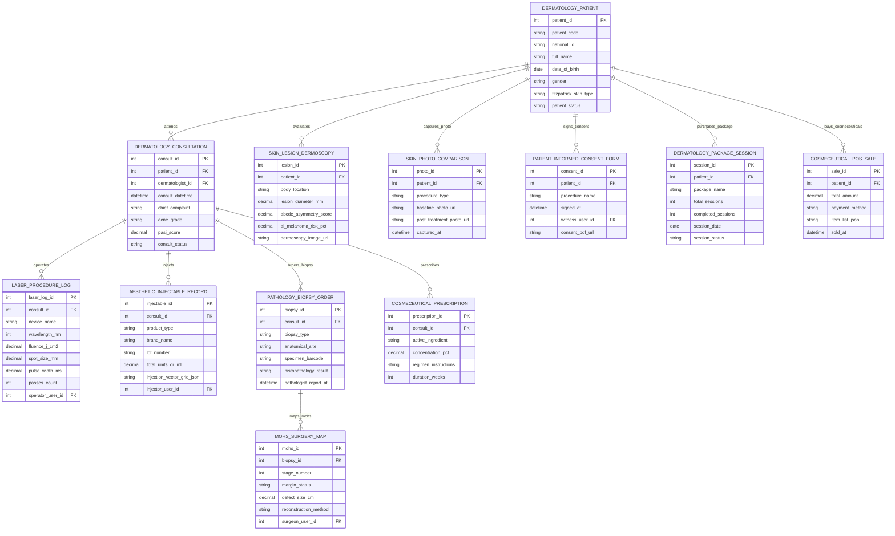

# Conceptual ERD — Dermatology Clinic Management System

## Mermaid Code

## Entity Description Table | Bảng mô tả Entity

| # | Entity Name | Vietnamese Name | Description | Key Attributes | Main Relationships |
|---|-------------|-----------------|-------------|----------------|-------------------|
| 1 | DERMATOLOGY_PATIENT | Bệnh nhân Da liễu Master | Master dermatology patient profile storing patient code, national ID, full name, DOB, gender, Fitzpatrick skin type (Type I-VI), and status. | patient_id, patient_code, national_id, full_name, dob, gender, fitzpatrick_skin_type, patient_status | Has CONSULTATION, DERMOSCOPY, PHOTO_COMPARISON, CONSENT, PACKAGE, POS_SALE. |
| 2 | DERMATOLOGY_CONSULTATION | Lượt Khám Da liễu | Medical/aesthetic dermatology consultation record tracking patient ID, dermatologist ID, consult datetime, chief complaint, acne grade, PASI score, and status. | consult_id, patient_id, dermatologist_id, consult_datetime, chief_complaint, acne_grade, pasi_score, consult_status | Belongs to DERMATOLOGY_PATIENT; Has LASER_LOG, INJECTABLE, BIOPSY, PRESCRIPTION. |
| 3 | SKIN_LESION_DERMOSCOPY | Soi Da Dermoscopy & AI | Digital dermoscopy lesion record tracking body location, diameter mm, ABCD asymmetry score, AI melanoma risk %, and image URL. | lesion_id, patient_id, body_location, lesion_diameter_mm, abcde_asymmetry_score, ai_melanoma_risk_pct, dermoscopy_image_url | Belongs to DERMATOLOGY_PATIENT. |
| 4 | LASER_PROCEDURE_LOG | Nhật ký Laser & Công nghệ cao | Energy-Based Device (EBD) procedure log tracking device name (CO2, Nd:YAG), wavelength nm, fluence J/cm², spot size mm, pulse width ms, passes, and operator ID. | laser_log_id, consult_id, device_name, wavelength_nm, fluence_j_cm2, spot_size_mm, pulse_width_ms, passes_count, operator_user_id | Belongs to DERMATOLOGY_CONSULTATION. |
| 5 | AESTHETIC_INJECTABLE_RECORD | Nhật ký Tiêm Botox / Filler | Aesthetic injectable record tracking product type (Botox/Filler), brand name, lot number, total units/mL, injection vector grid JSON, and injector user ID. | injectable_id, consult_id, product_type, brand_name, lot_number, total_units_or_ml, injection_vector_grid_json, injector_user_id | Belongs to DERMATOLOGY_CONSULTATION. |
| 6 | PATHOLOGY_BIOPSY_ORDER | Đơn Sinh thiết Giải phẫu bệnh | Dermatopathology biopsy order tracking biopsy type (Punch/Shave), anatomical site, specimen barcode, histopathology result, and report timestamp. | biopsy_id, consult_id, biopsy_type, anatomical_site, specimen_barcode, histopathology_result, pathologist_report_at | Belongs to DERMATOLOGY_CONSULTATION; Has MOHS_SURGERY_MAP. |
| 7 | MOHS_SURGERY_MAP | Sơ đồ Phẫu thuật Mohs | Mohs micrographic surgery mapping record tracking stage number, margin clearance status, defect size cm, reconstruction method, and surgeon ID. | mohs_id, biopsy_id, stage_number, margin_status, defect_size_cm, reconstruction_method, surgeon_user_id | Belongs to PATHOLOGY_BIOPSY_ORDER. |
| 8 | COSMECEUTICAL_PRESCRIPTION | Đơn Dược mỹ phẩm | Cosmeceutical skincare prescription tracking active ingredient (Tretinoin, Hydroquinone), concentration %, regimen instructions, and duration weeks. | prescription_id, consult_id, active_ingredient, concentration_pct, regimen_instructions, duration_weeks | Belongs to DERMATOLOGY_CONSULTATION. |
| 9 | SKIN_PHOTO_COMPARISON | Chụp ảnh So sánh Trước/Sau | Before-and-after clinical photo comparison record tracking procedure type, baseline photo URL, post-treatment photo URL, and capture timestamp. | photo_id, patient_id, procedure_type, baseline_photo_url, post_treatment_photo_url, captured_at | Belongs to DERMATOLOGY_PATIENT. |
| 10 | PATIENT_INFORMED_CONSENT_FORM | Cam kết Đồng ý Điều trị | Patient procedural informed consent record tracking procedure name (Laser, Botox), signed timestamp, witness user ID, and signed PDF URL. | consent_id, patient_id, procedure_name, signed_at, witness_user_id, consent_pdf_url | Belongs to DERMATOLOGY_PATIENT. |
| 11 | DERMATOLOGY_PACKAGE_SESSION | Gói Liệu trình Da liễu | Multi-session treatment package subscription record tracking package name, total sessions, completed sessions, session date, and status. | session_id, patient_id, package_name, total_sessions, completed_sessions, session_date, session_status | Belongs to DERMATOLOGY_PATIENT. |
| 12 | COSMECEUTICAL_POS_SALE | Hóa đơn Bán lẻ Dược mỹ phẩm | Retail point-of-sale cosmeceutical transaction tracking patient ID, total amount, payment method, item list JSON, and sale timestamp. | sale_id, patient_id, total_amount, payment_method, item_list_json, sold_at | Belongs to DERMATOLOGY_PATIENT. |

## Relationship Description | Mô tả Quan hệ

| # | From Entity | Cardinality | To Entity | Relationship Label | Business Explanation |
|---|-------------|-------------|-----------|-------------------|----------------------|
| 1 | DERMATOLOGY_PATIENT | one-to-many | DERMATOLOGY_CONSULTATION | attends | One dermatology patient attends multiple medical or aesthetic consultations over time. |
| 2 | DERMATOLOGY_PATIENT | one-to-many | SKIN_LESION_DERMOSCOPY | evaluates | One dermatology patient has skin lesions evaluated via digital dermoscopy imaging. |
| 3 | DERMATOLOGY_PATIENT | one-to-many | SKIN_PHOTO_COMPARISON | captures_photo | One dermatology patient has standardized before-and-after clinical photo comparisons. |
| 4 | DERMATOLOGY_PATIENT | one-to-many | PATIENT_INFORMED_CONSENT_FORM | signs_consent | One dermatology patient signs procedural informed consent forms for lasers/injectables. |
| 5 | DERMATOLOGY_PATIENT | one-to-many | DERMATOLOGY_PACKAGE_SESSION | purchases_package | One dermatology patient purchases multi-session treatment packages (e.g., 6 CO2 sessions). |
| 6 | DERMATOLOGY_PATIENT | one-to-many | COSMECEUTICAL_POS_SALE | buys_cosmeceuticals | One dermatology patient buys retail cosmeceuticals and skincare products at POS. |
| 7 | DERMATOLOGY_CONSULTATION | one-to-many | LASER_PROCEDURE_LOG | operates | One consultation logs energy-based laser procedure parameters (CO2, Nd:YAG, Pico). |
| 8 | DERMATOLOGY_CONSULTATION | one-to-many | AESTHETIC_INJECTABLE_RECORD | injects | One consultation logs facial aesthetic injectables (Botox units, HA Filler mL). |
| 9 | DERMATOLOGY_CONSULTATION | one-to-many | PATHOLOGY_BIOPSY_ORDER | orders_biopsy | One consultation orders punch or shave biopsies for histopathological evaluation. |
| 10 | DERMATOLOGY_CONSULTATION | one-to-many | COSMECEUTICAL_PRESCRIPTION | prescribes | One consultation prescribes custom cosmeceutical topical skincare regimens. |
| 11 | PATHOLOGY_BIOPSY_ORDER | one-to-many | MOHS_SURGERY_MAP | maps_mohs | One malignant biopsy diagnosis maps Mohs micrographic surgery stages and clear margins. |
