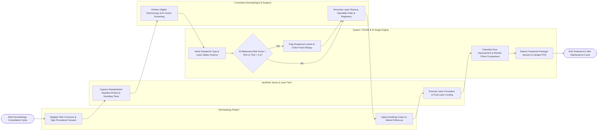

# Swimlane Diagram — Dermatology Clinic Management System

## Mermaid Code

## Flow Description | Mô tả luồng

| Lane | Actor / Subsystem | Role in Flow |
|------|-------------------|--------------|
| 1 | Dermatology Patient | Registers skin chief complaints, signs procedure-specific informed consents, receives topical numbing cream, attends treatment visits, and reviews photo comparisons. |
| 2 | Aesthetic Nurse & Laser Tech | Captures standardized baseline clinical photos, monitors topical numbing timers (30-45m), operates medical lasers/IPL under doctor orders, and logs post-laser cooling. |
| 3 | System / DCMS & AI Image Engine | Validates laser parameter fluence against Fitzpatrick skin safety limits, computes AI melanoma risk scores, renders before/after split-screen photo comparisons, and deducts package sessions. |
| 4 | Consultant Dermatologist & Surgeon | Conducts 100x digital dermoscopy, evaluates ABCD lesion criteria, prescribes laser parameters (J/cm²), maps facial injection grids (Botox/Filler), and performs Mohs surgeries. |
