# Action Tree — Dermatology Clinic Management System

## Mermaid Code

```mermaid
graph TD
    Root["Dermatology Clinic Management System"]

    Root --> M1["Patient Intake & Fitzpatrick Typing"]
    Root --> M2["Digital Dermoscopy & AI Lesion Screening"]
    Root --> M3["Laser & Energy-Based Device Logging"]
    Root --> M4["Aesthetic Injectables & Facial Mapping"]
    Root --> M5["Dermatopathology Biopsy & Mohs Surgery"]
    Root --> M6["Before & After Photo Studio"]
    Root --> M7["Cosmeceuticals POS & Packages"]
    Root --> M8["Teledermatology & Laser Safety"]

    M1 --> A11["Assess Fitzpatrick Skin Type I to VI"]
    M1 --> A12["Evaluate Glogau Photo-Aging Scale"]
    M1 --> A13["Score Global Acne Grading System GAGS"]
    M1 --> A14["Calculate Psoriasis Area Severity Index PASI"]

    M2 --> A21["Capture 100x Polarized Dermoscopy Images"]
    M2 --> A22["Map Pigmented Lesions on 3D Body Grid"]
    M2 --> A23["Calculate ABCD Dermoscopy Asymmetry Score"]
    M2 --> A24["Compute AI Deep-Learning Melanoma Risk Score"]

    M3 --> A31["Log CO2 Nd YAG & Pico Laser Parameters"]
    M3 --> A32["Validate Fluence J cm2 Fitzpatrick Safety Rules"]
    M3 --> A33["Record Laser Shot Counts & Handpiece Passes"]
    M3 --> A34["Log Post-Laser Cooling & Hydrogel Protocols"]

    M4 --> A41["Map Facial Injection Vector Grid Coordinates"]
    M4 --> A42["Log Botulinum Toxin Units per Muscle Group"]
    M4 --> A43["Log Hyaluronic Acid Dermal Filler Volume mL"]
    M4 --> A44["Record Injectable Product Brand Lot Numbers"]

    M5 --> A51["Request Punch Shave Excision Skin Biopsies"]
    M5 --> A52["Print Specimen Barcodes & Track Lab Status"]
    M5 --> A53["Map Mohs Surgery Stages & Frozen Section Margins"]
    M5 --> A54["Ingest Histopathology Report Diagnosis PDFs"]

    M6 --> A61["Capture Standardized Clinical Photos with Overlays"]
    M6 --> A62["Render Split-Screen Baseline vs Post Photo Studio"]
    M6 --> A63["Calculate Quantitative Scar Depth Reduction"]
    M6 --> A64["Export Branded Before After Photos to Portal"]

    M7 --> A71["Sell & Deduct Multi-Session Treatment Packages"]
    M7 --> A72["Prescribe Retinoids & Custom Cosmeceutical Skincare"]
    M7 --> A73["Process Retail Point-of-Sale Cosmeceutical Orders"]
    M7 --> A74["Track Topical Numbing Anesthesia Timer Safety"]

    M8 --> A81["Conduct Asynchronous Teledermatology Consultations"]
    M8 --> A82["Audit Laser Handpiece Shot Telemetry & Lifespan"]
    M8 --> A83["Verify Digital Procedural Informed Consent Forms"]
    M8 --> A84["Export Dermatology Financial & Clinical Analytics"]
```

## Module Description | Mô tả Module

| # | Module | Description | Actions |
|---|--------|-------------|---------|
| 1 | Patient Intake & Fitzpatrick Typing | Assesses Fitzpatrick skin types (I-VI), Glogau photo-aging scale, Global Acne Grading System (GAGS), and Psoriasis PASI scores. | Assess Fitzpatrick Skin Type I to VI, Evaluate Glogau Photo-Aging Scale, Score Global Acne Grading System GAGS, Calculate Psoriasis Area Severity Index PASI |
| 2 | Digital Dermoscopy & AI Lesion Screening | Captures 100x polarized dermoscopy images, maps lesions onto 3D body maps, calculates ABCD asymmetry criteria, and scores AI melanoma risk. | Capture 100x Polarized Dermoscopy Images, Map Pigmented Lesions on 3D Body Grid, Calculate ABCD Dermoscopy Asymmetry Score, Compute AI Deep-Learning Melanoma Risk Score |
| 3 | Laser & Energy-Based Device Logging | Logs medical laser parameters (CO2, Nd:YAG, Pico), validates fluence (J/cm²) against Fitzpatrick safety limits, tracks shot counts, and logs cooling. | Log CO2 Nd YAG & Pico Laser Parameters, Validate Fluence J cm2 Fitzpatrick Safety Rules, Record Laser Shot Counts & Handpiece Passes, Log Post-Laser Cooling & Hydrogel Protocols |
| 4 | Aesthetic Injectables & Facial Mapping | Maps facial injection vector grids, logs Botulinum Toxin units per muscle group, records HA Dermal Filler volume (mL), and tracks product lot numbers. | Map Facial Injection Vector Grid Coordinates, Log Botulinum Toxin Units per Muscle Group, Log Hyaluronic Acid Dermal Filler Volume mL, Record Injectable Product Brand Lot Numbers |
| 5 | Dermatopathology Biopsy & Mohs Surgery | Requests punch/shave biopsies, labels specimen barcodes, maps Mohs micrographic surgical stages/margins, and ingests histopathology report PDFs. | Request Punch Shave Excision Skin Biopsies, Print Specimen Barcodes & Track Lab Status, Map Mohs Surgery Stages & Frozen Section Margins, Ingest Histopathology Report Diagnosis PDFs |
| 6 | Before & After Photo Studio | Captures standardized clinical photos with grid overlays, renders split-screen comparisons, computes scar reduction %, and exports patient PDFs. | Capture Standardized Clinical Photos with Overlays, Render Split-Screen Baseline vs Post Photo Studio, Calculate Quantitative Scar Depth Reduction, Export Branded Before After Photos to Portal |
| 7 | Cosmeceuticals POS & Packages | Sells and auto-deducts multi-session laser packages, prescribes cosmeceutical skincare regimens, processes POS sales, and tracks numbing timers. | Sell & Deduct Multi-Session Treatment Packages, Prescribe Retinoids & Custom Cosmeceutical Skincare, Process Retail Point-of-Sale Cosmeceutical Orders, Track Topical Numbing Anesthesia Timer Safety |
| 8 | Teledermatology & Laser Safety | Conducts asynchronous teledermatology photo consultations, audits laser handpiece shot telemetry, verifies digital consents, and exports analytics. | Conduct Asynchronous Teledermatology Consultations, Audit Laser Handpiece Shot Telemetry & Lifespan, Verify Digital Procedural Informed Consent Forms, Export Dermatology Financial & Clinical Analytics |
