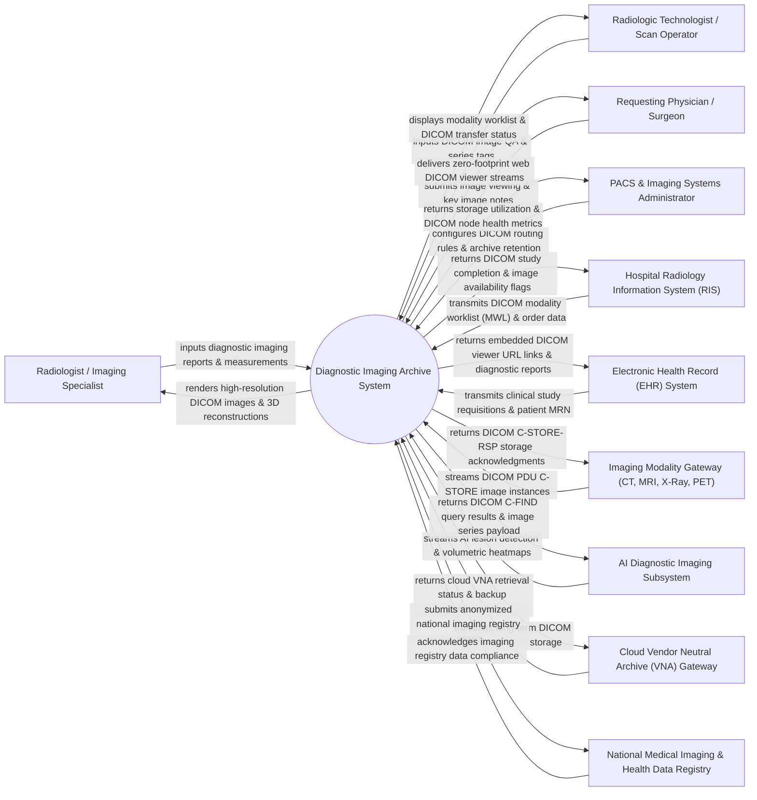

# Context Diagram — Diagnostic Imaging Archive System

## Mermaid Code

## Actor & Interaction Table | Bảng Actor & Tương tác

| # | Actor | Actor Type | Data Sent TO System | Data Received FROM System | Notes |
|---|-------|------------|---------------------|---------------------------|-------|
| 1 | Radiologist / Imaging Specialist | Primary | Diagnostic imaging findings, key image bookmarks, 3D multi-planar reconstructions (MPR), CAD annotations, electronic report sign-offs. | High-resolution 2D/3D DICOM image series, prior imaging study comparison, hanging protocols, window/level presets, AI CAD overlays. | Certified physician specializing in interpreting diagnostic imaging studies (CT, MRI, Mammography, PET, X-Ray). |
| 2 | Radiologic Technologist / Scan Operator | Primary | Scan quality control (QC) status, image rejection notes, patient positioning tags, contrast media injection logs. | Modality Worklist (MWL) order details, DICOM storage transfer confirmation status, image acquisition QA feedback. | Technical operator executing imaging acquisitions on scanner hardware (CT, MRI, Ultrasound, Digital Radiography). |
| 3 | Requesting Physician / Surgeon | Primary | Image access requests, clinical history queries, surgical planning key image requests, 3D printing export tasks. | Zero-footprint web DICOM image stream, key image snapshots, radiologist diagnostic reports, 3D anatomical models. | Attending physician or surgeon accessing diagnostic images for clinical treatment and surgical planning. |
| 4 | PACS & Imaging Systems Administrator | Primary | DICOM C-STORE/C-FIND routing rules, storage tier policies (Hot/Warm/Cold), user access permissions, compression settings. | Storage capacity utilization metrics, DICOM network node health status, study migration logs, DICOM audit trails. | IT administrator managing Picture Archiving and Communication System (PACS) infrastructure, VNAs, and storage nodes. |
| 5 | Hospital Radiology Information System (RIS) | Supporting | DICOM Modality Worklist (MWL) payloads, accession numbers, patient demographics, study priority flags. | DICOM Study Content Notification (SCN), DICOM MPPS (Modality Performed Procedure Step) status, image availability alerts. | Enterprise RIS software managing radiology ordering, scheduling, technician workflow, and reporting. |
| 6 | Electronic Health Record (EHR) System | Supporting | Patient master index (MPI), clinical encounter history, radiology requisitions, pre-op clinical notes. | Embedded zero-footprint web viewer URL links, finalized radiology reports, critical imaging findings alerts. | Hospital EHR system integrated via HL7 and FHIR ImagingStudy resource APIs for seamless image launch. |
| 7 | Imaging Modality Gateway (CT, MRI, X-Ray, PET) | Supporting | DICOM PDU C-STORE image instances (CT slices, MRI series, Digital X-Rays, PET-CT volumes), DICOM header tags. | DICOM C-STORE-RSP storage acknowledgments, DICOM MWL query responses. | Hardware imaging scanner modalities transmitting standardized DICOM image files over TCP/IP network. |
| 8 | AI Diagnostic Imaging Subsystem | Supporting | AI-assisted CAD findings (pulmonary nodule detection, intracranial hemorrhage flags, bone fracture probability, tumor volume). | DICOM C-FIND query results, anonymized image series payloads for AI model processing. | Deep learning AI engine performing automated triage, lesion detection, and quantitative image analysis. |
| 9 | Cloud Vendor Neutral Archive (VNA) Gateway | Supporting | Cloud VNA retrieval responses, disaster recovery backup acknowledgments, lifecycle tier migration statuses. | Long-term DICOM study archiving payloads (compressed JPEG2000 / HTJ2K DICOM files), cross-enterprise document sharing (XDS-I). | Enterprise Cloud VNA platform providing vendor-independent, long-term DICOM storage and disaster recovery. |
| 10 | National Medical Imaging & Health Data Registry | Supporting / Regulatory | Mandated imaging data standards, radiation dose registry schemas, national cancer screening guidelines. | Anonymized population imaging dose statistics, lung cancer screening registry reports, mammography audit benchmarks. | Government public health organization tracking diagnostic imaging quality, safety, and radiation dose compliance. |

## System Boundary Description | Mô tả Phạm vi Hệ thống

The **Diagnostic Imaging Archive System (DIAS)** is an enterprise Picture Archiving and Communication System (PACS) and Vendor Neutral Archive (VNA) platform designed to ingest, store, route, display, and manage high-volume DICOM diagnostic imaging studies across healthcare networks.

**Inside System Scope:**
- Ingestion of multi-modality DICOM image instances (CT, MRI, X-Ray, Ultrasound, PET-CT, Mammography) via DICOM C-STORE network services.
- Multi-tier DICOM storage lifecycle management (Hot NVMe storage, Warm NAS storage, Cold Cloud VNA archival).
- Advanced diagnostic web viewer providing hanging protocols, multi-planar reconstruction (MPR), maximum intensity projection (MIP), and 3D volume rendering.
- Integration with AI Diagnostic Subsystems for automated triage, pulmonary nodule detection, and hemorrhage flagging.
- Zero-footprint web viewer integration with EHR/RIS systems via DICOMweb (WADO-RS, QIDO-RS, STOW-RS) and HL7 FHIR interfaces.

**Outside System Scope:**
- Physical hardware sensing and X-ray tube/gradient coil voltage generation (handled by Scanner Modality hardware).
- Physical maintenance of optical glass monitors or diagnostic display hardware calibration (managed by IT display engineers).
- Direct billing processing for radiology technical fees (delegated to Patient Billing Systems).
