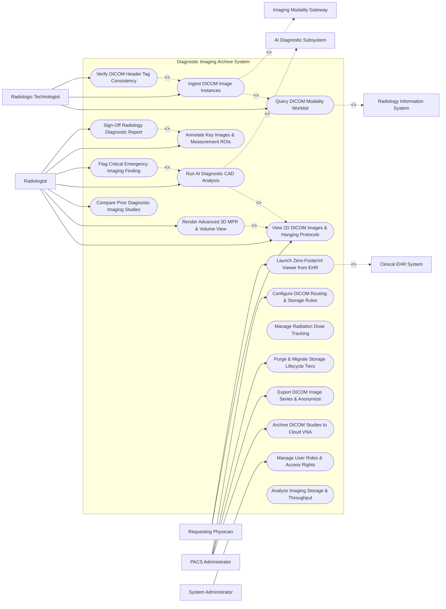

# Use Case Diagram — Diagnostic Imaging Archive System

## Mermaid Code

## Actor Table | Bảng Actor

| # | Actor | Actor Type | Role Description | Related Use Cases |
|---|-------|------------|------------------|-------------------|
| 1 | Radiologic Technologist | Primary | Scan operator querying worklists, transmitting scanned images, and verifying DICOM metadata. | UC01, UC02, UC03 |
| 2 | Radiologist | Primary | Specialist interpreting DICOM images, analyzing 3D renders, using AI CAD overlays, and signing reports. | UC04, UC05, UC06, UC07, UC08, UC09, UC10 |
| 3 | Requesting Physician | Primary | Attending physician or surgeon reviewing diagnostic images and viewing key images via zero-footprint web viewer. | UC04, UC11 |
| 4 | PACS Administrator | Primary | IT manager configuring DICOM routing rules, Cloud VNA archival, storage tier migration, and DICOM anonymization. | UC12, UC14, UC15, UC17 |
| 5 | System Administrator | Primary | IT administrative user managing security roles, user permissions, and network node configurations. | UC16 |
| 6 | Radiology Information System | System (Secondary) | Hospital RIS sending Modality Worklist (MWL) orders and receiving study completion events. | UC01 |
| 7 | Imaging Modality Gateway | System (Secondary) | Scanner hardware (CT, MRI, X-Ray, PET) transmitting DICOM C-STORE image instances. | UC02 |
| 8 | AI Diagnostic Subsystem | System (Secondary) | Deep learning CAD engine detecting nodules, hemorrhages, and fractures on DICOM image series. | UC07 |
| 9 | Clinical EHR System | System (Secondary) | Hospital EHR launching zero-footprint web image viewer links and displaying final radiology reports. | UC11 |

## Use Case Table | Bảng Use Case

| # | UC ID | Use Case Name | Primary Actor | Secondary Actor | Description | Priority |
|---|-------|---------------|---------------|-----------------|-------------|----------|
| 1 | UC01 | Query DICOM Modality Worklist | RadTech | RIS | Queries the RIS Modality Worklist (MWL) to populate patient demographics on scanner console. | High |
| 2 | UC02 | Ingest DICOM Image Instances | RadTech | Modality Gateway | Ingests DICOM PDU C-STORE image series (CT, MRI, X-Ray) from scanner modalities into PACS buffer. | High |
| 3 | UC03 | Verify DICOM Header Tag Consistency | RadTech | None | Validates DICOM header metadata (Patient ID, Accession No, Modality Type, Frame of Reference UID). | High |
| 4 | UC04 | View 2D DICOM Images & Hanging Protocols | Radiologist | None | Renders 2D DICOM slices with specialized hanging protocols, window/level presets, and pan/zoom. | High |
| 5 | UC05 | Render Advanced 3D MPR & Volume View | Radiologist | None | Performs Multi-Planar Reconstruction (MPR: Axial, Sagittal, Coronal), MIP, and 3D Volume Rendering. | High |
| 6 | UC06 | Compare Prior Diagnostic Imaging Studies | Radiologist | None | Renders current and historical imaging studies side-by-side with synchronized viewport panning. | High |
| 7 | UC07 | Run AI Diagnostic CAD Analysis | Radiologist | AI Subsystem | Processes DICOM series through deep learning AI models to detect nodules, hemorrhages, and fractures. | High |
| 8 | UC08 | Flag Critical Emergency Imaging Finding | Radiologist | None | Triggers urgent critical alert (e.g., Acute Intracranial Hemorrhage) sent immediately to ordering doctor. | Critical |
| 9 | UC10 | Sign-Off Radiology Diagnostic Report | Radiologist | None | Applies digital signature to diagnostic report, locks case, and dispatches report to RIS and EHR. | High |
| 10 | UC09 | Annotate Key Images & Measurement ROIs | Radiologist | None | Draws Regions of Interest (ROIs), SUV measurements, linear distances, and saves DICOM Key Object Selection (KOS). | High |
| 11 | UC11 | Launch Zero-Footprint Viewer from EHR | Physician | Clinical EHR | Launches web-based zero-footprint DICOM image viewer directly from EHR patient chart using WADO-RS. | High |
| 12 | UC12 | Archive DICOM Studies to Cloud VNA | PACSAdmin | None | Migrates inactive DICOM studies to long-term Cloud Vendor Neutral Archive (VNA) for cold storage. | Medium |
| 13 | UC13 | Manage Radiation Dose Tracking | PACSAdmin | None | Ingests DICOM Radiation Dose Structured Reports (RDSR) to track cumulative patient radiation exposure. | Medium |
| 14 | UC14 | Export DICOM Image Series & Anonymize | PACSAdmin | None | Exports DICOM studies to external media/cloud while stripping Patient PII tags for research anonymization. | Medium |
| 15 | UC15 | Purge & Migrate Storage Lifecycle Tiers | PACSAdmin | None | Executes automated storage tier policies, moving studies from NVMe hot storage to NAS warm storage. | Medium |
| 16 | UC16 | Manage User Roles & Access Rights | Admin | None | Configures user accounts, RBAC permissions, and diagnostic vs. clinical viewing access rights. | High |
| 17 | UC17 | Configure DICOM Routing & Storage Rules | PACSAdmin | None | Configures DICOM C-STORE routing nodes, auto-forwarding rules, and DICOM AE Title mappings. | High |
| 18 | UC18 | Analyze Imaging Storage & Throughput | System | None | Computes daily image ingestion volumes (Gigabytes/Day), study completion rates, and storage forecasts. | Medium |

## Use Case Specification | Đặc tả Use Case

---

### UC02 — Ingest DICOM Image Instances

| Field | Detail |
|-------|--------|
| **UC ID** | UC02 |
| **Use Case Name** | Ingest DICOM Image Instances |
| **Actor(s)** | Primary: Radiologic Technologist / Scan Operator   Secondary: Imaging Modality Gateway |
| **Description** | Receives standardized DICOM image series (CT slices, MRI volumes, Digital X-Rays) transmitted over TCP/IP DICOM C-STORE protocol, validates transfer integrity, and indexes images in PACS storage. |
| **Precondition** | 1. Imaging modality is configured with PACS AE Title, IP Address, and Port.   2. Patient scan is completed on scanner console. |
| **Main Flow** | 1. Modality Gateway initiates DICOM Association Request (A-ASSOCIATE-RQ) with PACS server.   2. PACS server accepts association (A-ASSOCIATE-AC) matching AE Title.   3. Modality Gateway streams DICOM PDU C-STORE image instances (e.g., 500 CT slice files).   4. System ingests DICOM files, parses DICOM header tags (SOP Instance UID, Study Instance UID, Series Instance UID), and checks file integrity.   5. System indexes study into PACS database linked to Accession Number and Patient ID.   6. System sends DICOM C-STORE-RSP success status (`0x0000 SUCCESS`) back to modality gateway for each instance.   7. System releases DICOM association (A-RELEASE-RQ) and updates study status to `INGESTED_READY`. |
| **Alternative Flow** | **AF1** — Compressed Lossless DICOM Transfer: Modality transmits JPEG2000 Lossless or High-Throughput JPEG2000 (HTJ2K) compressed DICOM instances; System decompresses or indexes compressed payload directly to optimize bandwidth. |
| **Exception Flow** | **EX1** — DICOM Transfer Abort: Network disconnect occurs mid-transfer; System logs "C-STORE Transfer Abort", flags study as `PARTIALLY_INGESTED`, and waits for modality re-transmission.   **EX2** — Storage Disk Full: Hot storage tier reaches 98% capacity; System triggers emergency storage purge rule (UC15), moves oldest cached studies to warm storage, and ingests incoming study. |
| **Postcondition** | DICOM study is indexed in PACS database, storage receipt is confirmed, and images are available for radiologist review (UC04). |
| **Business Rule** | **BR1**: DICOM C-STORE ingest must enforce strict DICOM Part 10 compliance and verify SOP Instance UID uniqueness. |

---

### UC05 — Render Advanced 3D MPR & Volume View

| Field | Detail |
|-------|--------|
| **UC ID** | UC05 |
| **Use Case Name** | Render Advanced 3D MPR & Volume View |
| **Actor(s)** | Primary: Radiologist / Imaging Specialist   Secondary: None |
| **Description** | Reconstructs 3D volumetric DICOM datasets (CT/MRI) into Multi-Planar Reconstructions (Axial, Coronal, Sagittal views), Maximum Intensity Projections (MIP), and 3D color volume renderings. |
| **Precondition** | 1. High-resolution thin-slice CT or MRI DICOM dataset is loaded in diagnostic viewer (UC04). |
| **Main Flow** | 1. Radiologist selects "3D MPR / Volume Reconstruct" tool on viewer toolbar.   2. System fetches thin-slice DICOM volume dataset (e.g., 0.625mm CT Chest slices).   3. System builds 3D isotropic spatial matrix from DICOM slice locations and pixel spacings.   4. System renders synchronized 3x3 viewport layout displaying:   &nbsp;&nbsp;&nbsp;&nbsp; a. Axial view (Transverse).   &nbsp;&nbsp;&nbsp;&nbsp; b. Coronal view (Frontal).   &nbsp;&nbsp;&nbsp;&nbsp; c. Sagittal view (Side profile).   &nbsp;&nbsp;&nbsp;&nbsp; d. 3D Volume Rendered anatomical model.   5. Radiologist drags crosshair cursor in Axial view; System dynamically updates orthogonal Coronal and Sagittal views in real time.   6. Radiologist applies Maximum Intensity Projection (MIP) to visualize pulmonary nodules or vascular CT angiograms.   7. Radiologist saves 3D reconstruction key images into study series. |
| **Alternative Flow** | **AF1** — Cardiac Calcium Scoring 3D View: Radiologist selects "Cardiac Calcium Score" preset; System segments coronary arteries in 3D, calculates Agatston score, and color-codes calcium deposits. |
| **Exception Flow** | **EX1** — Non-Isotropic Thick Slices: Dataset contains 5mm thick slices, resulting in blurry 3D reconstruction; System displays warning "Suboptimal Slice Thickness (> 2mm) for 3D MPR" and applies anti-aliasing interpolation filter. |
| **Postcondition** | 3D MPR view is rendered, orthogonal crosshair navigation is active, and 3D key images are saved to study series. |
| **Business Rule** | **BR1**: 3D MPR spatial alignment must recalculate crosshair coordinates using exact DICOM `Image Position (Patient)` and `Image Orientation (Patient)` header vectors. |

---

### UC07 — Run AI Diagnostic CAD Analysis

| Field | Detail |
|-------|--------|
| **UC ID** | UC07 |
| **Use Case Name** | Run AI Diagnostic CAD Analysis |
| **Actor(s)** | Primary: Radiologist / Imaging Specialist   Secondary: AI Diagnostic Subsystem |
| **Description** | Sends DICOM image series to deep learning AI CAD models to detect abnormalities (pulmonary nodules, intracranial hemorrhage, fractures, mammography lesions) and displays AI overlay bounding boxes. |
| **Precondition** | 1. DICOM image series is ingested and indexed in PACS (UC02).   2. AI CAD model service is online. |
| **Main Flow** | 1. System automatically dispatches newly ingested DICOM study to AI Diagnostic Subsystem based on study modality and body part (e.g., Non-Contrast Head CT -> Intracranial Hemorrhage AI Model).   2. AI Diagnostic Subsystem executes deep convolutional neural network (CNN) inference on image slices.   3. AI Subsystem identifies a suspect lesion (e.g., 6mm solid pulmonary nodule in Right Upper Lobe with 88% probability).   4. AI Subsystem returns DICOM Structured Report (SR) and Secondary Capture overlay series to PACS.   5. Radiologist opens study in diagnostic viewer; System displays "AI Findings Available" badge.   6. Radiologist toggles "AI CAD Overlay" on viewport; System draws color-coded bounding boxes and probability scores over suspect lesions.   7. Radiologist inspects AI finding, accepts or rejects AI annotation, and incorporates confirmed finding into diagnostic report. |
| **Alternative Flow** | **AF1** — Triage Priority Escalation: AI detects acute Intracranial Hemorrhage on Head CT; AI Subsystem immediately elevates study priority to top of Radiologist reading list and triggers UC08 (Critical Emergency Finding). |
| **Exception Flow** | **EX1** — AI Model Service Timeout: AI Subsystem takes > 60 seconds due to server load; System bypasses AI overlay delay, presents raw DICOM study to Radiologist immediately, and updates AI status to `PENDING_BACKGROUND`. |
| **Postcondition** | AI CAD findings are generated, visual overlays are presented to Radiologist, and confirmed AI metrics are saved. |
| **Business Rule** | **BR1**: AI CAD findings are computer-assisted prompts only and must be confirmed or rejected by a licensed Radiologist. |

---

### UC10 — Sign-Off Radiology Diagnostic Report

| Field | Detail |
|-------|--------|
| **UC ID** | UC10 |
| **Use Case Name** | Sign-Off Radiology Diagnostic Report |
| **Actor(s)** | Primary: Radiologist / Imaging Specialist   Secondary: None |
| **Description** | Verifies complete diagnostic radiology report (Clinical History, Examination Technique, Comparison, Findings, Impression), applies cryptographic digital signature, and locks case file. |
| **Precondition** | 1. Radiologist has completed image interpretation (UC04) and drafted diagnostic report text.   2. Radiologist holds active digital signing certificate. |
| **Main Flow** | 1. Radiologist completes typing or dictating Findings and Impression sections in report editor.   2. Radiologist attaches annotated Key Images (UC09) to report.   3. Radiologist clicks "Sign & Authorize Report".   4. System validates mandatory report fields (Modality, Exam Type, Impression text).   5. Radiologist enters digital signature PIN.   6. System generates cryptographic digital signature hash, embeds signature block, locks report from further edits, and sets report status to `FINAL_SIGNED`.   7. System dispatches HL7 ORU result message containing report text and DICOMweb WADO URL link to RIS and EHR systems (UC14). |
| **Alternative Flow** | **AF1** — Preliminary Sign-Off by Resident: Radiology Resident signs preliminary report `PRELIMINARY_SIGNED`; System routes report to Attending Radiologist queue for mandatory final co-signature. |
| **Exception Flow** | **EX1** — Report Amendment: Radiologist receives additional clinical info post-signature; Radiologist selects "Create Addendum", enters supplemental text, re-signs, and System releases `FINAL_AMENDED` report version. |
| **Postcondition** | Diagnostic report is cryptographically signed and locked, RIS/EHR systems receive final report, and study status changes to `COMPLETED`. |
| **Business Rule** | **BR1**: Final signed radiology reports cannot be overwritten; any alterations must be appended as timestamped addenda with new digital signatures. |

---

### UC12 — Archive DICOM Studies to Cloud VNA

| Field | Detail |
|-------|--------|
| **UC ID** | UC12 |
| **Use Case Name** | Archive DICOM Studies to Cloud VNA |
| **Actor(s)** | Primary: PACS Administrator   Secondary: None |
| **Description** | Migrates completed DICOM imaging studies from local hot PACS storage tiers to long-term Cloud Vendor Neutral Archive (VNA) storage following automated lifecycle retention rules. |
| **Precondition** | 1. DICOM study status is `FINAL_SIGNED` and study age exceeds local hot cache retention period (e.g., > 30 days old).   2. Cloud VNA storage gateway is connected via secure HTTPS/DICOMweb connection. |
| **Main Flow** | 1. System background Storage Lifecycle Manager evaluates study age and access frequency rules.   2. System identifies candidate studies for long-term archiving (e.g., signed CT studies older than 30 days).   3. System applies HTJ2K / JPEG2000 lossless compression to DICOM pixel data to reduce transfer payload.   4. System transmits compressed DICOM study package over DICOMweb STOW-RS API to Cloud VNA.   5. Cloud VNA ingests payload, stores data across geographically redundant cloud storage tiers, and returns a STOW-RS HTTP `200 OK` success response with VNA Study Instance UID.   6. System updates PACS database location index to `ARCHIVED_CLOUD_VNA`.   7. System purges local pixel data from local hot NVMe cache while retaining fast metadata index for rapid searching. |
| **Alternative Flow** | **AF1** — On-Demand Auto-Retrieve (Prefetch): Patient is scheduled for new MRI scan; System queries Cloud VNA, automatically prefetches prior archived MRI study back into hot PACS cache 12 hours before scheduled scan time. |
| **Exception Flow** | **EX1** — Cloud Network Transfer Error: Network outage interrupts Cloud VNA upload; System flags transfer error, retries upload after 15 minutes, and retains local study copy until cloud receipt is verified. |
| **Postcondition** | DICOM study is securely archived in Cloud VNA, local hot cache disk space is reclaimed, and DICOM index remains searchable. |
| **Business Rule** | **BR1**: Diagnostic imaging studies must be retained in VNA storage for a minimum of 7 years (and until age 21 for pediatric patients) in compliance with HIPAA retention laws. |
