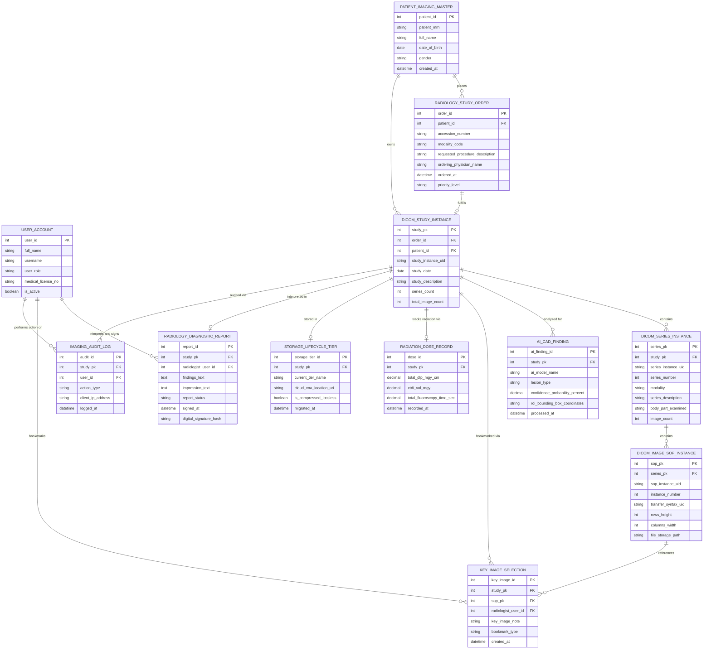

# Conceptual ERD — Diagnostic Imaging Archive System

## Mermaid Code

## Entity Description Table | Bảng mô tả Entity

| # | Entity Name | Vietnamese Name | Description | Key Attributes | Main Relationships |
|---|-------------|-----------------|-------------|----------------|-------------------|
| 1 | USER_ACCOUNT | Tài khoản Nguời dùng | Credentials and access permissions for radiologists, radiologic technologists, physicians, and PACS admins. | `user_id`, `username`, `user_role`, `medical_license_no` | Interprets and signs `RADIOLOGY_DIAGNOSTIC_REPORT`, bookmarks `KEY_IMAGE_SELECTION`, performs `IMAGING_AUDIT_LOG`. |
| 2 | PATIENT_IMAGING_MASTER | Sổ Master Chẩn đoán Hình ảnh | Master patient demographic and medical record index for imaging studies. | `patient_id`, `patient_mrn`, `full_name`, `date_of_birth`, `gender` | Places `RADIOLOGY_STUDY_ORDER`, owns `DICOM_STUDY_INSTANCE`. |
| 3 | RADIOLOGY_STUDY_ORDER | Đơn Đặt Hàng Chẩn đoán | Order requisition created in RIS/EHR containing Accession Number, Modality type, and exam description. | `order_id`, `patient_id`, `accession_number`, `modality_code`, `ordering_physician_name` | Belongs to `PATIENT_IMAGING_MASTER`, fulfills `DICOM_STUDY_INSTANCE`. |
| 4 | DICOM_STUDY_INSTANCE | Nghiên cứu Hình ảnh DICOM | Top-level DICOM Study entity representing a complete imaging session (e.g., CT Chest/Abdomen). | `study_pk`, `patient_id`, `study_instance_uid`, `study_date`, `study_description` | Fulfills `RADIOLOGY_STUDY_ORDER`, contains `DICOM_SERIES_INSTANCE`, summarized in `RADIOLOGY_DIAGNOSTIC_REPORT`. |
| 5 | DICOM_SERIES_INSTANCE | Chuỗi Hình ảnh DICOM | Sub-grouping of DICOM images sharing same modality, acquisition plane, or pulse sequence (e.g., Axial T1 MRI series). | `series_pk`, `study_pk`, `series_instance_uid`, `series_number`, `modality`, `body_part_examined` | Belongs to `DICOM_STUDY_INSTANCE`, contains `DICOM_IMAGE_SOP_INSTANCE`. |
| 6 | DICOM_IMAGE_SOP_INSTANCE | Thể hiện DICOM (SOP) | Individual 2D image slice file storing pixel matrix, spatial position coordinates, and DICOM header tags. | `sop_pk`, `series_pk`, `sop_instance_uid`, `instance_number`, `file_storage_path` | Belongs to `DICOM_SERIES_INSTANCE`, referenced by `KEY_IMAGE_SELECTION`. |
| 7 | AI_CAD_FINDING | Kết quả AI Chẩn đoán | Deep learning AI CAD lesion detection outputs, probability scores, and ROI bounding box coordinates. | `ai_finding_id`, `study_pk`, `ai_model_name`, `lesion_type`, `confidence_probability_percent` | Belongs to `DICOM_STUDY_INSTANCE`. |
| 8 | KEY_IMAGE_SELECTION | Ảnh Chìa khóa Đánh dấu | Radiologist-selected key image snapshots, annotated ROIs, and Key Object Selection (KOS) entries. | `key_image_id`, `study_pk`, `sop_pk`, `radiologist_user_id`, `key_image_note` | Relates `DICOM_STUDY_INSTANCE` and `DICOM_IMAGE_SOP_INSTANCE`. |
| 9 | RADIATION_DOSE_RECORD | Nhật ký Liều Lượng Bức xạ | Radiation Dose Structured Report (RDSR) metrics tracking Dose Length Product (DLP) and CTDIvol. | `dose_id`, `study_pk`, `total_dlp_mgy_cm`, `ctdi_vol_mgy`, `recorded_at` | Belongs to `DICOM_STUDY_INSTANCE`. |
| 10 | STORAGE_LIFECYCLE_TIER | Tầng Vòng đời Lưu trữ | Storage tier management status tracking Hot NVMe, Warm NAS, and Cold Cloud VNA archival URIs. | `storage_tier_id`, `study_pk`, `current_tier_name`, `cloud_vna_location_uri`, `is_compressed_lossless` | Belongs to `DICOM_STUDY_INSTANCE`. |
| 11 | RADIOLOGY_DIAGNOSTIC_REPORT | Báo cáo Chẩn đoán Hình ảnh | Finalized, digitally signed radiology report containing findings text, impression text, and sign-off timestamp. | `report_id`, `study_pk`, `radiologist_user_id`, `findings_text`, `impression_text`, `signed_at` | Belongs to `DICOM_STUDY_INSTANCE`, signed by `USER_ACCOUNT`. |
| 12 | IMAGING_AUDIT_LOG | Nhật ký Kiểm toán DICOM | HIPAA compliance audit trail logging every image view, export, print, and query action with IP address. | `audit_id`, `study_pk`, `user_id`, `action_type`, `client_ip_address`, `logged_at` | Relates `DICOM_STUDY_INSTANCE` and `USER_ACCOUNT`. |

## Relationship Description | Mô tả Quan hệ

| # | From Entity | Cardinality | To Entity | Label | Business Explanation |
|---|-------------|-------------|-----------|-------|----------------------|
| 1 | PATIENT_IMAGING_MASTER | 1 to 0..N | RADIOLOGY_STUDY_ORDER | places | A patient places radiology study orders in the system. |
| 2 | PATIENT_IMAGING_MASTER | 1 to 0..N | DICOM_STUDY_INSTANCE | owns | A patient owns multiple DICOM study instances over time. |
| 3 | RADIOLOGY_STUDY_ORDER | 1 to 0..1 | DICOM_STUDY_INSTANCE | fulfills | A radiology study order is fulfilled by a completed DICOM study instance. |
| 4 | DICOM_STUDY_INSTANCE | 1 to 1..N | DICOM_SERIES_INSTANCE | contains | A DICOM study instance contains one or more DICOM series instances. |
| 5 | DICOM_SERIES_INSTANCE | 1 to 1..N | DICOM_IMAGE_SOP_INSTANCE | contains | A DICOM series instance contains multiple individual DICOM SOP image slice files. |
| 6 | DICOM_STUDY_INSTANCE | 1 to 0..N | AI_CAD_FINDING | analyzed for | A DICOM study instance is analyzed for deep learning AI CAD findings. |
| 7 | DICOM_STUDY_INSTANCE | 1 to 0..N | KEY_IMAGE_SELECTION | bookmarked via | A DICOM study instance has radiologist-selected key images bookmarked. |
| 8 | DICOM_IMAGE_SOP_INSTANCE | 1 to 0..N | KEY_IMAGE_SELECTION | references | A key image selection references a specific DICOM SOP image slice. |
| 9 | DICOM_STUDY_INSTANCE | 1 to 0..1 | RADIATION_DOSE_RECORD | tracks radiation via | A DICOM study tracks patient radiation dose exposure via RDSR records. |
| 10 | DICOM_STUDY_INSTANCE | 1 to 0..1 | STORAGE_LIFECYCLE_TIER | stored in | A DICOM study is stored in a specific storage lifecycle tier (Hot/Warm/Cloud VNA). |
| 11 | DICOM_STUDY_INSTANCE | 1 to 0..1 | RADIOLOGY_DIAGNOSTIC_REPORT | interpreted in | A DICOM study instance is interpreted in a final signed radiology diagnostic report. |
| 12 | DICOM_STUDY_INSTANCE | 1 to 0..N | IMAGING_AUDIT_LOG | audited via | All user access actions on a DICOM study are logged in imaging audit logs. |
| 13 | USER_ACCOUNT | 1 to 0..N | RADIOLOGY_DIAGNOSTIC_REPORT | interprets and signs | A radiologist user account interprets and signs final diagnostic reports. |
| 14 | USER_ACCOUNT | 1 to 0..N | KEY_IMAGE_SELECTION | bookmarks | A radiologist user account bookmarks key image snapshots. |
| 15 | USER_ACCOUNT | 1 to 0..N | IMAGING_AUDIT_LOG | performs action on | A user account performs view/export actions tracked in audit logs. |
