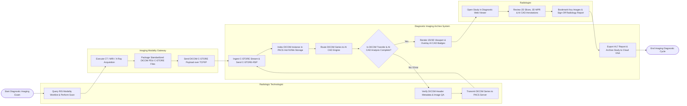

# Swimlane Diagram — Diagnostic Imaging Archive System

## Mermaid Code

## Flow Description | Mô tả luồng

| Lane | Actor | Role in Flow |
|------|-------|-------------|
| 1 | Radiologic Technologist | Queries RIS Modality Worklists, performs imaging scan, verifies DICOM metadata consistency, and initiates C-STORE transfer. |
| 2 | Imaging Modality Gateway | Executes physical CT/MRI/X-Ray image acquisition, packages standardized DICOM PDU files, and streams C-STORE instance data over TCP/IP network. |
| 3 | Diagnostic Imaging Archive System | Ingests DICOM C-STORE streams, sends DICOM storage acknowledgments, indexes DICOM headers in hot NVMe storage, routes images to AI CAD engines, renders 2D/3D viewports, dispatches signed reports, and archives studies to Cloud VNA. |
| 4 | Radiologist | Opens studies in diagnostic web viewports, evaluates 2D/3D MPR reconstructions, inspects AI CAD overlays, bookmarks key images, and signs radiology diagnostic reports. |
