# Action Tree — Diagnostic Imaging Archive System

## Mermaid Code

```mermaid
graph TD
    Root["Diagnostic Imaging Archive System"]

    Root --> M1["DICOM Ingestion & Worklist Integration"]
    Root --> M2["Diagnostic 2D/3D Web Viewing"]
    Root --> M3["AI CAD & Automated Triage"]
    Root --> M4["Diagnostic Reporting & Critical Alerts"]
    Root --> M5["Multi-Tier Storage & Cloud VNA Archiving"]
    Root --> M6["System Administration & Compliance"]

    M1 --> A11["Query RIS DICOM Modality Worklist (MWL)"]
    M1 --> A12["Ingest DICOM PDU C-STORE Image Instances"]
    M1 --> A13["Verify DICOM Header Metadata Consistency"]
    M1 --> A14["Perform Lossless HTJ2K Image Compression"]

    M2 --> A21["Render 2D Slices with Hanging Protocols"]
    M2 --> A22["Perform 3D Multi-Planar Reconstruction (MPR)"]
    M2 --> A23["Generate 3D Maximum Intensity Projections (MIP)"]
    M2 --> A24["Compare Current vs. Historic Baseline Studies"]

    M3 --> A31["Dispatch DICOM Series to AI Deep Learning Engines"]
    M3 --> A32["Detect Pulmonary Nodules & Bone Fractures"]
    M3 --> A33["Overlay AI CAD Bounding Boxes & Probabilities"]
    M3 --> A34["Elevate High-Risk Scans to Top of Reading Queue"]

    M4 --> A41["Draw Key Image ROIs & SUV Measurements"]
    M4 --> A42["Flag Emergency Critical Imaging Findings"]
    M4 --> A43["Draft CAP Synoptic Radiology Reports"]
    M4 --> A44["Apply Cryptographic Digital Signatures to Reports"]

    M5 --> A51["Manage Hot NVMe & Warm NAS Storage Tiers"]
    M5 --> A52["Archive Long-Term DICOM Studies to Cloud VNA"]
    M5 --> A53["Prefetch Prior Studies for Scheduled Scans"]
    M5 --> A54["Execute DICOM Study Anonymization for Research"]

    M6 --> A61["Configure DICOM C-STORE AE Title Routing Nodes"]
    M6 --> A62["Track Patient Radiation Dose Records (RDSR)"]
    M6 --> A63["Log HIPAA-Compliant Image Access Audit Trails"]
    M6 --> A64["Analyze Storage Capacity & Ingestion Throughput"]
```

## Module Description | Mô tả Module

| # | Module | Description | Actions |
|---|--------|-------------|---------|
| 1 | DICOM Ingestion & Worklist Integration | Handles RIS Modality Worklist (MWL) queries, DICOM C-STORE image ingests, header tag validation, and HTJ2K lossless compression. | Query Modality Worklist, Ingest DICOM C-STORE Images, Verify DICOM Header Tags, Perform Lossless Compression. |
| 2 | Diagnostic 2D/3D Web Viewing | Renders 2D DICOM viewports with hanging protocols, 3D Multi-Planar Reconstructions (MPR), MIP projections, and prior study side-by-side comparisons. | Render 2D Slices, Perform 3D MPR Reconstructions, Generate MIP Projections, Compare Prior Studies. |
| 3 | AI CAD & Automated Triage | Routes DICOM series to AI engines, detects nodules/fractures, overlays AI bounding boxes, and escalates high-risk cases on radiologist reading lists. | Dispatch Series to AI Engines, Detect Nodules & Fractures, Overlay AI Bounding Boxes, Elevate High-Risk Scans. |
| 4 | Diagnostic Reporting & Critical Alerts | Facilitates key image annotations, critical emergency finding alerts, CAP synoptic report drafting, and cryptographic digital signatures. | Draw Key Image ROIs, Flag Critical Emergency Findings, Draft Synoptic Reports, Apply Digital Signatures. |
| 5 | Multi-Tier Storage & Cloud VNA Archiving | Manages hot/warm PACS storage tiers, Cloud VNA cold archiving, prior study prefetching, and study anonymization for research. | Manage Hot/Warm Storage Tiers, Archive Studies to Cloud VNA, Prefetch Prior Studies, Execute Study Anonymization. |
| 6 | System Administration & Compliance | Configures DICOM AE Title routing nodes, monitors radiation dose tracking (RDSR), logs HIPAA audit trails, and analyzes PACS throughput. | Configure DICOM Routing Nodes, Track Radiation Dose Records, Log HIPAA Audit Trails, Analyze PACS Throughput. |
