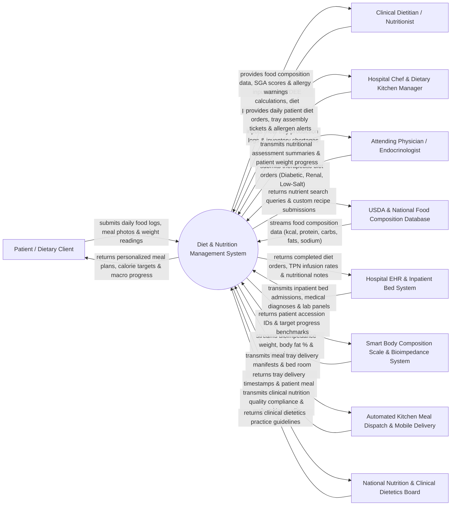

# Context Diagram — Diet & Nutrition Management System

## Mermaid Code

## Actor & Interaction Table | Bảng Actor & Tương tác

| # | Actor | Actor Type | Data Sent TO System | Data Received FROM System | Notes |
|---|-------|------------|---------------------|---------------------------|-------|
| 1 | Patient / Dietary Client | Primary | Daily food consumption logs, meal photos, self-reported weight, food preferences, dietary feedback. | Personalized meal plans, daily calorie/macro targets, nutritional progress charts. | Inpatient or outpatient receiving nutritional counseling, weight management, or medical diet plans. |
| 2 | Clinical Dietitian / Nutritionist | Primary | Anthropometric assessments, BMR/TDEE energy calculations, therapeutic diet prescriptions, TPN orders, SGA scores. | Food composition databases, drug-nutrient interaction alerts, patient compliance charts. | Certified healthcare professional designing medical nutrition therapy and supervising patient diets. |
| 3 | Hospital Chef & Dietary Kitchen Manager | Primary | Kitchen meal preparation logs, ingredient inventory levels, tray assembly confirmations. | Daily inpatient diet order summaries, meal tray assembly tickets, room-by-room allergen alerts. | Hospital food service staff preparing therapeutic diets (soft, pureed, low-sodium, diabetic) in the kitchen. |
| 4 | Attending Physician / Endocrinologist | Primary | Physician therapeutic diet orders (e.g., Diabetic 1800 kcal, Low-Sodium 2g, Renal, NPO), lab orders. | Dietitian clinical assessment notes, patient nutritional status, weight loss/gain progress graphs. | Hospital doctor prescribing clinical diet restrictions based on medical conditions (Diabetes, Renal failure). |
| 5 | USDA & National Food Composition Database | Supporting System | Comprehensive nutritional composition data: Calories, Macros (Protein, Carbs, Fats), Micronutrients, Sodium, Potassium. | Nutrient lookup queries, custom recipe nutrient calculation requests. | External nutritional database (e.g., USDA FoodData Central or Vietnam Institute of Nutrition Database). |
| 6 | Hospital EHR & Inpatient Bed System | Supporting System | Inpatient admission records, bed/room numbers, primary diagnoses (ICD-10), lab blood chemistry (Albumin, HbA1c). | Active diet orders, TPN orders, nutritional assessment summaries, dietitian clinical notes. | Enterprise hospital information system managing inpatient beds and clinical electronic health records. |
| 7 | Smart Body Composition Scale & Bioimpedance System | Supporting System | Automated bioelectrical impedance telemetry: Weight (kg), Body Fat %, Muscle Mass (kg), Visceral Fat Rating. | Patient accession UIDs, baseline target weight goals, historical body composition trends. | Connected medical body composition analyzer (e.g., InBody, Seca scale) streaming body metrics. |
| 8 | Automated Kitchen Meal Dispatch & Mobile Delivery | Supporting System | Meal tray delivery timestamps, patient meal intake percentage (0%, 50%, 100% consumed), tray pickup logs. | Inpatient meal delivery manifests, patient room numbers, tray barcode IDs. | Dietary cart logistics system tracking tray delivery from kitchen to inpatient hospital beds. |
| 9 | National Nutrition & Clinical Dietetics Board | Regulatory | Clinical nutrition guidelines, hospital malnutrition screening standards (MST/MUST), dietary audit rules. | Hospital malnutrition prevalence reports, dietetic quality compliance metrics. | Professional regulatory body overseeing clinical nutrition standards and hospital dietary safety. |

## System Boundary Description | Mô tả Phạm vi Hệ thống

The **Diet & Nutrition Management System (DNMS)** is a specialized clinical healthcare and food-service platform operating across hospital dietary departments, outpatient nutrition clinics, and metabolic centers. It manages anthropometric nutritional assessments (BMI, BMR, TDEE, SGA), formulates personalized therapeutic meal plans using standardized food databases (USDA), processes inpatient hospital diet orders (Diabetic, Renal, Texture-modified, Low-Salt), handles enteral/parenteral nutrition (TPN) orders, screens for food allergies and drug-nutrient interactions, and tracks kitchen meal tray assembly and delivery.

**Inside System Scope:**
- Anthropometric assessment, BMR/TDEE calculation (Harris-Benedict, Mifflin-St Jeor), and SGA scoring.
- Integration with food composition catalogs for precise macro/micronutrient breakdown.
- Multi-day meal plan builder with customizable macro ratios (Carbs/Protein/Fat %) and calorie targets.
- Inpatient hospital diet order management (Soft, Pureed, Fluid Restricted, Low-Sodium, NPO).
- Enteral tube feeding and Total Parenteral Nutrition (TPN) order calculations.
- Food allergy, intolerance, and drug-nutrient interaction screening.
- Hospital dietary kitchen production reporting, tray assembly ticketing, and bed delivery tracking.
- Mobile patient food logging, photo meal tracking, and weight progress graphs.

**Outside System Scope:**
- Physical cooking, slicing, and baking of food ingredients inside the kitchen (handled by kitchen staff).
- Physical farming, procurement, and agricultural supply chain of raw food ingredients.
- Non-dietary inpatient medical nursing care (handled by HIS / Hospital Nursing).
- General hospital financial billing and cashiering (handled by Hospital Billing / HIS).
