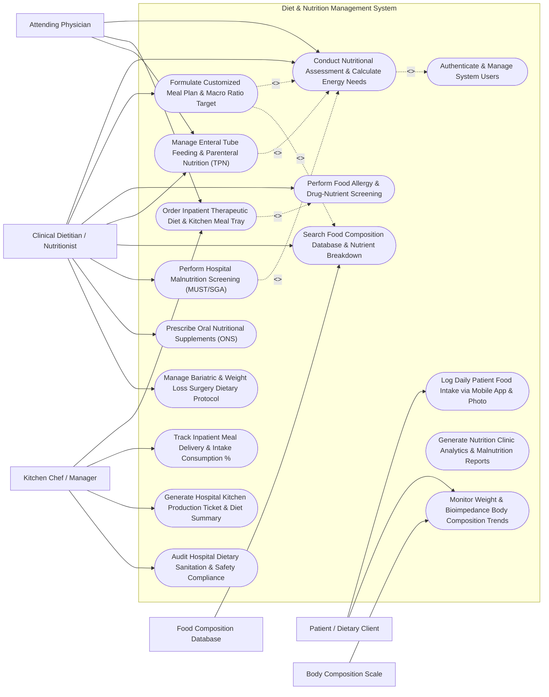

# Use Case Diagram — Diet & Nutrition Management System

## Mermaid Code

## Actor Table | Bảng Actor

| # | Actor | Actor Type | Role Description | Related Use Cases |
|---|-------|------------|------------------|-------------------|
| 1 | Patient / Dietary Client | Primary | Individual logging daily food intake via mobile app photos, tracking weight, and following assigned meal plans. | UC08, UC09 |
| 2 | Clinical Dietitian / Nutritionist | Primary | Specialist performing nutritional assessments, calculating energy needs, designing therapeutic meal plans, and ordering TPN. | UC01, UC02, UC04, UC05, UC06, UC10, UC12, UC13 |
| 3 | Kitchen Chef / Manager | Primary | Hospital food service manager receiving diet orders, printing tray tickets, assembling meals, and auditing sanitation. | UC03, UC07, UC11, UC14 |
| 4 | Attending Physician | Primary | Hospital doctor issuing clinical diet orders (Diabetic, Low-Sodium, NPO) and authorizing TPN/Enteral nutrition. | UC01, UC03, UC05 |
| 5 | Food Composition Database | Secondary / System | External nutritional database (USDA) streaming macro/micronutrient breakdown for ingredients and recipes. | UC06 |
| 6 | Body Composition Scale | Secondary / System | Connected bioimpedance scale hardware streaming weight, body fat %, and muscle mass metrics into patient charts. | UC09 |

## Use Case Table | Bảng Use Case

| # | UC ID | Use Case Name | Primary Actor | Secondary Actor | Description | Priority |
|---|-------|---------------|---------------|-----------------|-------------|----------|
| 1 | UC01 | Conduct Nutritional Assessment & Calculate Energy Needs | Clinical Dietitian / Nutritionist | Attending Physician | Measure anthropometry (BMI, Body Fat %), calculate BMR and TDEE energy requirements, and perform Subjective Global Assessment (SGA). | High |
| 2 | UC02 | Formulate Customized Meal Plan & Macro Ratio Target | Clinical Dietitian / Nutritionist | Food Composition Database | Design multi-day meal plans setting daily calorie targets, Carbohydrate/Protein/Fat macro ratios, and searching food catalogs. | High |
| 3 | UC03 | Order Inpatient Therapeutic Diet & Kitchen Meal Tray | Attending Physician | Kitchen Chef / Manager | Prescribe inpatient hospital diets (Diabetic 1800 kcal, Low-Sodium, Soft, Pureed, NPO) and route meal orders to the kitchen. | High |
| 4 | UC04 | Perform Food Allergy & Drug-Nutrient Screening | Clinical Dietitian / Nutritionist | None | Screen proposed meal items against patient food allergies (Nuts, Shellfish, Gluten) and drug-nutrient interactions (Warfarin vs Vitamin K). | High |
| 5 | UC05 | Manage Enteral Tube Feeding & Parenteral Nutrition (TPN) | Clinical Dietitian / Nutritionist | Attending Physician | Calculate Total Parenteral Nutrition (TPN) macronutrients, amino acids, dextrose, lipid emulsions, and enteral tube feeding rates. | High |
| 6 | UC06 | Search Food Composition Database & Nutrient Breakdown | Clinical Dietitian / Nutritionist | Food Composition Database | Query USDA/National food databases for specific ingredients to view calories, macros, vitamins, minerals, and sodium. | Medium |
| 7 | UC07 | Track Inpatient Meal Delivery & Intake Consumption % | Kitchen Chef / Manager | None | Track meal tray dispatch to inpatient beds and log meal consumption percentage (0%, 50%, 100%) for clinical monitoring. | Medium |
| 8 | UC08 | Log Daily Patient Food Intake via Mobile App & Photo | Patient / Dietary Client | None | Log consumed meals via mobile barcode scanning, food database search, or AI photo meal recognition to track daily calorie intake. | High |
| 9 | UC09 | Monitor Weight & Bioimpedance Body Composition Trends | Patient / Dietary Client | Body Composition Scale | Ingest connected scale readings (Weight kg, Body Fat %, Muscle Mass kg) and generate longitudinal weight progress curves. | Medium |
| 10 | UC10 | Perform Hospital Malnutrition Screening (MUST/SGA) | Clinical Dietitian / Nutritionist | None | Execute hospital malnutrition screening tools (MUST - Malnutrition Universal Self-Tool, SGA) to identify at-risk patients. | High |
| 11 | UC11 | Generate Hospital Kitchen Production Ticket & Diet Summary | Kitchen Chef / Manager | None | Compile daily kitchen batch production tickets, summary counts of special diets (e.g., 45 Diabetic, 30 Low-Salt), and room tray tags. | High |
| 12 | UC12 | Prescribe Oral Nutritional Supplements (ONS) | Clinical Dietitian / Nutritionist | None | Order specialized liquid Oral Nutritional Supplements (ONS - High Protein, Renal Formula) between meals for malnourished patients. | Medium |
| 13 | UC13 | Manage Bariatric & Weight Loss Surgery Dietary Protocol | Clinical Dietitian / Nutritionist | None | Guide post-bariatric surgery dietary progression (Stage 1 Clear Liquid -> Stage 2 Pureed -> Stage 3 Soft -> Stage 4 Regular High-Protein). | Medium |
| 14 | UC14 | Audit Hospital Dietary Sanitation & Safety Compliance | Kitchen Chef / Manager | None | Conduct HACCP food safety audits, check kitchen refrigerator temperatures, and verify food handler sanitation logs. | Medium |
| 15 | UC15 | Generate Nutrition Clinic Analytics & Reports | Clinical Dietitian / Nutritionist | None | Produce clinic weight loss success rates, hospital malnutrition prevalence metrics, diet compliance rates, and TPN volume reports. | Medium |
| 16 | UC16 | Authenticate & Manage System Users | All Users | None | Enforce secure role-based login, patient data confidentiality compliance, and electronic signature audit logging. | High |

## Use Case Specification | Đặc tả Use Case

---

### UC01 — Conduct Nutritional Assessment & Calculate Energy Needs

| Field | Detail |
|-------|--------|
| **UC ID** | UC01 |
| **Use Case Name** | Conduct Nutritional Assessment & Calculate Energy Needs |
| **Actor(s)** | Primary: Clinical Dietitian / Nutritionist   Secondary: Attending Physician |
| **Description** | Conducts a comprehensive clinical nutritional assessment, capturing anthropometric measurements (Height, Weight, BMI, Waist Circumference, Bioimpedance Body Fat %), calculating Basal Metabolic Rate (BMR) and Total Daily Energy Expenditure (TDEE), and scoring Subjective Global Assessment (SGA Class A, B, C). |
| **Precondition** | 1. The patient profile is registered in DNMS.   2. The Dietitian is authenticated with clinical assessment privileges. |
| **Main Flow** | 1. The Dietitian opens "New Nutritional Assessment" for the patient.   2. The Dietitian enters Anthropometric Data: Height (e.g., 175 cm), Current Weight (85 kg), Usual Weight 6 months ago (95 kg, calculating 10.5% weight loss), Waist Circumference (98 cm).   3. The System auto-computes Body Mass Index (BMI): `BMI = Weight / (Height in m)² = 85 / (1.75)² = 27.76 kg/m²` (Classified as Overweight / Pre-obese).   4. The System calculates Basal Metabolic Rate (BMR) using Mifflin-St Jeor Formula: `BMR = (10 x Weight kg) + (6.25 x Height cm) - (5 x Age) + 5` (e.g., BMR = 1,720 kcal/day).   5. The Dietitian selects Physical Activity Factor (e.g., Sedentary 1.2, Lightly Active 1.375) and Stress / Disease Injury Factor (e.g., Major Surgery 1.3, Severe Burn 1.5).   6. The System calculates Total Daily Energy Expenditure (TDEE): `TDEE = BMR x Activity Factor x Stress Factor` (e.g., `TDEE = 1,720 x 1.2 x 1.3 = 2,683 kcal/day`).   7. The Dietitian calculates Protein Requirements (e.g., 1.2g to 1.5g protein/kg/day = 102g to 127g protein/day).   8. The Dietitian completes Subjective Global Assessment (SGA) domain questions (weight change, dietary intake change, GI symptoms, muscle wasting, edema) and assigns SGA Rating: **SGA-A** (Well Nourished), **SGA-B** (Mildly/Moderately Malnourished), or **SGA-C** (Severely Malnourished).   9. The Dietitian saves the assessment, and the System logs energy/protein targets for Meal Plan Formulation (UC02). |
| **Alternative Flow** | **AF1** — Harris-Benedict / Penn State Formula Override: For critically ill ventilated ICU patients, the Dietitian selects the Penn State 2010 formula incorporating Minute Ventilation and Peak Inspiratory Temperature to calculate ICU energy expenditure.   **AF2** — Amputee Adjusted Body Weight Calculation: For amputee patients, the System adjusts ideal body weight by subtracting the percentage proportion of missing limbs (e.g., Below-knee amputation = 5.9% deduction). |
| **Exception Flow** | **EX1** — Unintended Severe Weight Loss Alert (> 10% in 6 Months): If weight loss exceeds 10% within 6 months, the System flashes a red "Severe Malnutrition Risk Alert" and prompts an urgent SGA-C evaluation.   **EX2** — Impossible Height/Weight Entry Error: If height is entered as 17.5 cm instead of 175 cm, the System flags an out-of-range validation error. |
| **Postcondition** | BMI is calculated, BMR and TDEE energy/protein target goals are established, SGA malnutrition score is recorded, and data is ready for meal planning. |
| **Business Rule** | **BR1**: Unintended weight loss >= 10% within 6 months or >= 5% in 1 month MUST be flagged as high malnutrition risk requiring dietitian intervention within 24 hours.   **BR2**: Protein calculations for renal failure patients not on dialysis must restrict protein to 0.6g-0.8g/kg/day to prevent uremic toxicity. |

---

### UC02 — Formulate Customized Meal Plan & Macro Ratio Target

| Field | Detail |
|-------|--------|
| **UC ID** | UC02 |
| **Use Case Name** | Formulate Customized Meal Plan & Macro Ratio Target |
| **Actor(s)** | Primary: Clinical Dietitian / Nutritionist   Secondary: Food Composition Database |
| **Description** | Designs a customized multi-day therapeutic meal plan tailored to the patient's energy targets (TDEE), setting target macronutrient ratios (Carbohydrate %, Protein %, Fat %), searching ingredient composition catalogs, calculating total daily calories, and generating recipe menus. |
| **Precondition** | 1. TDEE energy and protein requirements are established in the Nutritional Assessment (UC01).   2. Food composition database (USDA) is active. |
| **Main Flow** | 1. The Dietitian opens the "Meal Plan Builder" for the target patient.   2. The System populates baseline target requirements: Daily Energy Target = 2,000 kcal; Daily Protein Target = 100g.   3. The Dietitian configures Macronutrient Ratio Distribution:   &nbsp;&nbsp;&nbsp;&nbsp;- **Carbohydrates**: 50% of total calories (250g / day)   &nbsp;&nbsp;&nbsp;&nbsp;- **Protein**: 20% of total calories (100g / day)   &nbsp;&nbsp;&nbsp;&nbsp;- **Fats**: 30% of total calories (67g / day).   4. The Dietitian builds daily meal slots: Breakfast, Mid-Morning Snack, Lunch, Afternoon Snack, Dinner, Evening Snack.   5. For each meal slot, the Dietitian searches the Food Composition Database (UC06) and adds food items with portion sizes (e.g., Oatmeal 100g, Steamed Chicken Breast 150g, Brown Rice 200g, Olive Oil 10g).   6. The System continuously sums real-time meal totals:   &nbsp;&nbsp;&nbsp;&nbsp;- **Calculated Total Calories**: 1,980 kcal / 2,000 kcal target (99% match)   &nbsp;&nbsp;&nbsp;&nbsp;- **Calculated Protein**: 102g (102% match)   &nbsp;&nbsp;&nbsp;&nbsp;- **Calculated Carbs**: 242g (97% match)   &nbsp;&nbsp;&nbsp;&nbsp;- **Calculated Fats**: 64g (95% match)   &nbsp;&nbsp;&nbsp;&nbsp;- **Micronutrients**: Sodium 1,800 mg (Low-Salt < 2,000 mg met), Potassium 3,200 mg.   7. The Dietitian checks for Food Allergy & Drug-Nutrient Warnings (UC04).   8. The Dietitian saves and publishes the Meal Plan, which is sent to the Patient's mobile app and queued for Inpatient Kitchen Production (UC03). |
| **Alternative Flow** | **AF1** — Ketogenic / Low-Carb High-Fat (LCHF) Plan: For epilepsy or weight loss, the Dietitian sets Keto ratio 4:1 (75% Fat, 20% Protein, 5% Carbs); the System adjusts ingredient selection rules to restrict high-carb items.   **AF2** — Template-Based Auto-Generation: The Dietitian selects a pre-approved template (e.g., "1800 kcal Diabetic Mediterranean Diet Template"), and the System auto-populates a 7-day meal plan, allowing portion fine-tuning. |
| **Exception Flow** | **EX1** — Calorie Target Variance Exceeded (> 10% Off Target): If total calculated calories are 2,450 kcal against a 2,000 kcal target, the System highlights "Calories Exceed Target by +22.5%" in red.   **EX2** — Nutrient Threshold Breach (e.g., High Potassium for Renal Patient): For a Stage 4 Renal patient, if total potassium exceeds 2,000 mg/day, the System flashes a red "High Potassium Alert". |
| **Postcondition** | Multi-day customized meal plan is created, macronutrient and calorie targets are matched, food safety checks are cleared, and plan is published to patient/kitchen. |
| **Business Rule** | **BR1**: Diabetic meal plans MUST distribute carbohydrate portions evenly across 3 main meals and 2 snacks to prevent glycemic spikes.   **BR2**: Renal disease meal plans (CKD Stage 3-5) must enforce daily restrictions on Sodium (< 2,000mg), Potassium (< 2,000mg), and Phosphorus (< 800mg). |

---

### UC03 — Order Inpatient Therapeutic Diet & Kitchen Meal Tray

| Field | Detail |
|-------|--------|
| **UC ID** | UC03 |
| **Use Case Name** | Order Inpatient Therapeutic Diet & Kitchen Meal Tray |
| **Actor(s)** | Primary: Attending Physician   Secondary: Kitchen Chef / Manager |
| **Description** | Orders inpatient hospital therapeutic diets (e.g., Regular, Diabetic, Low-Sodium, Soft, Pureed, Fluid Restricted, NPO - Nothing by Mouth), specifies texture modifications and fluid limits, and transmits electronic diet orders to the hospital kitchen production system. |
| **Precondition** | 1. The patient is admitted to a hospital inpatient bed.   2. The Physician or Dietitian has clinical ordering authority. |
| **Main Flow** | 1. The Physician opens the "Inpatient Diet Order" module for a newly admitted patient in Bed 402-B.   2. The Physician selects Primary Therapeutic Diet Type: **Diabetic 1800 kcal + Low-Sodium (2g Na)**.   3. The Physician selects Texture Modification: Regular, Soft Mechanical, Minced/Moist, or Pureed (IDDSI Level 4).   4. The Physician specifies Fluid Restriction (e.g., 1,500 mL / 24 hours) or Special Feeding Requirements (e.g., Assistance Required, Blind Patient).   5. The System checks for patient Food Allergies (UC04) linked in EHR (e.g., Peanut Allergy).   6. The Physician signs the electronic diet order.   7. The System dispatches the order payload instantly to the Hospital Kitchen Production System.   8. The Kitchen Manager prints the **Meal Tray Assembly Ticket** for Bed 402-B, featuring color-coded diet tags, prohibited allergen list, and meal portion instructions.   9. Kitchen staff assemble the meal tray, scan the tray barcode, and dispatch the cart for bed delivery (UC07). |
| **Alternative Flow** | **AF1** — NPO (Nothing By Mouth) Pre-Surgery Order: The Physician sets diet to "NPO (Nothing By Mouth) starting at 00:00 Midnight" for upcoming morning surgery; the System suppresses kitchen tray generation and flashes "NPO" on the nursing bed board.   **AF2** — Clear Liquid / Full Liquid Post-Op Progression: Post-surgery, the Physician updates diet from NPO to "Clear Liquid Diet", and 24 hours later upgrades to "Full Liquid Diet". |
| **Exception Flow** | **EX1** — Diet Order Allergen Conflict Hard Block: If the Physician orders a standard diet containing eggs for a patient with documented severe egg anaphylaxis, the System blocks order sign-off and flashes "ALLERGEN CONFLICT DETECTED".   **EX2** — Late Inpatient Admission (Post-Kitchen Cutoff): If an admission occurs at 20:30 PM (after dinner kitchen cutoff), the System auto-orders a "Late Admission Emergency Box Meal". |
| **Postcondition** | Inpatient therapeutic diet order is signed, allergy checks are verified, kitchen production ticket is printed, and meal tray assembly is queued. |
| **Business Rule** | **BR1**: All inpatient diet orders MUST specify both Primary Diet Code (e.g., Diabetic, Low-Salt) and Texture Modification Level (IDDSI Framework Levels 0-7).   **BR2**: NPO (Nothing by Mouth) orders must suppress all automated kitchen meal tray generation for the designated patient bed. |

---

### UC04 — Perform Food Allergy & Drug-Nutrient Interaction Screening

| Field | Detail |
|-------|--------|
| **UC ID** | UC04 |
| **Use Case Name** | Perform Food Allergy & Drug-Nutrient Interaction Screening |
| **Actor(s)** | Primary: Clinical Dietitian / Nutritionist |
| **Description** | Screens proposed meal plans and inpatient diet orders against patient documented food allergies/intolerances (Peanuts, Shellfish, Lactose, Gluten) and drug-nutrient interactions (e.g., Warfarin vs Vitamin K, MAOIs vs Tyramine, Statins vs Grapefruit), flagging safety hazards. |
| **Precondition** | 1. The patient's active drug prescriptions and allergy history are loaded from EHR.   2. A proposed meal plan or diet order is being created. |
| **Main Flow** | 1. The Dietitian opens a draft meal plan or inpatient diet order for review.   2. The System runs the **Food Allergy & Intolerance Cross-Check**:   &nbsp;&nbsp;&nbsp;&nbsp;- Compares ingredients against patient allergy profile (e.g., Patient allergic to Shellfish).   &nbsp;&nbsp;&nbsp;&nbsp;- Scans recipe items for hidden derivatives (e.g., Oyster sauce in stir-fry).   3. The System runs the **Drug-Nutrient Interaction Engine**:   &nbsp;&nbsp;&nbsp;&nbsp;- Fetches active medications: Patient taking *Warfarin (Coumadin)* 5mg daily.   &nbsp;&nbsp;&nbsp;&nbsp;- Identifies Nutrient Interaction: High Vitamin K foods (Spinach, Kale, Broccoli) antagonize Warfarin anticoagulant efficacy.   &nbsp;&nbsp;&nbsp;&nbsp;- Scans meal plan for high Vitamin K items (e.g., Spinach salad 150g contains 220 mcg Vitamin K).   4. The System displays an amber **Drug-Nutrient Interaction Warning**: "High Vitamin K intake detected while patient is on Warfarin therapy. Maintain consistent daily Vitamin K or reduce spinach portion."   5. The Dietitian modifies the meal plan (substitutes spinach with iceberg lettuce) or enters a clinical justification note ("Patient instructed on consistent Vitamin K intake").   6. The System logs cleared food safety checks into the diet record. |
| **Alternative Flow** | **AF1** — Celiac Disease / Gluten-Free Hard Filter: For a patient diagnosed with Celiac Disease, the System applies a strict "Gluten-Free Filter", automatically excluding wheat, barley, rye, and non-certified oats from food search results.   **AF2** — Enteral Feeding & Medication Timing Interaction: For patients receiving Phenytoin (Dilantin) via enteral tube, the System generates a nursing schedule warning: "Hold tube feeding 1 hour before and 1 hour after Phenytoin administration". |
| **Exception Flow** | **EX1** — Anaphylactic Food Allergy Conflict: If a meal plan includes Whole Milk for a patient with documented severe Cow's Milk Anaphylaxis, the System blocks publishing with an un-overrideable red error.   **EX2** — Grapefruit / Statin Interaction Warning: If Grapefruit juice is selected for a patient taking Atorvastatin, the System warns of increased statin blood concentration and toxicity risk. |
| **Postcondition** | Proposed meals are screened against allergies and drug interactions, unsafe ingredients are substituted or flagged, and cleared food safety status is archived. |
| **Business Rule** | **BR1**: Documented anaphylactic food allergies MUST trigger an absolute hard block preventing kitchen meal tray assembly containing the allergen.   **BR2**: Patients prescribed Warfarin must receive dietary counseling ensuring consistent daily Vitamin K intake rather than complete elimination. |

---

### UC05 — Manage Enteral Tube Feeding & Parenteral Nutrition (TPN) Order

| Field | Detail |
|-------|--------|
| **UC ID** | UC05 |
| **Use Case Name** | Manage Enteral Tube Feeding & Parenteral Nutrition (TPN) Order |
| **Actor(s)** | Primary: Clinical Dietitian / Nutritionist   Secondary: Attending Physician |
| **Description** | Calculates, formulates, and monitors specialized Enteral Tube Feeding (NG-tube, PEG-tube formulas) and Total Parenteral Nutrition (TPN central IV infusions), calculating amino acid, dextrose, lipid emulsion, electrolyte, and fluid infusion rates for ICU or non-oral patients. |
| **Precondition** | 1. The patient is unable to consume oral nutrition (ICU ventilated, severe stroke dysphagia, bowel resection).   2. Central venous line or enteral feeding tube access is verified. |
| **Main Flow** | 1. The Dietitian selects "New Enteral / Parenteral Nutrition Order" for an ICU patient in Bed 201-A.   2. The Dietitian selects Nutrition Mode: **Total Parenteral Nutrition (TPN)** via Central Line.   3. The System loads patient clinical targets: Energy = 1,800 kcal/day; Protein = 110g/day; Fluid Limit = 1,800 mL/day.   4. The Dietitian inputs TPN Solution Components:   &nbsp;&nbsp;&nbsp;&nbsp;- **Amino Acids (Protein)**: 10% Amino Acid solution -> 110g (440 kcal)   &nbsp;&nbsp;&nbsp;&nbsp;- **Dextrose (Carbohydrates)**: 50% Dextrose solution -> 220g (748 kcal, checking GIR Dextrose Infusion Rate < 4 mg/kg/min)   &nbsp;&nbsp;&nbsp;&nbsp;- **Lipid Emulsion (Fat)**: 20% Intralipid -> 60g (612 kcal)   &nbsp;&nbsp;&nbsp;&nbsp;- **Electrolytes**: Sodium 70 mEq, Potassium 60 mEq, Calcium 10 mEq, Magnesium 10 mEq, Phosphate 30 mmol   &nbsp;&nbsp;&nbsp;&nbsp;- **Additives**: Multi-vitamin (MVI) + Trace Elements (Zinc, Copper, Selenium).   5. The System calculates total TPN volume (1,650 mL), total osmolality (1,450 mOsm/L - Central Line Required), and sets IV Infusion Pump Rate: `1,650 mL / 24 hours = 68.75 mL/hour`.   6. The Dietitian checks for Refeeding Syndrome Risk (verifying baseline Serum Phosphate, Potassium, Magnesium).   7. The Physician co-signs the TPN order, and the System dispatches the formulation ticket to the Sterile Hospital Pharmacy Compounding Lab. |
| **Alternative Flow** | **AF1** — Enteral Tube Feeding (NG / PEG Tube) Order: The Dietitian orders a commercial enteral formula (e.g., Jevity 1.2 kcal/mL), setting Continuous Pump Rate (e.g., 65 mL/hr for 20 hours/day) with 50 mL water flushes every 4 hours.   **AF2** — Peripheral Parenteral Nutrition (PPN): For short-term PPN via peripheral IV line, the System enforces an Osmolality Cap (< 900 mOsm/L) to prevent peripheral vein phlebitis. |
| **Exception Flow** | **EX1** — Glucose Infusion Rate (GIR) Exceeded Alert (`GIR > 5 mg/kg/min`): If dextrose concentration exceeds liver glucose oxidation capacity, the System flashes "High GIR - Risk of Hepatic Steatosis & Hyperglycemia".   **EX2** — Severe Refeeding Syndrome Hypophosphatemia: If baseline serum phosphate is < 1.5 mg/dL, the System blocks high-carbohydrate TPN startup until electrolyte deficits are repleted. |
| **Postcondition** | TPN / Enteral formulation is calculated, infusion pump rates and osmolality are verified, physician co-signature is recorded, and sterile pharmacy compounding ticket is generated. |
| **Business Rule** | **BR1**: TPN solutions with total osmolality > 900 mOsm/L MUST be infused exclusively through a dedicated Central Venous Catheter (CVC).   **BR2**: Dextrose Infusion Rate (GIR) in TPN formulations shall not exceed 4-5 mg/kg/minute to prevent severe hyperglycemia and liver steatosis. |
