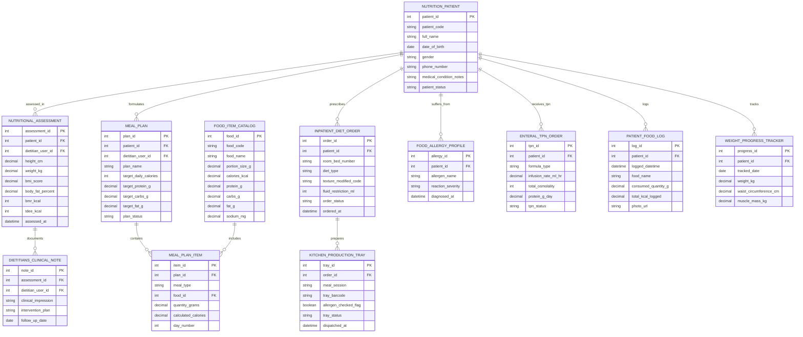

# Conceptual ERD — Diet & Nutrition Management System

## Mermaid Code

## Entity Description Table | Bảng mô tả Entity

| # | Entity Name | Vietnamese Name | Description | Key Attributes | Main Relationships |
|---|-------------|-----------------|-------------|----------------|-------------------|
| 1 | NUTRITION_PATIENT | Bệnh nhân Dinh dưỡng Profile | Master patient record storing patient code, full name, DOB, gender, phone, medical conditions, and status. | patient_id, patient_code, full_name, dob, gender, phone_number, patient_status | Has many NUTRITIONAL_ASSESSMENT, MEAL_PLAN, INPATIENT_DIET_ORDER, FOOD_ALLERGY_PROFILE, etc. |
| 2 | NUTRITIONAL_ASSESSMENT | Đánh giá Tình trạng Dinh dưỡng | Clinical anthropometric assessment record storing height, weight, BMI, body fat %, BMR, TDEE, and SGA ratings. | assessment_id, patient_id, dietitian_user_id, height_cm, weight_kg, bmi_score, bmr_kcal, tdee_kcal | Belongs to NUTRITION_PATIENT; Has many DIETITIANS_CLINICAL_NOTE entities. |
| 3 | FOOD_ITEM_CATALOG | Danh mục Thực phẩm Nutrient | Master food database entry (USDA based) storing portion size, calories, protein, carbs, fat, and sodium content. | food_id, food_code, food_name, portion_size_g, calories_kcal, protein_g, carbs_g, fat_g, sodium_mg | Has many MEAL_PLAN_ITEM entities. |
| 4 | MEAL_PLAN | Thực đơn Dinh dưỡng (Meal Plan) | Customized multi-day meal plan master setting plan name, daily calorie target, and protein/carb/fat target grams. | plan_id, patient_id, dietitian_user_id, plan_name, target_daily_calories, target_protein_g, plan_status | Belongs to NUTRITION_PATIENT; Has many MEAL_PLAN_ITEM entities. |
| 5 | MEAL_PLAN_ITEM | Chi tiết Món ăn Thức đơn | Individual meal line item detailing meal type (Breakfast, Lunch), food item ID, quantity grams, and calculated calories. | item_id, plan_id, meal_type, food_id, quantity_grams, calculated_calories, day_number | Belongs to MEAL_PLAN and FOOD_ITEM_CATALOG. |
| 6 | INPATIENT_DIET_ORDER | Chỉ định Chế độ ăn Nội trú | Inpatient hospital diet order specifying room/bed number, diet type (Diabetic, Low-Salt), texture modification, and fluid caps. | order_id, patient_id, room_bed_number, diet_type, texture_modified_code, fluid_restriction_ml, order_status | Belongs to NUTRITION_PATIENT; Has many KITCHEN_PRODUCTION_TRAY entities. |
| 7 | KITCHEN_PRODUCTION_TRAY | Khay Ăn Bếp Bệnh viện | Kitchen meal tray production record tracking meal session (Breakfast, Dinner), tray barcode, allergen checks, and dispatch status. | tray_id, order_id, meal_session, tray_barcode, allergen_checked_flag, tray_status, dispatched_at | Belongs to INPATIENT_DIET_ORDER. |
| 8 | FOOD_ALLERGY_PROFILE | Hồ sơ Dị ứng Thực phẩm | Food allergy and intolerance record storing allergen name (Peanuts, Shellfish, Milk), severity grade, and diagnosis date. | allergy_id, patient_id, allergen_name, reaction_severity, diagnosed_at | Belongs to NUTRITION_PATIENT. |
| 9 | ENTERAL_TPN_ORDER | Y lệnh Dinh dưỡng Tĩnh mạch (TPN) | Enteral tube feeding and Total Parenteral Nutrition (TPN) order tracking formula type, infusion rate mL/hr, osmolality, and protein g/day. | tpn_id, patient_id, formula_type, infusion_rate_ml_hr, total_osmolality, protein_g_day, tpn_status | Belongs to NUTRITION_PATIENT. |
| 10 | PATIENT_FOOD_LOG | Nhật ký Ăn uống Bệnh nhân | Mobile food intake log recording logged datetime, food name, consumed quantity grams, total calories logged, and photo URLs. | log_id, patient_id, logged_datetime, food_name, consumed_quantity_g, total_kcal_logged, photo_url | Belongs to NUTRITION_PATIENT. |
| 11 | WEIGHT_PROGRESS_TRACKER | Theo dõi Cân nặng Body Comp | Longitudinal weight and body composition tracking record storing weight kg, waist circumference cm, and muscle mass kg. | progress_id, patient_id, tracked_date, weight_kg, waist_circumference_cm, muscle_mass_kg | Belongs to NUTRITION_PATIENT. |
| 12 | DIETITIANS_CLINICAL_NOTE | Ghi chú Lâm sàng Chuyên gia | Dietitian clinical consultation note recording clinical impression, intervention plan, and follow-up recommendation date. | note_id, assessment_id, dietitian_user_id, clinical_impression, intervention_plan, follow_up_date | Belongs to NUTRITIONAL_ASSESSMENT. |

## Relationship Description | Mô tả Quan hệ

| # | From Entity | Cardinality | To Entity | Relationship Label | Business Explanation |
|---|-------------|-------------|-----------|-------------------|----------------------|
| 1 | NUTRITION_PATIENT | one-to-many | NUTRITIONAL_ASSESSMENT | assessed_in | One patient undergoes multiple anthropometric and clinical nutritional assessments over time. |
| 2 | NUTRITION_PATIENT | one-to-many | MEAL_PLAN | formulates | One patient has customized multi-day therapeutic meal plans formulated for them. |
| 3 | NUTRITION_PATIENT | one-to-many | INPATIENT_DIET_ORDER | prescribes | One inpatient has therapeutic diet orders prescribed for hospital bed stay. |
| 4 | NUTRITION_PATIENT | one-to-many | FOOD_ALLERGY_PROFILE | suffers_from | One patient has recorded food allergies and intolerance profiles. |
| 5 | NUTRITION_PATIENT | one-to-many | ENTERAL_TPN_ORDER | receives_tpn | One critically ill patient receives enteral tube feeding or TPN orders. |
| 6 | NUTRITION_PATIENT | one-to-many | PATIENT_FOOD_LOG | logs | One patient logs daily meal consumption entries via mobile app. |
| 7 | NUTRITION_PATIENT | one-to-many | WEIGHT_PROGRESS_TRACKER | tracks | One patient tracks longitudinal body weight and bioimpedance trends. |
| 8 | NUTRITIONAL_ASSESSMENT | one-to-many | DIETITIANS_CLINICAL_NOTE | documents | One nutritional assessment is documented by clinical dietitian notes. |
| 9 | MEAL_PLAN | one-to-many | MEAL_PLAN_ITEM | contains | One meal plan contains multiple individual food meal items across days. |
| 10 | FOOD_ITEM_CATALOG | one-to-many | MEAL_PLAN_ITEM | includes | One food item from the USDA catalog is included in meal plan line items. |
| 11 | INPATIENT_DIET_ORDER | one-to-many | KITCHEN_PRODUCTION_TRAY | prepares | One inpatient diet order prepares daily hospital kitchen meal production trays. |
