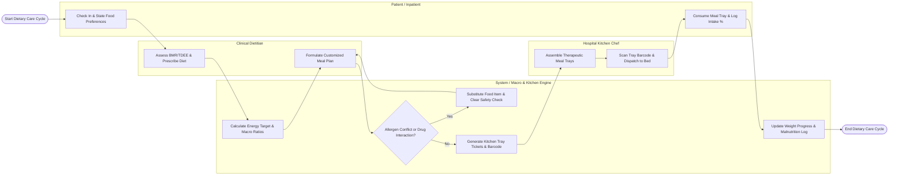

# Swimlane Diagram — Diet & Nutrition Management System

## Mermaid Code

## Flow Description | Mô tả luồng

| Lane | Actor / Subsystem | Role in Flow |
|------|-------------------|--------------|
| 1 | Patient / Inpatient | Checks in to outpatient clinic or hospital bed, states food preferences and allergies, consumes served therapeutic meal trays, and logs food intake percentage via mobile app. |
| 2 | Clinical Dietitian | Conducts anthropometric nutritional assessments, calculates BMR and TDEE energy needs, prescribes therapeutic diets (Diabetic, Renal, TPN), and formulates customized macro meal plans. |
| 3 | System / Macro & Kitchen Engine | Computes daily calorie and macronutrient targets, screens recipes against food allergy profiles and drug-nutrient interactions, generates kitchen tray tickets, and logs weight trends. |
| 4 | Hospital Kitchen Chef | Receives electronic diet orders, prints room tray assembly tickets, prepares texture-modified therapeutic meals, scans tray barcodes, and dispatches food carts to inpatient beds. |
