# Action Tree — Diet & Nutrition Management System

## Mermaid Code

```mermaid
graph TD
    Root["Diet & Nutrition Management System"]

    Root --> M1["Nutritional Assessment BMR TDEE"]
    Root --> M2["Therapeutic Meal Planning"]
    Root --> M3["Inpatient Hospital Diet Orders"]
    Root --> M4["Food Allergy & Drug Screening"]
    Root --> M5["Enteral & TPN Nutrition"]
    Root --> M6["Kitchen Production & Tray Logistics"]
    Root --> M7["Mobile Food Logging & Weight"]
    Root --> M8["Malnutrition Audit & Analytics"]

    M1 --> A11["Measure Anthropometry BMI & Body Fat"]
    M1 --> A12["Calculate BMR via Mifflin-St Jeor"]
    M1 --> A13["Compute TDEE Energy & Protein Goals"]
    M1 --> A14["Score Subjective Global Assessment SGA"]

    M2 --> A21["Configure Carbs Protein Fat Macro Ratios"]
    M2 --> A22["Search USDA Food Nutrient Database"]
    M2 --> A23["Build Multi-Day Meal Plan Slots"]
    M2 --> A24["Apply Low-Sodium & Diabetic Limits"]

    M3 --> A31["Order Inpatient Therapeutic Diet Type"]
    M3 --> A32["Specify IDDSI Texture Modifications"]
    M3 --> A33["Enforce Inpatient Fluid Restriction Caps"]
    M3 --> A34["Suppress Meals for NPO Pre-Op Status"]

    M4 --> A41["Cross-Check Patient Food Allergy Profile"]
    M4 --> A42["Screen Warfarin vs Vitamin K Interactions"]
    M4 --> A43["Detect MAOI Tyramine & Statin Hazards"]
    M4 --> A44["Apply Celiac Gluten-Free Hard Filter"]

    M5 --> A51["Calculate TPN Dextrose Amino Acid Ratios"]
    M5 --> A52["Check TPN Central Line Osmolality Caps"]
    M5 --> A53["Set Enteral Tube Feeding Pump Rates"]
    M5 --> A54["Screen Refeeding Syndrome Electrolytes"]

    M6 --> A61["Compile Kitchen Batch Batch Tickets"]
    M6 --> A62["Print Room Tray Tags with Allergen Flags"]
    M6 --> A63["Scan Tray Barcode at Bed Delivery"]
    M6 --> A64["Track Patient Meal Consumption Percent"]

    M7 --> A71["Log Food Intake via App Barcode & Photo"]
    M7 --> A72["Ingest Smart Bioimpedance Scale Weight"]
    M7 --> A73["Render Longitudinal Weight Loss Curves"]
    M7 --> A74["Track Post-Bariatric Diet Progression"]

    M8 --> A81["Execute Hospital MUST Malnutrition Tool"]
    M8 --> A82["Screen Community MUAC Arm Circumference"]
    M8 --> A83["Export Malnutrition Prevalence Reports"]
    M8 --> A84["Calculate Clinical Diet Compliance Rates"]
```

## Module Description | Mô tả Module

| # | Module | Description | Actions |
|---|--------|-------------|---------|
| 1 | Nutritional Assessment BMR TDEE | Captures anthropometry (BMI, Body Fat %), calculates BMR via Mifflin-St Jeor, computes TDEE energy/protein targets, and scores SGA. | Measure Anthropometry BMI & Body Fat, Calculate BMR via Mifflin-St Jeor, Compute TDEE Energy & Protein Goals, Score Subjective Global Assessment SGA |
| 2 | Therapeutic Meal Planning | Sets Macronutrient ratios (Carbs/Protein/Fat %), queries USDA nutrient databases, builds multi-day menus, and applies diabetic/renal limits. | Configure Carbs Protein Fat Macro Ratios, Search USDA Food Nutrient Database, Build Multi-Day Meal Plan Slots, Apply Low-Sodium & Diabetic Limits |
| 3 | Inpatient Hospital Diet Orders | Orders inpatient therapeutic diet types (Diabetic, Renal), specifies IDDSI texture modifications, sets fluid caps, and handles NPO status. | Order Inpatient Therapeutic Diet Type, Specify IDDSI Texture Modifications, Enforce Inpatient Fluid Restriction Caps, Suppress Meals for NPO Pre-Op Status |
| 4 | Food Allergy & Drug Screening | Cross-checks recipes against patient food allergies (Peanuts, Shellfish), screens Warfarin/Vitamin K interactions, and applies Celiac filters. | Cross-Check Patient Food Allergy Profile, Screen Warfarin vs Vitamin K Interactions, Detect MAOI Tyramine & Statin Hazards, Apply Celiac Gluten-Free Hard Filter |
| 5 | Enteral & TPN Nutrition | Calculates TPN macronutrients (amino acids, dextrose, lipids), checks central line osmolality caps, sets tube feeding rates, and monitors refeeding. | Calculate TPN Dextrose Amino Acid Ratios, Check TPN Central Line Osmolality Caps, Set Enteral Tube Feeding Pump Rates, Screen Refeeding Syndrome Electrolytes |
| 6 | Kitchen Production & Tray Logistics | Compiles kitchen batch tickets, prints room tray tags with allergen alerts, scans tray barcodes upon delivery, and logs consumption percentages. | Compile Kitchen Batch Batch Tickets, Print Room Tray Tags with Allergen Flags, Scan Tray Barcode at Bed Delivery, Track Patient Meal Consumption Percent |
| 7 | Mobile Food Logging & Weight | Ingests mobile food photo logs, captures bioimpedance scale weight readings, plots weight loss progress curves, and manages bariatric diet stages. | Log Food Intake via App Barcode & Photo, Ingest Smart Bioimpedance Scale Weight, Render Longitudinal Weight Loss Curves, Track Post-Bariatric Diet Progression |
| 8 | Malnutrition Audit & Analytics | Executes hospital MUST malnutrition screening tools, audits community MUAC arm circumferences, and exports malnutrition prevalence reports. | Execute Hospital MUST Malnutrition Tool, Screen Community MUAC Arm Circumference, Export Malnutrition Prevalence Reports, Calculate Clinical Diet Compliance Rates |
