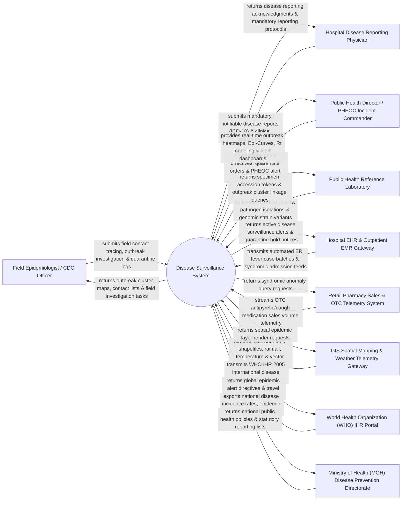

# Context Diagram — Disease Surveillance System

## Mermaid Code

## Actor & Interaction Table | Bảng Actor & Tương tác

| # | Actor | Actor Type | Data Sent TO System | Data Received FROM System | Notes |
|---|-------|------------|---------------------|---------------------------|-------|
| 1 | Field Epidemiologist / CDC Officer | Primary | Field investigation notes, contact tracing lists, exposure source data, quarantine monitoring logs. | Outbreak cluster heatmaps, assigned field investigation tasks, contact follow-up schedules. | Public health officer conducting field contact tracing and outbreak investigations in the community. |
| 2 | Hospital Disease Reporting Physician | Primary | Mandatory notifiable infectious disease case reports (ICD-10), symptom onset dates, patient demographics. | Case submission acknowledgments, mandatory reporting guidelines (Category A/B/C timelines). | Hospital or clinic physician required by law to report suspected/confirmed infectious diseases. |
| 3 | Public Health Director / PHEOC Incident Commander | Primary | Epidemic containment directives, quarantine enforcement orders, Public Health Emergency Operations Center (PHEOC) alerts. | Real-time epidemic heatmaps, Epi-Curves, effective reproductive number ($R_t$) models, cluster alerts. | Health authority executive directing outbreak containment strategies and public health emergency responses. |
| 4 | Public Health Reference Laboratory | Primary | Diagnostic PCR test results, serology panels, pathogen strain isolations, genomic variant sequencing. | Specimen accession tokens, cluster case linkage queries, diagnostic verification requests. | National or regional reference laboratory confirming pathogen strains and genomic variants. |
| 5 | Hospital EHR & Outpatient EMR Gateway | Supporting System | Automated emergency room (ER) fever symptom feeds, syndromic admission batches, discharge ICD-10 codes. | Active disease surveillance alerts, infectious disease quarantine notices, reporting compliance checks. | Enterprise hospital information systems streaming real-time clinical syndromic data feeds. |
| 6 | Retail Pharmacy Sales & OTC Telemetry System | Supporting System | Automated daily over-the-counter (OTC) antipyretic, fever, and cough medication sales volume statistics. | Syndromic anomaly detection queries, baseline sales threshold benchmarks. | Commercial pharmacy network telemetry capturing early syndromic community illness signals. |
| 7 | GIS Spatial Mapping & Weather Telemetry Gateway | Supporting System | Municipal GIS boundary shapefiles, daily rainfall (mm), ambient temperature, mosquito Breteau Index. | Spatial epidemic layer render requests, vector risk mapping queries. | Geographic Information System and meteorological service providing spatial and vector data. |
| 8 | World Health Organization (WHO) IHR Portal | Supporting System | Global health security directives, international travel warnings, novel pathogen guidelines. | WHO International Health Regulations (IHR 2005) mandatory notification reports, global risk assessments. | International health body monitoring global disease outbreaks and cross-border health threats. |
| 9 | MOH Disease Prevention Directorate | Regulatory | Statutory notifiable disease lists (Category A, B, C), national surveillance mandates, reporting deadlines. | Annual national disease incidence reports, vaccination coverage statistics, CDC performance metrics. | Government ministry regulating public health policy, disease notification laws, and national CDC operations. |

## System Boundary Description | Mô tả Phạm vi Hệ thống

The **Disease Surveillance System (DSS)** is an enterprise public health and epidemiological software platform operating across national Centers for Disease Control (CDC), Ministries of Health (MOH), regional health departments, public health reference laboratories, and sentinel hospitals. It automates mandatory notifiable disease case reporting, executes real-time syndromic surveillance early warning algorithms, maps GIS spatial outbreak clusters, manages field contact tracing, ingests genomic pathogen sequencing, and models epidemic curves (Epi-Curves) and effective reproductive numbers ($R_t$).

**Inside System Scope:**
- Electronic mandatory notifiable disease case intake (Category A, B, C per MOH standards).
- Automated syndromic surveillance early warning anomaly detection (ER fever spikes, OTC pharmacy sales).
- GIS spatial outbreak mapping, cluster heatmapping, and vector/environmental risk overlays.
- Field epidemiological case investigation, contact tracing, and quarantine compliance management.
- Public Health Reference Laboratory (PHL) diagnostic result ingestion and genomic strain variant tracking.
- Epidemic curve (Epi-Curve) generation and mathematical reproductive number ($R_0$ / $R_t$) modeling.
- Public Health Emergency Operations Center (PHEOC) alert escalation and containment task dispatch.
- WHO International Health Regulations (IHR 2005) global health reporting compliance.

**Outside System Scope:**
- Individual patient clinical treatment inside hospital wards (handled by Inpatient / HIS).
- Physical laboratory execution of PCR assays or genomic sequencing (handled by laboratory hardware).
- Physical enforcement of police quarantine checkpoints (handled by municipal law enforcement).
- Commercial corporate financial general ledger accounting (handled by enterprise ERP).
