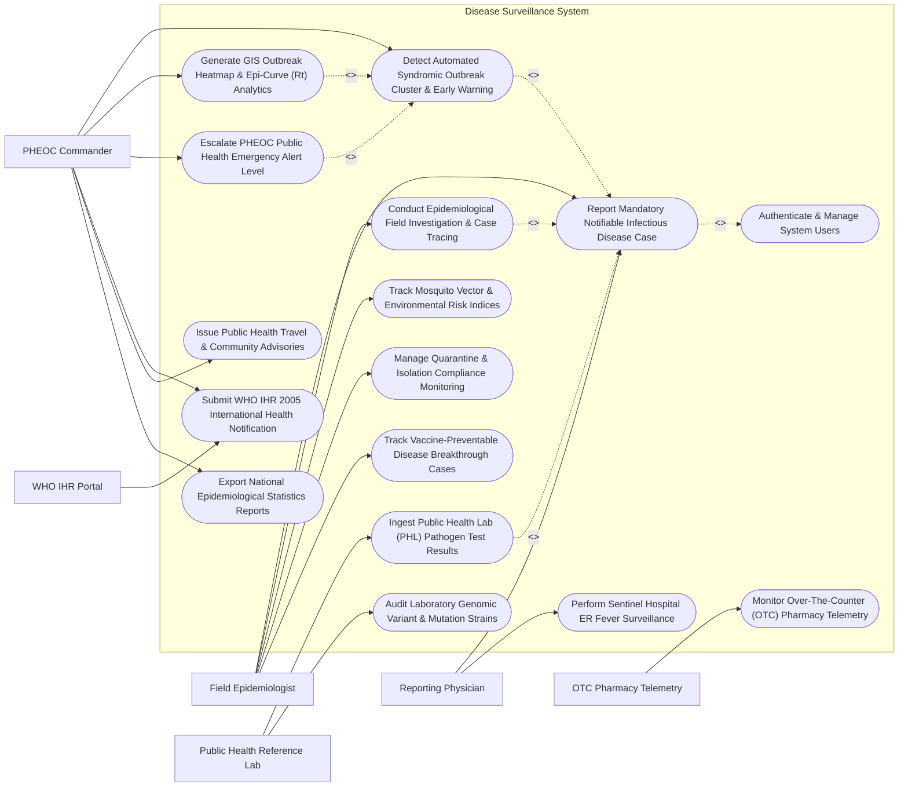

# Use Case Diagram — Disease Surveillance System

## Mermaid Code

## Actor Table | Bảng Actor

| # | Actor | Actor Type | Role Description | Related Use Cases |
|---|-------|------------|------------------|-------------------|
| 1 | Reporting Physician | Primary | Hospital or clinic doctor required by law to report suspected/confirmed cases of mandatory notifiable diseases. | UC01, UC11 |
| 2 | Field Epidemiologist | Primary | CDC officer conducting field outbreak investigations, contact tracing, vector surveys, and quarantine tracking. | UC01, UC03, UC08, UC09, UC14 |
| 3 | PHEOC Commander | Primary | Public Health Emergency Operations Center director monitoring outbreak heatmaps, $R_t$ curves, escalating alert levels, and WHO reporting. | UC02, UC05, UC06, UC10, UC13, UC15 |
| 4 | Public Health Reference Lab | Secondary / System | National reference laboratory confirming pathogen strains (PCR, ELISA) and uploading genomic variant sequences. | UC04, UC12 |
| 5 | WHO IHR Portal | Secondary / System | World Health Organization international health regulations system receiving notification of potential global health emergencies. | UC10 |
| 6 | OTC Pharmacy Telemetry | Secondary / System | Retail pharmacy sales system streaming daily over-the-counter fever and cough medicine sales volume data. | UC07 |

## Use Case Table | Bảng Use Case

| # | UC ID | Use Case Name | Primary Actor | Secondary Actor | Description | Priority |
|---|-------|---------------|---------------|-----------------|-------------|----------|
| 1 | UC01 | Report Mandatory Notifiable Infectious Disease Case | Reporting Physician | Field Epidemiologist | Report suspected or confirmed cases of mandatory notifiable diseases (Category A/B/C: Dengue, Measles, COVID-19, Cholera). | High |
| 2 | UC02 | Detect Automated Syndromic Outbreak Cluster & Early Warning | PHEOC Commander | None | Execute AI anomaly detection algorithms across ER fever feeds and pharmacy sales to flag unexpected geographic outbreak clusters. | High |
| 3 | UC03 | Conduct Epidemiological Field Investigation & Case Tracing | Field Epidemiologist | None | Investigate outbreak Index Cases in the field, trace close contacts, log exposure locations, and assign quarantine protocols. | High |
| 4 | UC04 | Ingest Public Health Lab (PHL) Pathogen Test Results | Public Health Reference Lab | None | Ingest PCR, serology, and genomic sequencing test results, confirming case classification (Suspected -> Confirmed) and variant strain. | High |
| 5 | UC05 | Generate GIS Outbreak Heatmap & Epi-Curve (Rt) Analytics | PHEOC Commander | None | Render interactive GIS spatial disease heatmaps, epidemic curves (Epi-Curves), and calculate effective reproductive number ($R_t$). | High |
| 6 | UC06 | Escalate PHEOC Public Health Emergency Alert Level | PHEOC Commander | None | Escalate public health alert levels (Level 1 Watch to Level 4 Emergency), issuing emergency containment instructions. | High |
| 7 | UC07 | Monitor Over-The-Counter (OTC) Pharmacy Telemetry | OTC Pharmacy Telemetry | None | Ingest daily sales telemetry of antipyretic/cough medications to detect community illness spikes 3-5 days before hospital visits. | Medium |
| 8 | UC08 | Track Mosquito Vector & Environmental Risk Indices | Field Epidemiologist | None | Monitor vector density metrics (Dengue Breteau Index, Container Index) alongside rainfall and temperature data to predict vector outbreaks. | Medium |
| 9 | UC09 | Manage Quarantine & Isolation Compliance Monitoring | Field Epidemiologist | None | Track home or facility quarantine orders, logging daily temperature check-ins and geofence isolation compliance. | High |
| 10 | UC10 | Submit WHO IHR 2005 International Health Notification | PHEOC Commander | WHO IHR Portal | Compile and transmit statutory WHO International Health Regulations (IHR 2005) notifications for events of international concern. | High |
| 11 | UC11 | Perform Sentinel Hospital ER Fever Surveillance | Reporting Physician | None | Stream real-time syndromic surveillance feeds (Acute Respiratory Illness - ARI, Undifferentiated Fever) from sentinel hospital ERs. | High |
| 12 | UC12 | Audit Laboratory Genomic Variant & Mutation Strains | Public Health Reference Lab | None | Track pathogen genomic mutations, lineage variants (e.g., SARS-CoV-2 Omicron sublineages, Influenza strains), and vaccine match. | Medium |
| 13 | UC13 | Issue Public Health Travel & Community Advisories | PHEOC Commander | None | Publish public health travel advisories, community mask/sanitation directives, and school closure recommendations. | Medium |
| 14 | UC14 | Track Vaccine-Preventable Disease Breakthrough Cases | Field Epidemiologist | None | Monitor vaccine breakthrough infections (Measles, Pertussis, Polio in vaccinated individuals), calculating vaccine effectiveness. | Medium |
| 15 | UC15 | Generate National Epidemiological Statistics Reports | PHEOC Commander | None | Produce statutory weekly epidemiologic bulletins, disease incidence rates per 100,000 population, case fatality rates (CFR), and maps. | Medium |
| 16 | UC16 | Authenticate & Manage System Users | All Users | None | Enforce secure multi-factor authentication, role-based access control (Physician, Epidemiologist, Commander), and data encryption. | High |

## Use Case Specification | Đặc tả Use Case

---

### UC01 — Report Mandatory Notifiable Infectious Disease Case

| Field | Detail |
|-------|--------|
| **UC ID** | UC01 |
| **Use Case Name** | Report Mandatory Notifiable Infectious Disease Case |
| **Actor(s)** | Primary: Reporting Physician   Secondary: Field Epidemiologist |
| **Description** | Reports a suspected or laboratory-confirmed case of a mandatory notifiable infectious disease (Category A: Plague, Cholera, Avian Flu; Category B: Dengue, Measles, COVID-19; Category C: Typhoid, Hepatitis) within statutory reporting timelines (e.g., 2 hours for Category A, 24 hours for Category B). |
| **Precondition** | 1. The physician examines a patient presenting with symptoms matching a mandatory notifiable disease definition.   2. The physician is authenticated in DSS. |
| **Main Flow** | 1. The Reporting Physician opens "New Infectious Disease Notification" in DSS or via integrated Hospital EMR gateway.   2. The Physician enters Patient Identity: National Citizen ID (CCCD), Full Name, Age, Gender, Occupation, Residential Address (District, Ward, Street), and Phone Number.   3. The Physician selects **Notifiable Disease Code**: `Dengue Hemorrhagic Fever (ICD-10 A91)` (Category B Notifiable Disease).   4. The Physician inputs Clinical Case Details: Symptom Onset Date (e.g., 3 days ago), Primary Symptoms (High Fever 39.5°C, Retro-orbital pain, Petechiae rash, Thrombocytopenia Platelets 45,000/μL), and Hospital Admission Status.   5. The System checks Statutory Reporting Time Limits: Category B requires reporting within 24 hours of clinical suspicion -> Timely Reporting Verified.   6. The Physician sets Case Classification: **Suspected Case** (pending laboratory NS1/PCR confirmation).   7. The Physician submits the report.   8. The System generates a unique **Disease Case Number** (e.g., CASE-DEN-2026-08192), dispatches an electronic receipt to the hospital, and routes an urgent alert to the District Field Epidemiologist (UC03). |
| **Alternative Flow** | **AF1** — Category A Emergency Immediate Notification (2-Hour SLA): Physician reports suspected Avian Influenza A (H5N1); the System instantly flashes a red "CATEGORY A CRITICAL ALERT" to the CDC Incident Commander and triggers a 2-hour field investigation countdown.   **AF2** — Automated EMR Batch Intake: The hospital EMR system automatically scans discharge ICD-10 codes and transmits an XML batch of 15 Dengue cases every midnight. |
| **Exception Flow** | **EX1** — Late Reporting Penalty Warning (> 24 Hours Past SLA): If a Category B case is reported 4 days after symptom onset, the System flags "LATE REPORTING VIOLATION" and requires the Physician to enter a compliance justification note.   **EX2** — Invalid Patient Geographic Coordinates: If the entered residential address cannot be geocoded into GIS coordinates, the System prompts manual map pin placement. |
| **Postcondition** | Disease Case Number is assigned, mandatory notification is logged with timestamp, statutory reporting SLA is verified, and field epidemiologist is alerted. |
| **Business Rule** | **BR1**: Category A mandatory diseases (Plague, Cholera, Ebola, H5N1) MUST be reported within 2 hours; Category B diseases (Dengue, Measles, Hand-Foot-Mouth) MUST be reported within 24 hours of suspicion.   **BR2**: Notifiable case reports MUST capture exact residential street address and GIS geographic coordinates for spatial outbreak cluster mapping. |

---

### UC02 — Detect Automated Syndromic Outbreak Cluster & Early Warning

| Field | Detail |
|-------|--------|
| **UC ID** | UC02 |
| **Use Case Name** | Detect Automated Syndromic Outbreak Cluster & Early Warning |
| **Actor(s)** | Primary: PHEOC Commander |
| **Description** | Executes automated spatial-temporal anomaly detection algorithms (Farrington algorithm, Spatial Scan Statistics - SaTScan) across sentinel ER fever feeds, lab test positivity rates, and OTC pharmacy sales telemetry to detect emerging disease outbreak clusters 3-7 days before traditional clinical reporting. |
| **Precondition** | 1. High-frequency syndromic data streams (hospital ER fever feeds, pharmacy OTC sales) are active.   2. Historical baseline thresholds for 5-year seasonal disease trends are computed. |
| **Main Flow** | 1. The **Early Warning Surveillance Engine** runs its scheduled 4-hour spatial-temporal scanning algorithm across District 3.   2. The Engine analyzes **Multi-Stream Syndromic Telemetry**:   &nbsp;&nbsp;&nbsp;&nbsp;- **Sentinel ER Fever Feed**: 48 acute fever admissions in District 3 over 48 hours (Baseline average = 12 cases; Anomaly Ratio = 4.0x)   &nbsp;&nbsp;&nbsp;&nbsp;- **OTC Pharmacy Telemetry (UC07)**: Paracetamol/Ibuprofen sales up +310% in District 3 ZIP code   &nbsp;&nbsp;&nbsp;&nbsp;- **Lab Positivity**: Dengue NS1 rapid test positivity rate jumped from 8% to 35%.   3. The Engine calculates the **Outbreak Anomaly Index (Z-Score)**: `Z-Score = 4.85` (Exceeds critical alert threshold Z > 3.0).   4. The Engine identifies the **Geographic Cluster Epicenter**: Latitude 10.7769, Longitude 106.6951 (Radius: 1.5 km covering Ward 7, District 3).   5. The System flags an automated **Outbreak Early Warning Signal**: "HIGH-RISK DENGUE OUTBREAK CLUSTER DETECTED — DISTRICT 3, WARD 7".   6. The System dispatches an urgent Early Warning Alert to the PHEOC Commander's dashboard and auto-generates a Field Investigation Task (UC03). |
| **Alternative Flow** | **AF1** — School Absenteeism Syndromic Trigger: The Engine detects a +45% spike in elementary school absenteeism due to fever/rash in Ward 12, triggering a Hand-Foot-Mouth Disease (HFMD) cluster alert.   **AF2** — Waterborne Diarrheal Disease Cluster: The Engine detects 18 acute watery diarrhea cases near Water Treatment Plant B, issuing a Cholera / Typhoid contamination warning. |
| **Exception Flow** | **EX1** — False Anomaly Spike Override (Holiday Data Distortion): A pharmacy sales spike occurs due to a 3-day public holiday store closure; the PHEOC Commander marks the alert as "False Positive — Holiday Distortion", suppressing further alerts.   **EX2** — Missing Geographic Shapefile Data: If a new administrative ward boundary is missing GIS geometry, the System uses the centroid coordinates of the nearest reporting clinic. |
| **Postcondition** | Outbreak cluster epicenter coordinates and Z-score anomaly index are calculated, GIS spatial heatmap is highlighted, and early warning alerts are dispatched to PHEOC. |
| **Business Rule** | **BR1**: Anomaly Z-scores exceeding 3.0 standard deviations above historical 5-year seasonal baselines MUST trigger an automated PHEOC Early Warning Alert.   **BR2**: Multi-source syndromic triggers combining hospital ER feeds AND pharmacy OTC sales spikes shall receive higher confidence weighting than single-source data. |

---

### UC03 — Conduct Epidemiological Field Investigation & Case Tracing

| Field | Detail |
|-------|--------|
| **UC ID** | UC03 |
| **Use Case Name** | Conduct Epidemiological Field Investigation & Case Tracing |
| **Actor(s)** | Primary: Field Epidemiologist |
| **Description** | Dispatches field epidemiological teams to investigate confirmed or suspected Index Cases in the community, trace close contacts, log exposure locations (schools, workplaces, public transport), collect diagnostic samples, and enforce home/facility quarantine protocols. |
| **Precondition** | 1. A mandatory disease case report (UC01) or outbreak cluster alert (UC02) is assigned to the Field Epidemiologist.   2. Mobile GIS Field Application is active on the epidemiologist's tablet. |
| **Main Flow** | 1. The Field Epidemiologist opens "Assigned Field Investigation" for Case `CASE-DEN-2026-08192` (Dengue Hemorrhagic Fever, District 3).   2. The Epidemiologist conducts a physical field visit to the Index Patient's residence (142 Ward 7, District 3).   3. The Epidemiologist completes the **Standard Epidemiological Investigation Form**:   &nbsp;&nbsp;&nbsp;&nbsp;- **Exposure Source Investigation**: Identifies standing water containers in neighbor's garden   &nbsp;&nbsp;&nbsp;&nbsp;- **Travel History (14 Days Prior)**: Traveled to Can Tho from Oct 1 to Oct 4   &nbsp;&nbsp;&nbsp;&nbsp;- **Food/Water Consumption**: Tap water, local market food.   4. The Epidemiologist executes **Contact Tracing**:   &nbsp;&nbsp;&nbsp;&nbsp;- Identifies Household Contacts: Spouse, 2 Children   &nbsp;&nbsp;&nbsp;&nbsp;- Identifies Workplace Contacts: 4 co-workers sharing enclosed office space.   5. For each contact, the Epidemiologist logs: Full Name, Phone Number, Exposure Type (High Risk / Household), Symptom Status (Asymptomatic), and assigns 14-Day Health Monitoring (UC09).   6. The Epidemiologist collects blood samples from symptomatic contacts, attaches barcode tags, and routes them to the Public Health Reference Lab (UC04).   7. The Epidemiologist submits the investigation report, and the System updates the Disease Transmission Chain Graph. |
| **Alternative Flow** | **AF1** — Respiratory Airborne Contact Tracing (COVID-19 / Measles): For airborne pathogens, the Epidemiologist logs flight/bus numbers, seating row numbers, and uses automated Bluetooth / QR location check-in logs to identify Tier-1 (F1) and Tier-2 (F2) contacts.   **AF2** — Vector Control Remediation Request: The Epidemiologist detects high mosquito breeding; the System auto-issues an urgent "Vector Fogging & Abate Chemical Treatment Order" to the Municipal Sanitation Unit (UC08). |
| **Exception Flow** | **EX1** — Uncooperative Patient / Refusal to Disclose Contacts: If the Index Patient refuses to share contact details, the System flags "Contact Tracing Resistance", alerting the Local Health Authority for legal administrative assistance.   **EX2** — Untraceable Contact Details: If a contact phone number is disconnected, the System flags "Untraced Contact — Local Police Assistance Requested". |
| **Postcondition** | Field investigation findings, exposure sources, and contact tracing trees are recorded, diagnostic samples are routed to PHL, and contact monitoring is active. |
| **Business Rule** | **BR1**: High-risk household contacts of Category A and B infectious diseases MUST be identified and enrolled in health monitoring within 24 hours of Index Case confirmation.   **BR2**: Field epidemiological investigation forms must record exact GPS coordinates of suspected transmission hot-spots. |

---

### UC04 — Ingest Public Health Lab (PHL) Pathogen Test Results

| Field | Detail |
|-------|--------|
| **UC ID** | UC04 |
| **Use Case Name** | Ingest Public Health Lab (PHL) Pathogen Test Results |
| **Actor(s)** | Primary: Public Health Reference Lab |
| **Description** | Ingests diagnostic laboratory test results (RT-PCR, ELISA Serology, Bacterial Culture) and Next-Generation Sequencing (NGS) genomic variant data from the Public Health Reference Laboratory, updating case classifications (Suspected -> Confirmed / Excluded) and linking pathogen strains to outbreak clusters. |
| **Precondition** | 1. Clinical specimens collected during case intake (UC01) or field investigation (UC03) arrive at the reference lab.   2. The Reference Lab LIMS is connected to DSS via API. |
| **Main Flow** | 1. The Reference Lab LIMS transmits an electronic test result payload linked to Specimen Barcode `SPEC-2026-99182`.   2. The System matches Specimen Barcode `SPEC-2026-99182` to Case `CASE-DEN-2026-08192` (Index Patient: Nguyen Van A).   3. The System ingests Laboratory Test Findings:   &nbsp;&nbsp;&nbsp;&nbsp;- **Test Type**: Real-Time RT-PCR   &nbsp;&nbsp;&nbsp;&nbsp;- **Target Pathogen**: Dengue Virus   &nbsp;&nbsp;&nbsp;&nbsp;- **Test Result**: POSITIVE (Ct Value = 22.4)   &nbsp;&nbsp;&nbsp;&nbsp;- **Serotype Identified**: DENV-2 (Dengue Serotype 2).   4. For viral genomic sequencing studies, the System ingests **Genomic Variant Data**: Whole Genome Sequence (WGS) accession, GISAID clade, and specific amino acid mutation markers (e.g., E-protein mutation E156G).   5. The System updates Case Classification: **Lab-Confirmed Case** (Status updated from *Suspected* to *Confirmed*).   6. The System updates the Outbreak Cluster linkage, linking Case `CASE-DEN-2026-08192` to DENV-2 Outbreak Cluster #04 (District 3).   7. The System dispatches notification alerts to the Reporting Physician and Field Epidemiologist. |
| **Alternative Flow** | **AF1** — Negative Diagnostic Test Result (Case Exclusion): RT-PCR returns NEGATIVE for Dengue; the System updates Case Classification to "Excluded Case", releases linked contacts from quarantine, and updates cluster tallies.   **AF2** — Novel Pathogen Mutation / Variant of Concern (VOC) Detection: NGS sequencing detects a novel mutation conferring resistance to antiviral therapy; the System flashes an urgent "NOVEL VARIANT ALERT" to the CDC Incident Commander (UC12). |
| **Exception Flow** | **EX1** — Unmatched Specimen Barcode Error: If LIMS transmits a lab result with a barcode not found in the DSS registry, the System places the result in "Unlinked Lab Queue" and alerts the lab manager.   **EX2** — Inconclusive / Indeterminate Lab Result: If RT-PCR returns "Indeterminate", the System retains "Suspected" status and requests a repeat blood sample collection in 48 hours. |
| **Postcondition** | Case classification is updated to Lab-Confirmed or Excluded, pathogen serotype and genomic variant data are attached, and outbreak cluster linkages are refreshed. |
| **Business Rule** | **BR1**: Positive RT-PCR or culture test results from reference laboratories MUST automatically upgrade case classification from Suspected to Confirmed.   **BR2**: Detection of novel genomic variants of concern (VOC) or WHO high-threat pathogens MUST trigger immediate automated notification to the National CDC Director within 1 hour. |

---

### UC05 — Generate GIS Outbreak Heatmap & Epi-Curve (Rt) Analytics

| Field | Detail |
|-------|--------|
| **UC ID** | UC05 |
| **Use Case Name** | Generate GIS Outbreak Heatmap & Epi-Curve (Rt) Analytics |
| **Actor(s)** | Primary: PHEOC Commander |
| **Description** | Renders real-time spatial GIS outbreak heatmaps, kernel density maps, spatial scan statistics, epidemic curves (Epi-Curves grouped by day/week), and calculates the Effective Reproductive Number ($R_t$) and Case Fatality Rate (CFR) to evaluate epidemic trajectory and intervention efficacy. |
| **Precondition** | 1. Confirmed and suspected disease case reports with GIS geographic coordinates are indexed.   2. The PHEOC Commander is authenticated in the Analytics Module. |
| **Main Flow** | 1. The PHEOC Commander opens "Epidemic Analytics Dashboard" and selects Disease: *Dengue Fever*, Timeframe: *Last 30 Days*, Region: *Ho Chi Minh City*.   2. The System renders the **Interactive GIS Spatial Outbreak Heatmap**:   &nbsp;&nbsp;&nbsp;&nbsp;- Displays kernel density hotspot clusters layered over municipal ward shapefiles   &nbsp;&nbsp;&nbsp;&nbsp;- Colors wards by incidence rate per 100,000 population (Red: > 150/100k; Orange: 50-150/100k; Green: < 50/100k)   &nbsp;&nbsp;&nbsp;&nbsp;- Overlays vector density Breteau Index markers (> 30 containers/100 houses).   3. The System generates the **Epidemic Curve (Epi-Curve)**: Plots daily new case counts bar chart stacked by Case Classification (Confirmed vs Suspected) against 5-year historical average line.   4. The System calculates **Effective Reproductive Number ($R_t$)**:   &nbsp;&nbsp;&nbsp;&nbsp;- Fits daily incidence data using serial interval distribution (Mean SI = 4.8 days)   &nbsp;&nbsp;&nbsp;&nbsp;- Current $R_t = 1.45$ (95% CI: 1.32 - 1.58) -> Indicates **Expanding Epidemic** ($R_t > 1.0$).   5. The System calculates Case Fatality Rate: `CFR = (Total Deaths / Total Cases) x 100% = 0.08%`.   6. The Commander simulates intervention scenarios (e.g., Effect of 80% vector fogging coverage dropping $R_t$ below 1.0).   7. The Commander exports the analytics suite as the official PHEOC Daily Situation Report. |
| **Alternative Flow** | **AF1** — Micro-Level Street & Building Cluster View: The Commander zooms into District 3, viewing exact building 3D pins, identifying multi-story apartment buildings with 5+ cases.   **AF2** — Age-Gender Pyramidal Demographics Analysis: The System renders age-stratified incidence pyramids, showing that 65% of Dengue hospitalizations occur in children aged 5-14 years. |
| **Exception Flow** | **EX1** — Insufficient Data for Rt Calculation ($N < 10$ Cases): If a rural district has only 3 cases, the System flags "Sample Size Insufficient for Stable $R_t$ Estimation" and displays confidence interval warnings.   **EX2** — GIS Layer Render Timeout: If rendering 100,000 spatial points causes browser lag, the System auto-switches to aggregated hexagonal spatial binning (H3 Hexagonal Grid). |
| **Postcondition** | Real-time GIS spatial heatmaps, Epi-Curves, $R_t$ values, and CFR metrics are rendered, and PHEOC situation reports are exported. |
| **Business Rule** | **BR1**: Effective Reproductive Number ($R_t$) calculations MUST display 95% confidence intervals and serial interval assumptions.   **BR2**: $R_t > 1.0$ sustained over 7 consecutive days MUST trigger mandatory review of public health containment measures. |
