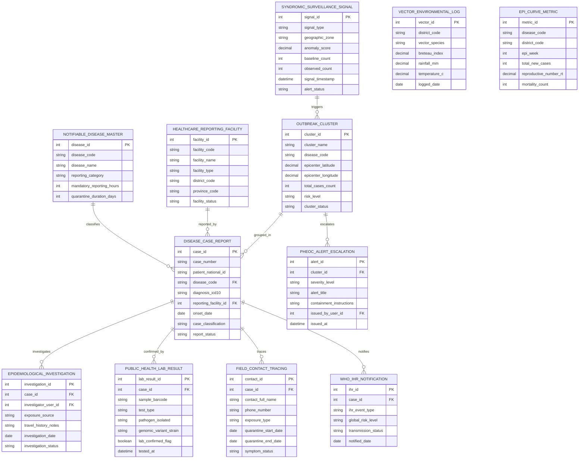

# Conceptual ERD — Disease Surveillance System

## Mermaid Code

## Entity Description Table | Bảng mô tả Entity

| # | Entity Name | Vietnamese Name | Description | Key Attributes | Main Relationships |
|---|-------------|-----------------|-------------|----------------|-------------------|
| 1 | DISEASE_CASE_REPORT | Báo cáo Ca bệnh Truyền nhiễm | Core infectious disease case report storing case number, patient national ID, disease code, ICD-10 diagnosis, facility ID, onset date, case classification (Suspected/Confirmed/Excluded), and status. | case_id, case_number, patient_national_id, disease_code, diagnosis_icd10, reporting_facility_id, case_classification, report_status | Belongs to NOTIFIABLE_DISEASE_MASTER, FACILITY, CLUSTER; Has INVESTIGATION, LAB_RESULT, CONTACT_TRACING, IHR. |
| 2 | NOTIFIABLE_DISEASE_MASTER | Danh mục Bệnh Khai báo Bắt buộc | Master list of statutory notifiable diseases storing disease code, disease name, reporting category (Cat A/B/C), mandatory reporting SLA hours, and quarantine days. | disease_id, disease_code, disease_name, reporting_category, mandatory_reporting_hours, quarantine_duration_days | Has many DISEASE_CASE_REPORT entities. |
| 3 | HEALTHCARE_REPORTING_FACILITY | Cơ sở Y tế Khai báo | Registered healthcare facility record (Hospital, Clinic, Sentinel Center) storing facility code, name, type, district, province, and status. | facility_id, facility_code, facility_name, facility_type, district_code, province_code, facility_status | Has many DISEASE_CASE_REPORT entities. |
| 4 | EPIDEMIOLOGICAL_INVESTIGATION | Điều tra Dịch tễ Trường | Field epidemiological investigation record tracking investigator user ID, exposure source, travel history notes, investigation date, and status. | investigation_id, case_id, investigator_user_id, exposure_source, travel_history_notes, investigation_date | Belongs to DISEASE_CASE_REPORT. |
| 5 | OUTBREAK_CLUSTER | Ổ dịch / Cụm Bệnh (Cluster) | Identified spatial-temporal outbreak cluster tracking cluster name, disease code, epicenter GPS coordinates (lat/long), total case count, risk level, and status. | cluster_id, cluster_name, disease_code, epicenter_latitude, epicenter_longitude, total_cases_count, risk_level | Has many DISEASE_CASE_REPORT and PHEOC_ALERT_ESCALATION entities. |
| 6 | PUBLIC_HEALTH_LAB_RESULT | Kết quả Xét nghiệm CDC | Public health reference lab result record tracking sample barcode, test type (RT-PCR, Serology), pathogen isolated, genomic variant strain, lab confirmed flag, and timestamp. | lab_result_id, case_id, sample_barcode, test_type, pathogen_isolated, genomic_variant_strain, lab_confirmed_flag | Belongs to DISEASE_CASE_REPORT. |
| 7 | SYNDROMIC_SURVEILLANCE_SIGNAL | Tín hiệu Giám sat Hội chứng | Syndromic surveillance anomaly signal tracking signal type (ER Fever, OTC Sales), geographic zone, anomaly Z-score, baseline count, observed count, and alert status. | signal_id, signal_type, geographic_zone, anomaly_score, baseline_count, observed_count, signal_timestamp | Has many OUTBREAK_CLUSTER entities. |
| 8 | FIELD_CONTACT_TRACING | Truy vết Tiếp xúc (F1/F2) | Field contact tracing record tracking contact full name, phone number, exposure type (Household, Office), quarantine start/end dates, and symptom status. | contact_id, case_id, contact_full_name, phone_number, exposure_type, quarantine_start_date, symptom_status | Belongs to DISEASE_CASE_REPORT. |
| 9 | VECTOR_ENVIRONMENTAL_LOG | Nhật ký Muỗi & Môi trường | Vector and environmental surveillance log recording district code, vector species (Aedes aegypti), Breteau Index, rainfall mm, temperature, and logged date. | vector_id, district_code, vector_species, breteau_index, rainfall_mm, temperature_c, logged_date | Standalone environmental monitoring entity by district. |
| 10 | PHEOC_ALERT_ESCALATION | Cảnh báo Khẩn cấp PHEOC | Public Health Emergency Operations Center alert escalation record tracking cluster ID, severity level (Level 1-4), alert title, containment instructions, and issue timestamp. | alert_id, cluster_id, severity_level, alert_title, containment_instructions, issued_by_user_id, issued_at | Belongs to OUTBREAK_CLUSTER. |
| 11 | WHO_IHR_NOTIFICATION | Khai báo Quốc tế WHO (IHR) | Statutory World Health Organization (WHO IHR 2005) international health notification tracking event type, global risk level, transmission status, and notified date. | ihr_id, case_id, ihr_event_type, global_risk_level, transmission_status, notified_date | Belongs to DISEASE_CASE_REPORT. |
| 12 | EPI_CURVE_METRIC | Chỉ số Đường cong Dịch tễ | Aggregated epidemiological metric store tracking disease code, district code, epi week, total new cases, effective reproductive number ($R_t$), and mortality count. | metric_id, disease_code, district_code, epi_week, total_new_cases, reproductive_number_rt, mortality_count | Standalone analytical metric store. |

## Relationship Description | Mô tả Quan hệ

| # | From Entity | Cardinality | To Entity | Relationship Label | Business Explanation |
|---|-------------|-------------|-----------|-------------------|----------------------|
| 1 | NOTIFIABLE_DISEASE_MASTER | one-to-many | DISEASE_CASE_REPORT | classifies | Master notifiable disease registry classifies statutory case reports. |
| 2 | HEALTHCARE_REPORTING_FACILITY | one-to-many | DISEASE_CASE_REPORT | reported_by | One healthcare facility reports multiple notifiable disease cases. |
| 3 | DISEASE_CASE_REPORT | one-to-many | EPIDEMIOLOGICAL_INVESTIGATION | investigates | One disease case report undergoes field epidemiological investigations. |
| 4 | DISEASE_CASE_REPORT | one-to-many | PUBLIC_HEALTH_LAB_RESULT | confirmed_by | One disease case report is confirmed or excluded by public health lab results. |
| 5 | DISEASE_CASE_REPORT | one-to-many | FIELD_CONTACT_TRACING | traces | One disease case report traces multiple close contacts (F1, F2). |
| 6 | DISEASE_CASE_REPORT | one-to-many | WHO_IHR_NOTIFICATION | notifies | One disease case report generates WHO International Health Regulations (IHR) notifications. |
| 7 | OUTBREAK_CLUSTER | one-to-many | DISEASE_CASE_REPORT | grouped_in | One spatial outbreak cluster groups multiple related disease case reports. |
| 8 | OUTBREAK_CLUSTER | one-to-many | PHEOC_ALERT_ESCALATION | escalates | One high-risk outbreak cluster escalates PHEOC emergency alert levels. |
| 9 | SYNDROMIC_SURVEILLANCE_SIGNAL | one-to-many | OUTBREAK_CLUSTER | triggers | One syndromic anomaly signal triggers spatial outbreak cluster investigations. |
