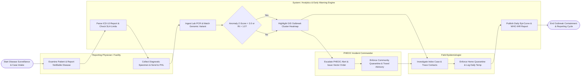

# Swimlane Diagram — Disease Surveillance System

## Mermaid Code

## Flow Description | Mô tả luồng

| Lane | Actor / Subsystem | Role in Flow |
|------|-------------------|--------------|
| 1 | Reporting Physician / Facility | Examines patients presenting with infectious symptoms, reports mandatory notifiable cases (ICD-10) within statutory timelines, collects clinical specimens, and dispatches to reference labs. |
| 2 | Field Epidemiologist | Conducts physical field investigations of Index Cases, traces close contacts (F1/F2), logs exposure locations, enforces quarantine orders, and records daily temperature check-ins. |
| 3 | System / Analytics & Early Warning Engine | Parses mandatory case reports, verifies statutory SLA timelines, ingests reference lab PCR results, executes spatial-temporal anomaly detection (Z-scores), plots Epi-Curves, and computes $R_t$. |
| 4 | PHEOC Incident Commander | Reviews spatial outbreak heatmaps and $R_t$ trajectory curves, escalates public health emergency alert levels (PHEOC Level 1-4), orders vector fogging/quarantine containment, and issues travel advisories. |
