# Action Tree — Disease Surveillance System

## Mermaid Code

```mermaid
graph TD
    Root["Disease Surveillance System"]

    Root --> M1["Mandatory Notifiable Case Reporting"]
    Root --> M2["Syndromic Early Warning Anomaly"]
    Root --> M3["Field Investigation & Contact Tracing"]
    Root --> M4["Public Health Lab & Genomics"]
    Root --> M5["GIS Outbreak Mapping & Epi-Curves"]
    Root --> M6["PHEOC Alert & Containment"]
    Root --> M7["Quarantine & Vector Tracking"]
    Root --> M8["WHO IHR & Statutory Reports"]

    M1 --> A11["Submit Category A B C Case Reports"]
    M1 --> A12["Verify Statutory Reporting SLA Timelines"]
    M1 --> A13["Index Citizen ID & GIS Address Pin"]
    M1 --> A14["Assign Unique Disease Case Number"]

    M2 --> A21["Ingest Sentinel ER Fever Case Feeds"]
    M2 --> A22["Monitor OTC Pharmacy Antipyretic Sales"]
    M2 --> A23["Run Spatial-Temporal SaTScan Scan"]
    M2 --> A24["Compute Outbreak Anomaly Z-Score Index"]

    M3 --> A31["Dispatch Field Epidemiologist Tasks"]
    M3 --> A32["Trace Household & Workplace Contacts"]
    M3 --> A33["Map Disease Transmission Chain Graph"]
    M3 --> A34["Collect Bedside Diagnostic Field Samples"]

    M4 --> A41["Ingest RT-PCR & Serology Test Results"]
    M4 --> A42["Update Case Class Suspected to Confirmed"]
    M4 --> A43["Track NGS Whole Genome Variant Strain"]
    M4 --> A44["Detect Novel Pathogen Mutation Markers"]

    M5 --> A51["Render GIS Kernel Density Heatmap Layers"]
    M5 --> A52["Plot Daily Epi-Curve Stacked Bar Chart"]
    M5 --> A53["Calculate Effective Reproductive Number Rt"]
    M5 --> A54["Model Epidemic Forecast Trajectory Curves"]

    M6 --> A61["Escalate PHEOC Public Emergency Levels"]
    M6 --> A62["Issue Municipal Vector Fogging Orders"]
    M6 --> A63["Publish Community Travel Advisory Notices"]
    M6 --> A64["Dispatch Emergency Response Medical Kits"]

    M7 --> A71["Enforce Home & Facility Quarantine Orders"]
    M7 --> A72["Log Geofence Isolation Check-In Vitals"]
    M7 --> A73["Monitor Mosquito Breteau Vector Index"]
    M7 --> A74["Correlate Rainfall & Temperature Risk"]

    M8 --> A81["Compile WHO IHR 2005 Global Reports"]
    M8 --> A82["Export Weekly CDC Epidemiologic Bulletin"]
    M8 --> A83["Calculate Disease Incidence Rate per 100k"]
    M8 --> A84["Audit Vaccine Breakthrough Case Rates"]
```

## Module Description | Mô tả Module

| # | Module | Description | Actions |
|---|--------|-------------|---------|
| 1 | Mandatory Notifiable Case Reporting | Ingests Category A/B/C statutory case reports, verifies reporting SLA timelines, indexes citizen ID GIS coordinates, and assigns case numbers. | Submit Category A B C Case Reports, Verify Statutory Reporting SLA Timelines, Index Citizen ID & GIS Address Pin, Assign Unique Disease Case Number |
| 2 | Syndromic Early Warning Anomaly | Ingests ER fever feeds and OTC pharmacy sales telemetry, runs spatial-temporal SaTScan algorithms, and computes outbreak anomaly Z-scores. | Ingest Sentinel ER Fever Case Feeds, Monitor OTC Pharmacy Antipyretic Sales, Run Spatial-Temporal SaTScan Scan, Compute Outbreak Anomaly Z-Score Index |
| 3 | Field Investigation & Contact Tracing | Dispatches field investigation tasks, traces household/workplace contacts (F1/F2), maps transmission chain graphs, and collects diagnostic samples. | Dispatch Field Epidemiologist Tasks, Trace Household & Workplace Contacts, Map Disease Transmission Chain Graph, Collect Bedside Diagnostic Field Samples |
| 4 | Public Health Lab & Genomics | Ingests RT-PCR and serology test results, updates case classifications (Suspected to Confirmed), and tracks NGS whole genome variant strains. | Ingest RT-PCR & Serology Test Results, Update Case Class Suspected to Confirmed, Track NGS Whole Genome Variant Strain, Detect Novel Pathogen Mutation Markers |
| 5 | GIS Outbreak Mapping & Epi-Curves | Renders GIS spatial kernel density heatmaps, plots daily Epi-Curves, calculates effective reproductive numbers ($R_t$), and models epidemic forecasts. | Render GIS Kernel Density Heatmap Layers, Plot Daily Epi-Curve Stacked Bar Chart, Calculate Effective Reproductive Number Rt, Model Epidemic Forecast Trajectory Curves |
| 6 | PHEOC Alert & Containment | Escalates public health emergency alert levels (PHEOC Level 1-4), issues vector fogging orders, and publishes community travel advisories. | Escalate PHEOC Public Emergency Levels, Issue Municipal Vector Fogging Orders, Publish Community Travel Advisory Notices, Dispatch Emergency Response Medical Kits |
| 7 | Quarantine & Vector Tracking | Enforces home/facility quarantine orders, tracks geofence isolation compliance, monitors mosquito Breteau vector indices, and correlates weather. | Enforce Home & Facility Quarantine Orders, Log Geofence Isolation Check-In Vitals, Monitor Mosquito Breteau Vector Index, Correlate Rainfall & Temperature Risk |
| 8 | WHO IHR & Statutory Reports | Compiles WHO International Health Regulations (IHR 2005) notifications, exports weekly CDC epidemiologic bulletins, and audits vaccine coverage. | Compile WHO IHR 2005 Global Reports, Export Weekly CDC Epidemiologic Bulletin, Calculate Disease Incidence Rate per 100k, Audit Vaccine Breakthrough Case Rates |
