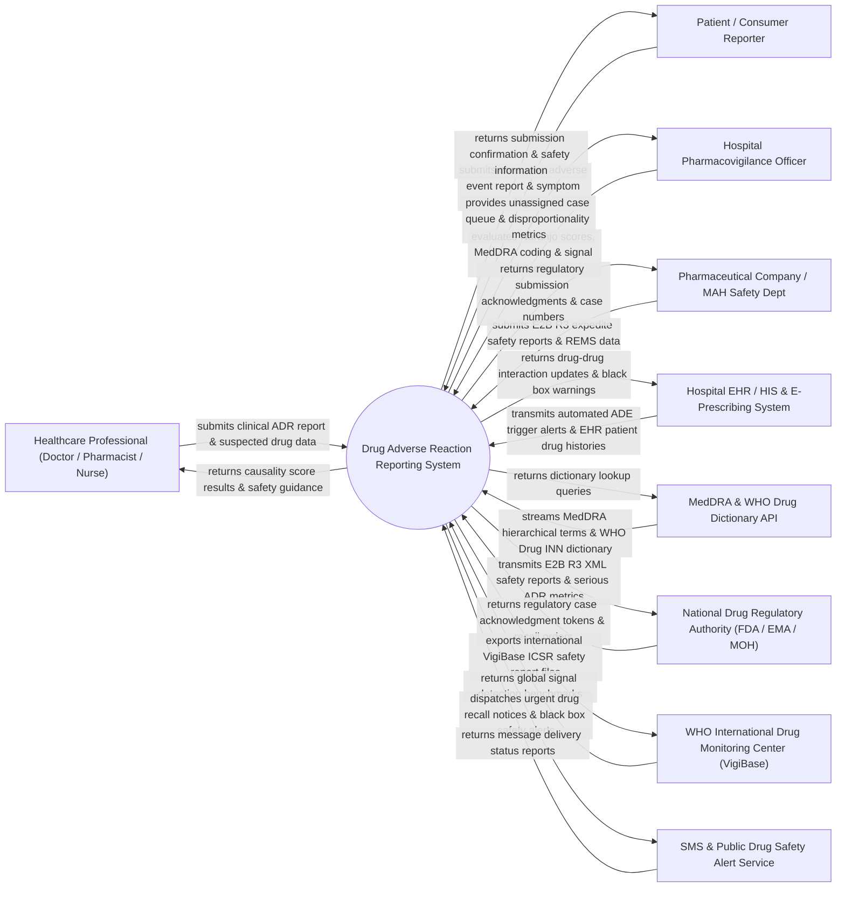

# Context Diagram — Drug Adverse Reaction Reporting System

## Mermaid Code

## Actor & Interaction Table | Bảng Actor & Tương tác

| # | Actor | Actor Type | Data Sent TO System | Data Received FROM System | Notes |
|---|-------|------------|---------------------|---------------------------|-------|
| 1 | Healthcare Professional (Doctor / Pharmacist / Nurse) | Primary | Clinical ADR case details, suspect drug lot numbers, onset timestamps, reaction outcomes, de-challenge/re-challenge responses. | Causality assessment score results (Naranjo/WHO), drug safety advisories, case reference codes. | Clinical clinician reporting unexpected or serious adverse drug events observed during patient care. |
| 2 | Patient / Consumer Reporter | Primary | Self-reported adverse symptoms, over-the-counter/herbal drug usage, patient demographics, contact details. | Case submission acknowledgment token, consumer drug safety advice, hotline contacts. | Patient or family member submitting spontaneous reports of unexpected drug side effects. |
| 3 | Hospital Pharmacovigilance Officer | Primary | Naranjo causality scoring, MedDRA term coding, signal detection parameters, causality overrides. | Unassigned ADR case queue, disproportionality metrics (PRR/ROR), serious reaction alerts. | Specialized clinical pharmacist or safety officer evaluating, coding, and managing ADR cases. |
| 4 | Pharmaceutical Company / MAH Safety Dept | Primary | E2B(R3) expedite Individual Case Safety Reports (ICSR), Periodic Benefit-Risk Evaluation Reports (PBRER). | Electronic submission acknowledgment (ACK) files, regulatory case numbers, signal query results. | Marketing Authorization Holder (MAH) legally required to report post-marketing drug safety events. |
| 5 | National Drug Regulatory Authority (FDA / EMA / MOH) | Regulatory | National drug safety laws, black box warning mandates, drug recall orders, mandatory reporting rules. | E2B(R3) XML ICSR safety files, urgent serious ADR reports, national signal detection reports. | Governmental authority (e.g., FDA FAERS, EMA EudraVigilance, Vietnam MOH Drug Administration) supervising drug safety. |
| 6 | WHO International Drug Monitoring Center (VigiBase) | Supporting System | Global signal detection benchmarks, international WHO-UMC causality guidelines, global ICSR stats. | International E2B(R3) ICSR safety report uploads (VigiBase database synchronization). | WHO Uppsala Monitoring Centre (UMC) managing international drug safety surveillance. |
| 7 | Hospital EHR / HIS & E-Prescribing System | Supporting System | Automated Adverse Drug Event (ADE) trigger alerts (e.g., sudden lab drops, Naloxone orders), patient drug profile. | Updated drug allergy warnings, black box safety advisories, contraindication alert overrides. | Enterprise hospital information platform generating automated ADE triggers and updating EHR allergy lists. |
| 8 | MedDRA & WHO Drug Dictionary API | Supporting System | MedDRA term hierarchy (LLT, PT, HLT, HLGT, SOC), WHO Drug Global International Non-proprietary Names (INN). | Dictionary term search queries, MedDRA version update payloads. | Standardized medical terminology service coding adverse reaction symptoms and drug trade/generic names. |
| 9 | SMS & Public Drug Safety Alert Service | Supporting System | Message transmission status reports, public notification delivery confirmations. | Urgent drug recall notices, black box safety advisories, batch quarantine warnings. | Multi-channel alert dispatch system broadcasting high-priority drug safety advisories to clinics and public. |

## System Boundary Description | Mô tả Phạm vi Hệ thống

The **Drug Adverse Reaction Reporting System (DARRS)** is a specialized national and clinical pharmacovigilance platform designed to collect, evaluate, code, analyze, and submit Adverse Drug Reactions (ADRs), Adverse Events Following Immunization (AEFI), and Medication Errors. It supports spontaneous reporting by clinicians and consumers, automates MedDRA / WHO Drug Dictionary coding, performs causality scoring (Naranjo Algorithm, WHO-UMC Scale), executes statistical signal detection (PRR, ROR), generates E2B(R3) compliant XML files for regulatory bodies (FDA, EMA, WHO VigiBase), and manages drug safety recalls.

**Inside System Scope:**
- Intake of spontaneous ADR reports from healthcare providers, consumers, and pharmaceutical MAHs.
- Automated Adverse Drug Event (ADE) trigger detection integrated with hospital EHR systems.
- Medical coding of reaction terms using MedDRA hierarchies (LLT, PT, SOC) and WHO Drug INNs.
- Causality assessment workflows using the Naranjo Algorithm and WHO-UMC Causality Scale.
- Statistical data mining for signal detection using Proportional Reporting Ratio (PRR) and Reporting Odds Ratio (ROR).
- Compilation and transmission of ICH E2B(R3) compliant ICSR XML safety files to regulatory authorities.
- Management of Drug Safety Advisories, Black Box Warnings, and Batch Lot Recalls.

**Outside System Scope:**
- Physical laboratory chemical analysis of counterfeit or contaminated drug samples (handled by Drug Testing Labs).
- Hospital financial compensation, malpractice legal settlement, and litigation (handled by Legal/Insurance).
- Commercial pharmaceutical manufacturing and factory quality control (handled by Pharma Manufacturing GMP).
- Direct host operating system management of national server infrastructure (handled by Cloud/IT Data Centers).
