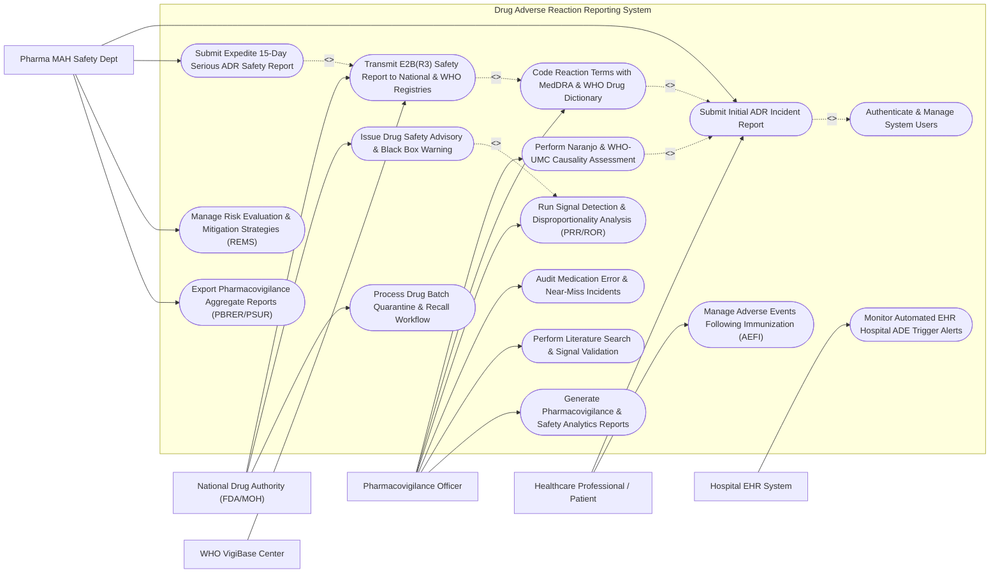

# Use Case Diagram — Drug Adverse Reaction Reporting System

## Mermaid Code

## Actor Table | Bảng Actor

| # | Actor | Actor Type | Role Description | Related Use Cases |
|---|-------|------------|------------------|-------------------|
| 1 | Healthcare Professional / Patient | Primary | Physician, pharmacist, nurse, or consumer patient submitting spontaneous adverse drug reaction reports. | UC01, UC07 |
| 2 | Pharmacovigilance Officer | Primary | Clinical safety specialist reviewing incoming ADR cases, coding MedDRA terms, scoring causality, and mining signals. | UC02, UC03, UC04, UC08, UC13, UC15 |
| 3 | Pharma MAH Safety Dept | Primary | Marketing Authorization Holder safety officer responsible for 15-day expedited reporting, REMS plans, and PBRER reports. | UC01, UC11, UC12, UC14 |
| 4 | National Drug Authority (FDA/MOH) | Regulatory / Secondary | Governmental regulatory body reviewing E2B(R3) safety reports, issuing safety advisories, and ordering drug recalls. | UC05, UC09, UC10 |
| 5 | WHO VigiBase Center | Secondary / System | Global drug monitoring center receiving international E2B(R3) ICSR files to track global drug safety signals. | UC05 |
| 6 | Hospital EHR System | Secondary / System | Enterprise hospital software generating automated ADE trigger alerts (e.g., lab drops, antidote orders). | UC06 |

## Use Case Table | Bảng Use Case

| # | UC ID | Use Case Name | Primary Actor | Secondary Actor | Description | Priority |
|---|-------|---------------|---------------|-----------------|-------------|----------|
| 1 | UC01 | Submit Initial ADR Incident Report | Healthcare Professional / Patient | None | Intake initial adverse drug reaction report specifying patient demographics, suspect drug details, reaction onset, and severity. | High |
| 2 | UC02 | Perform Naranjo & WHO-UMC Causality Assessment | Pharmacovigilance Officer | None | Evaluate drug-event relationship using the 10-question Naranjo probability scale and WHO-UMC causality categories. | High |
| 3 | UC03 | Code Reaction Terms with MedDRA & WHO Drug Dictionary | Pharmacovigilance Officer | None | Standardize verbatim reaction descriptions into MedDRA (LLT/PT/SOC) terms and match drug trade names to WHO Drug INNs. | High |
| 4 | UC04 | Run Signal Detection & Disproportionality Analysis (PRR/ROR) | Pharmacovigilance Officer | None | Execute disproportionality algorithms (PRR, ROR, BCPNN) to detect unexpected statistical safety signals for drug-event pairs. | High |
| 5 | UC05 | Transmit E2B(R3) Safety Report to National & WHO Registries | National Drug Authority (FDA/MOH) | WHO VigiBase Center | Format validated ICSR safety cases into E2B(R3) XML schema payloads and transmit to FDA FAERS, EMA, or WHO VigiBase. | High |
| 6 | UC06 | Monitor Automated EHR Hospital ADE Trigger Alerts | Hospital EHR System | Pharmacovigilance Officer | Ingest automated clinical trigger rules from EHRs (e.g., sudden Creatinine spike, Naloxone administration) to flag unassigned ADEs. | High |
| 7 | UC07 | Manage Adverse Events Following Immunization (AEFI) | Healthcare Professional / Patient | None | Capture vaccine-specific adverse reaction events, tracking vaccine manufacturer, lot/batch number, dose number, and cold chain logs. | High |
| 8 | UC08 | Audit Medication Error & Near-Miss Incidents | Pharmacovigilance Officer | None | Log prescribing, dispensing, or administration errors (near-misses / actual errors) to identify systemic hospital safety flaws. | Medium |
| 9 | UC09 | Issue Drug Safety Advisory & Black Box Warning | National Drug Authority (FDA/MOH) | None | Publish official drug safety advisories, black box label modifications, or Dear Healthcare Provider (DHCP) letters. | High |
| 10 | UC10 | Process Drug Batch Quarantine & Recall Workflow | National Drug Authority (FDA/MOH) | None | Issue urgent drug batch quarantine orders, notify hospital pharmacies, and track returned/quarantined lot units. | High |
| 11 | UC11 | Submit Expedite 15-Day Serious ADR Safety Report | Pharma MAH Safety Dept | None | Flag serious unlisted adverse events (death, life-threatening, disability) for mandatory 15-day expedited regulatory submission. | High |
| 12 | UC12 | Manage Risk Evaluation & Mitigation Strategies (REMS) | Pharma MAH Safety Dept | None | Define REMS protocols, monitor mandatory prescriber training certifications, and verify patient registry enrollment. | Medium |
| 13 | UC13 | Perform Literature Search & Signal Validation | Pharmacovigilance Officer | None | Perform scientific literature database searches (PubMed / Embase) to validate newly detected drug-event safety signals. | Medium |
| 14 | UC14 | Export Pharmacovigilance Aggregate Reports (PBRER/PSUR) | Pharma MAH Safety Dept | None | Compile periodic safety update reports (PBRER / PSUR) summarizing global benefit-risk profile data for regulatory submission. | Medium |
| 15 | UC15 | Generate Pharmacovigilance & Safety Analytics Reports | Pharmacovigilance Officer | None | Produce national ADR reporting frequency trends, organ class disproportionality heatmaps, and drug safety performance metrics. | Medium |
| 16 | UC16 | Authenticate & Manage System Users | All Users | None | Enforce secure login, role-based access control, and immutable cryptographic audit logging for regulatory compliance. | High |

## Use Case Specification | Đặc tả Use Case

---

### UC01 — Submit Initial ADR Incident Report

| Field | Detail |
|-------|--------|
| **UC ID** | UC01 |
| **Use Case Name** | Submit Initial ADR Incident Report |
| **Actor(s)** | Primary: Healthcare Professional / Patient   Secondary: Pharma MAH Safety Dept |
| **Description** | Captures the initial spontaneous adverse drug reaction incident report, gathering 4 mandatory ICSR safety elements: An Identifiable Reporter, An Identifiable Patient, At Least One Suspected Drug, and At Least One Adverse Reaction. |
| **Precondition** | 1. The reporter is authenticated or accessing the secure public/clinical ADR reporting portal.   2. The suspected drug and adverse reaction event occurred. |
| **Main Flow** | 1. The Reporter opens "New ADR Report Form" (CIOMS I / MedWatch 3500 style).   2. The System validates the 4 Mandatory ICSR Elements: **Element 1 (Reporter)**: Full Name, Role (Doctor, Pharmacist, Nurse, Patient), Contact Email/Phone; **Element 2 (Patient)**: Patient Initials, Age/DOB, Gender, Weight, Medical History; **Element 3 (Suspected Drug)**: Brand/Generic Name, Manufacturer, Batch/Lot Number, Dose/Frequency, Route of Admin, Indication, Start/Stop Dates; **Element 4 (Adverse Reaction)**: Verbatim Reaction Description, Onset Date/Time, Severity, Outcome (Recovered, Ongoing, Fatal, Hospitalization).   3. The Reporter enters concomitant medications (other drugs taken concurrently) and de-challenge response (Did reaction abate after drug withdrawal?).   4. The System evaluates Seriousness Criteria (Is reaction Fatal, Life-Threatening, Causing Disability, Requiring Hospitalization, or Congenital Anomaly?).   5. The System generates a unique Case Safety Number (e.g., ADR-2026-00981) and issues a digital receipt with a tracking token.   6. The System routes the raw case to the Pharmacovigilance Officer's intake queue for MedDRA coding (UC03) and Causality Assessment (UC02). |
| **Alternative Flow** | **AF1** — Direct MAH E2B(R3) Gateway Intake: Pharmaceutical MAHs submit XML safety files directly via E2B(R3) AS2 gateway; the System parses the XML payload automatically into the database.   **AF2** — Consumer Self-Reporting Simplified Flow: A patient uses the mobile app simplified wizard to report a drug side effect; the System maps consumer terms to clinical fields. |
| **Exception Flow** | **EX1** — Missing Mandatory ICSR Element: If any of the 4 mandatory elements (Reporter, Patient, Drug, Reaction) is missing, the System blocks submission and highlights the missing mandatory field.   **EX2** — Duplicate Case Detection Alert: If a case with the same patient initials, drug name, and onset date was submitted within 48 hours, the System flags "Potential Duplicate Case" for case merging. |
| **Postcondition** | Initial ADR case is registered with a unique Case Safety ID, 4 mandatory ICSR elements are captured, seriousness criteria are flagged, and the case is queued for clinical review. |
| **Business Rule** | **BR1**: An ICSR report must contain all 4 ICH E2B mandatory elements (Reporter, Patient, Suspect Drug, Adverse Reaction) to be valid for regulatory filing.   **BR2**: Reports meeting "Serious" criteria (Fatal, Life-Threatening, Disability, Hospitalization) must be flagged for mandatory 15-day expedited regulatory processing. |

---

### UC02 — Perform Naranjo & WHO-UMC Causality Assessment

| Field | Detail |
|-------|--------|
| **UC ID** | UC02 |
| **Use Case Name** | Perform Naranjo & WHO-UMC Causality Assessment |
| **Actor(s)** | Primary: Pharmacovigilance Officer |
| **Description** | Evaluates the probability that the suspected drug caused the reported adverse reaction by applying the 10-question Naranjo Algorithm score and assigning WHO-UMC Causality Categories (Certain, Probable, Possible, Unlikely, Unclassified). |
| **Precondition** | 1. An initial ADR case report (UC01) with suspect drug and reaction details is active in the queue.   2. The Pharmacovigilance Officer is authenticated with clinical evaluator privileges. |
| **Main Flow** | 1. The Officer opens the "Causality Assessment Workbench" for the target ADR case.   2. The System displays case timeline: Drug administration start/stop dates, Reaction onset date, De-challenge response, and Re-challenge results.   3. The Officer answers the 10 Naranjo Algorithm Questionnaire Items:   &nbsp;&nbsp;&nbsp;&nbsp;Q1: Are there previous conclusive reports on this reaction? (+1 Yes, 0 No, 0 Do Not Know)   &nbsp;&nbsp;&nbsp;&nbsp;Q2: Did the adverse event appear after the suspected drug was administered? (+2 Yes, -1 No, 0 Do Not Know)   &nbsp;&nbsp;&nbsp;&nbsp;Q3: Did the adverse reaction improve when the drug was discontinued (De-challenge)? (+1 Yes, 0 No, 0 Do Not Know)   &nbsp;&nbsp;&nbsp;&nbsp;Q4: Did the adverse reaction reappear when the drug was re-administered (Re-challenge)? (+2 Yes, -1 No, 0 Do Not Know)   &nbsp;&nbsp;&nbsp;&nbsp;Q5: Are there alternative causes (other disease state / concomitant drugs)? (-1 Yes, +2 No, 0 Do Not Know)   &nbsp;&nbsp;&nbsp;&nbsp;Q6: Did the reaction reappear when a placebo was given? (-1 Yes, +1 No, 0 Do Not Know)   &nbsp;&nbsp;&nbsp;&nbsp;Q7: Was the drug detected in the blood in toxic concentrations? (+1 Yes, 0 No, 0 Do Not Know)   &nbsp;&nbsp;&nbsp;&nbsp;Q8: Was the reaction more severe when dose increased, or less severe when decreased? (+1 Yes, 0 No, 0 Do Not Know)   &nbsp;&nbsp;&nbsp;&nbsp;Q9: Did the patient have a similar reaction to the same/similar drugs previously? (+1 Yes, 0 No, 0 Do Not Know)   &nbsp;&nbsp;&nbsp;&nbsp;Q10: Was the adverse event confirmed by objective evidence (lab test / biopsy)? (+1 Yes, 0 No, 0 Do Not Know).   4. The System sums the total Naranjo Score (-4 to +13) and maps it to Naranjo Category: **>= 9**: Definite; **5 to 8**: Probable; **1 to 4**: Possible; **<= 0**: Unlikely.   5. The Officer selects the corresponding WHO-UMC Causality Category (Certain, Probable/Likely, Possible, Unlikely, Conditional/Unclassified, Unassessable/Unresolvable).   6. The Officer enters qualitative clinical reasoning notes and signs the assessment.   7. The System locks the causality evaluation into the master ICSR record. |
| **Alternative Flow** | **AF1** — Multi-Drug Causality Comparison: For patients taking multiple concomitant drugs, the Officer runs the Naranjo score independently for each suspected drug, identifying the most probable offending agent.   **AF2** — Specialist Expert Panel Review: For complex fatal cases, the Officer routes the case to a 3-pharmacist Expert Review Panel for consensus causality voting. |
| **Exception Flow** | **EX1** — Incomplete De-Challenge Information: If de-challenge information is missing, Q3 defaults to score 0 ("Do Not Know") and flags a request for follow-up patient data.   **EX2** — Conflict Between Naranjo and WHO Category: If Naranjo score indicates "Definite" (+9) but WHO-UMC is set to "Unlikely", the System requires a documented justification note before saving. |
| **Postcondition** | Naranjo total score (-4 to +13) is calculated, Naranjo Category is assigned, WHO-UMC Category is recorded, and causality rationale is locked into the case record. |
| **Business Rule** | **BR1**: Causality assessment MUST evaluate de-challenge, re-challenge, baseline disease state, and concomitant drug interactions.   **BR2**: Cases rated as "Definite" or "Probable" must be automatically included in the statistical signal detection pool (UC04). |

---

### UC03 — Code Reaction Terms with MedDRA & WHO Drug Dictionary

| Field | Detail |
|-------|--------|
| **UC ID** | UC03 |
| **Use Case Name** | Code Reaction Terms with MedDRA & WHO Drug Dictionary |
| **Actor(s)** | Primary: Pharmacovigilance Officer |
| **Description** | Maps verbatim free-text adverse reaction descriptions into standardized MedDRA (Medical Dictionary for Regulatory Activities) 5-level hierarchical terms (LLT, PT, HLT, HLGT, SOC) and standardizes suspect drug names to WHO Drug Global INN (International Non-proprietary Name) codes. |
| **Precondition** | 1. A raw ADR report with verbatim symptom descriptions (e.g., "patient developed red itching skin hives after taking drug") is active.   2. MedDRA dictionary version (e.g., v26.1) and WHO Drug Global database are loaded. |
| **Main Flow** | 1. The Officer opens the "Medical Coding Workbench" for the target case.   2. The System displays the reported verbatim text (e.g., "severe shortness of breath and facial swelling").   3. The Officer uses the MedDRA Auto-Coder engine to search for matching Lowest Level Terms (LLT).   4. The System highlights candidate MedDRA terms: Verbatim "shortness of breath" -> LLT: *Dyspnoea* (10013924) -> Preferred Term (PT): *Dyspnoea*; Verbatim "facial swelling" -> LLT: *Facial oedema* (10015923) -> PT: *Face oedema*.   5. The System displays the full 5-level MedDRA hierarchy for selected PT *Face oedema*:   &nbsp;&nbsp;&nbsp;&nbsp;**LLT**: Facial oedema   &nbsp;&nbsp;&nbsp;&nbsp;**PT**: Face oedema   &nbsp;&nbsp;&nbsp;&nbsp;**HLT**: Oedematous conditions NEC   &nbsp;&nbsp;&nbsp;&nbsp;**HLGT**: Decreased and non-site specific tissue perfusion conditions   &nbsp;&nbsp;&nbsp;&nbsp;**SOC**: General disorders and administration site conditions.   6. The Officer maps reported suspect drug trade names (e.g., "Augmentin 625mg") to the WHO Drug Global INN code: *Amoxicillin and Beta-Lactamase Inhibitor* (WHO Drug Code: 004123-01-001).   7. The Officer clicks "Confirm & Lock Medical Coding", updating the case with standardized MedDRA PTs and WHO Drug INNs. |
| **Alternative Flow** | **AF1** — Automated NLP Auto-Coding: The System uses Natural Language Processing (NLP) to parse raw clinical narrative text, pre-selecting top 3 candidate MedDRA PTs with confidence scores (> 90%).   **AF2** — MedDRA Version Up-Versioning: When a new MedDRA version is released, the System executes automated batch re-coding, flagging terms whose PT mappings have changed. |
| **Exception Flow** | **EX1** — Unmapped Verbatim Term Alert: If a reported symptom (e.g., "brain fog") has no direct LLT match, the System prompts the coder to select the closest Synonym or escalate to the Senior Medical Coder.   **EX2** — Off-Label Drug Trade Name: If a trade name is not in the WHO Drug dictionary, the System prompts manual entry of active chemical ingredients. |
| **Postcondition** | Verbatim reactions are coded to MedDRA Preferred Terms (PT) and System Organ Classes (SOC), suspect drugs are mapped to WHO INNs, and case coding is locked. |
| **Business Rule** | **BR1**: All adverse reaction terms MUST be coded to an official MedDRA Preferred Term (PT) before regulatory E2B transmission.   **BR2**: MedDRA coding must preserve the reporter's original medical intent without under-coding or over-coding symptom severity. |

---

### UC04 — Run Signal Detection & Disproportionality Analysis (PRR/ROR)

| Field | Detail |
|-------|--------|
| **UC ID** | UC04 |
| **Use Case Name** | Run Signal Detection & Disproportionality Analysis (PRR/ROR) |
| **Actor(s)** | Primary: Pharmacovigilance Officer |
| **Description** | Executes statistical data mining algorithms (Proportional Reporting Ratio - PRR, Reporting Odds Ratio - ROR, Empirical Bayes Geometric Mean - EBGM) across the national ADR safety database to detect disproportionality signals for unexpected drug-event pairs. |
| **Precondition** | 1. The national ADR database contains coded ICSR cases (MedDRA PTs and WHO Drug INNs).   2. The statistical signal detection engine parameters are configured. |
| **Main Flow** | 1. The Officer opens the "Pharmacovigilance Signal Detection Dashboard" and initiates "Run Monthly Disproportionality Mining".   2. The System builds a 2x2 Contingency Table for every Drug-Event Pair (Drug X and Reaction Y):   &nbsp;&nbsp;&nbsp;&nbsp;- **Cell A**: Cases with Drug X and Reaction Y   &nbsp;&nbsp;&nbsp;&nbsp;- **Cell B**: Cases with Drug X and Other Reactions   &nbsp;&nbsp;&nbsp;&nbsp;- **Cell C**: Cases with Other Drugs and Reaction Y   &nbsp;&nbsp;&nbsp;&nbsp;- **Cell D**: Cases with Other Drugs and Other Reactions.   3. The System computes Proportional Reporting Ratio (PRR): `PRR = [A / (A + B)] / [C / (C + D)]`.   4. The System computes Reporting Odds Ratio (ROR): `ROR = (A * D) / (B * C)` along with 95% Confidence Interval (CI).   5. The System computes Chi-Square (χ²) statistic with Yates' correction.   6. The System evaluates Evans' Criteria for Signal Detection: **Signal Threshold**: `Case Count A >= 3`, `PRR >= 2.0`, and `Chi-Square >= 4.0`.   7. The System identifies new drug-event pairs meeting signal criteria (e.g., Drug *SGLT2 Inhibitor* + Reaction *Fournier's Gangrene*: `A = 14`, `PRR = 8.4`, `χ² = 22.1`).   8. The System generates a "New Safety Signal Alert", creating a Signal Evaluation Dossier for validation review (UC13). |
| **Alternative Flow** | **AF1** — Bayesian Confidence Propagation Neural Network (BCPNN): The System executes BCPNN computing Information Component (IC) and IC-2.5% lower confidence bound (Signal triggered when `IC-2.5% > 0`).   **AF2** — Sub-Group Stratification: The Officer filters signal analysis by age group (Pediatric vs Elderly) or gender to uncover subgroup-specific vulnerabilities. |
| **Exception Flow** | **EX1** — False Positive Web Signal Alert (Weber Effect): For newly launched drugs (first 1-2 years), peak reporting may artificially spike PRR scores; the System flags "Weber Effect - High Media Bias Likely".   **EX2** — Low Case Volume Warning (`A < 3`): If a severe reaction has only 2 reported cases, the System flags "Emerging Low-Volume Signal - Monitor Closely" without generating a full PRR alert. |
| **Postcondition** | 2x2 contingency tables are constructed, PRR, ROR, and Chi-Square metrics are calculated, new safety signals are detected, and signal evaluation dossiers are generated. |
| **Business Rule** | **BR1**: A statistical safety signal is validated when `Case Count >= 3`, `PRR >= 2.0`, `Chi-Square >= 4.0`, and the reaction is unlisted in the current drug package insert.   **BR2**: Validated safety signals must trigger a mandatory 30-day internal safety review for potential label modification or black box advisory (UC09). |

---

### UC05 — Transmit E2B(R3) Safety Report to National & WHO Registries

| Field | Detail |
|-------|--------|
| **UC ID** | UC05 |
| **Use Case Name** | Transmit E2B(R3) Safety Report to National & WHO Registries |
| **Actor(s)** | Primary: National Drug Authority (FDA/MOH)   Secondary: WHO VigiBase Center |
| **Description** | Formats validated Individual Case Safety Reports (ICSR) into international ICH E2B(R3) XML schema standards, performs XML DTD validation, and securely transmits XML files via B2B Gateway (AS2 protocol) to national regulatory authorities (FDA FAERS, EMA EudraVigilance) and the WHO VigiBase global database. |
| **Precondition** | 1. An ICSR case report (UC01) is coded with MedDRA (UC03) and evaluated for causality (UC02).   2. Regulatory AS2 gateway digital certificates are active. |
| **Main Flow** | 1. The System identifies validated ICSR safety cases ready for regulatory transmission.   2. The System runs E2B(R3) Schema Validation Rules: Verifies mandatory ICH elements (N.1.1 Sender, N.2.r Patient, C.1.1 Case Identifier, G.k Suspect Drug, E.i Reaction Term).   3. The System converts the case database record into an official ICH E2B(R3) XML document structure (complying with ISO 27953-2 standard).   4. The System signs the XML payload with an electronic digital signature certificate.   5. The System transmits the XML payload via AS2 encrypted protocol to the target regulatory gateway (e.g., FDA FAERS Gateway or WHO VigiBase API).   6. The receiving gateway returns an automated E2B Acknowledgment (ACK) XML file (ACK Code: `1` = Success / ICSR accepted; `2` = Error / Rejected).   7. The System parses the ACK XML, updates transmission status to "Transmitted & Accepted", logs the regulatory Case Safety Report Unique ID, and archives the XML transmission log. |
| **Alternative Flow** | **AF1** — Bulk E2B(R3) Batch Transmission: For monthly reporting cycles, the System compiles a ZIP archive of 500 E2B(R3) XML files and transmits them in a single batch operation.   **AF2** — VigiBase Direct Sync API: The System transmits ICSR records directly to the WHO Uppsala Monitoring Centre via REST API using VigiBase OAuth2 security tokens. |
| **Exception Flow** | **EX1** — E2B Schema Validation Error (`ACK Code 2`): If the receiving regulatory gateway rejects the XML due to invalid MedDRA version or missing element, the System logs "Transmission Rejected", alerts the PV Officer, and displays the exact XML line error.   **EX2** — AS2 Network Gateway Timeout: If the AS2 connection times out during transmission, the System queues automated retries (3 attempts at 15-minute intervals). |
| **Postcondition** | ICSR safety case is formatted into ICH E2B(R3) XML, validated, digitally signed, transmitted via AS2 gateway, and regulatory ACK approval is archived. |
| **Business Rule** | **BR1**: E2B(R3) XML safety reports MUST strictly comply with ICH ISO 27953-2 DTD schemas and use official MedDRA PT codes.   **BR2**: Serious expedited ADR reports must be transmitted to regulatory authorities within 15 calendar days of initial receipt date. |
