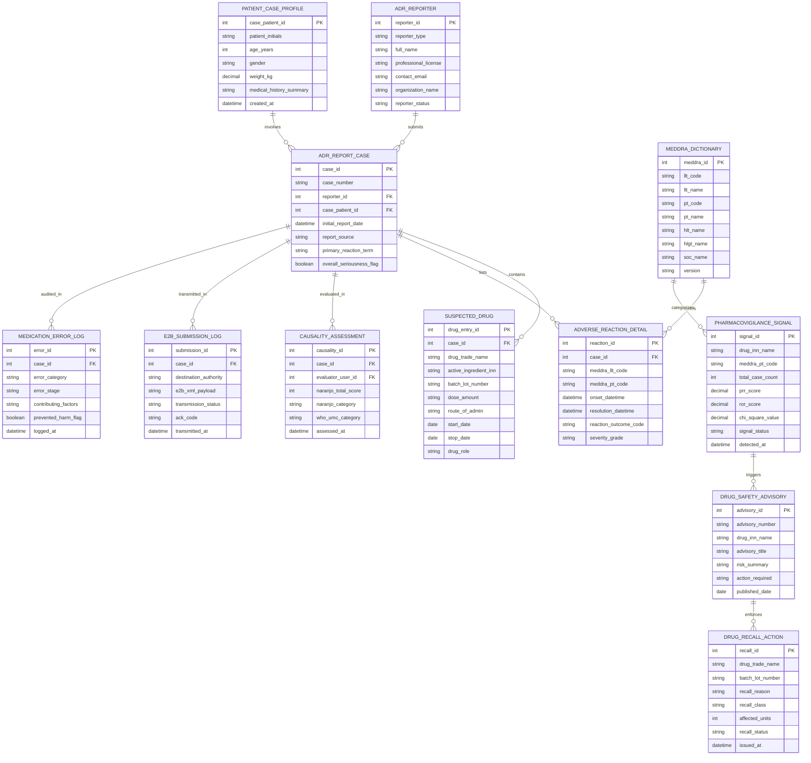

# Conceptual ERD — Drug Adverse Reaction Reporting System

## Mermaid Code

## Entity Description Table | Bảng mô tả Entity

| # | Entity Name | Vietnamese Name | Description | Key Attributes | Main Relationships |
|---|-------------|-----------------|-------------|----------------|-------------------|
| 1 | ADR_REPORTER | Người Báo cáo ADR | Reporter entity storing contact info, professional role (Doctor, Pharmacist, Nurse, Consumer), and license details. | reporter_id, reporter_type, full_name, professional_license, contact_email | Has many ADR_REPORT_CASE entities. |
| 2 | PATIENT_CASE_PROFILE | Bệnh nhân trong Báo cáo | De-identified case patient record storing initials, age, gender, weight kg, and relevant medical history summary. | case_patient_id, patient_initials, age_years, gender, weight_kg, medical_history_summary | Has many ADR_REPORT_CASE entities. |
| 3 | ADR_REPORT_CASE | Hồ sơ Báo cáo ADR Master | Core Individual Case Safety Report (ICSR) master record storing case number, report date, source, and seriousness flags. | case_id, case_number, reporter_id, case_patient_id, initial_report_date, report_source, overall_seriousness_flag | Belongs to ADR_REPORTER and PATIENT_CASE_PROFILE; Has many SUSPECTED_DRUG, ADVERSE_REACTION_DETAIL, CAUSALITY_ASSESSMENT, E2B_SUBMISSION_LOG, etc. |
| 4 | SUSPECTED_DRUG | Thuốc Nghi ngờ gây ADR | Suspected or concomitant drug entry detailing trade name, INN generic name, lot number, dose, route, and start/stop dates. | drug_entry_id, case_id, drug_trade_name, active_ingredient_inn, batch_lot_number, dose_amount, drug_role | Belongs to ADR_REPORT_CASE. |
| 5 | ADVERSE_REACTION_DETAIL | Biểu hiện Phản ứng Phụ | Adverse reaction event record linking MedDRA LLT/PT codes, onset date, resolution date, reaction outcome, and severity. | reaction_id, case_id, meddra_llt_code, meddra_pt_code, onset_datetime, reaction_outcome_code, severity_grade | Belongs to ADR_REPORT_CASE; Coded by MEDDRA_DICTIONARY. |
| 6 | CAUSALITY_ASSESSMENT | Đánh giá Mối quan hệ Năng lực | Causality evaluation record storing 10-item Naranjo total score (-4 to +13), Naranjo Category, and WHO-UMC Category. | causality_id, case_id, evaluator_user_id, naranjo_total_score, naranjo_category, who_umc_category | Belongs to ADR_REPORT_CASE. |
| 7 | MEDDRA_DICTIONARY | Từ điển Chuẩn hóa MedDRA | Standardized MedDRA terminology lookup table storing LLT, PT, HLT, HLGT, and SOC code hierarchies and dictionary version. | meddra_id, llt_code, llt_name, pt_code, pt_name, hlt_name, hlgt_name, soc_name, version | Has many ADVERSE_REACTION_DETAIL and PHARMACOVIGILANCE_SIGNAL entities. |
| 8 | PHARMACOVIGILANCE_SIGNAL | Tín hiệu Tín hiệu Dược cảnh giác | Statistical safety signal record tracking drug INN, MedDRA PT, total cases, PRR score, ROR score, Chi-Square, and signal status. | signal_id, drug_inn_name, meddra_pt_code, total_case_count, prr_score, ror_score, chi_square_value, signal_status | Belongs to MEDDRA_DICTIONARY; Has many DRUG_SAFETY_ADVISORY entities. |
| 9 | E2B_SUBMISSION_LOG | Nhật ký Truyền dữ liệu E2B(R3) | Regulatory submission log storing destination authority, generated E2B(R3) XML payload, transmission status, and ACK codes. | submission_id, case_id, destination_authority, e2b_xml_payload, transmission_status, ack_code, transmitted_at | Belongs to ADR_REPORT_CASE. |
| 10 | DRUG_SAFETY_ADVISORY | Cảnh báo An toàn Thuốc | Official drug safety advisory record detailing advisory number, drug INN, risk summary, required clinical action, and publish date. | advisory_id, advisory_number, drug_inn_name, advisory_title, risk_summary, action_required, published_date | Belongs to PHARMACOVIGILANCE_SIGNAL; Has many DRUG_RECALL_ACTION entities. |
| 11 | DRUG_RECALL_ACTION | Quyết định Thu hồi Thuốc | Mandatory drug recall execution record tracking trade name, lot number, recall reason, recall class (Class I-III), and affected units. | recall_id, drug_trade_name, batch_lot_number, recall_reason, recall_class, affected_units, recall_status | Belongs to DRUG_SAFETY_ADVISORY. |
| 12 | MEDICATION_ERROR_LOG | Nhật ký Lỗi dùng Thuốc | Medication error log detailing error category (prescribing/dispensing), error stage, contributing factors, and harm prevention flags. | error_id, case_id, error_category, error_stage, contributing_factors, prevented_harm_flag, logged_at | Belongs to ADR_REPORT_CASE. |

## Relationship Description | Mô tả Quan hệ

| # | From Entity | Cardinality | To Entity | Relationship Label | Business Explanation |
|---|-------------|-------------|-----------|-------------------|----------------------|
| 1 | ADR_REPORTER | one-to-many | ADR_REPORT_CASE | submits | One reporter submits multiple spontaneous ADR incident reports. |
| 2 | PATIENT_CASE_PROFILE | one-to-many | ADR_REPORT_CASE | involves | One de-identified patient case profile is involved in ADR reports. |
| 3 | ADR_REPORT_CASE | one-to-many | SUSPECTED_DRUG | contains | One ADR case report contains multiple suspected or concomitant drugs. |
| 4 | ADR_REPORT_CASE | one-to-many | ADVERSE_REACTION_DETAIL | lists | One ADR case report lists one or more adverse reaction symptom details. |
| 5 | ADR_REPORT_CASE | one-to-many | CAUSALITY_ASSESSMENT | evaluated_in | One ADR case report undergoes causality assessment evaluations. |
| 6 | ADR_REPORT_CASE | one-to-many | E2B_SUBMISSION_LOG | transmitted_in | One ADR case report is transmitted in E2B(R3) regulatory XML submissions. |
| 7 | ADR_REPORT_CASE | one-to-many | MEDICATION_ERROR_LOG | audited_in | One ADR case report can be audited for medication errors or near-misses. |
| 8 | MEDDRA_DICTIONARY | one-to-many | ADVERSE_REACTION_DETAIL | codes | One MedDRA dictionary term codes multiple reported adverse reaction details. |
| 9 | MEDDRA_DICTIONARY | one-to-many | PHARMACOVIGILANCE_SIGNAL | categorizes | One MedDRA PT term categorizes statistical disproportionality safety signals. |
| 10 | PHARMACOVIGILANCE_SIGNAL | one-to-many | DRUG_SAFETY_ADVISORY | triggers | One validated pharmacovigilance safety signal triggers official safety advisories. |
| 11 | DRUG_SAFETY_ADVISORY | one-to-many | DRUG_RECALL_ACTION | enforces | One drug safety advisory enforces mandatory drug batch recalls or quarantines. |
