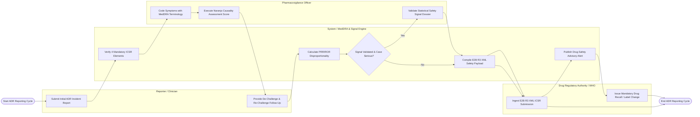

# Swimlane Diagram — Drug Adverse Reaction Reporting System

## Mermaid Code

## Flow Description | Mô tả luồng

| Lane | Actor / Subsystem | Role in Flow |
|------|-------------------|--------------|
| 1 | Reporter / Clinician | Submits initial spontaneous adverse drug reaction incident report, detailing patient demographics, suspect drug lot numbers, reaction symptoms, and de-challenge responses. |
| 2 | Pharmacovigilance Officer | Reviews incoming cases, standardizes verbatim symptoms to MedDRA (LLT/PT) terms, scores Naranjo causality, and validates statistical safety signal dossiers. |
| 3 | System / MedDRA & Signal Engine | Validates 4 mandatory ICSR elements, auto-maps MedDRA hierarchies, runs PRR/ROR statistical disproportionality algorithms, builds E2B(R3) XML payloads, and dispatches public safety advisories. |
| 4 | Drug Regulatory Authority / WHO | Ingests E2B(R3) XML safety reports via AS2 gateway (FDA FAERS, EMA, WHO VigiBase), issues electronic acknowledgments (ACK), and orders mandatory drug batch recalls or black box label changes. |
