# Action Tree — Drug Adverse Reaction Reporting System

## Mermaid Code

```mermaid
graph TD
    Root["Drug Adverse Reaction Reporting System"]

    Root --> M1["ADR Intake & Validation"]
    Root --> M2["MedDRA & WHO Drug Coding"]
    Root --> M3["Causality & Risk Scoring"]
    Root --> M4["Signal Detection & Mining"]
    Root --> M5["E2B R3 Regulatory Gateway"]
    Root --> M6["EHR Hospital ADE Triggers"]
    Root --> M7["Safety Advisories & Recalls"]
    Root --> M8["PV Analytics & PBRER Exports"]

    M1 --> A11["Validate 4 Mandatory ICSR Elements"]
    M1 --> A12["Capture Suspect Drug Batch Lot"]
    M1 --> A13["Evaluate Case Seriousness Criteria"]
    M1 --> A14["Detect Duplicate Case Submissions"]

    M2 --> A21["Map Verbatim Text to MedDRA LLT PT"]
    M2 --> A22["Standardize Drug to WHO Drug INN"]
    M2 --> A23["Execute NLP Auto-Coding Suggestions"]
    M2 --> A24["Batch Re-Code on MedDRA Up-Version"]

    M3 --> A31["Execute 10-Question Naranjo Score"]
    M3 --> A32["Assign WHO-UMC Causality Category"]
    M3 --> A33["Evaluate De-Challenge & Re-Challenge"]
    M3 --> A34["Audit Concomitant Drug Interactions"]

    M4 --> A41["Build 2x2 Contingency Matrix"]
    M4 --> A42["Calculate PRR & ROR Disproportionality"]
    M4 --> A43["Evaluate Evans Signal Threshold Rules"]
    M4 --> A44["Analyze Sub-Group Age & Gender Signals"]

    M5 --> A51["Build ICH E2B R3 XML Safety File"]
    M5 --> A52["Validate XML DTD Schema & Sign"]
    M5 --> A53["Transmit AS2 Gateway to FDA & EMA"]
    M5 --> A54["Parse Regulatory ACK Confirmation"]

    M6 --> A61["Ingest Hospital EHR ADE Trigger Alerts"]
    M6 --> A62["Detect Sudden Lab Drops & Antidotes"]
    M6 --> A63["Flag Unassigned Hospital Inpatient ADE"]
    M6 --> A64["Push Allergy Alerts to E-Prescribing"]

    M7 --> A71["Issue Black Box Warning Advisories"]
    M7 --> A72["Enforce Drug Batch Quarantine Orders"]
    M7 --> A73["Track Hospital Returned Lot Units"]
    M7 --> A74["Dispatch Public SMS Safety Advisories"]

    M8 --> A81["Compile Periodic PBRER Safety Reports"]
    M8 --> A82["Export VigiBase WHO ICSR Dataset"]
    M8 --> A83["Render System Organ Class Heatmaps"]
    M8 --> A84["Calculate National Reporting Trends"]
```

## Module Description | Mô tả Module

| # | Module | Description | Actions |
|---|--------|-------------|---------|
| 1 | ADR Intake & Validation | Validates 4 mandatory ICSR elements, captures suspect drug batch numbers, evaluates seriousness criteria, and detects duplicate case filings. | Validate 4 Mandatory ICSR Elements, Capture Suspect Drug Batch Lot, Evaluate Case Seriousness Criteria, Detect Duplicate Case Submissions |
| 2 | MedDRA & WHO Drug Coding | Maps verbatim reaction descriptions to MedDRA 5-level hierarchical terms (LLT/PT/SOC) and standardizes trade names to WHO Drug INNs. | Map Verbatim Text to MedDRA LLT PT, Standardize Drug to WHO Drug INN, Execute NLP Auto-Coding Suggestions, Batch Re-Code on MedDRA Up-Version |
| 3 | Causality & Risk Scoring | Executes the 10-question Naranjo probability algorithm (-4 to +13), assigns WHO-UMC categories, and evaluates de-challenge/re-challenge. | Execute 10-Question Naranjo Score, Assign WHO-UMC Causality Category, Evaluate De-Challenge & Re-Challenge, Audit Concomitant Drug Interactions |
| 4 | Signal Detection & Mining | Builds 2x2 contingency matrices, computes PRR, ROR, and Chi-Square disproportionality metrics, and evaluates Evans signal threshold rules. | Build 2x2 Contingency Matrix, Calculate PRR & ROR Disproportionality, Evaluate Evans Signal Threshold Rules, Analyze Sub-Group Age & Gender Signals |
| 5 | E2B R3 Regulatory Gateway | Formats validated ICSR safety cases into ICH E2B(R3) XML schemas, signs XML payloads, transmits via AS2 gateway, and parses regulatory ACKs. | Build ICH E2B R3 XML Safety File, Validate XML DTD Schema & Sign, Transmit AS2 Gateway to FDA & EMA, Parse Regulatory ACK Confirmation |
| 6 | EHR Hospital ADE Triggers | Ingests automated clinical trigger alerts from hospital EHRs (sudden lab drops, antidote orders) and pushes allergy alerts to E-Prescribing. | Ingest Hospital EHR ADE Trigger Alerts, Detect Sudden Lab Drops & Antidotes, Flag Unassigned Hospital Inpatient ADE, Push Allergy Alerts to E-Prescribing |
| 7 | Safety Advisories & Recalls | Issues official drug safety advisories, black box warnings, enforces batch quarantine orders, and dispatches public SMS alerts. | Issue Black Box Warning Advisories, Enforce Drug Batch Quarantine Orders, Track Hospital Returned Lot Units, Dispatch Public SMS Safety Advisories |
| 8 | PV Analytics & PBRER Exports | Compiles periodic benefit-risk reports (PBRER/PSUR), exports VigiBase datasets, renders Organ Class heatmaps, and calculates reporting trends. | Compile Periodic PBRER Safety Reports, Export VigiBase WHO ICSR Dataset, Render System Organ Class Heatmaps, Calculate National Reporting Trends |
