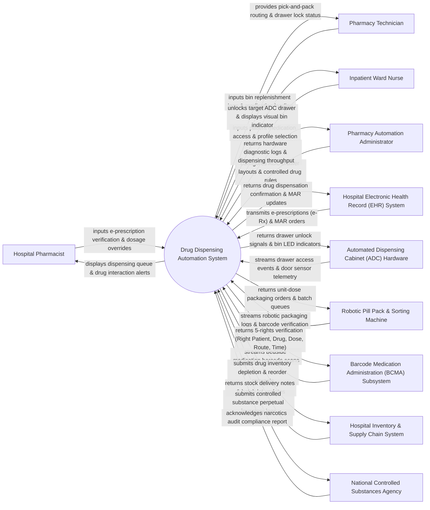

# Context Diagram — Drug Dispensing Automation System

## Mermaid Code

## Actor & Interaction Table | Bảng Actor & Tương tác

| # | Actor | Actor Type | Data Sent TO System | Data Received FROM System | Notes |
|---|-------|------------|---------------------|---------------------------|-------|
| 1 | Hospital Pharmacist | Primary | Clinical e-prescription verifications, drug-drug interaction overrides, restricted drug approvals, dosage adjustment orders. | Real-time dispensing queue, allergy conflict alerts, dosage verification prompts, drug formulary notes. | Certified pharmacist reviewing electronic prescriptions and authorizing automated drug dispensation. |
| 2 | Pharmacy Technician | Primary | Automated dispensing cabinet (ADC) restocking logs, unit-dose packaging inputs, lot/expiry date entries, inventory counts. | Pick-and-pack routing paths, bin loading guides, expired drug removal lists, ADC drawer unlock signals. | Pharmacy technician loading drugs into automated machines and fulfilling unit-dose packaging queues. |
| 3 | Inpatient Ward Nurse | Primary | Patient selection, active MAR medication picks, emergency STAT withdrawal requests, waste/return logs. | ADC drawer unlock signals, illuminated bin LED indicators, medication administration instructions, 5-rights prompts. | Ward nurse withdrawing prescribed patient medications from decentralized automated dispensing cabinets. |
| 4 | Pharmacy Automation Administrator | Primary | ADC matrix configuration, matrix drawer security levels, biometric login settings, perpetual inventory rules. | Hardware diagnostic logs, cabinet door status alerts, machine dispensing throughput, narcotics discrepancy reports. | IT/Pharmacy administrator managing automated cabinets, packaging robotics, and hardware configurations. |
| 5 | Hospital Electronic Health Record (EHR) System | Supporting | Electronic prescriptions (e-Rx), Medication Administration Records (MAR), patient allergies, height/weight, renal function. | Real-time dispensation confirmations, drug withdrawal timestamps, MAR status updates, bedside scanning validation. | Enterprise hospital EHR system integrated via HL7 Pharmacy (RDE/RDS) messaging standards. |
| 6 | Automated Dispensing Cabinet (ADC) Hardware | Supporting | Micro-switch drawer access events, weight-scale bin sensor readings, door open/close telemetry, biometric fingerprint scans. | Solenoid drawer unlock commands, guided LED light matrix signals, bin lockout triggers. | Decentralized smart medication cabinets (Pyxis / Omnicell) located in hospital inpatient wards. |
| 7 | Robotic Pill Pack & Sorting Machine | Supporting | High-speed robotic packaging logs, 2D barcode print verifications, pouch sealing temperature sensors. | Unit-dose packaging queues, patient multi-dose pouch orders, pill image verification patterns. | Central pharmacy automated robotic machine packaging loose pills into barcoded unit-dose pouches. |
| 8 | Barcode Medication Administration (BCMA) Subsystem | Supporting | Bedside wristband barcode scans, medication pouch barcode scans, nurse scanner ID. | 5-Rights verification feedback (Right Patient, Right Drug, Right Dose, Right Route, Right Time), administration confirm. | Bedside mobile scanning system used by nurses prior to administering drugs to patients. |
| 9 | Hospital Inventory & Supply Chain System | Supporting | Stock delivery updates, batch lot numbers, wholesale price changes, stock shipment receipts. | Automated stock depletion alerts, reorder point triggers, waste/expired item disposal logs. | Material management software maintaining central hospital pharmacy stock and reorder points. |
| 10 | National Controlled Substances Agency | Supporting / Regulatory | Mandated narcotics tracking schemas, DEA Schedule II reporting guidelines, audit receipts. | Perpetual narcotics inventory logs, Schedule II-V dispensing records, waste/destruction audit trails. | Government regulatory body monitoring controlled substance (narcotics) distribution and security compliance. |

## System Boundary Description | Mô tả Phạm vi Hệ thống

The **Drug Dispensing Automation System (DDAS)** is an enterprise pharmacy robotics and smart cabinet management platform designed to automate unit-dose packaging, prescription verification, ward cabinet dispensing, and bedside medication administration tracking.

**Inside System Scope:**
- Ingestion and clinical verification of e-prescriptions (e-Rx) from hospital EHR systems.
- Automated control of decentralized Ward Automated Dispensing Cabinets (ADCs) with guided LED bin illumination and solenoid drawer unlocking.
- Integration with central pharmacy Robotic Pill Pack & Sorting Machines for unit-dose pouch packaging and 2D barcode printing.
- Perpetual inventory management of controlled substances (Schedule II-V narcotics) with dual-witness waste logging and discrepancy tracking.
- Bedside Barcode Medication Administration (BCMA) 5-Rights verification (Right Patient, Right Drug, Right Dose, Right Route, Right Time).

**Outside System Scope:**
- Physical motor drive mechanics and pneumatic pouch sealing hardware in packaging robots (handled by robotics hardware firmware).
- Chemical manufacturing and synthesis of pharmaceutical drugs (performed by pharmaceutical companies).
- Direct financial patient billing ledger posting (delegated to Patient Billing Systems).
