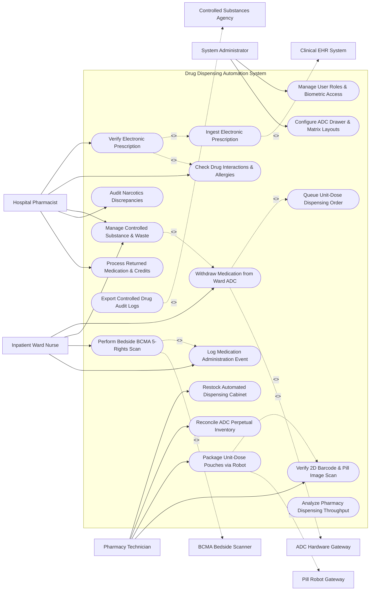

# Use Case Diagram — Drug Dispensing Automation System

## Mermaid Code

## Actor Table | Bảng Actor

| # | Actor | Actor Type | Role Description | Related Use Cases |
|---|-------|------------|------------------|-------------------|
| 1 | Hospital Pharmacist | Primary | Clinical pharmacist verifying e-prescriptions, overriding interaction alerts, managing narcotics waste, and auditing discrepancies. | UC02, UC03, UC08, UC09, UC14 |
| 2 | Pharmacy Technician | Primary | Technical staff restocking automated dispensing cabinets, operating packaging robots, and verifying barcode pouch printing. | UC06, UC07, UC12, UC13 |
| 3 | Inpatient Ward Nurse | Primary | Clinical nurse withdrawing prescribed drugs from ward ADCs, performing bedside BCMA scanning, and logging administration. | UC05, UC08, UC10, UC11 |
| 4 | System Administrator | Primary | IT administrative user managing system permissions, biometric fingerprint access, and ADC drawer layout matrices. | UC16, UC17 |
| 5 | Clinical EHR System | System (Secondary) | Central hospital EHR sending e-prescriptions (e-Rx) and receiving Medication Administration Record (MAR) updates. | UC01 |
| 6 | ADC Hardware Gateway | System (Secondary) | Decentralized smart cabinet hardware sending micro-switch sensor events and receiving solenoid unlock signals. | UC05 |
| 7 | Pill Robot Gateway | System (Secondary) | Automated packaging robot sorting loose pills into unit-dose barcoded pouches. | UC12 |
| 8 | BCMA Bedside Scanner | System (Secondary) | Mobile scanning device verifying patient wristband and drug pouch barcodes prior to administration. | UC10 |
| 9 | Controlled Substances Agency | System (Secondary) | Regulatory body receiving mandatory Schedule II-V narcotics perpetual inventory audit reports. | UC15 |

## Use Case Table | Bảng Use Case

| # | UC ID | Use Case Name | Primary Actor | Secondary Actor | Description | Priority |
|---|-------|---------------|---------------|-----------------|-------------|----------|
| 1 | UC01 | Ingest Electronic Prescription | Pharmacist | Clinical EHR | Receives e-prescriptions (e-Rx) from EHR detailing drug name, dosage, frequency, and patient ID. | High |
| 2 | UC02 | Verify Electronic Prescription | Pharmacist | Clinical EHR | Clinical verification of medication order appropriateness, dosing limits, and physician credentials. | High |
| 3 | UC03 | Check Drug Interactions & Allergies | Pharmacist | None | Automated screening of e-Rx against patient allergy profile, renal function, and existing active drugs. | High |
| 4 | UC04 | Queue Unit-Dose Dispensing Order | Pharmacist | None | Routes verified drug orders to central packaging robot or decentralized ward ADC queues. | High |
| 5 | UC05 | Withdraw Medication from Ward ADC | Ward Nurse | ADC Hardware | Authenticates nurse via biometrics, unlocks target cabinet drawer, and lights guided LED bin for drug pick. | High |
| 6 | UC06 | Restock Automated Dispensing Cabinet | PharmTech | ADC Hardware | Guides pharmacy technician to reload drug bins in ADCs using barcode verification and lot/expiry logging. | High |
| 7 | UC07 | Reconcile ADC Perpetual Inventory | PharmTech | None | Compares physical ADC bin counts against database inventory logs to identify stock variances. | Medium |
| 8 | UC08 | Manage Controlled Substance & Waste | Ward Nurse | Pharmacist | Enforces dual-witness logging and biometric sign-off when wasting unused portions of Schedule II narcotics. | Critical |
| 9 | UC09 | Audit Narcotics Discrepancies | Pharmacist | None | Investigates inventory count mismatches, unexpected drawer opens, and un-witnessed waste events. | High |
| 10 | UC10 | Perform Bedside BCMA 5-Rights Scan | Ward Nurse | BCMA Scanner | Scans patient wristband and drug pouch barcodes at bedside to verify 5-Rights prior to administration. | Critical |
| 11 | UC11 | Log Medication Administration Event | Ward Nurse | None | Records dose administration timestamp in EHR Medication Administration Record (MAR). | High |
| 12 | UC12 | Package Unit-Dose Pouches via Robot | PharmTech | Pill Robot | Commands robotic sorter to package loose tablets into barcoded, patient-specific unit-dose pouches. | High |
| 13 | UC13 | Verify 2D Barcode & Pill Image Scan | PharmTech | None | Performs high-speed optical camera verification of pill shape/color and scans 2D barcode on unit-dose pouches. | High |
| 14 | UC14 | Process Returned Medication & Credits | Pharmacist | None | Restocks unused, un-opened unit-dose medications returned from wards and issues patient financial credits. | Medium |
| 15 | UC15 | Export Controlled Drug Audit Logs | Pharmacist | Controlled Agency | Generates and exports perpetual narcotics inventory compliance reports for DEA regulatory submission. | High |
| 16 | UC16 | Manage User Roles & Biometric Access | Admin | None | Configures user accounts, fingerprint biometric templates, and security clearance for cabinet access. | High |
| 17 | UC17 | Configure ADC Drawer & Matrix Layouts | Admin | None | Maps drug items to specific physical ADC drawers, sub-drawers, and carousel matrix locations. | Medium |
| 18 | UC18 | Analyze Pharmacy Dispensing Throughput | System | None | Computes daily dispensing volumes, turnaround times from order to pick, and machine uptime stats. | Medium |

## Use Case Specification | Đặc tả Use Case

---

### UC02 — Verify Electronic Prescription (e-Rx)

| Field | Detail |
|-------|--------|
| **UC ID** | UC02 |
| **Use Case Name** | Verify Electronic Prescription (e-Rx) |
| **Actor(s)** | Primary: Hospital Pharmacist   Secondary: Clinical EHR System |
| **Description** | Reviews incoming electronic prescriptions (e-Rx), evaluates dosage safety, screens for clinical interactions, and approves orders for automated dispensing. |
| **Precondition** | 1. Electronic prescription is submitted by physician in EHR (UC01).   2. Pharmacist is logged into verification queue with active license credentials. |
| **Main Flow** | 1. Pharmacist opens "Orders Pending Verification" queue.   2. System displays e-Rx details: Patient Name, Drug Name, Dose, Route, Frequency, Indication, and Patient Renal Function (eGFR).   3. System automatically executes Drug Interaction & Allergy Check (UC03).   4. Pharmacist reviews clinical appropriateness of order.   5. Pharmacist confirms order details and taps "Verify & Authorize Order".   6. System updates order status to `VERIFIED_READY`, routes order to target ward ADC or robotics queue (UC04), and updates MAR in EHR. |
| **Alternative Flow** | **AF1** — Order Modification with Physician Consult: Pharmacist contacts ordering physician to suggest dosage reduction for renal impairment; Pharmacist adjusts dose in system, enters intervention note, and verifies modified order. |
| **Exception Flow** | **EX1** — Severe Drug Allergy / Interaction Warning: System detects severe anaphylactic allergy to prescribed penicillin; System highlights order in red modal "CONTRAINDICATED ALLERGY", blocks single-click verification, and requires explicit pharmacist override reason. |
| **Postcondition** | e-Rx is verified, order status updates to `VERIFIED_READY`, and drug is queued for dispensing. |
| **Business Rule** | **BR1**: High-risk medications (chemotherapy, insulin, IV anticoagulants) require independent dual-pharmacist verification before order release. |

---

### UC05 — Withdraw Medication from Ward ADC

| Field | Detail |
|-------|--------|
| **UC ID** | UC05 |
| **Use Case Name** | Withdraw Medication from Ward ADC |
| **Actor(s)** | Primary: Inpatient Ward Nurse   Secondary: ADC Hardware Gateway |
| **Description** | Authenticates nurse at ward Automated Dispensing Cabinet (ADC) using biometrics, lists verified patient medications, unlocks target drawer, and guides physical picking with bin LEDs. |
| **Precondition** | 1. Verified e-Rx order exists for patient on current ward.   2. Ward nurse has active biometric fingerprint template registered in system. |
| **Main Flow** | 1. Ward Nurse scans ID badge or places finger on ADC biometric fingerprint scanner.   2. ADC Hardware Gateway authenticates nurse and displays active ward patient list on cabinet touchscreen.   3. Nurse selects target patient name; System displays list of active due medications from EHR MAR.   4. Nurse selects required medication (e.g., Metoprolol 50mg Tablet, 1 Tab).   5. System checks inventory, sends solenoid unlock signal to target cabinet drawer, and illuminates guided LED light directly over specific drug bin.   6. Nurse opens drawer, picks 1 tablet from illuminated bin, closes drawer, and confirms pick on touchscreen.   7. System updates ADC inventory count, records withdrawal timestamp, and updates MAR status to `WITHDRAWN`. |
| **Alternative Flow** | **AF1** — STAT Emergency Override: In acute cardiac arrest, Nurse taps "STAT Emergency Override"; System presents un-profiled emergency medication list (Epinephrine, Atropine), unlocks emergency drawer immediately, and flags withdrawal for post-hoc pharmacy review. |
| **Exception Flow** | **EX1** — Inventory Bin Empty: Target bin count is 0; System displays alert "Bin Empty", automatically unlocks alternative ADC cabinet in adjacent wing, and dispatches urgent stock alert to pharmacy (UC06).   **EX2** — Drawer Forced Open: Cabinet drawer is forced open without authorization; System sounds local security alarm siren, locks all other drawers, and alerts security administrator. |
| **Postcondition** | Target medication is physically withdrawn, drawer locks, ADC stock balance is decremented, and MAR withdrawal event is logged. |
| **Business Rule** | **BR1**: Non-profiled emergency overrides must be restricted to designated emergency resuscitation medications and audited within 2 hours. |

---

### UC08 — Manage Controlled Substance & Waste

| Field | Detail |
|-------|--------|
| **UC ID** | UC08 |
| **Use Case Name** | Manage Controlled Substance & Waste |
| **Actor(s)** | Primary: Inpatient Ward Nurse, Hospital Pharmacist   Secondary: ADC Hardware Gateway |
| **Description** | Enforces perpetual inventory counts, blind count verification, dual-witness authentication, and physical disposal logging when withdrawing or wasting Schedule II-V controlled narcotics. |
| **Precondition** | 1. Order is for a Schedule II-V controlled substance (e.g., Morphine, Fentanyl, Oxycodone).   2. Two authorized healthcare workers (Primary Nurse + Witness Nurse) are present at ADC. |
| **Main Flow** | 1. Ward Nurse selects controlled drug order on ADC touchscreen.   2. System prompts nurse to perform a "Blind Count": "Count and enter total remaining vials in bin BEFORE picking".   3. Nurse counts vials in bin and enters number (e.g., 14 Vials).   4. System compares entered count with database perpetual inventory count (14 Vials). Count matches.   5. System unlocks drawer; Nurse picks required dose vial (e.g., Fentanyl 100mcg/2mL vial, administered dose 50mcg).   6. System prompts for immediate waste disposal of unused portion (50mcg / 1mL remaining).   7. Witness Nurse steps to ADC, scans ID badge or fingerprint, and confirms physical destruction/wasting of remaining liquid into biohazard sink.   8. Both Primary Nurse and Witness Nurse sign touchscreen.   9. System records perpetual count, waste log, and witness ID in `CONTROLLED_SUBSTANCE_LOG`. |
| **Alternative Flow** | **AF1** — Deferred Waste Logging: Nurse cannot find immediate witness; System allows 60-minute waste deferral window, flagging transaction as `PENDING_WASTE_WITNESS` and sending reminder alerts to ward charge nurse. |
| **Exception Flow** | **EX1** — Blind Count Discrepancy: Nurse enters 12 vials, but database expects 14 vials; System immediately freezes drawer, flags `NARCOTICS_DISCREPANCY_ALERT`, requires immediate supervisor co-signature to proceed, and notifies Pharmacist (UC09). |
| **Postcondition** | Controlled drug is withdrawn, perpetual count is reconciled, dual-witness waste is logged, and DEA regulatory compliance record is updated. |
| **Business Rule** | **BR1**: Schedule II narcotics waste MUST be witnessed and co-signed by a second licensed nurse or pharmacist at the time of disposal. |

---

### UC10 — Perform Bedside BCMA 5-Rights Scan

| Field | Detail |
|-------|--------|
| **UC ID** | UC10 |
| **Use Case Name** | Perform Bedside BCMA 5-Rights Scan |
| **Actor(s)** | Primary: Inpatient Ward Nurse   Secondary: BCMA Bedside Scanner |
| **Description** | Scans patient wristband 2D barcode and unit-dose medication pouch barcode at patient bedside using mobile terminal to execute automated 5-Rights safety verification before drug administration. |
| **Precondition** | 1. Nurse has withdrawn medication from ADC or received unit-dose pouch (UC05/UC12).   2. Nurse is at patient bedside with mobile BCMA scanner terminal. |
| **Main Flow** | 1. Ward Nurse opens BCMA scanning app on mobile handheld terminal.   2. Nurse scans 2D barcode on Patient's wristband; System verifies Patient identity, displays photo, and matches active MAR.   3. Nurse scans 2D barcode on unit-dose medication pouch.   4. System performs automated 5-Rights verification:   &nbsp;&nbsp;&nbsp;&nbsp; a. Right Patient (Scanned wristband matches MAR patient ID).   &nbsp;&nbsp;&nbsp;&nbsp; b. Right Drug (Scanned barcode matches prescribed drug ID).   &nbsp;&nbsp;&nbsp;&nbsp; c. Right Dose (Scanned pouch strength matches active order dose).   &nbsp;&nbsp;&nbsp;&nbsp; d. Right Route (Scanned formulation matches ordered route, e.g., Oral vs IV).   &nbsp;&nbsp;&nbsp;&nbsp; e. Right Time (Current time is within scheduled administration window, e.g., +/- 60 mins).   5. System displays green checkmark "5-RIGHTS VERIFIED - SAFE TO ADMINISTER".   6. Nurse administers medication to patient and taps "Confirm Administration".   7. System updates MAR status in EHR to `GIVEN` with exact timestamp (UC11). |
| **Alternative Flow** | **AF1** — Early / Late Administration Reason Entry: Nurse administers medication 90 minutes past scheduled time; System prompts "Administration Outside Time Window", Nurse selects reason "Patient at Imaging Test", and completes log. |
| **Exception Flow** | **EX1** — Wrong Patient Scan Alert: Nurse accidentally scans Drug Pouch intended for Patient A while logged into Patient B chart; System sounds loud audible alarm "WRONG PATIENT ALERT - DO NOT ADMINISTER" and blocks administration log.   **EX2** — Expired / Recalled Drug Barcode Scan: Scanned pouch barcode belongs to expired or recalled lot; System displays red warning modal "EXPIRED DRUG DETECTED" and blocks administration. |
| **Postcondition** | 5-Rights are verified, administration event is logged in MAR, and patient safety compliance is recorded. |
| **Business Rule** | **BR1**: Bedside BCMA barcode scanning must verify all 5 Rights before any medication is administered to an inpatient. |

---

### UC12 — Package Unit-Dose Pouches via Robot

| Field | Detail |
|-------|--------|
| **UC ID** | UC12 |
| **Use Case Name** | Package Unit-Dose Pouches via Robot |
| **Actor(s)** | Primary: Pharmacy Technician   Secondary: Pill Robot Gateway |
| **Description** | Controls central pharmacy automated packaging robotics to sort loose tablets into individual, patient-specific unit-dose pouches printed with 2D barcodes, drug name, lot number, and expiration date. |
| **Precondition** | 1. Verified e-Rx orders are queued for unit-dose packaging (UC04).   2. Robotic pill packaging machine is loaded with drug canisters and packaging film rolls. |
| **Main Flow** | 1. Pharmacy Technician selects "Execute Unit-Dose Batch Packaging" on pharmacy robotics console.   2. System compiles pending batch orders and sends digital packaging manifest to Pill Robot Gateway.   3. Robotic Packaging Machine dispenses specific tablets from calibrated canisters into individual cellophane pouches.   4. Thermal printer prints high-density 2D Data-Matrix barcode, Drug Name, Strength, Patient Name, Ward, Lot Number, and Expiration Date on exterior of pouch.   5. Heat sealer seals pouch and cuts strip.   6. High-speed optical camera scans printed 2D barcode and verifies pill shape/color against master drug image (UC13).   7. System records completed unit-dose pouch IDs in database and updates packaging queue status to `PACKAGED_READY`. |
| **Alternative Flow** | **AF1** — Multi-Dose Time-Pass Pouching: System packages all solid oral medications due at 08:00 AM into a single multi-dose strip pouch labeled "Morning 08:00 AM Med Pass" for simplified nurse administration. |
| **Exception Flow** | **EX1** — Robotic Canister Jam / Misfeed: Canister #142 (Aspirin 81mg) experiences pill jam; Robot stops packaging line, System flashes "Canister Jam Alert #142", and technician clears jam.   **EX2** — Barcode Print Unreadable: Optical camera cannot read printed 2D barcode; System diverts unreadable pouch into rejection bin and re-packages unit-dose pouch. |
| **Postcondition** | Unit-dose pouches are packaged, 2D barcodes are verified, and pouches are sorted into ward delivery totes. |
| **Business Rule** | **BR1**: Every packaged unit-dose pouch must display a scannable 2D barcode containing GTIN, Lot Number, Expiration Date, and Serial Number compliant with DSCSA track-and-trace laws. |
