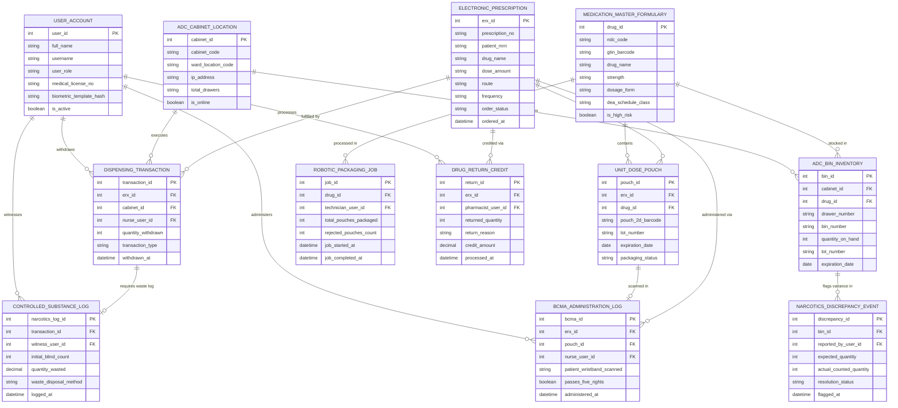

# Conceptual ERD — Drug Dispensing Automation System

## Mermaid Code

## Entity Description Table | Bảng mô tả Entity

| # | Entity Name | Vietnamese Name | Description | Key Attributes | Main Relationships |
|---|-------------|-----------------|-------------|----------------|-------------------|
| 1 | USER_ACCOUNT | Tài khoản Nguời dùng | Credentials, biometric fingerprint hashes, and RBAC security access for nurses, pharmacists, and technicians. | `user_id`, `username`, `user_role`, `biometric_template_hash` | Withdraws `DISPENSING_TRANSACTION`, witnesses `CONTROLLED_SUBSTANCE_LOG`, administers `BCMA_ADMINISTRATION_LOG`. |
| 2 | ELECTRONIC_PRESCRIPTION | Đơn thuốc Điện tử (e-Rx) | Inpatient prescription order ingested from EHR detailing drug name, dosage, frequency, and order status. | `erx_id`, `prescription_no`, `patient_mrn`, `drug_name`, `dose_amount`, `order_status` | Fulfilled by `DISPENSING_TRANSACTION`, packaged into `UNIT_DOSE_POUCH`, administered via `BCMA_ADMINISTRATION_LOG`. |
| 3 | MEDICATION_MASTER_FORMULARY | Danh mục Thuốc Bệnh viện | Master formulary database containing NDC codes, GS1 barcodes, DEA schedule classes, and high-risk flags. | `drug_id`, `ndc_code`, `gtin_barcode`, `drug_name`, `strength`, `dea_schedule_class` | Stocked in `ADC_BIN_INVENTORY`, contains `UNIT_DOSE_POUCH`. |
| 4 | ADC_CABINET_LOCATION | Vị trí Tủ phát Thuốc (ADC) | Physical ward automated dispensing cabinet hardware profile, location code, and IP address. | `cabinet_id`, `cabinet_code`, `ward_location_code`, `ip_address`, `total_drawers` | Houses `ADC_BIN_INVENTORY`, executes `DISPENSING_TRANSACTION`. |
| 5 | ADC_BIN_INVENTORY | Tồn kho Ô Tủ ADC | Individual matrix bin inventory levels, drug assignment, lot numbers, and expiration dates within ADC cabinets. | `bin_id`, `cabinet_id`, `drug_id`, `drawer_number`, `quantity_on_hand`, `expiration_date` | Belongs to `ADC_CABINET_LOCATION` and `MEDICATION_MASTER_FORMULARY`. |
| 6 | DISPENSING_TRANSACTION | Giao dịch Lấy Thuốc | Transaction record capturing nurse withdrawal of medication from ADC cabinets with timestamp. | `transaction_id`, `erx_id`, `cabinet_id`, `nurse_user_id`, `quantity_withdrawn`, `withdrawn_at` | Fulfills `ELECTRONIC_PRESCRIPTION`, requires `CONTROLLED_SUBSTANCE_LOG`. |
| 7 | CONTROLLED_SUBSTANCE_LOG | Nhật ký Thuốc Gây nghiện | Dual-witness authentication log, blind count checks, and waste disposal records for Schedule II-V narcotics. | `narcotics_log_id`, `transaction_id`, `witness_user_id`, `initial_blind_count`, `quantity_wasted` | Belongs to `DISPENSING_TRANSACTION`, witnessed by `USER_ACCOUNT`. |
| 8 | NARCOTICS_DISCREPANCY_EVENT | Sự cố Chênh lệch Thuốc Hướng thần | Audit record flagging count mismatches between physical ADC bin stock and database inventory logs. | `discrepancy_id`, `bin_id`, `reported_by_user_id`, `expected_quantity`, `actual_counted_quantity` | Flags variance in `ADC_BIN_INVENTORY`. |
| 9 | UNIT_DOSE_POUCH | Túi Thuốc Đơn liều | Individual barcoded cellophane pouch packaging single-dose medication, lot number, and 2D matrix barcode. | `pouch_id`, `erx_id`, `drug_id`, `pouch_2d_barcode`, `lot_number`, `packaging_status` | Belongs to `ELECTRONIC_PRESCRIPTION` and `MEDICATION_MASTER_FORMULARY`. |
| 10 | BCMA_ADMINISTRATION_LOG | Nhật ký Quét Mã vạch Giường | Bedside Barcode Medication Administration 5-Rights verification log recording exact dose administration timestamp. | `bcma_id`, `erx_id`, `pouch_id`, `nurse_user_id`, `passes_five_rights`, `administered_at` | Relates `ELECTRONIC_PRESCRIPTION`, `UNIT_DOSE_POUCH`, and `USER_ACCOUNT`. |
| 11 | ROBOTIC_PACKAGING_JOB | Ca Đóng gói Robot | Pharmacy robotics packaging execution log tracking total unit-dose pouches packaged and rejected count. | `job_id`, `drug_id`, `technician_user_id`, `total_pouches_packaged`, `rejected_pouches_count` | Belongs to `MEDICATION_MASTER_FORMULARY`. |
| 12 | DRUG_RETURN_CREDIT | Hóa đơn Hoàn trả Thuốc | Re-crediting log processing un-opened unit-dose medications returned from wards back into pharmacy stock. | `return_id`, `erx_id`, `pharmacist_user_id`, `returned_quantity`, `credit_amount`, `processed_at` | Belongs to `ELECTRONIC_PRESCRIPTION`, processed by `USER_ACCOUNT`. |

## Relationship Description | Mô tả Quan hệ

| # | From Entity | Cardinality | To Entity | Label | Business Explanation |
|---|-------------|-------------|-----------|-------|----------------------|
| 1 | ELECTRONIC_PRESCRIPTION | 1 to 0..N | DISPENSING_TRANSACTION | fulfilled by | An e-prescription order is fulfilled by one or more ADC dispensing transactions. |
| 2 | ELECTRONIC_PRESCRIPTION | 1 to 0..N | UNIT_DOSE_POUCH | packaged into | An e-prescription order is packaged into unit-dose barcoded pouches. |
| 3 | ELECTRONIC_PRESCRIPTION | 1 to 0..N | BCMA_ADMINISTRATION_LOG | administered via | An e-prescription order is administered at bedside via BCMA scanning. |
| 4 | ELECTRONIC_PRESCRIPTION | 1 to 0..N | DRUG_RETURN_CREDIT | credited via | Unused e-prescription medications generate drug return credit logs. |
| 5 | MEDICATION_MASTER_FORMULARY | 1 to 0..N | ADC_BIN_INVENTORY | stocked in | A master formulary drug is stocked across multiple ward ADC cabinet bins. |
| 6 | MEDICATION_MASTER_FORMULARY | 1 to 0..N | UNIT_DOSE_POUCH | contains | A master formulary drug is packaged into unit-dose pouches. |
| 7 | MEDICATION_MASTER_FORMULARY | 1 to 0..N | ROBOTIC_PACKAGING_JOB | processed in | A master formulary drug is processed in robotic packaging jobs. |
| 8 | ADC_CABINET_LOCATION | 1 to 1..N | ADC_BIN_INVENTORY | houses | An ADC cabinet location houses multiple matrix drawers and individual bins. |
| 9 | ADC_CABINET_LOCATION | 1 to 0..N | DISPENSING_TRANSACTION | executes | An ADC cabinet location executes nurse withdrawal transactions. |
| 10 | DISPENSING_TRANSACTION | 1 to 0..1 | CONTROLLED_SUBSTANCE_LOG | requires waste log | A controlled drug dispensing transaction requires a dual-witness waste log. |
| 11 | ADC_BIN_INVENTORY | 1 to 0..N | NARCOTICS_DISCREPANCY_EVENT | flags variance in | An ADC bin inventory flags stock count discrepancy events. |
| 12 | UNIT_DOSE_POUCH | 1 to 0..1 | BCMA_ADMINISTRATION_LOG | scanned in | A unit-dose pouch is scanned during bedside BCMA administration. |
| 13 | USER_ACCOUNT | 1 to 0..N | DISPENSING_TRANSACTION | withdraws | A nurse user account withdraws medications from ADC cabinets. |
| 14 | USER_ACCOUNT | 1 to 0..N | CONTROLLED_SUBSTANCE_LOG | witnesses | A witness nurse user account co-signs controlled narcotics disposal. |
| 15 | USER_ACCOUNT | 1 to 0..N | BCMA_ADMINISTRATION_LOG | administers | A nurse user account administers medications at patient bedside. |
