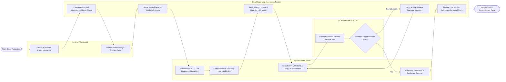

# Swimlane Diagram — Drug Dispensing Automation System

## Mermaid Code

## Flow Description | Mô tả luồng

| Lane | Actor | Role in Flow |
|------|-------|-------------|
| 1 | Hospital Pharmacist | Reviews electronic prescriptions (e-Rx), evaluates clinical dosing safety, checks drug interactions, and approves orders for automated dispensing. |
| 2 | Inpatient Ward Nurse | Authenticates at ward Automated Dispensing Cabinets (ADC) via fingerprint biometrics, selects patient, picks drug from guided LED illuminated bins, and scans barcodes at patient bedside. |
| 3 | Drug Dispensing Automation System | Runs automated drug interaction and allergy checks, routes verified orders to ward ADCs, unlocks cabinet drawers, illuminates bin LEDs, verifies 5-Rights matching algorithms, and updates MAR logs in EHR. |
| 4 | BCMA Bedside Scanner | Streams scanned 2D barcodes from patient wristbands and unit-dose pouches, evaluating 5-Rights safety verification (Right Patient, Drug, Dose, Route, Time). |
