# Action Tree — Drug Dispensing Automation System

## Mermaid Code

```mermaid
graph TD
    Root["Drug Dispensing Automation System"]

    Root --> M1["e-Prescription Verification & Order Intake"]
    Root --> M2["Ward Automated Dispensing Cabinet Control"]
    Root --> M3["Controlled Substance & Narcotics Management"]
    Root --> M4["Bedside BCMA 5-Rights Verification"]
    Root --> M5["Robotic Unit-Dose Packaging & Barcoding"]
    Root --> M6["Inventory Reconcile & DEA Compliance"]

    M1 --> A11["Ingest e-Prescriptions (e-Rx) from EHR"]
    M1 --> A12["Execute Automated Interaction & Allergy Checks"]
    M1 --> A13["Verify Clinical Dosing & Pharmacist Sign-Off"]
    M1 --> A14["Queue Orders to Ward ADCs & Robotics"]

    M2 --> A21["Authenticate Nurses via Biometric Fingerprints"]
    M2 --> A22["Unlock Solenoid Cabinet Drawers"]
    M2 --> A23["Light Guided LED Bin Matrix Indicators"]
    M2 --> A24["Restock ADC Drawers with Barcode Verification"]

    M3 --> A31["Enforce Blind Count Bin Verification"]
    M3 --> A32["Require Dual-Witness Biometric Sign-Off"]
    M3 --> A33["Log Partial Narcotic Waste & Disposal"]
    M3 --> A34["Audit Narcotics Inventory Discrepancies"]

    M4 --> A41["Scan Patient Wristband 2D Barcodes"]
    M4 --> A42["Scan Unit-Dose Pouch Barcodes"]
    M4 --> A43["Verify 5-Rights Safety Matching Engine"]
    M4 --> A44["Update EHR Medication Administration Record"]

    M5 --> A51["Route Unit-Dose Orders to Packaging Robot"]
    M5 --> A52["Package Loose Pills into Barcoded Pouches"]
    M5 --> A53["Print 2D Data-Matrix Barcodes & Expiry Dates"]
    M5 --> A54["Verify Pill Shape & Color via Optical Camera"]

    M6 --> A61["Reconcile Perpetual ADC Inventory Levels"]
    M6 --> A62["Process Unused Medication Returns & Credits"]
    M6 --> A63["Export DEA Schedule II-V Narcotics Audit Reports"]
    M6 --> A64["Analyze Machine Dispensing Throughput & Uptime"]
```

## Module Description | Mô tả Module

| # | Module | Description | Actions |
|---|--------|-------------|---------|
| 1 | e-Prescription Verification & Order Intake | Ingests e-prescriptions from EHR, screens for allergies/interactions, validates clinical dosing, and routes orders to automated queues. | Ingest e-Prescriptions, Execute Interaction Checks, Verify Clinical Dosing, Queue Dispensing Orders. |
| 2 | Ward Automated Dispensing Cabinet Control | Authenticates nurses via biometrics, unlocks solenoid drawers, illuminates guided LED bin lights, and guides drawer restocking. | Authenticate Nurse Biometrics, Unlock Cabinet Drawers, Light Guided LED Matrix, Restock ADC Drawers. |
| 3 | Controlled Substance & Narcotics Management | Enforces blind count checks, dual-witness biometric sign-off, partial narcotic waste disposal logging, and discrepancy auditing. | Enforce Blind Count Verification, Require Dual-Witness Sign-Off, Log Narcotic Waste, Audit Narcotics Discrepancies. |
| 4 | Bedside BCMA 5-Rights Verification | Scans patient wristbands and drug pouches, executes 5-Rights matching (Patient, Drug, Dose, Route, Time), and logs MAR updates. | Scan Patient Wristband, Scan Unit-Dose Barcode, Verify 5-Rights Engine, Update EHR MAR. |
| 5 | Robotic Unit-Dose Packaging & Barcoding | Commands packaging robots to sort pills into unit-dose pouches, prints 2D barcodes, and performs optical camera pill verification. | Route Orders to Packaging Robot, Package Unit-Dose Pouches, Print 2D Barcodes & Expiry, Verify Pill Images. |
| 6 | Inventory Reconcile & DEA Compliance | Reconciles perpetual inventory counts, processes returned drug credits, exports DEA narcotics reports, and analyzes machine throughput. | Reconcile Perpetual Inventory, Process Returned Drug Credits, Export DEA Narcotics Reports, Analyze Machine Throughput. |
