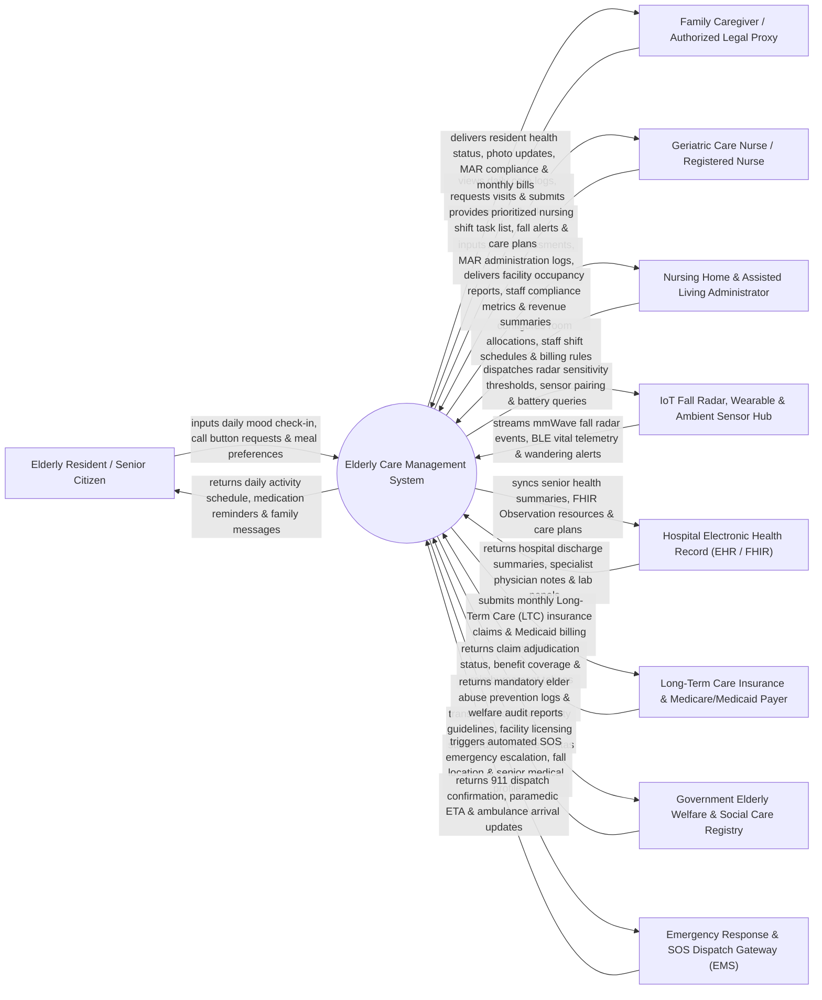

# Context Diagram — Elderly Care Management System

## Mermaid Code

## Actor & Interaction Table | Bảng Actor & Tương tác

| # | Actor | Actor Type | Data Sent TO System | Data Received FROM System | Notes |
|---|-------|------------|---------------------|---------------------------|-------|
| 1 | Elderly Resident / Senior | Primary | Daily self-reported mood, SOS wearable button presses, meal choices, activity participation responses. | Personalized daily activity schedules, audio/visual medication reminders, family voice messages, room climate status. | Senior citizens living in nursing homes, assisted living facilities, or receiving home-based elder care. |
| 2 | Family Caregiver / Legal Proxy | Primary | Visit reservation requests, family care preferences, authorized proxy consents, electronic bill payments. | Daily care progress logs, Medication Administration Record (MAR) compliance %, photo updates, monthly billing invoices. | Family members or legal guardians monitoring the senior's well-being and managing facility financial billing. |
| 3 | Geriatric Care Nurse / Technician | Primary | ADL/IADL functional assessments, MAR drug administration timestamps, vital signs, wound care notes, incident reports. | Shift task rosters, fall alert sirens, medication administration due lists, customized geriatric care plans. | Registered nurses (RN) and certified nursing assistants (CNA) providing direct daily care in elder care facilities. |
| 4 | Care Facility Administrator | Primary | Room/bed allocations, nursing staff shift schedules, facility care fee rates, admission/discharge orders. | Facility bed occupancy %, staff care task compliance metrics, monthly revenue summaries, incident audit logs. | Nursing home directors and assisted living administrators overseeing facility operations and regulatory compliance. |
| 5 | IoT Fall Radar & Wearable Hub | Supporting System | Real-time mmWave fall detection radar events, wearable heart rate/SpO2 telemetry, room ambient motion, bed exit alerts. | Sensor pairing configurations, mmWave radar sensitivity thresholds, battery level queries, OTA firmware updates. | Non-intrusive ceiling mmWave fall radars, smart bed sensor pads, wearable emergency SOS pendants, and ambient motion detectors. |
| 6 | Hospital Electronic Health Record (EHR) | Supporting System | Hospital discharge summaries, specialist clinical notes, diagnostic lab blood panels, active ICD-10 medical diagnoses. | FHIR `Observation` resources, senior health summaries, functional ADL progress trends, emergency transfer notes. | Regional hospital EMR (Epic, Cerner) integrating senior medical records via HL7 FHIR R4 standard interfaces. |
| 7 | Long-Term Care (LTC) Insurance Payer | Supporting System | Claim adjudication responses, Medicare/Medicaid LTC benefit coverage rules, direct settlement tokens. | Monthly Long-Term Care (LTC) insurance claims, itemized nursing care billing payloads, ADL dependency level proof. | Private LTC insurance companies and public healthcare payers (Medicare Part 100 / Medicaid) funding elder care. |
| 8 | Government Elderly Welfare Department | Regulatory | Mandatory elder care facility licensing standards, elder abuse prevention guidelines, social welfare quotas. | Mandatory elder abuse inspection audit logs, resident safety compliance reports, social welfare subsidy feeds. | Municipal social welfare and health department regulating senior care facilities and elder rights protection. |
| 9 | Emergency Response & Dispatch (EMS) | Supporting System | Ambulance dispatch confirmation, paramedic ETA updates, emergency incident resolution status. | Automated SOS emergency escalation payloads, senior resident GPS/room location, medical baseline summary. | Local 911 or private ambulance dispatch services triggered during acute fall trauma or unhandled cardiac/respiratory emergencies. |

## System Boundary Description | Mô tả Phạm vi Hệ thống

The **Elderly Care Management System (ECMS)** is an enterprise geriatric health, nursing home management, fall detection, Activities of Daily Living (ADL) assessment, and family engagement platform. Operating across nursing homes, assisted living communities, senior day-care centers, and home elder care networks, it manages resident registration, functional ADL/IADL scoring (Barthel Index, Katz ADL, Morse Fall Scale), mmWave radar fall detection, Medication Administration Records (MAR), room/bed allocation, physical therapy progress, family portal communication, and Long-Term Care (LTC) insurance billing.

**Inside System Scope:**
- Elderly resident profile management, emergency contact linkage, and legal proxy authorization.
- Functional status scoring (Barthel Index ADL, Katz ADL, MMSE cognitive evaluation, Morse Fall Risk Scale).
- Real-time IoT fall detection ingestion (mmWave radar, smart bed sensors) with instant nurse workstation alerts.
- Electronic Medication Administration Record (eMAR) with barcode scanning and five-rights medication verification.
- Nursing home bed allocation, room assignment, and facility occupancy tracking.
- Physical rehabilitation therapy logging, mobility scoring, and dysphagia dietary plan management.
- Family caregiver mobile portal for daily care summaries, MAR logs, photo updates, and video check-ins.
- Long-Term Care (LTC) insurance claims generation and Medicare/Medicaid reimbursement export.

**Outside System Scope:**
- Inpatient acute surgical operations and complex ICU interventions (handled by Acute Care Hospitals).
- Physical manufacturing and hardware repairs of mmWave radar sensors and smart beds.
- Direct management of municipal public infrastructure (public parks, public senior transport buses).
