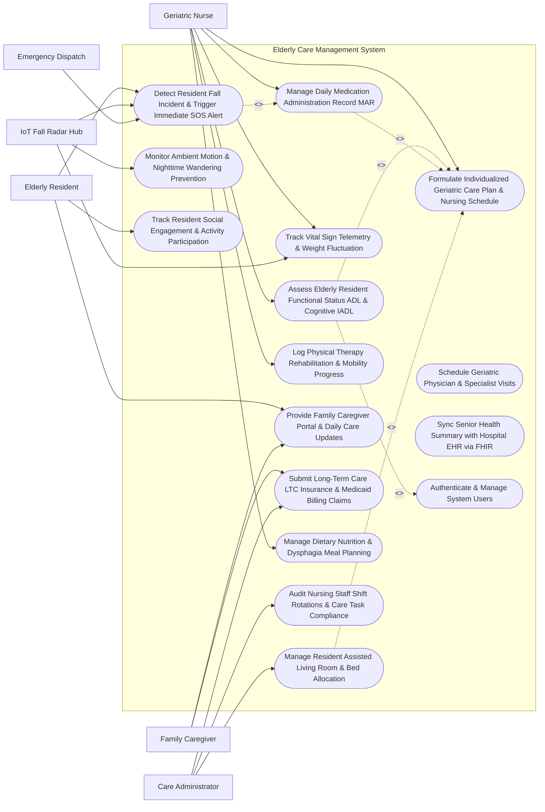

# Use Case Diagram — Elderly Care Management System

## Mermaid Code

## Actor Table | Bảng Actor

| # | Actor | Actor Type | Role Description | Related Use Cases |
|---|-------|------------|------------------|-------------------|
| 1 | Elderly Resident | Primary | Senior citizen residing in assisted living facility using wearable SOS buttons, participating in social activities, and receiving daily nursing care. | UC03, UC09, UC14 |
| 2 | Family Caregiver | Primary | Authorized family member or legal proxy reviewing daily care logs, tracking MAR compliance, communicating with nurses, and paying bills. | UC09, UC10 |
| 3 | Geriatric Nurse | Primary | Registered nurse (RN) or certified nursing assistant (CNA) conducting ADL assessments, administering medications, recording vitals, and logging care notes. | UC01, UC02, UC04, UC05, UC07, UC13 |
| 4 | Care Administrator | Primary | Facility director managing resident admissions, room allocations, staff shift scheduling, compliance auditing, and LTC insurance billing. | UC06, UC10, UC15 |
| 5 | IoT Fall Radar Hub | Secondary / System | Non-intrusive ceiling mmWave fall radar, smart bed sensor pad, and ambient motion detector streaming real-time safety events. | UC03, UC05, UC11 |
| 6 | Emergency Dispatch | Secondary / System | External 911 or private ambulance dispatch network receiving automated high-priority fall trauma or emergency SOS dispatch payloads. | UC03 |

## Use Case Table | Bảng Use Case

| # | UC ID | Use Case Name | Primary Actor | Secondary Actor | Description | Priority |
|---|-------|---------------|---------------|-----------------|-------------|----------|
| 1 | UC01 | Assess Elderly Resident Functional Status ADL & Cognitive IADL | Geriatric Nurse | None | Perform structured functional assessments using Barthel Index ADL, Katz ADL, Mini-Mental State Examination (MMSE), and Morse Fall Scale. | High |
| 2 | UC02 | Formulate Individualized Geriatric Care Plan & Nursing Schedule | Geriatric Nurse | None | Formulate customized care plans defining daily assistance levels (bathing, dressing, transfer), mobility aids, nursing shift schedules, and goals. | High |
| 3 | UC03 | Detect Resident Fall Incident & Trigger Immediate SOS Alert | IoT Fall Radar Hub | Emergency Dispatch | Process mmWave radar fall events or wearable SOS button presses, triggering red siren alerts on nurse stations and dispatching EMS if unhandled. | High |
| 4 | UC04 | Manage Daily Medication Administration Record MAR | Geriatric Nurse | None | Administer scheduled medications, verify five-rights (Patient, Drug, Dose, Route, Time) using barcode scanner, and log eMAR compliance. | High |
| 5 | UC05 | Track Vital Sign Telemetry & Weight Fluctuation | Geriatric Nurse | IoT Fall Radar Hub | Record daily vital signs (BP, SpO2, HR, Temperature) and monitor weekly weight fluctuations to detect fluid retention or malnutrition. | High |
| 6 | UC06 | Manage Resident Assisted Living Room & Bed Allocation | Care Administrator | None | Assign assisted living rooms, manage bed availability in special care units (Dementia Wing, High Dependency), and track facility occupancy. | High |
| 7 | UC07 | Log Physical Therapy Rehabilitation & Mobility Progress | Geriatric Nurse | None | Document physical therapy sessions, gait stability scores, range-of-motion progress, and mobility aid transitions (Wheelchair to Walker). | Medium |
| 8 | UC08 | Schedule Geriatric Physician & Specialist Visits | Geriatric Nurse | None | Coordinate routine on-site visits with visiting geriatricians, psychiatrists, podiatrists, and ophthalmologists. | Medium |
| 9 | UC09 | Provide Family Caregiver Portal & Daily Care Updates | Family Caregiver | Elderly Resident | Deliver real-time family app portal access to view daily care notes, MAR compliance %, meal logs, photo updates, and schedule visits. | High |
| 10 | UC10 | Submit Long-Term Care LTC Insurance & Medicaid Billing Claims | Care Administrator | Family Caregiver | Generate monthly itemized billing invoices, calculate LTC insurance benefits based on ADL dependency tiers, and submit Medicaid claims. | High |
| 11 | UC11 | Monitor Ambient Motion & Nighttime Wandering Prevention | IoT Fall Radar Hub | None | Process door contact sensors and hallway motion detectors to detect nighttime wandering in memory care residents, alerting duty staff. | High |
| 12 | UC12 | Sync Senior Health Summary with Hospital EHR via FHIR | Geriatric Nurse | None | Export resident health summaries, ADL trends, and emergency transfer SOAP notes to hospital EHRs via HL7 FHIR R4 interfaces. | High |
| 13 | UC13 | Manage Dietary Nutrition & Dysphagia Meal Planning | Geriatric Nurse | None | Configure dietary texture levels (Pureed, Soft, Normal), fluid thickness (Nectar-thick, Honey-thick), and log daily meal consumption %. | Medium |
| 14 | UC14 | Track Resident Social Engagement & Activity Participation | Elderly Resident | None | Log resident attendance in social activities (bingo, gardening, music therapy, group exercise), monitoring social isolation risk. | Low |
| 15 | UC15 | Audit Nursing Staff Shift Rotations & Care Task Compliance | Care Administrator | None | Track CNA task completion SLAs, audit shift handover notes, and ensure mandatory nurse-to-resident care ratio compliance. | Medium |
| 16 | UC16 | Authenticate & Manage System Users | All Users | None | Enforce multi-factor authentication, role-based access control (Nurse, Administrator, Family Proxy), and cryptographic HIPAA audit logging. | High |

## Use Case Specification | Đặc tả Use Case

---

### UC01 — Assess Elderly Resident Functional Status ADL & Cognitive IADL

| Field | Detail |
|-------|--------|
| **UC ID** | UC01 |
| **Use Case Name** | Assess Elderly Resident Functional Status ADL & Cognitive IADL |
| **Actor(s)** | Primary: Geriatric Nurse |
| **Description** | Conducts comprehensive functional and cognitive assessments for an elderly resident using standardized clinical scales: Barthel Index for Activities of Daily Living (ADL), Katz Index of Independence, Mini-Mental State Examination (MMSE) for cognitive decline, and Morse Fall Scale for fall risk, establishing baseline care dependency tiers. |
| **Precondition** | 1. Geriatric Nurse is authenticated in ECMS with clinical assessment privileges.   2. Resident profile `RES-2026-99182` (*Eleanor Vance*, Age: 84) is admitted. |
| **Main Flow** | 1. The Geriatric Nurse selects "Start Clinical Functional Assessment" for Resident *Eleanor Vance*.   2. The Nurse completes **Barthel Index ADL Assessment (0-100 Scale)**:   &nbsp;&nbsp;&nbsp;&nbsp;- Feeding: 5/10 (Needs help cutting food)   &nbsp;&nbsp;&nbsp;&nbsp;- Bathing: 0/5 (Dependent)   &nbsp;&nbsp;&nbsp;&nbsp;- Grooming: 5/5 (Independent)   &nbsp;&nbsp;&nbsp;&nbsp;- Dressing: 5/10 (Needs help with shoes/buttons)   &nbsp;&nbsp;&nbsp;&nbsp;- Bowel & Bladder Control: 5/10 (Occasional incontinence)   &nbsp;&nbsp;&nbsp;&nbsp;- Toilet Use: 5/10 (Needs transfer assistance)   &nbsp;&nbsp;&nbsp;&nbsp;- Transfers (Bed to Chair): 10/15 (Major help required)   &nbsp;&nbsp;&nbsp;&nbsp;- Mobility on Level Surfaces: 10/15 (Walks with Rollator walker)   &nbsp;&nbsp;&nbsp;&nbsp;- Total Barthel Score: **55/100** (**MODERATE DEPENDENCY**).   3. The Nurse completes **MMSE Cognitive Assessment (0-30 Scale)**:   &nbsp;&nbsp;&nbsp;&nbsp;- Orientation, Memory, Attention, Language score: **21/30** (**MILD COGNITIVE IMPAIRMENT / EARLY DEMENTIA**).   4. The Nurse completes **Morse Fall Risk Scale**:   &nbsp;&nbsp;&nbsp;&nbsp;- History of Falls (Yes: 25), Secondary Diagnosis (Yes: 15), Ambulatory Aid (Walker: 15), Gait (Weak: 10) -> Total: **65** (**HIGH FALL RISK**).   5. The System calculates Care Dependency Tier: **CARE TIER 3 (HIGH ASSISTANCE NEEDED)**.   6. The System routes evaluation to Care Plan Generator (UC02) to establish daily nursing task schedules. |
| **Alternative Flow** | **AF1** — Fast-Track Quarterly ADL Re-Assessment: Nurse performs routine 90-day re-assessment, loading previous scores (Barthel 65 -> current 55) and flagging functional decline (-10 pts) for physician review.   **AF2** — Post-Stroke Rehab ADL Tracking: Resident recovering from acute CVA stroke; System tracks bi-weekly ADL recovery progress. |
| **Exception Flow** | **EX1** — Incomplete Assessment Category Block: Nurse leaves MMSE orientation section unanswered; System blocks submission with error "Cognitive MMSE Section Incomplete — All Mandatory Questions Required".   **EX2** — Severe Cognitive Decline Emergency Alert: MMSE score drops below 10 (Severe Dementia); System triggers alert to Geriatric Psychiatrist for medication review. |
| **Postcondition** | Functional Assessment ASS-2026-88192 (Barthel: 55, MMSE: 21, Morse Fall: 65) is completed, Care Tier 3 assigned, and high fall risk care plan generated. |
| **Business Rule** | **BR1**: Resident functional ADL assessments MUST utilize validated clinical scales (Barthel Index, Katz ADL, Morse Fall Scale) and be re-evaluated every 90 days or post-hospitalization.   **BR2**: Morse Fall Risk scores >= 45 MUST automatically trigger high fall risk protocols, including smart bed sensor activation and fall radar deployment. |

---

### UC02 — Formulate Individualized Geriatric Care Plan & Nursing Schedule

| Field | Detail |
|-------|--------|
| **UC ID** | UC02 |
| **Use Case Name** | Formulate Individualized Geriatric Care Plan & Nursing Schedule |
| **Actor(s)** | Primary: Geriatric Nurse |
| **Description** | Formulates a customized, multi-disciplinary geriatric care plan based on functional ADL scores (UC01), specifying daily personal hygiene assistance levels, mobility aid requirements, fall prevention measures, dietary texture modifications, and nursing shift task schedules. |
| **Precondition** | 1. Functional assessment `ASS-2026-88192` (Barthel: 55, Care Tier 3) (UC01) is finalized.   2. Geriatric Nurse is authenticated. |
| **Main Flow** | 1. The Geriatric Nurse opens "Care Plan Studio" for Resident *Eleanor Vance* (`RES-2026-99182`).   2. The System pre-populates care requirements based on Care Tier 3 (High Assistance).   3. The Nurse configures **Personal Care & ADL Assistance Schedule**:   &nbsp;&nbsp;&nbsp;&nbsp;- Morning Hygiene & Bathing: 2-Person Assist, Daily at 07:30 AM   &nbsp;&nbsp;&nbsp;&nbsp;- Dressing & Grooming: Partial Assist, Daily at 08:00 AM   &nbsp;&nbsp;&nbsp;&nbsp;- Toileting Schedule: Timed 2-Hour Prompting (08:00, 10:00, 12:00, 14:00, 16:00, 18:00, 20:00).   4. The Nurse configures **Fall Prevention & Mobility Rules**:   &nbsp;&nbsp;&nbsp;&nbsp;- Mobility Aid: Rollator Walker with non-slip footwear required for all transfers   &nbsp;&nbsp;&nbsp;&nbsp;- Bed Safety: Ultra-Low Bed with floor mats + Smart Bed Exit Sensor Active (22:00 to 06:00)   &nbsp;&nbsp;&nbsp;&nbsp;- Room Safety: mmWave Fall Radar active in Room 104 and ensuite bathroom.   5. The Nurse configures **Nutrition & Hydration**:   &nbsp;&nbsp;&nbsp;&nbsp;- Diet: Mechanical Soft, Nectar-Thick Liquids (Dysphagia Risk Level 1)   &nbsp;&nbsp;&nbsp;&nbsp;- Fluid Target: $1,500\text{ mL/day}$ with fluid log tracking.   6. The System generates the **Daily Nursing Shift Task Schedule** for Day, Evening, and Night CNA shifts.   7. The Nurse signs Care Plan `PLAN-2026-44120` and deploys it to staff tablets. |
| **Alternative Flow** | **AF1** — Memory Care / Wandering Protocol Addition: Resident has severe wandering tendency (MMSE < 12); Nurse adds "Memory Care Wing Door Contact Sensor & GPS Smart Pendant Active" to care plan.   **AF2** — Palliative / Comfort Care Modification: Resident transitions to hospice care; Nurse updates care plan goals to pain management, skin integrity protection, and family visit priority. |
| **Exception Flow** | **EX1** — Conflicting Care Orders Error: Nurse orders 1-Person assist for transfer, but Morse Fall score > 65 requires 2-Person assist; System flags "Safety Rule Conflict — High Fall Risk Requires Minimum 2-Person Assist".   **EX2** — Unassigned Shift Task SLA Alert: Required 2-hour toileting task is unassigned to any duty CNA; System alerts "Unassigned Care Task in Shift Schedule". |
| **Postcondition** | Individualized Care Plan PLAN-2026-44120 is created, fall safety rules deployed, 3-shift nursing schedules generated, and assigned to CNA shift tablets. |
| **Business Rule** | **BR1**: Care plans MUST specify exact staff assistance levels (1-Person vs 2-Person assist) for transfers and bathing based on Barthel transfer scores.   **BR2**: Dysphagia dietary modifications (pureed diet, thickened liquids) MUST be explicitly documented in care plans and verified by a speech-language pathologist or geriatric nurse. |

---

### UC03 — Detect Resident Fall Incident & Trigger Immediate SOS Alert

| Field | Detail |
|-------|--------|
| **UC ID** | UC03 |
| **Use Case Name** | Detect Resident Fall Incident & Trigger Immediate SOS Alert |
| **Actor(s)** | Primary: IoT Fall Radar Hub   Secondary: Emergency Dispatch, Geriatric Nurse |
| **Description** | Automatically detects sudden resident fall incidents using ceiling-mounted mmWave radar sensors, smart bed exit pads, or wearable SOS pendant button presses, instantly triggering high-priority red siren alerts on nursing station monitors and duty staff mobile tablets, and escalating to EMS if unhandled. |
| **Precondition** | 1. Resident *Eleanor Vance* (`RES-2026-99182`) is in Room 104 with mmWave fall radar active.   2. Duty nursing staff are logged into mobile care tablets. |
| **Main Flow** | 1. The mmWave Fall Radar (`RADAR-RM104`) detects sudden rapid downward motion followed by zero micro-motion on the bathroom floor at `02:14 AM`.   2. The System classifies event as **HIGH-CONFIDENCE UNRESPONSIVE FALL INCIDENT** (`FALL-ALERT-2026-9918`).   3. The System triggers **Immediate Emergency Alert Protocol**:   &nbsp;&nbsp;&nbsp;&nbsp;- Flashes Red Siren Alert on Central Nursing Station Monitor: *"ROOM 104 - ELEANOR VANCE - BATHROOM FALL DETECTED"*   &nbsp;&nbsp;&nbsp;&nbsp;- Sounds high-decibel audible alarm on all Night Shift CNA mobile tablets   &nbsp;&nbsp;&nbsp;&nbsp;- Turns on Room 104 pathway nightlights automatically.   4. Night Duty Nurse (RN Sarah Miller) acknowledges alert `FALL-ALERT-2026-9918` on tablet within 18 seconds.   5. Nurse Sarah rushes to Room 104 bathroom, performs clinical assessment:   &nbsp;&nbsp;&nbsp;&nbsp;- Resident is conscious, complaining of right hip pain   &nbsp;&nbsp;&nbsp;&nbsp;- Vitals: BP $138/84\text{ mmHg}$, HR $88\text{ bpm}$, SpO2 $96\%$   &nbsp;&nbsp;&nbsp;&nbsp;- No visible head trauma, but right leg appears shortened/externally rotated (Suspected Femoral Neck Fracture).   6. Nurse Sarah taps "Request Emergency Ambulance (911)" on tablet.   7. The System dispatches **EMS Emergency Payload** (UC03 / EMS) with resident EMR, hip trauma note, and Room 104 location.   8. The System notifies Family Caregiver (UC09) via automated urgent SMS. |
| **Alternative Flow** | **AF1** — Wearable SOS Pendant Button Press: Resident slips in bedroom and presses wearable SOS button on wristband; System triggers immediate alert showing precise GPS/BLE beacon location in hallway.   **AF2** — Non-Injury Fall Self-Resolution: Fall radar detects fall; Nurse responds in 30 seconds, assists resident up (no injury), and logs "Fall Incident — No Injury — Post-Fall Assessment Complete". |
| **Exception Flow** | **EX1** — Duty Staff No-Acknowledgment Timeout: Night shift staff fail to acknowledge Red Fall Alert within 60 seconds; System automatically escalates alert to Duty Administrator and initiates automated phone call to On-Call Doctor.   **EX2** — Radar Connection Disconnect Warning: mmWave radar in Room 104 drops Wi-Fi signal; System flags "Room 104 Fall Radar Offline — Deploy Backup Bed Exit Sensor". |
| **Postcondition** | Fall incident FALL-ALERT-2026-9918 acknowledged in 18s, nursing assessment completed, suspected hip fracture logged, EMS dispatched, and family notified. |
| **Business Rule** | **BR1**: Fall alerts generated by mmWave radar or SOS pendants MUST trigger high-decibel audible sirens with a strict 60-second staff acknowledgment SLA.   **BR2**: Post-fall clinical assessments MUST include vital signs, head trauma screening, musculoskeletal deformity check, and mandatory post-fall incident logging within 2 hours. |

---

### UC04 — Manage Daily Medication Administration Record MAR

| Field | Detail |
|-------|--------|
| **UC ID** | UC04 |
| **Use Case Name** | Manage Daily Medication Administration Record MAR |
| **Actor(s)** | Primary: Geriatric Nurse |
| **Description** | Manages electronic Medication Administration Records (eMAR), executing five-rights verification (Right Patient, Right Drug, Right Dose, Right Route, Right Time) using mobile barcode scanners, logging drug administration, documenting refusals or held doses, and maintaining strict controlled substance logs. |
| **Precondition** | 1. Active physician medication orders are loaded in Resident *Eleanor Vance*'s profile.   2. Geriatric Nurse is authenticated with barcode scanner tablet. |
| **Main Flow** | 1. Geriatric Nurse Sarah opens "Morning eMAR Administration List" for Room 104 (*Eleanor Vance*).   2. The System displays **Scheduled Morning Medications (08:00 AM)**:   &nbsp;&nbsp;&nbsp;&nbsp;- Med 1: *Donepezil HCl (Aricept) 10mg Oral Tablet* (Dementia)   &nbsp;&nbsp;&nbsp;&nbsp;- Med 2: *Amlodipine Besylate 5mg Oral Tablet* (Hypertension)   &nbsp;&nbsp;&nbsp;&nbsp;- Med 3: *Furosemide (Lasix) 20mg Oral Tablet* (Heart Failure / Edema).   3. The Nurse scans Resident Eleanor's Barcode Wristband (`RES-2026-99182` -> *Right Patient Verified*).   4. The Nurse scans the unit-dose blister pack for Amlodipine 5mg (`BAR-DRUG-44120` -> *Right Drug, Right Dose Verified*).   5. The Nurse checks vital preconditions: Systolic BP is $132\text{ mmHg}$ (Precondition BP > 100 mmHg met).   6. The Nurse administers the oral medications with nectar-thickened liquid (UC13).   7. The Nurse taps "Confirm Administered" at `08:12 AM`.   8. The System updates eMAR record `MAR-2026-88192` with nurse ID, timestamp, and deducts 1 dose from unit supply stock. |
| **Alternative Flow** | **AF1** — Resident Medication Refusal Logging: Resident refuses morning Furosemide tablet; Nurse provides education, resident still refuses; Nurse logs "Medication Refused by Resident — Client Informed of Risk", notifying attending physician.   **AF2** — Medication Held Due to Vital Precondition: Physician order specifies "Hold Amlodipine if Systolic BP < 110 mmHg"; Measured BP is $104\text{ mmHg}$; Nurse logs "Medication Held — BP 104 mmHg Below Threshold". |
| **Exception Flow** | **EX1** — Wrong Patient Barcode Scan Error: Nurse accidentally scans Resident B's wristband while holding Resident A's meds; System flashes RED ERROR SIREN "WRONG PATIENT SCAN — MEDICATION MISMATCH".   **EX2** — Overdue Medication SLA Warning: 08:00 AM scheduled meds remain unadministered at 09:30 AM (> 60 mins late); System flags "OVERDUE MAR ALERT — Medication 90 Mins Past Scheduled Time". |
| **Postcondition** | Morning eMAR record MAR-2026-88192 is logged, 3 medications administered at 08:12 AM, 5-rights verified via barcode, and inventory stock updated. |
| **Business Rule** | **BR1**: eMAR medication administration MUST enforce barcode scanning of both resident wristband and medication packaging to guarantee Five-Rights compliance.   **BR2**: Medications with vital sign parameters (e.g., Hold antihypertensives if Systolic BP < 110 mmHg) MUST require mandatory vital sign entry before unlocking the administration button. |

---

### UC05 — Track Vital Sign Telemetry & Weight Fluctuation

| Field | Detail |
|-------|--------|
| **UC ID** | UC05 |
| **Use Case Name** | Track Vital Sign Telemetry & Weight Fluctuation |
| **Actor(s)** | Primary: Geriatric Nurse   Secondary: IoT Fall Radar Hub |
| **Description** | Records and tracks routine and continuous physiological vital signs (Blood Pressure, Heart Rate, SpO2, Body Temperature, Blood Glucose) and weekly weight measurements, analyzing trend fluctuations (e.g., sudden $2\text{ kg}$ weight gain in 48 hours indicating fluid retention/heart failure decompensation). |
| **Precondition** | 1. Resident *Eleanor Vance* (`RES-2026-99182`) is admitted.   2. Bluetooth-enabled smart scale and vital sign monitors are paired. |
| **Main Flow** | 1. Vet/Geriatric Nurse performs routine morning vital sign check for Resident *Eleanor Vance*.   2. The Nurse measures vitals using BLE connected devices:   &nbsp;&nbsp;&nbsp;&nbsp;- Blood Pressure: $138/84\text{ mmHg}$   &nbsp;&nbsp;&nbsp;&nbsp;- Heart Rate: $76\text{ bpm}$   &nbsp;&nbsp;&nbsp;&nbsp;- SpO2: $95\%$   &nbsp;&nbsp;&nbsp;&nbsp;- Body Temperature: $36.8^\circ\text{C}$.   3. The Nurse assists Resident onto the Wheelchair Scale:   &nbsp;&nbsp;&nbsp;&nbsp;- Measured Weight: **$64.8\text{ kg}$**   &nbsp;&nbsp;&nbsp;&nbsp;- Previous Weight (3 days ago): **$62.3\text{ kg}$**   &nbsp;&nbsp;&nbsp;&nbsp;- Weight Fluctuation: **$+2.5\text{ kg}$ Gain in 72 Hours**.   4. The System analyzes weight trend algorithms:   &nbsp;&nbsp;&nbsp;&nbsp;- Detects rapid fluid retention threshold breached ($> 1.5\text{ kg}$ in 72 hours).   5. The System generates **Congestive Heart Failure (CHF) Decompensation Alert**:   &nbsp;&nbsp;&nbsp;&nbsp;- Flags alert on Nurse Triage Board: *"Sudden Weight Gain +2.5 kg — Evaluate Peripheral Edema & Lung Sounds"*.   6. The Nurse performs chest auscultation (noting mild basal crackles) and notifies Attending Geriatrician for diuretic adjustment.   7. The System logs vital record `VIT-2026-77812` and syncs trends to Family Caregiver Portal (UC09). |
| **Alternative Flow** | **AF1** — Diabetic Blood Glucose Monitoring Log: Nurse checks pre-meal blood glucose ($8.4\text{ mmol/L}$), logging value in eMAR for sliding-scale insulin administration.   **AF2** — Weight Loss & Malnutrition Detection: Resident loses $4.0\text{ kg}$ over 30 days (-6.2% body weight loss); System triggers Malnutrition Protocol referral to Clinical Dietitian (UC13). |
| **Exception Flow** | **EX1** — Extreme Vital Sign Outlier Alert: SpO2 drops to 84%; System immediately triggers Red Critical Oxygen Desaturation Alert (UC03).   **EX2** — Uncalibrated Scale Weight Error: Scale reads $12.0\text{ kg}$ due to tare weight error; System blocks entry with alert "Implausible Weight Change — Recalibrate Scale". |
| **Postcondition** | Vital record VIT-2026-77812 (Weight: 64.8 kg, BP: 138/84) is logged, +2.5 kg weight gain flagged, CHF fluid alert dispatched, and family portal updated. |
| **Business Rule** | **BR1**: Resident weight fluctuations exceeding 1.5 kg in 72 hours or 5% body weight loss in 30 days MUST automatically trigger clinical deterioration alerts.   **BR2**: Senior vital sign trend graphs MUST be accessible to authorized family proxies via the family portal to maintain care transparency. |
