# Conceptual ERD — Elderly Care Management System

## Mermaid Code

```mermaid
erDiagram
    ELDERLY_RESIDENT {
        int resident_id PK
        string national_id
        string full_name
        date date_of_birth
        string gender
        string emergency_contact_phone
        date admission_date
        string resident_status
    }

    FAMILY_CAREGIVER {
        int caregiver_id PK
        int resident_id FK
        string full_name
        string relationship
        string phone
        string email
        string legal_proxy_status
    }

    FUNCTIONAL_ADL_ASSESSMENT {
        int assessment_id PK
        int resident_id FK
        int assessed_by_nurse_id FK
        int barthel_index_score
        int katz_adl_score
        int mmse_cognitive_score
        int fall_risk_morse_score
        datetime assessed_at
    }

    GERIATRIC_CARE_PLAN {
        int care_plan_id PK
        int resident_id FK
        string care_level
        string daily_assistance_needs_json
        string mobility_aid_type
        string dietary_consistency
        date start_date
        string plan_status
    }

    MEDICATION_ADMINISTRATION_RECORD {
        int mar_id PK
        int resident_id FK
        string medication_name
        string dosage
        datetime scheduled_time
        datetime administered_time
        int administered_by_nurse_id FK
        string mar_status
    }

    FALL_INCIDENT_ALERT {
        int alert_id PK
        int resident_id FK
        string sensor_id
        datetime detected_at
        string fall_location
        datetime nurse_acknowledged_at
        string injury_severity
        string alert_status
    }

    ROOM_BED_ALLOCATION {
        int allocation_id PK
        int resident_id FK
        string building_wing
        string room_number
        string bed_type
        date start_date
        string allocation_status
    }

    PHYSICAL_THERAPY_LOG {
        int therapy_id PK
        int resident_id FK
        int therapist_id FK
        date session_date
        string exercise_type
        int mobility_score
        string progress_notes
    }

    LTC_BILLING_CLAIM {
        int claim_id PK
        int resident_id FK
        string billing_period_month
        string care_level_code
        decimal total_amount
        decimal insurance_covered_amount
        decimal out_of_pocket_amount
        string claim_status
    }

    GERIATRIC_PHYSICIAN_VISIT {
        int visit_id PK
        int resident_id FK
        int physician_id FK
        datetime visit_date
        string clinical_notes
        string orders_json
        string visit_status
    }

    EHR_SENIOR_SYNC_AUDIT {
        int sync_id PK
        int resident_id FK
        string fhir_resource_type
        string fhir_resource_id
        datetime synced_at
        string sync_status
    }

    ELDERLY_RESIDENT ||--o{ FAMILY_CAREGIVER : "represented_by"
    ELDERLY_RESIDENT ||--o{ FUNCTIONAL_ADL_ASSESSMENT : "assessed_for_adl"
    ELDERLY_RESIDENT ||--o{ GERIATRIC_CARE_PLAN : "assigned_care_plan"
    ELDERLY_RESIDENT ||--o{ MEDICATION_ADMINISTRATION_RECORD : "receives_mar"
    ELDERLY_RESIDENT ||--o{ FALL_INCIDENT_ALERT : "triggers_fall_alerts"
    ELDERLY_RESIDENT ||--o{ ROOM_BED_ALLOCATION : "allocated_room_bed"
    ELDERLY_RESIDENT ||--o{ PHYSICAL_THERAPY_LOG : "undergoes_therapy"
    ELDERLY_RESIDENT ||--o{ LTC_BILLING_CLAIM : "generates_ltc_claims"
    ELDERLY_RESIDENT ||--o{ GERIATRIC_PHYSICIAN_VISIT : "receives_physician_visits"
    ELDERLY_RESIDENT ||--o{ EHR_SENIOR_SYNC_AUDIT : "syncs_to_ehr"
```

## Entity Description Table | Bảng mô tả Entity

| # | Entity Name | Vietnamese Name | Description | Key Attributes | Main Relationships |
|---|-------------|-----------------|-------------|----------------|-------------------|
| 1 | ELDERLY_RESIDENT | Cụ ông/Cụ bà Cao tuổi | Master record of senior resident storing national ID, name, DOB, gender, emergency contact phone, admission date, and resident status. | resident_id, national_id, full_name, date_of_birth, gender, emergency_contact_phone, admission_date, resident_status | Has CAREGIVER, ADL_ASSESSMENT, CARE_PLAN, MAR, FALL_ALERT, ROOM_ALLOCATION, THERAPY, CLAIM, VISIT. |
| 2 | FAMILY_CAREGIVER | Người nhà Caregiver / Đại diện | Authorized family member or legal proxy record storing resident ID, full name, relationship, phone, email, and legal proxy status. | caregiver_id, resident_id, full_name, relationship, phone, email, legal_proxy_status | Belongs to ELDERLY_RESIDENT. |
| 3 | FUNCTIONAL_ADL_ASSESSMENT | Đánh giá Chức năng Sinh hoạt ADL | Structured clinical ADL assessment record storing Barthel Index (0-100), Katz ADL, MMSE cognitive score, Morse fall risk score, and timestamp. | assessment_id, resident_id, assessed_by_nurse_id, barthel_index_score, katz_adl_score, mmse_cognitive_score, fall_risk_morse_score, assessed_at | Belongs to ELDERLY_RESIDENT. |
| 4 | GERIATRIC_CARE_PLAN | Kế hoạch Chăm sóc Lão khoa | Individualized geriatric care plan record storing care tier level, daily assistance rules, mobility aid, dietary consistency, and status. | care_plan_id, resident_id, care_level, daily_assistance_needs_json, mobility_aid_type, dietary_consistency, start_date, plan_status | Belongs to ELDERLY_RESIDENT. |
| 5 | MEDICATION_ADMINISTRATION_RECORD | Nhật ký Dùng thuốc eMAR | Electronic Medication Administration Record tracking resident ID, drug name, dosage, scheduled/administered times, nurse ID, and MAR status. | mar_id, resident_id, medication_name, dosage, scheduled_time, administered_time, administered_by_nurse_id, mar_status | Belongs to ELDERLY_RESIDENT. |
| 6 | FALL_INCIDENT_ALERT | Cảnh báo Té ngã SOS | Emergency fall incident record generated by mmWave radar or SOS button storing sensor ID, location, nurse acknowledgment time, and severity. | alert_id, resident_id, sensor_id, detected_at, fall_location, nurse_acknowledged_at, injury_severity, alert_status | Belongs to ELDERLY_RESIDENT. |
| 7 | ROOM_BED_ALLOCATION | Phân bổ Phòng & Giường Nội trú | Nursing home assisted living room and bed allocation record tracking building wing, room number, bed type, start date, and allocation status. | allocation_id, resident_id, building_wing, room_number, bed_type, start_date, allocation_status | Belongs to ELDERLY_RESIDENT. |
| 8 | PHYSICAL_THERAPY_LOG | Nhật ký Phục hồi Chức năng | Physical rehabilitation therapy log tracking session date, exercise type, mobility score (gait stability), progress notes, and therapist ID. | therapy_id, resident_id, therapist_id, session_date, exercise_type, mobility_score, progress_notes | Belongs to ELDERLY_RESIDENT. |
| 9 | LTC_BILLING_CLAIM | Hóa đơn & Bồi thường LTC | Monthly Long-Term Care (LTC) insurance and Medicaid billing claim record tracking care tier code, total fee, insurance coverage, and out-of-pocket balance. | claim_id, resident_id, billing_period_month, care_level_code, total_amount, insurance_covered_amount, out_of_pocket_amount, claim_status | Belongs to ELDERLY_RESIDENT. |
| 10 | GERIATRIC_PHYSICIAN_VISIT | Lịch Khám Bác sĩ Lão khoa | On-site geriatrician or specialist visit record storing visit date, clinical progress notes, diagnostic orders, and visit status. | visit_id, resident_id, physician_id, visit_date, clinical_notes, orders_json, visit_status | Belongs to ELDERLY_RESIDENT. |
| 11 | EHR_SENIOR_SYNC_AUDIT | Nhật ký Đồng bộ EMR Senior | Integration audit log tracking HL7 FHIR R4 resource syncs (`Observation`, `CarePlan`, `DiagnosticReport`) between ECMS and hospital EHRs. | sync_id, resident_id, fhir_resource_type, fhir_resource_id, synced_at, sync_status | Belongs to ELDERLY_RESIDENT. |

## Relationship Description | Mô tả Quan hệ

| # | From Entity | Cardinality | To Entity | Relationship Label | Business Explanation |
|---|-------------|-------------|-----------|-------------------|----------------------|
| 1 | ELDERLY_RESIDENT | one-to-many | FAMILY_CAREGIVER | represented_by | One elderly resident is represented by family caregivers or legal proxies. |
| 2 | ELDERLY_RESIDENT | one-to-many | FUNCTIONAL_ADL_ASSESSMENT | assessed_for_adl | One elderly resident undergoes functional ADL, MMSE, and Morse fall risk assessments. |
| 3 | ELDERLY_RESIDENT | one-to-many | GERIATRIC_CARE_PLAN | assigned_care_plan | One elderly resident is assigned individualized geriatric care plans. |
| 4 | ELDERLY_RESIDENT | one-to-many | MEDICATION_ADMINISTRATION_RECORD | receives_mar | One elderly resident receives daily scheduled medications logged in eMAR. |
| 5 | ELDERLY_RESIDENT | one-to-many | FALL_INCIDENT_ALERT | triggers_fall_alerts | One elderly resident triggers real-time fall incident alerts and SOS emergencies. |
| 6 | ELDERLY_RESIDENT | one-to-many | ROOM_BED_ALLOCATION | allocated_room_bed | One elderly resident is allocated an assisted living room and bed. |
| 7 | ELDERLY_RESIDENT | one-to-many | PHYSICAL_THERAPY_LOG | undergoes_therapy | One elderly resident undergoes physical rehabilitation therapy sessions. |
| 8 | ELDERLY_RESIDENT | one-to-many | LTC_BILLING_CLAIM | generates_ltc_claims | One elderly resident generates monthly Long-Term Care insurance claims. |
| 9 | ELDERLY_RESIDENT | one-to-many | GERIATRIC_PHYSICIAN_VISIT | receives_physician_visits | One elderly resident receives routine on-site geriatric physician visits. |
| 10 | ELDERLY_RESIDENT | one-to-many | EHR_SENIOR_SYNC_AUDIT | syncs_to_ehr | One elderly resident syncs health summaries and care plans to hospital EHRs. |
