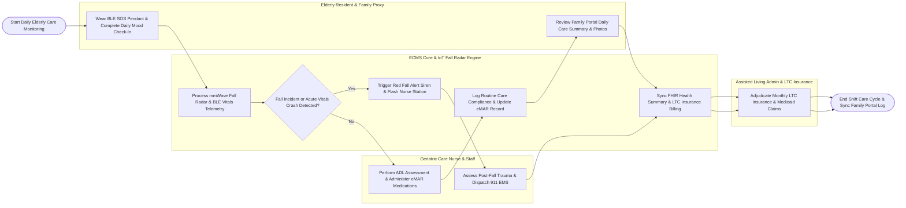

# Swimlane Diagram — Elderly Care Management System

## Mermaid Code

## Flow Description | Mô tả luồng

| Lane | Actor / Subsystem | Role in Flow |
|------|-------------------|--------------|
| 1 | Elderly Resident & Family Proxy | Wears BLE SOS pendant, completes daily mood check-in, receives personal hygiene assistance, and views daily care updates/photos on the family portal app. |
| 2 | Geriatric Care Nurse & Staff | Performs Barthel Index ADL assessments, administers scheduled eMAR medications using barcode scanners, responds to fall alerts, and performs post-fall trauma care. |
| 3 | ECMS Core & IoT Fall Radar Engine | Processes continuous mmWave ceiling fall radar data, detects bed exit/fall incidents, triggers red siren alerts on nurse stations, and syncs FHIR summaries. |
| 4 | Assisted Living Admin & LTC Insurance | Manages nursing home room allocations, monitors care task compliance SLAs, and submits monthly Long-Term Care (LTC) insurance claims to payers. |
