# Action Tree — Elderly Care Management System

## Mermaid Code

```mermaid
graph TD
    Root["Elderly Care Management System"]

    Root --> M1["Functional ADL & Cognitive Assessment"]
    Root --> M2["Geriatric Care Plan & Nursing Schedule"]
    Root --> M3["IoT Fall Radar & SOS Emergency Escalation"]
    Root --> M4["Electronic Medication Record eMAR"]
    Root --> M5["Assisted Living Room & Bed Allocation"]
    Root --> M6["Physical Rehab & Dysphagia Nutrition"]
    Root --> M7["Family Caregiver Mobile Portal"]
    Root --> M8["LTC Insurance Billing & EHR Sync"]

    M1 --> A11["Calculate Barthel Index ADL Functional Score"]
    M1 --> A12["Conduct MMSE Cognitive Mental Status Exam"]
    M1 --> A13["Evaluate Morse Fall Risk Scale Category"]
    M1 --> A14["Assign Resident Care Dependency Tiers"]

    M2 --> A21["Formulate Individualized Geriatric Care Plans"]
    M2 --> A22["Configure Personal Hygiene ADL Assist Rules"]
    M2 --> A23["Generate 3-Shift Nursing Task Schedules"]
    M2 --> A24["Track CNA Care Task SLA Completion"]

    M3 --> A31["Process Real-Time mmWave Ceiling Fall Radar"]
    M3 --> A32["Trigger Red Siren Alerts on Nurse Stations"]
    M3 --> A33["Detect Nighttime Wandering & Bed Exit Events"]
    M3 --> A34["Dispatch Automated 911 EMS Emergency Payload"]

    M4 --> A41["Verify Five-Rights Barcode Wristband Scan"]
    M4 --> A42["Log Administered eMAR Medication Timestamps"]
    M4 --> A43["Check Vital Sign Preconditions BP HR Limits"]
    M4 --> A44["Log Medication Refusals & Held Doses"]

    M5 --> A51["Assign Assisted Living Rooms & Special Beds"]
    M5 --> A52["Track Facility Bed Occupancy Percentages"]
    M5 --> A53["Manage Memory Care Dementia Wing Transfers"]
    M5 --> A54["Audit Room Climate & Ambient Motion Sensors"]

    M6 --> A61["Log Physical Therapy Mobility Progress Notes"]
    M6 --> A62["Track Gait Stability & Walker Transitions"]
    M6 --> A63["Configure Dysphagia Pureed Diet Consistency"]
    M6 --> A64["Log Daily Meal & Fluid Consumption Ratios"]

    M7 --> A71["Deliver Daily Care Progress Summaries to Family"]
    M7 --> A72["Publish Senior Photo Updates & Activity Logs"]
    M7 --> A73["Enable Family Visit Reservations & Check-Ins"]
    M7 --> A74["Provide Electronic Monthly Invoice Payments"]

    M8 --> A81["Generate Long-Term Care LTC Insurance Claims"]
    M8 --> A82["Submit Medicaid ADL Tier Reimbursement Payloads"]
    M8 --> A83["Sync FHIR Senior Health Summaries to EHR"]
    M8 --> A84["Audit Government Welfare Safety Compliance"]
```

## Module Description | Mô tả Module

| # | Module | Description | Actions |
|---|--------|-------------|---------|
| 1 | Functional ADL & Cognitive Assessment | Conducts standardized Barthel Index ADL, MMSE cognitive evaluation, and Morse Fall Risk assessments to assign care dependency tiers. | Calculate Barthel Index ADL Functional Score, Conduct MMSE Cognitive Mental Status Exam, Evaluate Morse Fall Risk Scale Category, Assign Resident Care Dependency Tiers |
| 2 | Geriatric Care Plan & Nursing Schedule | Formulates individualized care plans, configures personal hygiene rules, generates 3-shift nursing task schedules, and tracks CNA task SLAs. | Formulate Individualized Geriatric Care Plans, Configure Personal Hygiene ADL Assist Rules, Generate 3-Shift Nursing Task Schedules, Track CNA Care Task SLA Completion |
| 3 | IoT Fall Radar & SOS Emergency Escalation | Ingests real-time mmWave ceiling fall radar events, triggers red siren alerts on nurse stations, detects nighttime wandering, and dispatches 911 EMS. | Process Real-Time mmWave Ceiling Fall Radar, Trigger Red Siren Alerts on Nurse Stations, Detect Nighttime Wandering & Bed Exit Events, Dispatch Automated 911 EMS Emergency Payload |
| 4 | Electronic Medication Record eMAR | Verifies five-rights using barcode wristband scanning, logs administered medication timestamps, checks vital preconditions, and logs held doses. | Verify Five-Rights Barcode Wristband Scan, Log Administered eMAR Medication Timestamps, Check Vital Sign Preconditions BP HR Limits, Log Medication Refusals & Held Doses |
| 5 | Assisted Living Room & Bed Allocation | Assigns assisted living rooms and specialized beds, tracks facility bed occupancy %, manages memory care transfers, and audits room sensors. | Assign Assisted Living Rooms & Special Beds, Track Facility Bed Occupancy Percentages, Manage Memory Care Dementia Wing Transfers, Audit Room Climate & Ambient Motion Sensors |
| 6 | Physical Rehab & Dysphagia Nutrition | Logs physical therapy mobility progress, tracks gait stability, configures dysphagia pureed diet consistency, and logs daily meal/fluid consumption. | Log Physical Therapy Mobility Progress Notes, Track Gait Stability & Walker Transitions, Configure Dysphagia Pureed Diet Consistency, Log Daily Meal & Fluid Consumption Ratios |
| 7 | Family Caregiver Mobile Portal | Delivers real-time daily care summaries and photo updates to family proxies, enables visit reservations, and processes electronic bill payments. | Deliver Daily Care Progress Summaries to Family, Publish Senior Photo Updates & Activity Logs, Enable Family Visit Reservations & Check-Ins, Provide Electronic Monthly Invoice Payments |
| 8 | LTC Insurance Billing & EHR Sync | Generates Long-Term Care (LTC) insurance claims, submits Medicaid ADL tier reimbursement payloads, syncs FHIR summaries to hospital EHRs, and audits safety compliance. | Generate Long-Term Care LTC Insurance Claims, Submit Medicaid ADL Tier Reimbursement Payloads, Sync FHIR Senior Health Summaries to EHR, Audit Government Welfare Safety Compliance |
