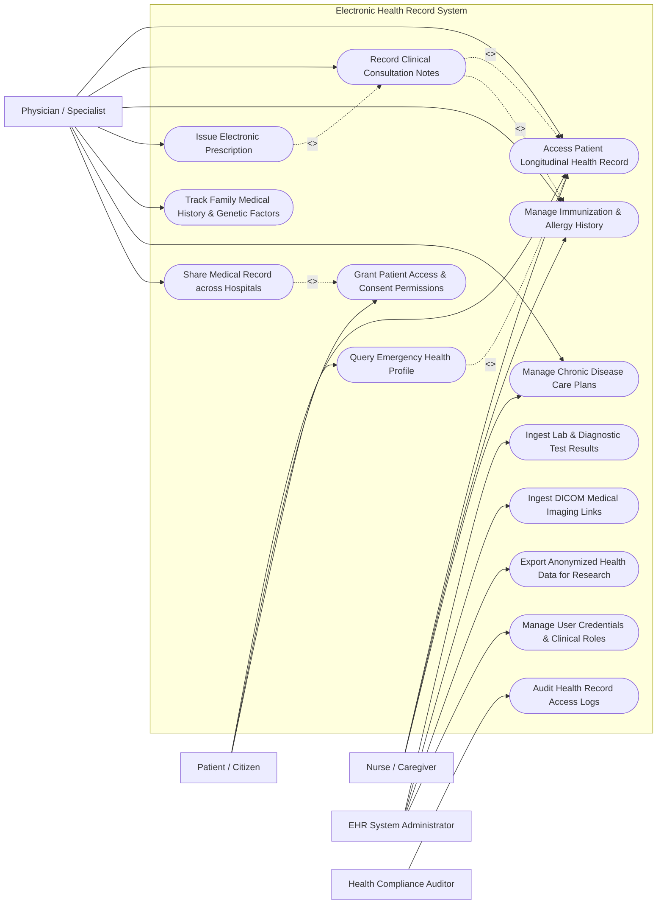

# Use Case Diagram — Electronic Health Record (EHR) System

## Mermaid Code

## Actor Table | Bảng Actor

| # | Actor | Actor Type | Role Description | Related Use Cases |
|---|-------|------------|------------------|-------------------|
| 1 | Patient / Citizen | Primary | Individual subject of care viewing personal health records, managing privacy consent rules, and setting emergency profile access. | UC01, UC07, UC11 |
| 2 | Physician / Specialist | Primary | Licensed medical practitioner recording consultation encounters, diagnosing conditions, reviewing longitudinal histories, prescribing medications, and requesting record sharing. | UC01, UC02, UC03, UC06, UC08, UC09, UC10 |
| 3 | Nurse / Caregiver | Primary | Clinical support staff updating vital signs, monitoring chronic care plans, and documenting immunization events. | UC01, UC03, UC09 |
| 4 | EHR System Administrator | Primary | Technical systems manager maintaining HL7 FHIR interoperability gateways, user role credentials, and anonymized research data pipelines. | UC04, UC05, UC13, UC14 |
| 5 | Health Compliance Auditor | Secondary | Privacy and regulatory officer monitoring HIPAA/GDPR compliance, auditing access logs, and verifying consent enforcement. | UC12 |

## Use Case Table | Bảng Use Case

| # | UC ID | Use Case Name | Primary Actor | Secondary Actor | Description | Priority |
|---|-------|---------------|---------------|-----------------|-------------|----------|
| 1 | UC01 | Access Patient Longitudinal Health Record | Physician | Patient / Citizen | Retrieves a complete, unified chronological timeline of patient encounters, past diagnoses, lab trends, and clinical documentation across facilities. | High |
| 2 | UC02 | Record Clinical Consultation Notes | Physician | System Engine | Captures structured SOAP notes (Subjective, Objective, Assessment, Plan), ICD-10 diagnostic codes, and clinical observations during a consultation. | High |
| 3 | UC03 | Manage Immunization & Allergy History | Nurse | Physician | Records vaccination dosages, manufacturer lot numbers, administration dates, and documents active drug/food/environmental allergies. | High |
| 4 | UC04 | Ingest Lab & Diagnostic Test Results | EHR System Administrator | LIS System | Automatically receives, parses, and binds LOINC-coded laboratory test results and pathology reports from external LIS systems to patient records. | High |
| 5 | UC05 | Ingest DICOM Medical Imaging Links | EHR System Administrator | PACS System | Links radiologist interpretation notes and WADO-RS DICOM web viewer URLs for X-rays, MRIs, and CT scans to specific clinical encounters. | High |
| 6 | UC06 | Issue Electronic Prescription | Physician | Pharmacy Gateway | Generates a structured digital prescription payload (e-Rx), verifies drug-drug and drug-allergy interactions, and routes to central pharmacy registry. | High |
| 7 | UC07 | Grant Patient Access & Consent Permissions | Patient / Citizen | System Engine | Allows patients to manage granular privacy consent settings, granting or revoking specific hospital or doctor access to sensitive health records. | High |
| 8 | UC08 | Track Family Medical History & Genetic Factors | Physician | Patient / Citizen | Records hereditary medical conditions, multi-generational pedigree history, and genetic marker risk profiles for preventive care. | Medium |
| 9 | UC09 | Manage Chronic Disease Care Plans | Physician | Nurse | Creates long-term care plans for chronic conditions (e.g., Diabetes, Hypertension), defining treatment goals, milestone target vitals, and follow-up schedules. | High |
| 10 | UC10 | Share Medical Record across Hospitals | Physician | Patient / Citizen | Enables cross-facility Health Information Exchange (HIE), securely transmitting encrypted FHIR bundles between disparate hospital systems. | High |
| 11 | UC11 | Query Emergency Health Profile | Patient / Citizen | Paramedic / Physician | Provides immediate break-glass emergency access to critical health data (blood type, allergies, advance directives) during life-threatening events. | High |
| 12 | UC12 | Audit Health Record Access Logs | Health Compliance Auditor | System Engine | Monitors and audits immutable access logs, recording who accessed which patient record, when, from where, and under what consent scope. | High |
| 13 | UC13 | Export Anonymized Health Data for Research | EHR System Administrator | Research Portal | De-identifies and exports population-level health data adhering to Safe Harbor standards for clinical research and epidemiological studies. | Medium |
| 14 | UC14 | Manage User Credentials & Clinical Roles | EHR System Administrator | System Engine | Manages user authentication, clinical credentials, National Provider Identifiers (NPI), and role-based authorization policies (RBAC). | High |

## Use Case Specification | Đặc tả Use Case

---

### UC01 — Access Patient Longitudinal Health Record

| Field | Detail |
|-------|--------|
| **UC ID** | UC01 |
| **Use Case Name** | Access Patient Longitudinal Health Record |
| **Actor(s)** | Primary: Physician / Specialist   Secondary: Patient / Citizen |
| **Description** | Physician queries the central EHR system to view a comprehensive lifetime medical history of a patient, combining outpatient visits, hospital admissions, diagnostic test trends, and medication history. |
| **Precondition** | 1. Physician is authenticated with active clinical license credentials.   2. Active patient consent grant exists or break-glass emergency override is active. |
| **Main Flow** | 1. Physician inputs Patient National Health Identifier (NHID), Social Security Number, or scans biometric/QR identity token.   2. System verifies active consent status (UC07) for the requesting physician and healthcare facility.   3. System aggregates clinical data from local and federated HIE nodes.   4. System presents a unified chronological timeline displaying past encounters, active problems list (ICD-10), vital sign trend charts, lab values, and imaging reports.   5. Physician filters records by clinical specialty, date range, or diagnostic category.   6. System logs the record access event into the immutable audit database (UC12). |
| **Alternative Flow** | **AF1** — Patient Self-Access (PHR View): Patient logs into Personal Health Record portal; System displays patient-friendly summary, excluding confidential clinical notes flagged as restricted by physician.   **AF2** — Longitudinal Lab Trend Comparison: Physician selects specific lab test parameters (e.g., HbA1c, Serum Creatinine); System renders multi-year graphical trend charts across multiple lab providers. |
| **Exception Flow** | **EX1** — Consent Revoked / Restricted: If patient has revoked consent for the requesting facility, System displays "Access Denied — Consent Required" and prompts physician to request patient authorization.   **EX2** — Emergency Break-Glass Access: If patient is unconscious in ER, Physician activates "Emergency Break-Glass Override", providing mandatory clinical justification. System grants temporary 2-hour full access and sends immediate SMS alert to patient/guardian. |
| **Postcondition** | Complete health record is displayed to physician, and a detailed audit access event is logged. |
| **Business Rule** | **BR1**: Access to sensitive health categories (Mental Health, HIV, Substance Abuse) requires explicit opt-in consent unless overridden by emergency break-glass protocol. |

---

### UC02 — Record Clinical Consultation Notes

| Field | Detail |
|-------|--------|
| **UC ID** | UC02 |
| **Use Case Name** | Record Clinical Consultation Notes |
| **Actor(s)** | Primary: Physician / Specialist   Secondary: System Engine |
| **Description** | Physician documents structured clinical encounter notes (SOAP format), assigns standardized diagnostic codes (ICD-10/11), records clinical observations, and defines treatment plans. |
| **Precondition** | 1. Physician has open access to active patient EHR session (UC01).   2. Encounter session is initiated. |
| **Main Flow** | 1. Physician opens new Clinical Encounter form.   2. Physician documents Subjective symptoms (chief complaint, history of present illness) and Objective findings (physical examination, vitals).   3. Physician selects Assessment diagnoses using standardized ICD-10 code lookup auto-complete.   4. System checks for duplicate or conflicting active diagnoses on the patient profile.   5. Physician inputs Plan details (follow-up care, lifestyle advice, procedure requisitions).   6. Physician signs the clinical note with digital certificate/signature.   7. System seals the encounter note, assigns cryptographic hash, and appends it to the patient's permanent record timeline. |
| **Alternative Flow** | **AF1** — Voice Dictation Input: Physician uses integrated speech-to-text medical dictation engine to auto-populate clinical note fields.   **AF2** — Template-Based Specialty Note: Physician loads specialty-specific encounter template (e.g., Cardiology, Pediatrics, Ophthalmology) pre-populated with relevant clinical check-boxes. |
| **Exception Flow** | **EX1** — Unsigned Draft Auto-Save: If network disconnects before signing, System auto-saves draft encounter note locally and prompts physician to sign upon re-login.   **EX2** — Invalid Diagnostic Code: If typed ICD code is deprecated or invalid, System highlights error in red and suggests current valid ICD-10 replacement codes. |
| **Postcondition** | Signed clinical encounter note is permanently committed to EHR database and indexed for longitudinal query. |
| **Business Rule** | **BR1**: Signed clinical encounter notes cannot be edited or deleted; modifications require an addendum document linked to original encounter ID. |

---

### UC06 — Issue Electronic Prescription (e-Rx)

| Field | Detail |
|-------|--------|
| **UC ID** | UC06 |
| **Use Case Name** | Issue Electronic Prescription (e-Rx) |
| **Actor(s)** | Primary: Physician / Specialist   Secondary: Pharmacy Gateway |
| **Description** | Physician creates a digitally signed electronic prescription payload specifying medication name, generic active ingredient, strength, dosage form, frequency, and duration while verifying safety rules. |
| **Precondition** | 1. Active clinical consultation session (UC02) is open.   2. Patient active medication and allergy history is loaded in memory. |
| **Main Flow** | 1. Physician initiates "Add Medication / E-Rx" action.   2. Physician searches master drug database by brand name or generic active ingredient.   3. Physician inputs dosage strength, frequency (e.g., "1 tablet BID"), route of administration, and treatment duration (days).   4. System automatically runs clinical safety rules (UC03): checking patient allergy profile, drug-drug interactions with current active medications, and dosage safety thresholds based on kidney/liver function.   5. System displays "Safety Check Cleared" indicator.   6. Physician applies digital signature and issues prescription.   7. System transmits structured FHIR MedicationRequest payload to the central National E-Prescription Gateway and updates patient EHR profile. |
| **Alternative Flow** | **AF1** — Chronic Refill Renewal: Physician reviews current active chronic medications list and executes "1-Click Renewal", generating new e-Rx with identical dosage parameters. |
| **Exception Flow** | **EX1** — Critical Drug-Allergy Conflict: System detects prescribed drug shares active compound with documented patient allergy. System blocks issuance, displays prominent red warning, and requires drug change.   **EX2** — Controlled Narcotics Requirement: Prescribing controlled substances (Schedule II narcotics) requires multi-factor authentication (MFA) token confirmation by physician before payload dispatch. |
| **Postcondition** | E-prescription is registered on central gateway, visible in patient PHR portal, and added to patient active medication ledger. |
| **Business Rule** | **BR1**: E-prescriptions must include mandatory RxNorm or SNOMED-CT generic medication identifiers. |

---

### UC07 — Grant Patient Access & Consent Permissions

| Field | Detail |
|-------|--------|
| **UC ID** | UC07 |
| **Use Case Name** | Grant Patient Access & Consent Permissions |
| **Actor(s)** | Primary: Patient / Citizen   Secondary: System Engine |
| **Description** | Patient configures granular privacy consent settings via the personal health portal, defining which healthcare organizations, clinics, or specific doctors can access their medical history. |
| **Precondition** | 1. Patient is authenticated on Personal Health Portal via strong identity verification (National Digital ID / Biometrics). |
| **Main Flow** | 1. Patient opens Privacy & Consent Management tab.   2. System displays current active consent grants, connected hospital systems, and consent expiration dates.   3. Patient selects "Add New Access Consent".   4. Patient searches for target Healthcare Facility or Physician by National Provider ID.   5. Patient selects scope of access: Full Record, General Medical Only, Exclude Sensitive Categories (Mental Health, Reproductive Health), or Time-Limited Access (e.g., valid for 14 days).   6. Patient confirms selection and digitally signs consent agreement token.   7. System publishes updated cryptographic consent token to the HIE authorization server. |
| **Alternative Flow** | **AF1** — Instant Consent Revocation: Patient selects an existing authorized hospital/physician and clicks "Revoke Access Immediately", immediately terminating record access permissions. |
| **Exception Flow** | **EX1** — Consent Token Verification Failure: If HIE consent authority cannot cryptographically sign consent policy, System notifies patient and retains prior consent state. |
| **Postcondition** | Patient consent policies are updated in real-time, enforcing access control decisions across all HIE federated nodes. |
| **Business Rule** | **BR1**: Patient consent settings override general hospital record sharing agreements unless emergency break-glass protocol is invoked by an emergency physician. |

---

### UC10 — Share Medical Record across Hospitals

| Field | Detail |
|-------|--------|
| **UC ID** | UC010 |
| **Use Case Name** | Share Medical Record across Hospitals |
| **Actor(s)** | Primary: Physician / Specialist   Secondary: Patient / Citizen |
| **Description** | Facilitates secure, encrypted Health Information Exchange (HIE) transmitting standardized FHIR medical record bundles from one hospital's EHR system to another for continuous patient care. |
| **Precondition** | 1. Requesting physician belongs to an accredited, participating HIE healthcare institution.   2. Patient identity is matched in the Master Patient Index (MPI).   3. Active patient consent (UC07) is validated. |
| **Main Flow** | 1. Requesting Physician submits cross-facility record retrieval request for a referred patient.   2. System queries the Master Patient Index (MPI) to locate patient records across federated hospital nodes.   3. System checks patient consent policy registry (UC07) for cross-institutional sharing authorization.   4. Source Hospital EHR server compiles requested clinical data into a standardized HL7 FHIR Document Bundle (JSON/XML).   5. System encrypts FHIR payload using TLS 1.3 / AES-256 and securely transmits data to destination EHR system.   6. Destination EHR system parses FHIR bundle, validates schema, and merges incoming records into physician's viewing session.   7. Both source and destination systems log exchange transaction in audit registry. |
| **Alternative Flow** | **AF1** — Direct Physician-to-Physician Referral Bundle: Physician creates a discrete Referral Summary Bundle containing relevant notes, labs, and imaging links, pushing payload directly to receiving specialist's inbox. |
| **Exception Flow** | **EX1** — Patient Record Unmatched in MPI: If MPI query returns multiple candidate records with low confidence score (< 95% match), System prompts health informatics administrator for manual identity reconciliation.   **EX2** — Transmission Timeout / Encryption Failure: If network connection drops mid-transfer, System rolls back transaction, flags partial transfer error, and automatically retries transmission via back-off schedule. |
| **Postcondition** | Medical records are securely transferred, rendered to requesting clinician, and exchange audit logs are recorded on both endpoints. |
| **Business Rule** | **BR1**: All cross-hospital data exchanges must comply strictly with HL7 FHIR Release 4 (R4) specifications and security encryption standards. |
