# Conceptual ERD — Electronic Health Record (EHR) System

## Mermaid Code

```mermaid
erDiagram
    PATIENT {
        int patient_id PK
        string national_health_id
        string full_name
        date date_of_birth
        string gender
        string blood_type
        string phone
        string emergency_contact
    }

    HEALTHCARE_FACILITY {
        int facility_id PK
        string facility_name
        string facility_code
        string license_no
        string address
        string contact_email
    }

    PRACTITIONER {
        int practitioner_id PK
        int facility_id FK
        string full_name
        string npi_license_no
        string specialty
        string role
        string email
    }

    HEALTH_RECORD {
        int ehr_id PK
        int patient_id FK
        datetime created_at
        string primary_status
        string confidential_flag
    }

    CLINICAL_ENCOUNTER {
        int encounter_id PK
        int ehr_id FK
        int practitioner_id FK
        int facility_id FK
        datetime start_time
        datetime end_time
        string encounter_type
        string chief_complaint
    }

    DIAGNOSIS_CODING {
        int diagnosis_id PK
        int encounter_id FK
        string icd10_code
        string diagnosis_name
        string severity
        string clinical_status
    }

    ALLERGY_INTOLERANCE {
        int allergy_id PK
        int ehr_id FK
        string allergen_name
        string substance_code
        string reaction_type
        string severity_level
        date onset_date
    }

    IMMUNIZATION_RECORD {
        int vaccine_id PK
        int ehr_id FK
        string vaccine_name
        string cvx_code
        string lot_number
        date admin_date
        string administrator_name
    }

    LAB_RESULT {
        int lab_id PK
        int encounter_id FK
        string loinc_code
        string test_name
        string test_value
        string reference_range
        string abnormal_flag
        datetime result_time
    }

    RADIOLOGY_STUDY {
        int study_id PK
        int encounter_id FK
        string dicom_study_uid
        string modality
        string body_part
        string radiologist_notes
        string wado_image_url
    }

    PRESCRIPTION_RECORD {
        int rx_id PK
        int encounter_id FK
        string rxnorm_code
        string drug_name
        string dosage_instruction
        int duration_days
        string rx_status
    }

    CARE_PLAN {
        int care_plan_id PK
        int ehr_id FK
        int practitioner_id FK
        string plan_title
        string condition_target
        date start_date
        date target_end_date
        string plan_status
    }

    CONSENT_RECORD {
        int consent_id PK
        int patient_id FK
        int authorized_facility_id FK
        string consent_scope
        datetime granted_at
        datetime expires_at
        string consent_status
    }

    ACCESS_AUDIT_LOG {
        int log_id PK
        int ehr_id FK
        int practitioner_id FK
        datetime access_timestamp
        string action_type
        string access_reason
        string ip_address
    }

    PATIENT ||--|| HEALTH_RECORD : "owns"
    PATIENT ||--o{ CONSENT_RECORD : "grants"
    HEALTHCARE_FACILITY ||--o{ PRACTITIONER : "employs"
    HEALTHCARE_FACILITY ||--o{ CLINICAL_ENCOUNTER : "hosts"
    PRACTITIONER ||--o{ CLINICAL_ENCOUNTER : "conducts"
    PRACTITIONER ||--o{ CARE_PLAN : "authorizes"

    HEALTH_RECORD ||--o{ CLINICAL_ENCOUNTER : "contains"
    HEALTH_RECORD ||--o{ ALLERGY_INTOLERANCE : "tracks"
    HEALTH_RECORD ||--o{ IMMUNIZATION_RECORD : "logs"
    HEALTH_RECORD ||--o{ CARE_PLAN : "includes"
    HEALTH_RECORD ||--o{ ACCESS_AUDIT_LOG : "audited_by"

    CLINICAL_ENCOUNTER ||--o{ DIAGNOSIS_CODING : "diagnoses"
    CLINICAL_ENCOUNTER ||--o{ LAB_RESULT : "generates"
    CLINICAL_ENCOUNTER ||--o{ RADIOLOGY_STUDY : "orders"
    CLINICAL_ENCOUNTER ||--o{ PRESCRIPTION_RECORD : "prescribes"

    CONSENT_RECORD }o--|| HEALTHCARE_FACILITY : "authorizes"
```

## Entity Description Table | Bảng mô tả Entity

| # | Entity Name | Vietnamese Name | Description | Key Attributes | Main Relationships |
|---|-------------|-----------------|-------------|----------------|-------------------|
| 1 | PATIENT | Bệnh nhân / Công dân | Central demographic entity storing national health ID, personal attributes, contact numbers, and blood type. | patient_id, national_health_id, full_name, date_of_birth | Owns Health Record, grants Consent Records. |
| 2 | HEALTHCARE_FACILITY | Cơ sở Y tế | Hospital, medical center, or clinic providing healthcare services and originating encounters. | facility_id, facility_name, facility_code, license_no | Employs Practitioners, hosts Encounters, target of Consent. |
| 3 | PRACTITIONER | Bác sĩ / Y bác sĩ | Licensed healthcare professional (physicians, specialists, nurses) providing clinical care. | practitioner_id, full_name, npi_license_no, specialty | Belongs to Facility, conducts Encounters, authorizes Care Plans. |
| 4 | HEALTH_RECORD | Hồ sơ Sức khỏe (EHR Header) | Core longitudinal electronic health record container binding lifetime encounters, allergies, and immunizations. | ehr_id, patient_id, created_at, primary_status | Owned by Patient, contains Encounters, Allergies, Immunizations, Care Plans. |
| 5 | CLINICAL_ENCOUNTER | Lượt khám / Đợt điều trị | Discrete medical visit or admission event documenting clinical consultation time, type, and chief complaint. | encounter_id, start_time, encounter_type, chief_complaint | Belongs to Health Record, hosted by Facility, conducted by Practitioner. |
| 6 | DIAGNOSIS_CODING | Mã chẩn đoán bệnh | Standardized diagnostic coding entries (ICD-10/11) associated with a clinical encounter. | diagnosis_id, icd10_code, diagnosis_name, severity | Linked to Clinical Encounter. |
| 7 | ALLERGY_INTOLERANCE | Dị ứng & Phản ứng thuốc | Known patient drug allergies, food intolerances, allergen codes, and historical severity levels. | allergy_id, allergen_name, reaction_type, severity_level | Linked to Health Record. |
| 8 | IMMUNIZATION_RECORD | Hồ sơ Tiêm chủng | Vaccination administration records including vaccine CVX code, brand name, lot number, and administration date. | vaccine_id, vaccine_name, cvx_code, admin_date | Linked to Health Record. |
| 9 | LAB_RESULT | Kết quả Xét nghiệm | Quantitative and qualitative laboratory test results with LOINC codes, reference ranges, and panic value flags. | lab_id, loinc_code, test_name, test_value, abnormal_flag | Generated during Clinical Encounter. |
| 10 | RADIOLOGY_STUDY | Diagnostic Imaging (Radiology) | Medical imaging metadata linking DICOM study instance UIDs, modality types (X-ray, MRI, CT), and WADO viewer links. | study_id, dicom_study_uid, modality, wado_image_url | Ordered in Clinical Encounter. |
| 11 | PRESCRIPTION_RECORD | Đơn thuốc điện tử | Structured e-prescription details including RxNorm drug code, dosage instructions, and duration. | rx_id, rxnorm_code, drug_name, dosage_instruction | Prescribed during Clinical Encounter. |
| 12 | CARE_PLAN | Kế hoạch Chăm sóc | Long-term disease management plans defining clinical goals, monitoring protocols, and target dates. | care_plan_id, plan_title, condition_target, start_date | Linked to Health Record, authorized by Practitioner. |
| 13 | CONSENT_RECORD | Hồ sơ Đồng ý Chia sẻ | Legal privacy consent policy specifying authorized facilities, date bounds, and consent scope. | consent_id, consent_scope, granted_at, expires_at | Granted by Patient, authorizes Healthcare Facility. |
| 14 | ACCESS_AUDIT_LOG | Nhật ký Truy cập Hồ sơ | Immutable security audit ledger tracking every record read, write, export, or break-glass access event. | log_id, access_timestamp, action_type, access_reason | Audits Health Record access by Practitioner. |

## Relationship Description | Mô tả Quan hệ

| # | From Entity | Cardinality | To Entity | Relationship Label | Business Explanation |
|---|-------------|-------------|-----------|-------------------|----------------------|
| 1 | PATIENT | one-to-one | HEALTH_RECORD | owns | Each patient owns exactly one longitudinal Electronic Health Record container. |
| 2 | PATIENT | one-to-many | CONSENT_RECORD | grants | A patient grants multiple privacy consent policy records across different healthcare institutions. |
| 3 | HEALTHCARE_FACILITY | one-to-many | PRACTITIONER | employs | A healthcare facility employs multiple clinical practitioners (doctors, specialists, nurses). |
| 4 | HEALTHCARE_FACILITY | one-to-many | CLINICAL_ENCOUNTER | hosts | A healthcare facility hosts multiple clinical encounters and patient visits. |
| 5 | PRACTITIONER | one-to-many | CLINICAL_ENCOUNTER | conducts | A practitioner conducts multiple patient consultations and clinical encounters over time. |
| 6 | PRACTITIONER | one-to-many | CARE_PLAN | authorizes | A practitioner creates and authorizes long-term care plans for chronic disease management. |
| 7 | HEALTH_RECORD | one-to-many | CLINICAL_ENCOUNTER | contains | A longitudinal health record contains multiple clinical encounter entries spanning a patient's lifetime. |
| 8 | HEALTH_RECORD | one-to-many | ALLERGY_INTOLERANCE | tracks | A health record tracks all documented drug and food allergies for patient safety. |
| 9 | HEALTH_RECORD | one-to-many | IMMUNIZATION_RECORD | logs | A health record logs all vaccination doses received by the patient. |
| 10 | HEALTH_RECORD | one-to-many | CARE_PLAN | includes | A health record includes active and historical chronic disease care plans. |
| 11 | HEALTH_RECORD | one-to-many | ACCESS_AUDIT_LOG | audited_by | A health record maintains an immutable audit trail for every clinical access event. |
| 12 | CLINICAL_ENCOUNTER | one-to-many | DIAGNOSIS_CODING | diagnoses | An encounter establishes one or more ICD-10 diagnostic entries. |
| 13 | CLINICAL_ENCOUNTER | one-to-many | LAB_RESULT | generates | An encounter generates one or more LOINC-coded lab test results. |
| 14 | CLINICAL_ENCOUNTER | one-to-many | RADIOLOGY_STUDY | orders | An encounter orders one or more DICOM radiology imaging studies. |
| 15 | CLINICAL_ENCOUNTER | one-to-many | PRESCRIPTION_RECORD | prescribes | An encounter generates one or more electronic prescriptions (e-Rx). |
| 16 | CONSENT_RECORD | many-to-one | HEALTHCARE_FACILITY | authorizes | A consent record authorizes a specific target healthcare facility to access patient records. |
