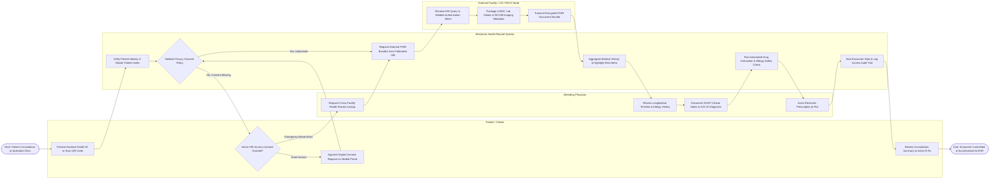

# Swimlane Diagram — Electronic Health Record (EHR) System

## Mermaid Code

## Flow Description | Mô tả luồng

| Lane | Actor | Role in Flow |
|------|-------|-------------|
| 1 | Patient / Citizen | Presents National Health ID at clinic intake, grants or confirms digital consent permissions via mobile portal if consent is missing, and receives final consultation summary and active e-prescriptions. |
| 2 | Attending Physician | Requests cross-facility health record lookup, reviews historical clinical timeline, past lab trends and allergy alerts, documents SOAP notes and ICD-10 diagnoses, and issues electronic prescriptions. |
| 3 | Electronic Health Record System | Validates patient identity in Master Patient Index (MPI), enforces privacy consent policies, orchestrates federated FHIR bundle requests, aggregates longitudinal data, executes safety checks, seals signed notes, and logs immutable access audit records. |
| 4 | External Facility / LIS / PACS Node | Receives secure HIE data queries from external hospital EHR, verifies authorization tokens, extracts LOINC lab results and DICOM imaging URLs, and returns encrypted FHIR document bundles. |
