# Action Tree — Electronic Health Record (EHR) System

## Mermaid Code

```mermaid
graph TD
    Root["Electronic Health Record System"]

    Root --> M1["1. Patient Identity & Consent Management"]
    Root --> M2["2. Clinical Encounters & SOAP Notes"]
    Root --> M3["3. Diagnostic Data & PACS Integration"]
    Root --> M4["4. Medication Profile & E-Prescribing"]
    Root --> M5["5. Immunization & Allergy Tracking"]
    Root --> M6["6. Chronic Care & Preventive Health"]
    Root --> M7["7. Health Information Exchange (HIE)"]
    Root --> M8["8. Compliance & Security Audit Logging"]

    M1 --> A11["Reconcile Master Patient Index"]
    M1 --> A12["Manage Patient Privacy Consent"]
    M1 --> A13["Set Emergency Break-Glass Profile"]
    M1 --> A14["Bind Family & Guardian Proxy Rights"]

    M2 --> A21["Create SOAP Consultation Note"]
    M2 --> A22["Assign Standard ICD-10 Diagnosis"]
    M2 --> A23["Attach Medical Document Scanning"]
    M2 --> A24["Sign & Cryptographically Seal Note"]

    M3 --> A31["Parse LOINC Laboratory Results"]
    M3 --> A32["Link DICOM Radiology WADO URLs"]
    M3 --> A33["Render Multi-Year Lab Trend Charts"]
    M3 --> A34["Flag Critical Diagnostic Values"]

    M4 --> A41["Generate Structured E-Prescription"]
    M4 --> A42["Check Drug-Drug & Allergy Conflicts"]
    M4 --> A43["Track Active Medication Profile"]
    M4 --> A44["Process Chronic Medication Refills"]

    M5 --> A51["Record Vaccine CVX Code & Lot No"]
    M5 --> A52["Generate Digital Vaccination Certificate"]
    M5 --> A53["Log Adverse Drug Reaction Events"]
    M5 --> A54["Maintain Allergy Severity Index"]

    M6 --> A61["Define Chronic Care Goals"]
    M6 --> A62["Monitor Vital Sign Trend Metrics"]
    M6 --> A63["Schedule Preventive Health Screenings"]
    M6 --> A64["Track Disease Progression Index"]

    M7 --> A71["Assemble Standard HL7 FHIR Bundles"]
    M7 --> A72["Execute Cross-Hospital Record Search"]
    M7 --> A73["Transmit Encrypted Referral Summaries"]
    M7 --> A74["Export Anonymized Research Datasets"]

    M8 --> A81["Log Immutable Access Audit Events"]
    M8 --> A82["Audit HIPAA / GDPR Compliance Rules"]
    M8 --> A83["Manage Clinical User RBAC Credentials"]
    M8 --> A84["Monitor HIE Gateway API Performance"]
```

## Module Description | Mô tả Module

| # | Module | Description | Actions |
|---|--------|-------------|---------|
| 1 | Patient Identity & Consent Management | Manages national patient identity indexing (MPI), granular privacy consent policies, emergency break-glass privileges, and proxy family access rights. | Reconcile Master Patient Index, Manage Patient Privacy Consent, Set Emergency Break-Glass Profile, Bind Family & Guardian Proxy Rights. |
| 2 | Clinical Encounters & SOAP Notes | Handles structured clinical documentation, SOAP notes (Subjective, Objective, Assessment, Plan), standardized ICD-10 diagnostic coding, and digital signatures. | Create SOAP Consultation Note, Assign Standard ICD-10 Diagnosis, Attach Medical Document Scanning, Sign & Cryptographically Seal Note. |
| 3 | Diagnostic Data & PACS Integration | Ingests LOINC laboratory test values, binds DICOM imaging study URLs (PACS WADO-RS), renders longitudinal lab trend charts, and flags panic laboratory values. | Parse LOINC Laboratory Results, Link DICOM Radiology WADO URLs, Render Multi-Year Lab Trend Charts, Flag Critical Diagnostic Values. |
| 4 | Medication Profile & E-Prescribing | Manages active patient medication lists, electronic prescription issuance (e-Rx), automated drug interaction/allergy checking, and chronic refill renewals. | Generate Structured E-Prescription, Check Drug-Drug & Allergy Conflicts, Track Active Medication Profile, Process Chronic Medication Refills. |
| 5 | Immunization & Allergy Tracking | Documents vaccination events with CVX codes and lot numbers, generates digital immunization certificates, logs adverse drug reactions, and tracks allergen severity. | Record Vaccine CVX Code & Lot No, Generate Digital Vaccination Certificate, Log Adverse Drug Reaction Events, Maintain Allergy Severity Index. |
| 6 | Chronic Care & Preventive Health | Formulates long-term chronic disease care plans, monitors remote vital sign trends, schedules health screening reminders, and assesses disease progression metrics. | Define Chronic Care Goals, Monitor Vital Sign Trend Metrics, Schedule Preventive Health Screenings, Track Disease Progression Index. |
| 7 | Health Information Exchange (HIE) | Orchestrates cross-institutional record sharing using HL7 FHIR Release 4 bundles, manages encrypted referral summaries, and exports anonymized clinical datasets for research. | Assemble Standard HL7 FHIR Bundles, Execute Cross-Hospital Record Search, Transmit Encrypted Referral Summaries, Export Anonymized Research Datasets. |
| 8 | Compliance & Security Audit Logging | Enforces HIPAA/GDPR compliance rules, maintains an immutable access audit trail for every record query, controls clinical user RBAC credentials, and monitors API security. | Log Immutable Access Audit Events, Audit HIPAA / GDPR Compliance Rules, Manage Clinical User RBAC Credentials, Monitor HIE Gateway API Performance. |
