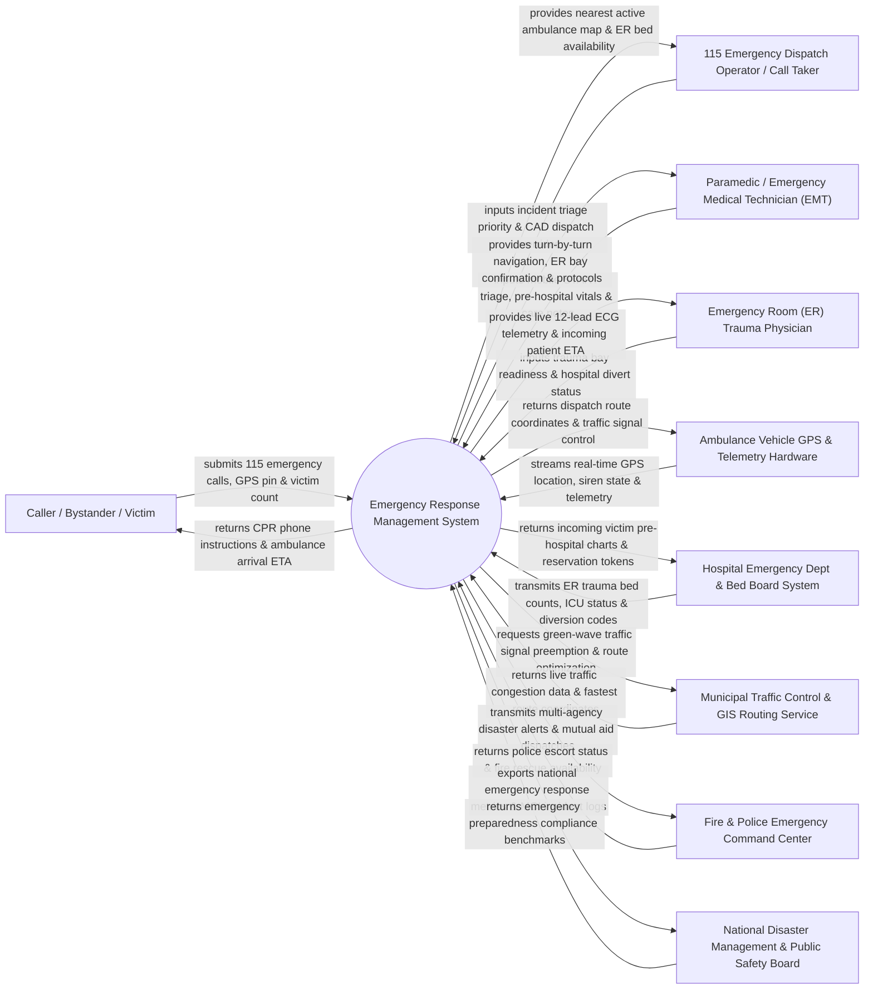

# Context Diagram — Emergency Response Management System

## Mermaid Code

## Actor & Interaction Table | Bảng Actor & Tương tác

| # | Actor | Actor Type | Data Sent TO System | Data Received FROM System | Notes |
|---|-------|------------|---------------------|---------------------------|-------|
| 1 | Caller / Bystander / Victim | Primary | 115 emergency phone calls, mobile GPS location pin, chief complaint (chest pain, crash, stroke), casualty count. | Telephone CPR instructions, ambulance arrival ETA updates, safety guidance. | Citizen reporting a medical emergency, traffic accident, or sudden illness via 115 hotline. |
| 2 | 115 Emergency Dispatch Operator / Call Taker | Primary | Incident call intake details, MPDS (Medical Priority Dispatch System) triage code, ambulance dispatch commands. | Real-time GPS map of active fleet, nearest available ambulances, hospital ER bed availability matrix. | 115 call-center dispatcher managing CAD incident creation and ambulance deployment. |
| 3 | Paramedic / Emergency Medical Technician (EMT) | Primary | Mobile START triage tags (Red, Yellow, Green, Black), pre-hospital vital signs, 12-lead ECG waveforms, care notes. | Turn-by-turn GPS navigation, receiving hospital ER bay confirmation, online medical direction orders. | Field emergency medical crew operating ambulances and providing advanced/basic life support. |
| 4 | Emergency Room (ER) Trauma Physician | Primary | Trauma bay readiness status, hospital diversion codes (ER full/divert), receiving doctor assignment. | Live 12-lead ECG telemetry, pre-hospital paramedic care charts, incoming victim ETA countdown. | Hospital emergency department doctor preparing trauma bays to receive critical ambulance arrivals. |
| 5 | Ambulance Vehicle GPS & Telemetry Hardware | Supporting System | Automated vehicle telemetry: GPS coordinates, speed, siren/beacon active status, fuel level, cardiac monitor data. | Dispatch destination coordinates, traffic signal preemption triggers, navigation routes. | On-board IoT hardware streaming vehicle location and telemetry from mobile ambulances. |
| 6 | Hospital Emergency Dept & Bed Board System | Supporting System | Live trauma bay availability, ICU bed counts, CT/MRI scanner readiness, emergency physician call rosters. | Incoming ambulance patient pre-hospital charts, victim triage category, estimated arrival timestamps. | Enterprise hospital information system managing emergency room bed capacity and trauma teams. |
| 7 | Municipal Traffic Control & GIS Routing Service | Supporting System | Real-time traffic congestion maps, road closure alerts, green-wave traffic light control confirmation. | Emergency vehicle route preemption requests, dispatch origin/destination GPS coordinates. | Smart city traffic management system optimizing green-wave traffic signals for responding ambulances. |
| 8 | Fire & Police Emergency Command Center | Supporting System | Police traffic escort confirmation, fire rescue extraction team availability, hazardous materials (HAZMAT) alerts. | Multi-agency incident dispatch alerts, mass casualty event notifications, joint response tokens. | Municipal 114 (Fire) and 113 (Police) emergency command centers coordinating joint rescue. |
| 9 | National Disaster Management & Public Safety Board | Regulatory | National disaster response protocols, mass casualty incident thresholds, emergency funding compliance rules. | System response time statistics (chute time, travel time), MCI disaster logs, national EMS metrics. | Governmental body overseeing national emergency medical services, disaster response, and public safety. |

## System Boundary Description | Mô tả Phạm vi Hệ thống

The **Emergency Response Management System (ERMS)** is a mission-critical, real-time Computer-Aided Dispatch (CAD) and pre-hospital emergency medical services platform. It digitizes 115 emergency call intake, caller GPS location pin ingestion, MPDS emergency triage scoring, automated ambulance fleet dispatching via GIS proximity, mobile START triage tagging, real-time 12-lead ECG telemetry streaming to hospital ER trauma bays, green-wave traffic signal preemption, and Mass Casualty Incident (MCI) command management.

**Inside System Scope:**
- 115 emergency call intake logging, caller mobile GPS location pin parsing, and MPDS triage classification.
- Computer-Aided Dispatch (CAD) automated vehicle recommendation based on GPS proximity and equipment (ALS vs BLS).
- Mobile paramedic pre-hospital care charting (vitals, IV medications, defibrillation, airway management).
- START Triage tagging (Red: Immediate, Yellow: Delayed, Green: Minor, Black: Deceased) for mass casualties.
- Real-time streaming of cardiac 12-lead ECG waveforms and vitals to hospital ER receiving doctors.
- Hospital ER bed board integration, trauma bay reservation, and hospital diversion status tracking.
- GIS route navigation optimization and green-wave traffic signal preemption integration.
- Emergency transport billing calculation based on base transport fee and mileage.

**Outside System Scope:**
- Physical driving and mechanical maintenance of ambulance vehicles (handled by motor pool logistics).
- Inpatient hospital surgical operations performed after ER admission (handled by hospital HIS).
- Physical firefighting or structural rescue operations (handled by 114 Fire Department).
- Public telecommunication cell tower infrastructure operation (handled by telecom carriers).
