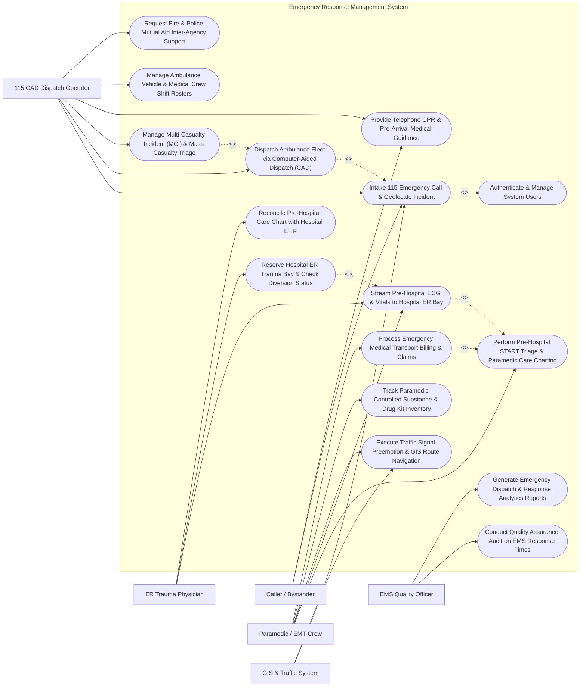

# Use Case Diagram — Emergency Response Management System

## Mermaid Code

## Actor Table | Bảng Actor

| # | Actor | Actor Type | Role Description | Related Use Cases |
|---|-------|------------|------------------|-------------------|
| 1 | Caller / Bystander | Primary | Citizen reporting a 115 emergency, providing scene details, and receiving telephone CPR guidance. | UC01, UC08 |
| 2 | 115 CAD Dispatch Operator | Primary | Emergency call-center operator intaking calls, classifying triage codes, dispatching ambulances, and managing multi-agency response. | UC01, UC02, UC05, UC08, UC09, UC13 |
| 3 | Paramedic / EMT Crew | Primary | Field emergency medical crew providing pre-hospital triage, care charting, ECG transmission, navigation, and transport. | UC03, UC04, UC07, UC10, UC12 |
| 4 | ER Trauma Physician | Primary | Hospital emergency doctor receiving telemetry, reviewing paramedic care charts, and reserving trauma bays. | UC04, UC06, UC11 |
| 5 | EMS Quality Officer | Primary | Performance officer auditing dispatch response time compliance, START triage accuracy, and system analytics. | UC14, UC15 |
| 6 | GIS & Traffic System | Secondary / System | Smart city traffic service providing live GPS map coordinates, traffic congestion updates, and signal preemption. | UC01, UC07 |

## Use Case Table | Bảng Use Case

| # | UC ID | Use Case Name | Primary Actor | Secondary Actor | Description | Priority |
|---|-------|---------------|---------------|-----------------|-------------|----------|
| 1 | UC01 | Intake 115 Emergency Call & Geolocate Incident | 115 CAD Dispatch Operator | Caller / Bystander | Record 115 emergency call details, parse caller mobile GPS coordinates, and assign MPDS priority codes. | High |
| 2 | UC02 | Dispatch Ambulance Fleet via Computer-Aided Dispatch (CAD) | 115 CAD Dispatch Operator | None | Run CAD recommendation algorithm to select and dispatch nearest available ALS/BLS ambulance by GPS proximity. | High |
| 3 | UC03 | Perform Pre-Hospital START Triage & Paramedic Care Charting | Paramedic / EMT Crew | None | Conduct START triage tagging (Red/Yellow/Green/Black), chart vitals, airway, and IV medications on tablet. | High |
| 4 | UC04 | Stream Pre-Hospital ECG & Vitals to Hospital ER Bay | Paramedic / EMT Crew | ER Trauma Physician | Stream live 12-lead ECG waveforms and vital telemetry from cardiac monitor to receiving hospital ER. | High |
| 5 | UC05 | Manage Multi-Casualty Incident (MCI) & Mass Casualty Triage | 115 CAD Dispatch Operator | None | Declare Mass Casualty Incident (MCI), coordinate multi-ambulance dispatch, and track Red/Yellow/Green victim counts. | High |
| 6 | UC06 | Reserve Hospital ER Trauma Bay & Check Diversion Status | ER Trauma Physician | None | Verify ER trauma bed capacity, confirm incoming ambulance ETA, and lock ER trauma bay reservation. | High |
| 7 | UC07 | Execute Traffic Signal Preemption & GIS Route Navigation | Paramedic / EMT Crew | GIS & Traffic System | Provide turn-by-turn navigation on ambulance tablet and trigger green-wave traffic signal preemption. | Medium |
| 8 | UC08 | Provide Telephone CPR & Pre-Arrival Medical Guidance | 115 CAD Dispatch Operator | Caller / Bystander | Provide step-by-step dispatch-assisted telephone CPR, choking relief, or bleeding control instructions to caller. | High |
| 9 | UC09 | Manage Ambulance Vehicle & Medical Crew Shift Rosters | 115 CAD Dispatch Operator | None | Manage ambulance fleet operational status (Available, En Route, On Scene, Transporting, Out of Service) and crew rosters. | Medium |
| 10 | UC10 | Track Paramedic Controlled Substance & Drug Kit Inventory | Paramedic / EMT Crew | None | Log narcotic drug kit usage (Morphine, Fentanyl), verify double-nurse signatures, and track daily kit seals. | High |
| 11 | UC11 | Reconcile Pre-Hospital Care Chart with Hospital EHR | ER Trauma Physician | None | Synchronize paramedic pre-hospital electronic patient care record (ePCR) with hospital emergency room EHR. | Medium |
| 12 | UC12 | Process Emergency Medical Transport Billing & Claims | Paramedic / EMT Crew | None | Calculate transport charges (Base fee + ALS/BLS service level + mileage), compiling insurance reimbursement claims. | Medium |
| 13 | UC13 | Request Fire & Police Mutual Aid Inter-Agency Support | 115 CAD Dispatch Operator | None | Transmit multi-agency incident dispatch alerts to 114 Fire Rescue (extrication) and 113 Police (traffic control). | Medium |
| 14 | UC14 | Conduct Quality Assurance Audit on EMS Response Times | EMS Quality Officer | None | Audit critical EMS response timestamps (Call Intake, Chute Time, Travel Time, Scene Time, Hospital Transport Time). | Medium |
| 15 | UC15 | Generate Emergency Dispatch & Response Analytics Reports | EMS Quality Officer | None | Produce monthly 115 call volumes, geographic incident heatmaps, average response time metrics, and MCI summaries. | Medium |
| 16 | UC16 | Authenticate & Manage System Users | All Users | None | Enforce high-availability secure authentication, role-based CAD permissions, and immutable audit logs. | High |

## Use Case Specification | Đặc tả Use Case

---

### UC01 — Intake 115 Emergency Call & Geolocate Incident

| Field | Detail |
|-------|--------|
| **UC ID** | UC01 |
| **Use Case Name** | Intake 115 Emergency Call & Geolocate Incident |
| **Actor(s)** | Primary: 115 CAD Dispatch Operator   Secondary: Caller / Bystander |
| **Description** | Ingests an incoming 115 emergency telephone call, automatically parses caller mobile cell-tower / GPS geolocation coordinates, prompts the Medical Priority Dispatch System (MPDS) triage question wizard, assigns an initial Incident Priority Tier (Priority 1 - Life-Threatening to Priority 4 - Non-Urgent), and creates an active CAD Incident. |
| **Precondition** | 1. The 115 CAD Workstation is operational with active telephony CTI integration.   2. The Dispatch Operator is logged in with call-taking authorization. |
| **Main Flow** | 1. An incoming 115 emergency call rings at the 115 Command Center.   2. The Dispatch Operator answers, and the System automatically ingests Call Telephony Data: Calling Phone Number, Cell Tower ID, and AML (Advanced Mobile Location) / GPS Pin (Latitude, Longitude).   3. The System plots the caller's location pin on the interactive GIS Command Map.   4. The Operator asks Chief Complaint: "115 Emergency, what is the exact address and what happened?"   5. The Operator selects the MPDS Chief Complaint Protocol (e.g., Protocol 09 - Cardiac Arrest / Unconsciousness, Protocol 29 - Traffic Accident).   6. The Operator completes MPDS Triage Questions:   &nbsp;&nbsp;&nbsp;&nbsp;- Is the patient conscious? [No]   &nbsp;&nbsp;&nbsp;&nbsp;- Is the patient breathing normally? [No / Agonal Breathing]   &nbsp;&nbsp;&nbsp;&nbsp;- Is there severe uncontrolled bleeding? [No].   7. The System computes MPDS Determinant Code **09-E-01 (Echo Priority - Cardiac Arrest)** and assigns **Priority 1 (Red Flash - Immediate Response)**.   8. The System generates an active CAD Incident Record (e.g., CAD-2026-09812), locks location coordinates, and instantly triggers the Automated Dispatch Recommendation Engine (UC02). |
| **Alternative Flow** | **AF1** — Mobile App E-Call / Silent Panic GPS Pin: A citizen presses the "115 Emergency E-Call" button on the public safety mobile app, transmitting precise GPS coordinates and medical history without voice call.   **AF2** — Non-English / Foreign Caller Triage: The Operator initiates automated multi-language translation or connects a 3-way interpreter service while holding the CAD incident active. |
| **Exception Flow** | **EX1** — Unidentifiable Location / Dropped Call: If a 115 call drops after 5 seconds with no GPS data, the System flags a "Dropped Emergency Call Alert", auto-dials back the number, and dispatches police to the nearest cell tower sector.   **EX2** — Hoax / Prank Call Filtering: If the phone number is flagged in the Blacklist database with >= 3 previous hoax calls, the System alerts the Operator to verify authenticity before dispatching. |
| **Postcondition** | Active CAD Incident is created, exact caller GPS coordinates are pinned on GIS map, MPDS Priority 1-4 tier is assigned, and CAD vehicle dispatch is triggered. |
| **Business Rule** | **BR1**: 115 emergency call intake and initial MPDS priority determination MUST be completed within 60 seconds of call ringing.   **BR2**: Priority 1 Echo/Delta incidents (Cardiac Arrest, Airway Obstruction, Massive Trauma) must trigger instant automated dispatch recommendations without waiting for full questionnaire completion. |

---

### UC02 — Dispatch Ambulance Fleet via Computer-Aided Dispatch (CAD)

| Field | Detail |
|-------|--------|
| **UC ID** | UC02 |
| **Use Case Name** | Dispatch Ambulance Fleet via Computer-Aided Dispatch (CAD) |
| **Actor(s)** | Primary: 115 CAD Dispatch Operator |
| **Description** | Executes the Computer-Aided Dispatch (CAD) recommendation algorithm to select the optimal available ambulance (ALS vs BLS) based on real-time vehicle GPS proximity, traffic conditions, and crew capabilities, transmitting dispatch orders to the vehicle mobile terminal. |
| **Precondition** | 1. An active CAD Incident with assigned MPDS Priority (UC01) is active in the dispatch queue.   2. Ambulance fleet telemetry and GPS tracking are active. |
| **Main Flow** | 1. The Dispatch Operator opens the "CAD Fleet Dispatch Board" for the target incident (e.g., CAD-2026-09812 - Priority 1 Cardiac Arrest).   2. The System queries all active ambulance units across the district.   3. The System filters available units by required Service Level: Priority 1 requires Advanced Life Support (ALS) Ambulance with Paramedic crew and Cardiac Monitor.   4. The System runs GIS Routing Algorithm (considering live traffic speed, road closures, and distance) to calculate estimated Travel Time to Scene for top 3 candidate units:   &nbsp;&nbsp;&nbsp;&nbsp;- **Candidate 1 (Ambulance 115-04)**: Station 2 — Travel Time: 4 mins (Distance: 2.1 km)   &nbsp;&nbsp;&nbsp;&nbsp;- **Candidate 2 (Ambulance 115-08)**: En Route from Hospital — Travel Time: 7 mins (Distance: 4.2 km)   &nbsp;&nbsp;&nbsp;&nbsp;- **Candidate 3 (Ambulance 115-12)**: Station 5 — Travel Time: 11 mins (Distance: 7.8 km).   5. The System highlights Candidate 1 (Ambulance 115-04) as "Recommended Dispatch Unit #1".   6. The Operator clicks "Confirm Dispatch - Unit 115-04".   7. The System dispatches an electronic CAD Order payload to the ambulance's vehicle mobile terminal (MDT) and crew mobile apps: Incident Address, GPS Pin, Chief Complaint, MPDS Code, and Route Coordinates.   8. The System updates Ambulance 115-04 status from "Available" to "Dispatched / En Route to Scene", starting the Chute Time timer. |
| **Alternative Flow** | **AF1** — Nearest Unit Preemption / Move-Up Dispatch: If all local station ambulances are busy, the CAD System automatically orders a distant station ambulance to "Move Up" to cover the vacant zone.   **AF2** — Air Ambulance / Helicopter Dispatch: For remote mountain or island emergencies, the Operator selects "Air Ambulance Dispatch", dispatching a medical helicopter squad. |
| **Exception Flow** | **EX1** — Chute Time Exceeded Alert (`Chute Time > 90 secs`): If the dispatched crew fails to acknowledge dispatch and start vehicle within 90 seconds, the System sounds a red "Chute Delay Alert" and prompts re-dispatch to Unit #2.   **EX2** — Dispatched Vehicle Breakdown: If Ambulance 115-04 experiences mechanical failure en route, the crew presses "Vehicle Breakdown", and the CAD System instantly re-routes Unit #2. |
| **Postcondition** | Optimal ALS/BLS ambulance unit is selected, CAD dispatch order is transmitted to vehicle terminal, vehicle status is updated to "En Route", and response timers are running. |
| **Business Rule** | **BR1**: Priority 1 life-threatening incidents MUST be assigned an Advanced Life Support (ALS) vehicle equipped with a certified Paramedic.   **BR2**: Total Response Time (from 115 call ring to ambulance arrival on scene) target is <= 8 minutes for 90% of urban Priority 1 incidents. |

---

### UC03 — Perform Pre-Hospital START Triage & Paramedic Care Charting

| Field | Detail |
|-------|--------|
| **UC ID** | UC03 |
| **Use Case Name** | Perform Pre-Hospital START Triage & Paramedic Care Charting |
| **Actor(s)** | Primary: Paramedic / EMT Crew |
| **Description** | Conducts pre-hospital patient evaluation on scene using START (Simple Triage and Rapid Treatment) algorithms, logs electronic patient care record (ePCR) data (vitals, GCS, airway intervention, IV medications, defibrillation shocks), and updates victim status. |
| **Precondition** | 1. The Paramedic crew has arrived on scene (MDT status: "Arrived Scene").   2. The mobile tablet ePCR app is active and paired with cardiac monitor hardware. |
| **Main Flow** | 1. The Paramedic approaches the victim, clicks "Arrived Scene", and opens a new ePCR (electronic Patient Care Record).   2. The Paramedic performs **START Triage Assessment**:   &nbsp;&nbsp;&nbsp;&nbsp;- **Ability to Walk?** No   &nbsp;&nbsp;&nbsp;&nbsp;- **Spontaneous Respiration?** Yes (Respiratory Rate: 34 bpm -> > 30 bpm)   &nbsp;&nbsp;&nbsp;&nbsp;- **Perfusion / Radial Pulse?** Weak, Capillary Refill > 2 secs   &nbsp;&nbsp;&nbsp;&nbsp;- **Mental Status?** Follows simple commands.   3. The System assigns START Triage Tag **RED TAG (Immediate - Category 1 Critical)** and generates a physical/digital barcode wristband token.   4. The Paramedic logs baseline Vitals: Blood Pressure (85/50 mmHg), Pulse (135 bpm), SpO2 (88% on room air), Glasgow Coma Scale (GCS 12: E3 V4 M5).   5. The Paramedic charts clinical interventions: High-flow Oxygen (15L/min NRB mask), Endotracheal Intubation / LMA Airway insertion, IV Access established (16G left AC), and IV Fluids (Normal Saline 500mL bolus).   6. The Paramedic documents medical procedures, photos of injuries (e.g., open femur fracture), and updates ePCR status to "Transporting to Hospital".   7. The System automatically packages the ePCR data and triggers real-time ER transmission (UC04). |
| **Alternative Flow** | **AF1** — Cardiac Arrest Resuscitation Protocol: For a non-breathing cardiac arrest victim, the Paramedic executes Advanced Cardiac Life Support (ACLS): CPR cycles, Manual Defibrillation (200J Biphasic Shock), IV Epinephrine 1mg every 3 mins, and CPR Compression Fraction tracking.   **AF2** — Refusal of Medical Transport (RMA): If a conscious Green-tag victim refuses transport, the Paramedic documents "Refusal of Treatment & Transport Form", captures victim signature, and logs legal witness notes. |
| **Exception Flow** | **EX1** — Unidentified Trauma Patient (John/Jane Doe): If the victim is unconscious with no ID, the System auto-generates a temporary alias (e.g., "John Doe-CAD09812-Red") and logs physical descriptors.   **EX2** — Controlled Substance Waste Double-Sign Failure: If 2mg Morphine is administered and 3mg wasted, the System blocks ePCR submission until a second certified paramedic enters a PIN signature. |
| **Postcondition** | START Triage Tag (Red/Yellow/Green/Black) is assigned, ePCR vitals and interventions are logged, and pre-hospital care data is ready for hospital transmission. |
| **Business Rule** | **BR1**: START Triage evaluation on scene must take less than 60 seconds per victim during multi-casualty incidents.   **BR2**: Administration of Class II controlled narcotics (Morphine, Fentanyl, Midazolam) requires mandatory dual paramedic signature logging in ePCR. |

---

### UC04 — Stream Pre-Hospital ECG & Vitals to Hospital ER Bay

| Field | Detail |
|-------|--------|
| **UC ID** | UC04 |
| **Use Case Name** | Stream Pre-Hospital ECG & Vitals to Hospital ER Bay |
| **Actor(s)** | Primary: Paramedic / EMT Crew   Secondary: ER Trauma Physician |
| **Description** | Transmits real-time 12-lead Electrocardiogram (ECG) diagnostic waveforms, continuous vital signs telemetry (SpO2, NIBP, EtCO2), and paramedic ePCR charts directly from the ambulance cardiac monitor to the receiving hospital ER trauma physician dashboard prior to ambulance arrival. |
| **Precondition** | 1. A 12-lead ECG is acquired on scene or en route using the ambulance cardiac monitor (e.g., Zoll, LIFEPAK, Corpuls).   2. Mobile cellular telemetry data link (4G/5G) is active. |
| **Main Flow** | 1. En route to the hospital, the Paramedic acquires a 12-Lead Diagnostic ECG on a cardiac chest pain victim.   2. The cardiac monitor detects ST-Elevation (e.g., ST Elevation > 2mm in V1-V4 indicating Acute Anterior STEMI).   3. The Paramedic selects "Transmit 12-Lead ECG & Vitals to ER" on the cardiac monitor.   4. The System transmits high-resolution 12-lead ECG PDF/DICOM waveforms, continuous vitals (BP, HR, SpO2, EtCO2 capnography), and ePCR notes to the designated receiving hospital ER dashboard (e.g., City Hospital ER Command Center).   5. The System sounds a high-priority "INCOMING STEMI / TRAUMA ALERT" chime on the ER Trauma Physician's workstation.   6. The ER Trauma Physician opens the incoming stream, inspects the 12-lead ECG, confirms ST-Elevation STEMI diagnosis, and clicks "Activate Cath Lab Team".   7. The Physician sends an online medical direction order back to the ambulance tablet: "Administer Aspirin 325mg PO + Ticagrelor 180mg PO en route".   8. The System updates incoming ambulance ETA countdown on the ER wallboard display. |
| **Alternative Flow** | **AF1** — Direct-to-Cath-Lab Bypass: For confirmed STEMI, the ER Physician orders "Bypass ER Bay - Proceed Direct to Cardiac Catheterization Lab Table", shaving 30 minutes off Door-to-Balloon time.   **AF2** — Stroke Code Tele-Neurology Consultation: For an acute ischemic stroke victim, the Paramedic initiates a live video tele-stroke consultation with the hospital neurologist en route, assessing NIH Stroke Scale (NIHSS). |
| **Exception Flow** | **EX1** — Cellular Data Link Drop en Route: If 4G/5G connection drops during ECG transmission, the System caches the waveform locally and re-transmits automatically upon network recovery.   **EX2** — ER Physician Rejects STEMI Activation: If the ER physician determines the ECG shows non-specific ST changes, the physician clicks "Deactivate STEMI Code - Standard ER Bay Intake". |
| **Postcondition** | 12-lead ECG waveforms and continuous vitals are streamed to receiving ER, STEMI/Trauma code is activated, online medical orders are returned, and Door-to-Needle time is minimized. |
| **Business Rule** | **BR1**: Pre-hospital 12-lead ECGs indicating ST-Elevation MUST be transmitted to the receiving hospital ER within 5 minutes of acquisition on scene.   **BR2**: Pre-hospital activation of Cath Lab / Stroke teams is restricted to authorized ER Physicians or certified Paramedics under standing protocols. |

---

### UC05 — Manage Multi-Casualty Incident (MCI) & Mass Casualty Triage

| Field | Detail |
|-------|--------|
| **UC ID** | UC05 |
| **Use Case Name** | Manage Multi-Casualty Incident (MCI) & Mass Casualty Triage |
| **Actor(s)** | Primary: 115 CAD Dispatch Operator |
| **Description** | Handles major disaster events (building collapse, industrial explosion, bus crash) by declaring a Mass Casualty Incident (MCI), activating multi-agency disaster command protocols, tracking color-coded victim tallies (Red, Yellow, Green, Black), and coordinating multi-hospital victim distribution to prevent ER overcrowding. |
| **Precondition** | 1. 115 call intake or field paramedic on scene reports a casualty count exceeding local EMS capacity (e.g., > 10 victims).   2. The 115 Dispatch Operator or Field On-Scene Commander has MCI declaration authority. |
| **Main Flow** | 1. The Field Paramedic on scene calls dispatch: "Declaring Mass Casualty Incident - Bus collision with overturned tanker, estimated 35 casualties".   2. The 115 Dispatch Operator clicks "DECLARE MASS CASUALTY INCIDENT (MCI)" in CAD.   3. The System creates a Master MCI Disaster Record (e.g., MCI-2026-DISASTER-02) and upgrades response priority to **Level 3 National Disaster Tier**.   4. The System dispatches automated Multi-Agency Inter-Agency Alerts (UC13) to 114 Fire Rescue (extrication/HAZMAT) and 113 Police (perimeter lockdown).   5. The System dispatches an initial wave of 10 ambulances from surrounding stations and activates regional off-duty paramedic callback.   6. On-Scene Triage Officer uses mobile tablets to scan START Triage Wristbands, populating real-time MCI Triage Counts:   &nbsp;&nbsp;&nbsp;&nbsp;- **RED TAG (Immediate)**: 8 victims   &nbsp;&nbsp;&nbsp;&nbsp;- **YELLOW TAG (Delayed)**: 14 victims   &nbsp;&nbsp;&nbsp;&nbsp;- **GREEN TAG (Minor)**: 11 victims   &nbsp;&nbsp;&nbsp;&nbsp;- **BLACK TAG (Deceased)**: 2 victims.   7. The System runs **MCI Patient Distribution Algorithm**: Distributes RED and YELLOW victims across 4 regional trauma centers (Hospital A: 3 Red; Hospital B: 3 Red; Hospital C: 2 Red) based on live ER capacity, preventing single-hospital saturation.   8. The System displays the real-time MCI Disaster Command Dashboard for municipal emergency directors. |
| **Alternative Flow** | **AF1** — HAZMAT Chemical Decontamination Protocol: If the MCI involves toxic chemical exposure, the System adds "Decontamination Zone Setup" to dispatch orders, routing ambulances to specialized HAZMAT-equipped hospitals.   **AF2** — Temporary Field Hospital Setup: For catastrophic disasters, the System assigns Green-tag victims to a temporary field shelter, reserving transport vehicles exclusively for Red and Yellow tags. |
| **Exception Flow** | **EX1** — All Regional ER Trauma Bays Saturated: If all regional hospitals reach 100% trauma bed capacity, the System triggers "Emergency Disaster Surge Beds", alerting regional health authorities to open secondary hospital wards.   **EX2** — Unaccounted Missing Victim Alert: If initial caller reported 40 bus passengers but triage total equals 33, the System flags "7 Unaccounted Victims - Request Search & Rescue Secondary Sweep". |
| **Postcondition** | Master MCI Disaster Event is active, multi-agency response is coordinated, START triage victim counts are tracked, and victim hospital distribution is optimized. |
| **Business Rule** | **BR1**: Declaration of an MCI automatically overrides standard single-ambulance dispatch rules and activates regional disaster hospital distribution algorithms.   **BR2**: No single receiving hospital ER shall receive more than 30% of total RED-tag immediate victims during an MCI event unless no alternative hospital exists within a 30-km radius. |
